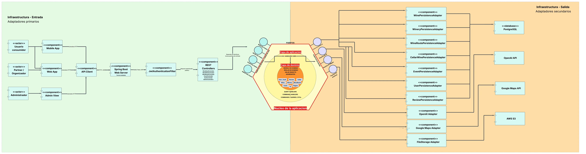
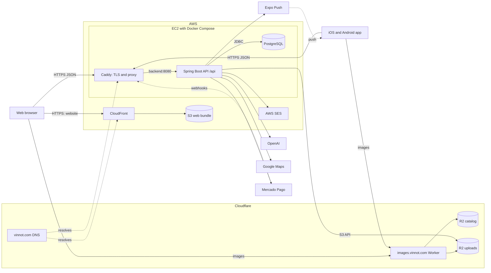
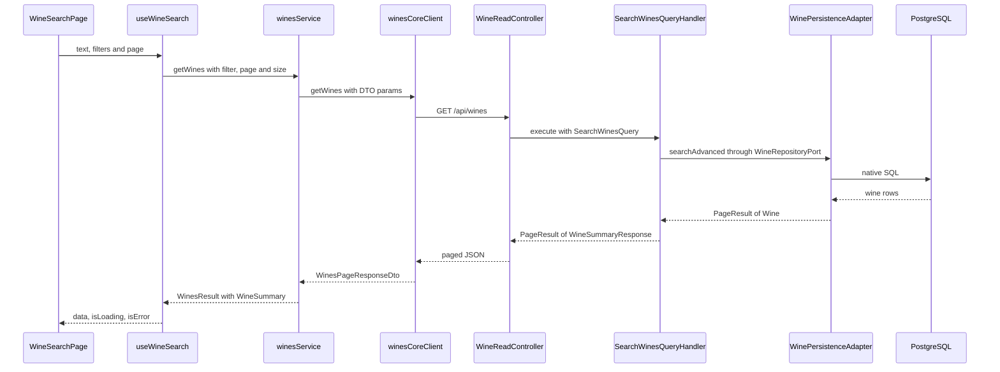

# System architecture

Overview of how the backend, web, mobile app and infrastructure connect. Each
part keeps its detail in its own chapter:
[backend](../backend/architecture/overview.md),
[web](../frontend-web/architecture/overview.md),
[mobile app](../frontend-mobile/architecture/overview.md) and
[infrastructure](../infra/architecture/aws-deployment.md).
The [technologies](technologies/README.md) catalog lists everything Vinnot uses.
The domain class diagrams are in the
[UML domain model](../backend/diagrams/domain-class-model.md), and the tables are in
the [detailed ERD by context](../backend/diagrams/relational-model.md).

## Architecture diagram

[Open the diagram at full size](./img/architecture-overview.webp)

On the left are the inbound adapters: the website and the app call the API over
HTTP, Spring Boot receives the request, `JwtAuthenticationFilter` checks the token
and the REST controllers call the inbound ports. In the middle is the core: use
cases, CQRS handlers and the domain. On the right are the outbound adapters:
PostgreSQL persistence, OpenAI, Google Maps and file storage.

It is a simplified view with the main modules. In the code:

- Image storage is Cloudflare R2, reached through its S3-compatible API
  ([`R2FileStorageService`](../../../backend/src/main/java/com/vinnot/shared/infrastructure/storage/R2FileStorageService.java)).
- Administration is not a separate application: it lives inside the website and the app.
- There are also outbound adapters for Mercado Pago (payments), AWS SES (email) and
  Expo (push notifications).
- There are more modules than the ones drawn: legal, community, notifications,
  payments, sharing, support, partner, activity (`activity`, detail views and
  app opens) and engagement (`engagement`, personalized push planning). Partner
  only exposes HTTP over the event use cases; the others have their
  persistence adapters. The full list is in
  [module boundaries](../backend/architecture/module-boundaries.md).

## System map

This is how the pieces connect in production. Each environment uses its own EC2
host with the same three containers: Caddy, the backend and PostgreSQL.

[View the full “System map” diagram](https://images.vinnot.com/docs/diagrams/v1/en/architecture-readme-161f0173df1b.svg)

The website and the app do not share a server: the website is a static bundle
served by CloudFront, and both call the same API over HTTPS. Images are not read
through the API: the browser and the app request them from `images.vinnot.com`.

| Component | What it does | Where it is documented |
|---|---|---|
| Website | React SPA served from S3 by CloudFront; calls the API set in `VITE_API_BASE_URL` | [Web architecture](../frontend-web/architecture/overview.md) |
| App | Expo app for iOS and Android; calls the API set in `EXPO_PUBLIC_API_BASE_URL` and receives push notifications | [App architecture](../frontend-mobile/architecture/overview.md) |
| Cloudflare DNS and proxy | DNS authority for `vinnot.com`; `api.vinnot.com` goes through the Cloudflare proxy, with WAF and rate limiting, to the host IP (pending apply) | [AWS deployment](../infra/architecture/aws-deployment.md#put-cloudflare-in-front-of-the-api) |
| CloudFront and S3 | Deliver the web bundle with edge caching | [AWS deployment](../infra/architecture/aws-deployment.md) |
| Caddy | Terminates TLS, adds security headers and forwards to `backend:8080` | [AWS deployment](../infra/architecture/aws-deployment.md) |
| Spring Boot API | Modular hexagonal/CQRS backend under the `/api` context path | [Backend architecture](../backend/architecture/overview.md) |
| PostgreSQL | Container on the same host with a persistent volume; schema managed by Flyway | [Data model](../backend/data/database-model.md) |
| Worker and R2 | `images.vinnot.com` serves the shared catalog and public user images; the backend writes uploads through the S3-compatible API | [Catalog images](../infra/operations/catalog-images-r2.md) and [user images](../infra/operations/user-images-r2.md) |
| External services | OpenAI (AI profiles, label scanning, moderation), Google Maps (route distances), Mercado Pago (checkout and webhooks), AWS SES (email) and Expo Push (notifications) | [Backend system maps](../backend/diagrams/system-map.md) |

## Request walkthrough

Example: a user searches for wines on the website. The request crosses every
layer and the response comes back mapped to frontend domain models.

[View the full “Request walkthrough” diagram](https://images.vinnot.com/docs/diagrams/v1/en/architecture-readme-9fa202bed68e.svg)

1. **Page.** [`WineSearchPage`](../../../frontend-react/src/presentation/pages/wines/WineSearchPage.tsx)
   is mounted on the `wines` route and only renders. Its view model
   [`useWineSearchViewModel`](../../../frontend-react/src/presentation/pages/wines/useWineSearchViewModel.ts)
   keeps the text, filters and page, syncs them with the URL and calls the query hook.
2. **Presentation hook.** [`useWineSearch`](../../../frontend-react/src/presentation/hooks/queries/wine/useWineSearch.ts)
   debounces input by 400 ms, ignores text shorter than two characters and uses
   TanStack Query with the `queryKeys.wines.search` key.
3. **Application service.** [`winesService.getWines`](../../../frontend-react/src/application/services/wines.service.ts)
   turns the domain filter into API params with `mapFilterToParams`
   ([`wines.service.helpers.ts`](../../../frontend-react/src/application/services/wines.service.helpers.ts)).
4. **Infrastructure client.** [`winesCoreClient.getWines`](../../../frontend-react/src/infrastructure/api/clients/wines.core.client.ts)
   sends `GET /wines` with the Axios instance from [`http.ts`](../../../frontend-react/src/infrastructure/http/http.ts),
   whose base is `VITE_API_BASE_URL`. The request reaches the backend through Caddy.
5. **Controller.** [`WineReadController.search`](../../../backend/src/main/java/com/vinnot/wine/infrastructure/web/controller/WineReadController.java)
   serves `GET /wines` under the `/api` context path, bounds paging with
   [`PublicWineCatalogAccessPolicy`](../../../backend/src/main/java/com/vinnot/wine/infrastructure/web/policy/PublicWineCatalogAccessPolicy.java)
   and builds a [`SearchWinesQuery`](../../../backend/src/main/java/com/vinnot/wine/application/query/model/SearchWinesQuery.java).
6. **Inbound port.** The controller depends on
   [`SearchWinesUseCase`](../../../backend/src/main/java/com/vinnot/wine/application/port/in/SearchWinesUseCase.java),
   implemented by [`SearchWinesQueryHandler`](../../../backend/src/main/java/com/vinnot/wine/application/query/handler/SearchWinesQueryHandler.java).
7. **Handler.** It calls `searchAdvanced` on the outbound port
   [`WineRepositoryPort`](../../../backend/src/main/java/com/vinnot/wine/application/port/out/WineRepositoryPort.java),
   then loads the page's wineries in a single query through `WineryQueryPort`.
8. **Persistence adapter.** [`WinePersistenceAdapter`](../../../backend/src/main/java/com/vinnot/wine/infrastructure/persistence/adapter/WinePersistenceAdapter.java)
   delegates to [`WineSearchNativeRepository`](../../../backend/src/main/java/com/vinnot/wine/infrastructure/persistence/search/WineSearchNativeRepository.java),
   which builds native PostgreSQL SQL: a plain listing without filters, filters only,
   or text search with match tiers and `pg_trgm` similarity.
9. **Back to the domain.** JPA entities become `Wine` through
   [`WinePersistenceMapper`](../../../backend/src/main/java/com/vinnot/wine/infrastructure/persistence/mapper/WinePersistenceMapper.java),
   and the handler projects each one into
   [`WineSummaryResponse`](../../../backend/src/main/java/com/vinnot/wine/application/query/response/WineSummaryResponse.java)
   inside a [`PageResult`](../../../backend/src/main/java/com/vinnot/shared/domain/valueobject/PageResult.java).
   The controller returns that JSON.
10. **Frontend mapping.** The client resolves image URLs and returns the raw DTO.
    The service maps each item with `mapWineSummaryFromDto`
    ([`wine.mappers.summary.ts`](../../../frontend-react/src/domain/wine/wine.mappers.summary.ts))
    and the paging with `mapWinesPagination`.
11. **Render.** [`WineResultsGrid`](../../../frontend-react/src/presentation/components/features/wine/WineResultsGrid.tsx)
    shows loading, an error with retry, the empty state or the `WineCard` tiles;
    the page adds pagination.

The app follows the same chain with its own pieces. The
`app/(app)/(tabs)/wines/index.tsx` screen uses
[`useWinesBrowseViewModel`](../../../frontend-mobile/src/presentation/features/wine/useWinesBrowseViewModel.ts)
and [`useWineCatalogPagination`](../../../frontend-mobile/src/presentation/features/wine/useWineCatalogPagination.ts).
The [`useWines`](../../../frontend-mobile/src/presentation/hooks/queries/wine/useWines.ts)
hook requests the `wine.list` operation from RTK Query ([`api.ts`](../../../frontend-mobile/src/presentation/store/api.ts)),
which resolves it in [`queryHandlers.ts`](../../../frontend-mobile/src/application/operations/queryHandlers.ts)
with [`winesService.getWines`](../../../frontend-mobile/src/application/services/wines.service.ts).
The service calls [`winesClient.getWines`](../../../frontend-mobile/src/infrastructure/api/clients/wines.client.ts),
which sends the same `GET /wines`, and the screen renders with
[`WineResultsList`](../../../frontend-mobile/src/presentation/features/wine/WineResultsList.tsx).
