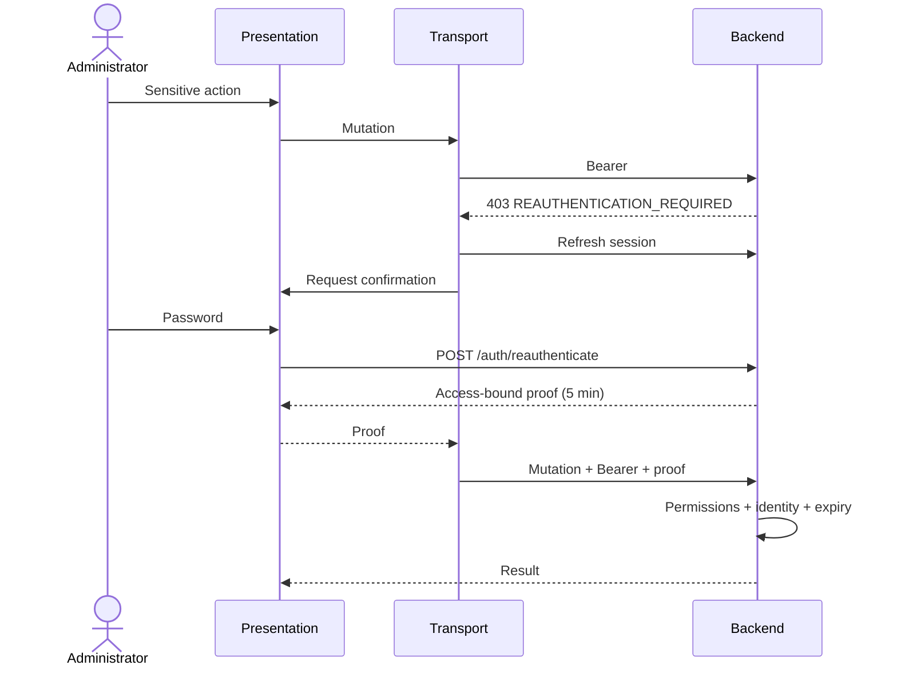
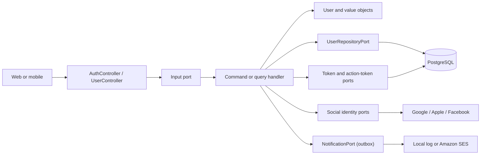
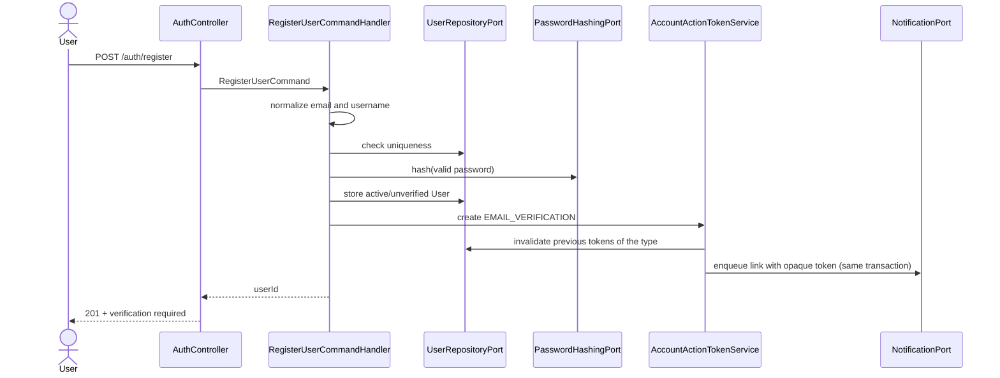
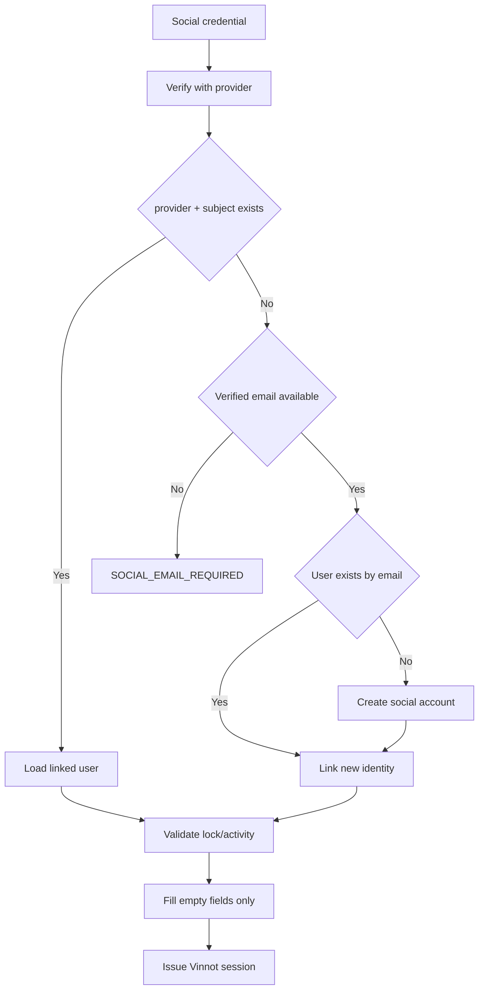
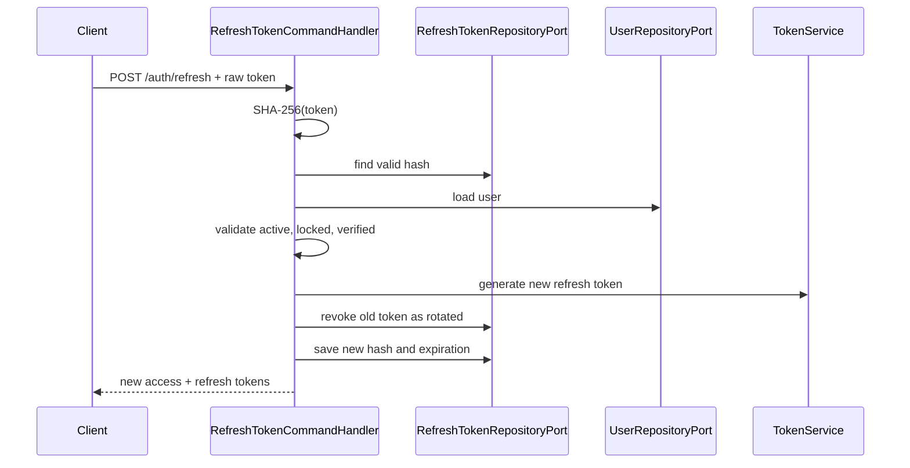

# Authentication, identity, and account lifecycle

## Browser session and administrative reauthentication

`BrowserAuthController` exposes POST `/auth/web/login`, `/auth/web/social`,
`/auth/web/refresh` and `/auth/web/logout`. It reuses native use cases, hashing,
rotation and revocation without duplicating identity rules. JSON contains
access/tokenType/expiresIn/user, never refresh; logout returns 204. Without a
cookie or legacy credential, browser refresh returns an empty 204 without
Set-Cookie: ordinary anonymous startup. Present invalid credentials retain
422 `INVALID_TOKEN`; native transport is unchanged. Successful responses use no-store.
Request bodies use JSON; an unsupported Content-Type returns 415
`UNSUPPORTED_MEDIA_TYPE` without invoking the use case or changing the cookie.

The `__Host-vinnot-refresh` cookie is host-only, Path=/, HttpOnly, Secure and
SameSite=Strict, with lifetime derived from `jwt.refresh-expiration`. Domain
sharing is not enabled. The vinnot.com/API and dev.vinnot.com/api-dev.vinnot.com
pairs are same-site but cross-origin: clients enable credentials; the server
requires an exact allowed Origin and `X-Vinnot-Web-Session: 1` for all four
operations. Missing/foreign origins are rejected before the use case. Duplicate
cookies are rejected rather than arbitrarily selected. CORS does not replace
this verification.

Local HTTP uses `app.auth.browser-cookie-secure=false` and `vinnot-refresh`
without Secure. Outside local the default is true; disabling it is not a fix
for TLS/domain errors. Native `/auth/login|social|refresh|logout` retains Bearer
and body refresh persisted through SecureStore. Product APIs do not authenticate
by cookie: they require Bearer.

Browser migration accepts a legacy refresh body only when no cookie exists.
Rotation invalidates that token and emits the cookie. Failed refresh does not
clear cookies, preventing an older response from removing a newer session.
Logout revokes refresh and expires the cookie.

### Recent administrator confirmation

POST `/auth/reauthenticate` requires a session, current Bearer and exactly one
credential: `{ "password": ... }` or `{ "provider": "GOOGLE"|"APPLE", "token":
..., "nonce"?: ... }`. Both or neither produce a 400 validation error. The
handler reloads an active, unlocked, verified identity (any role) before
checking the credential. It returns `{proof}` with no-store.

With a provider, `ReauthenticateCommandHandler` verifies the Google ID token or
Apple identity token through the same `SocialIdentityVerifierPort` used by
social login (JWKS signature, issuer, configured audience, expiry and the Apple
nonce when supplied). The verified subject must be a `SocialIdentity` already
linked to the authenticated user; another account's identity, an unlinked,
expired, wrong-audience or invalid token returns the same 401 `AUTH_FAILED` as
a wrong password, without revealing whether the identity exists. Facebook is
not accepted: its credential is an access token, not an audience-bound ID token.
Freshness is bounded by the provider's own expiry (Google: one hour; Apple: ten
minutes); no additional `iat` window is enforced because native Google Sign-In
may return a cached ID token.

`ReauthenticationProofPort` separates the use case from signed proof mechanics.
The adapter uses a purpose-separated derived key, user subject, hash of current
Authorization and five-minute expiry. It is not an access token and cannot
authenticate or elevate privileges. Only `X-Admin-Reauthentication` accepts it,
bound to the same user and credential. Access rotation requires new confirmation.

`AdminSensitiveActionInterceptor` requires proof for `/admin/users/**` mutations,
`/admin/notifications/**` mutations except the announcement preview,
`/admin/app-versions/**` mutations,
DELETE under `/admin/**`, and DELETE of wines, wineries, events and routes by ID
when the actor is ADMIN. For every account holder it also requires proof for
POST `/users/me/email-change` and DELETE `/users/me/permanent`; deactivation
(`DELETE /users/me`) and password change (which already asks for the current
password) do not. Existing permissions and ownership still apply; proof
does not replace them. Reads and ordinary catalog edits do not trigger a
challenge. Missing/invalid proof produces 403 `REAUTHENTICATION_REQUIRED` before
mutation. Confirmation shares the credential-attempt rate limit.

Web and native refresh access before opening the dialog, coordinate a single
challenge and retry once. Cancellation/session change discards late results.
Social-only accounts confirm with their linked provider without creating a
password; `/auth/me` (`UserResponse`) and session responses
(`AuthenticatedUserResponse`) expose `socialProviders` so clients offer only
those options. The dialog keeps the password form and recovery link because the
backend does not record whether a social account has set a password.

[View the full “Recent administrator confirmation” diagram](https://images.vinnot.com/docs/diagrams/v1/en/backend-architecture-authentication-and-identity-5d7d40b361e1.svg)

## Purpose and scope

This document describes the current `user` module implementation: credential
registration, email verification, local and social sign-in, session issuance
and renewal, password recovery, email changes, onboarding, avatars, and the
account lifecycle. The HTTP access matrix, roles, permissions, and rate limiting
are covered in [Security and authorization](security-and-authorization.md).

The implementation follows a hexagonal boundary:

[View the full “Purpose and scope” diagram](https://images.vinnot.com/docs/diagrams/v1/en/backend-architecture-authentication-and-identity-5bb8b52d0a6c.svg)

Controllers translate HTTP into commands or queries. They do not verify
passwords, create JWTs, or query JPA. Handlers coordinate rules and ports;
domain objects preserve invariants; adapters implement hashing, persistence,
OAuth provider access, storage, and email delivery.

## Identity model

### `User` aggregate

`User` is the account aggregate root. It owns:

| Field | Meaning |
|---|---|
| `id` | stable UUID and access-token subject |
| `username` | normalized, unique public identifier |
| `email` | normalized, unique email address |
| `password` | hash, never a plain-text password |
| `passwordSet` | the stored password was chosen by its owner; exposed as `hasPassword` |
| `firstName`, `lastName` | editable profile data |
| `profileImageUrl` | managed or remote avatar reference |
| `roles` | non-empty set of domain roles |
| `active` | distinguishes enabled accounts from voluntary deactivation |
| `locked`, `lockReason` | administrative lock and reason |
| `emailVerified` | evidence of control over the current address |
| `onboardingCompleted` | initial profile completion flag |
| `lastLoginAt` | last successfully issued sign-in |
| timestamps | creation and last modification |

Transitions go through aggregate methods: `verifyEmail`,
`changeVerifiedEmail`, `changePassword`, `updateUsername`,
`completeOnboarding`, `activate`, `deactivate`, `lock`, `unlock`, `addRole`, and
`removeRole`. The last operation prevents an account from losing every role.

### Value objects

- `Email` trims whitespace, lowercases the value, and validates its shape before
  it enters the aggregate.
- `Username` trims and normalizes with `Locale.ROOT`, requires 3 to 40
  characters, permits lowercase letters, numbers, dots, hyphens, and
  underscores, and requires an alphanumeric first and last character.
- `Password` only wraps a hash. Plain-text policy requires at least 8
  characters, one uppercase letter, one lowercase letter, and one digit.
- `Role` expresses roles recognized by the Java domain; `Permission` represents
  persisted granular authorities and normalizes them to uppercase.

Application code checks email and username uniqueness to return domain-level
errors, while PostgreSQL constraints close concurrent races.

## Credential registration

[View the full “Credential registration” diagram](https://images.vinnot.com/docs/diagrams/v1/en/backend-architecture-authentication-and-identity-3a349c4c5ff5.svg)

Local registration assigns the `USER` role, marks onboarding complete, and
keeps `emailVerified=false` until the link is consumed. The verification email
is enqueued in the registration transaction and delivered by the outbox worker
([notifications](../../modules/notifications/architecture.md)): an email provider outage no longer fails
registration, and the email is retried.

Registration does not return a session. Local login rejects the account until
the email is verified.

## Local login and reactivation

`LoginCommandHandler` searches by either email or username and returns the same
`AUTH_FAILED` error for an unknown identity and an incorrect password. This
avoids disclosing registered identifiers. An unknown identity still runs one
BCrypt comparison against a constant dummy hash (`LoginAttemptGuard`), so the
response time does not reveal which accounts exist either.

The rule order is intentional:

1. resolve the identity;
2. reject a running temporary lockout with `ACCOUNT_TEMPORARILY_LOCKED`, whatever the password;
3. verify the hash through `PasswordHashingPort` and count the result (see below);
4. reject an administratively locked account;
5. if deactivated, require `reactivate=true` before activation;
6. require a verified email;
7. issue the session, record `lastLoginAt` and the `LOGIN_SUCCEEDED` security event.

A deactivated account is not silently reactivated by valid credentials. The
client must ask for confirmation and repeat the request with explicit intent. An
administratively locked account cannot use this reactivation path.

### Temporary sign-in lockout

After 5 consecutive wrong passwords (`app.security.login-lockout.max-failures`)
an account cannot sign in with a password for 15 minutes
(`app.security.login-lockout.lock-duration`, `PT15M`). It covers
`/auth/login`, `/auth/web/login` (the same handler) and the password path of
`/auth/reauthenticate`. Social sign-in is not affected.

- The count and the end of the lock live in `users.failed_login_attempts` and
  `users.login_locked_until` (V72). They are separate from the administrative
  `locked` flag, which an administrator lifts by hand.
- `LoginAttemptPersistenceAdapter` changes them with single atomic statements
  whose `WHERE` checks the lock. PostgreSQL serializes the attempts on the row
  and re-checks the condition against the latest committed version, so parallel
  attempts never lose a count, a burst starts one lock, and nothing counts or
  clears it while it runs. JPA maps them read-only, so saving a loaded account
  never overwrites them.
- Sign-in is not transactional: BCrypt runs without holding a connection, so a
  burst of sign-ins cannot exhaust the pool. `LoginAttemptRecorder` runs outside
  a transaction too: each count is one auto-committed statement, the lock and its
  notice commit together in `LoginLockStarter`, and the events are written
  directly. `AuthSessionIssuer` stores the sign-in and the refresh token in one
  short transaction. Each sign-in uses at most one connection at a time.
- A right password clears the count, even when a later rule (unverified email,
  suspension) refuses the sign-in. It first checks the database for a lock that
  started after the account was loaded: then it answers 423 and the lock
  stays. A password reset clears it too, because the
  lock notice tells the owner to reset the password.
- While locked, every attempt answers HTTP 423 `ACCOUNT_TEMPORARILY_LOCKED` with
  a `Retry-After` header in seconds (`LoginLockoutExceptionHandler`). The answer
  is the same for a right and a wrong password.
- The attempt that starts the lock queues the `ACCOUNT_LOGIN_LOCKED` security
  email (es/en), once per lock.

## Social login

The client obtains a credential from a native or web SDK, but the backend
verifies it again. `SocialIdentityVerifierPort` keeps this dependency outside
the use case, and `SocialIdentityVerifierAdapter` applies provider-specific
rules:

| Provider | Current verification |
|---|---|
| Google | JWKS signature, expiration, accepted Google issuer, allowed audience |
| Apple | JWKS signature, issuer, audience, and raw or SHA-256 nonce when supplied |
| Facebook | `debug_token`, matching app, validity, subject, and profile lookup |

[View the full “Social login” diagram](https://images.vinnot.com/docs/diagrams/v1/en/backend-architecture-authentication-and-identity-eb0b09bc136f.svg)

The linking key is `(provider, providerSubject)`, not the email text. On first
access, email-based linking is only allowed when the provider certifies that
address. Name and image data fill empty fields and do not overwrite later user
choices. A new social account receives a temporary `vinnoter-<suffix>` username,
an unusable random password, and `onboardingCompleted=false`.

When a certified email links to an existing local account whose email was not
yet verified, the local password may belong to whoever pre-registered that
address. Before verifying and linking, the handler replaces it with an unusable
random hash through `User.changePassword`, which increments `sessionVersion` and
revokes existing access and refresh credentials. A verified local account keeps
its password and sessions.

## Session issuance

`AuthSessionIssuer` is shared by local and social login:

1. record the login on the aggregate;
2. persist the user;
3. generate 32 random bytes for a refresh token;
4. store only its SHA-256 hash and expiration;
5. load effective roles and permissions;
6. generate the access JWT;
7. build one consistent response.

The access token contains:

- `sub`: user UUID;
- `email`: current email;
- `roles`: `ROLE_*` authorities;
- `permissions`: granular permissions;
- `sessionVersion`: current credential generation;
- `iat` and `exp`.

Default configuration uses 15 minutes for access tokens
(`JWT_EXPIRATION=900000`) and 7 days for refresh tokens
(`JWT_REFRESH_EXPIRATION=604800000`). These are configurable defaults, not
business constants.

The refresh token is opaque, not a JWT. Only the raw value is returned to the
client; the database stores its hash. This limits the usefulness of an
accidental read of the session table.

## Renewal, rotation, and logout

[View the full “Renewal, rotation, and logout” diagram](https://images.vinnot.com/docs/diagrams/v1/en/backend-architecture-authentication-and-identity-3bfa539a251a.svg)

Every renewal rotates the refresh token. The old row records `rotated` and the
successor hash, preserving auditability and preventing normal reuse. Logout
with a refresh token revokes it and its known successors with reason `logout`. Logout without a body
remains idempotent, although it cannot invalidate a token the server did not
receive.

### Refresh-token reuse

A rotated token is accepted back only through the idempotent recovery: the same
`rotationId` derives the same live successor. Any other replay of a rotated,
unexpired token means two parties hold the same session, so
`RefreshTokenReuseResponder`, in its own transaction:

- increments the session generation, which ends every access and refresh token;
- revokes the successor chain with reason `reuse`;
- forgets the account's push devices;
- records `REFRESH_REUSE_DETECTED`.

The request still fails with `INVALID_TOKEN`. Parallel refreshes of one token
are not theft: the token row is locked while one of them rotates it, and the
others then find it rotated a moment ago. A replay within
`app.security.refresh-reuse.grace-period` (`PT30S`) of the rotation is only
refused.

Password, confirmed email, roles, locking and deactivation increment session generation. Previous access and refresh credentials no longer authorize. Reset/email/deactivation also remove refresh rows. Renewal locks the hash row with PESSIMISTIC_WRITE and compares its generation with the account; logout follows rotation successors. See the [session contract](session-and-data-integrity.md#versioned-sessions).

## Account action tokens

Email verification, password recovery, and email change use `UserActionToken`,
which is separate from session storage.

| Type | Default lifetime | Effect when consumed |
|---|---:|---|
| `EMAIL_VERIFICATION` | 24 h | verifies the current email |
| `PASSWORD_RESET` | 60 min | changes the hash and revokes refresh tokens |
| `EMAIL_CHANGE` | 60 min | replaces the verified email and revokes sessions |

The service generates 32 bytes with `SecureRandom`, URL-safe Base64 without
padding, and stores only SHA-256. Before issuing a new token, it invalidates
active tokens for the same user and type. `consume` requires the correct type,
valid lifetime, and no prior use, then writes `usedAt` inside the transaction.

Reset validation (`/auth/reset-password/validate`) is a query: it returns
`VALID`, `USED`, `EXPIRED`, or `INVALID` without consuming the token. Forgot
password and verification resend endpoints use neutral responses so account
existence and state are not disclosed.

## Email change

The request validates that the proposed address differs from the current one
and is not already used, but it does not mutate the aggregate. It issues an
`EMAIL_CHANGE` token whose `targetValue` holds the proposed address.

Confirmation:

1. consumes the correct token purpose;
2. checks uniqueness again to close the concurrency window;
3. changes the email and leaves it verified;
4. revokes all renewable sessions;
5. notifies the previous address.

The second check is essential because another account may register the address
between request and confirmation.

## Profile, onboarding, and avatar

The authenticated profile is always updated for the principal UUID, never for
an ID supplied by the client. Username is processed by the value object again
and checked for uniqueness. Social accounts may confirm or replace the
temporary username during onboarding.

Avatar upload is multipart and delegates to `FileStoragePort`. The handler uses
compensation:

- store the new image;
- update the user;
- if persistence fails, request cleanup of the new image;
- after success, request cleanup of the previous avatar;
- a later cleanup failure is logged without rolling back a valid profile.

Configuration selects the local/S3/R2 adapter. The local adapter writes to managed
directories. R2 optimizes to WebP and the transactional
wrapper schedules durable reconciliation and deletion. UI code only receives
the resulting URL. [Upload contract](../use-cases/uploads-and-reference-data.md).

## Deactivation and permanent deletion

Deactivation is reversible: it sets `active=false` and removes refresh tokens.
The next login requires explicit reactivation confirmation.

Permanent deletion removes the aggregate and lets foreign-key rules and the
cleanup adapter process related resources. If an Apple identity exists, provider
policy requires recent reauthentication: the backend exchanges the
authorization code, verifies that the subject matches, and revokes the provider
token before deleting the account. Authorization for a different identity is
rejected.

Managed avatar deletion is scheduled after commit so the database cannot be
left with a partially deleted user because storage cleanup failed.

## Persistence and secrets

The main tables are `users`, `roles`, `permissions`, `user_roles`,
`role_permissions`, `social_identities`, `refresh_tokens`, and
`user_action_tokens`. Adapters map JPA entities to domain models; handlers do not
import Spring Data repositories.

The `users.password` column holds a BCrypt hash at Spring Security's default
cost (10), because the
[SecurityConfig](../../../../backend/src/main/java/com/vinnot/shared/infrastructure/config/SecurityConfig.java)
bean is created without arguments. The cross-cutting view is in
[Passwords and authentication](../../security/passwords-and-authentication.md#password-hashing).

Sensitive configuration depends on enabled features:

- `JWT_SECRET` and access/refresh durations;
- Google and Apple OAuth audiences;
- Facebook app ID and secret;
- Apple team, key, private key, and redirect URIs for revocation;
- email provider, sender, and SES region;
- frontend base URL used in action links;
- remote storage credentials.

Real values belong in the environment secret store. `.env.example` files only
declare names and non-sensitive defaults.

## Relevant domain failures

| Code | Condition |
|---|---|
| `AUTH_FAILED` | unknown identifier or incorrect password |
| `EMAIL_NOT_VERIFIED` | login/refresh before email verification |
| `ACCOUNT_LOCKED` | administrative lock |
| `ACCOUNT_TEMPORARILY_LOCKED` | temporary sign-in lockout after repeated wrong passwords (HTTP 423, `Retry-After`) |
| `ACCOUNT_DEACTIVATED` | missing reactivation confirmation |
| `EMAIL_ALREADY_EXISTS` | uniqueness conflict |
| `USERNAME_ALREADY_EXISTS` | username conflict |
| `WEAK_PASSWORD` | password policy violation |
| `INVALID_TOKEN` | missing, expired, or revoked refresh token |
| `INVALID_OR_EXPIRED_TOKEN` | action token cannot be consumed |
| `SOCIAL_EMAIL_REQUIRED` | no certified provider email for link/create |
| `SOCIAL_LOGIN_NOT_CONFIGURED` | missing credentials or audiences |
| `APPLE_REAUTH_REQUIRED` | deletion lacks recent Apple proof |

The global exception handler translates these into HTTP. Domain code does not
know status codes or web payloads.

## Test strategy

Relevant coverage is distributed by layer:

- domain: normalization, password rules, roles, and `User` transitions;
- application: duplicates, account states, rotation, one-time consumption,
  bulk revocation, social linking, and compensations;
- adapters: BCrypt, JWT, persistence, claims/audience/issuer, SES, and storage;
- web: Bean Validation, authenticated principal, contracts, and HTTP status;
- integration: real PostgreSQL uniqueness/concurrency, full route security, and
  multipart avatar upload.

Critical regression scenarios:

1. concurrent registration cannot create duplicate emails or usernames;
2. a rotated refresh token cannot be reused;
3. an action token cannot be consumed twice;
4. reset, email change, and deactivation invalidate existing refresh tokens;
5. an existing social identity always resolves by provider/subject;
6. an unverified social email cannot link a local account;
7. an Apple account cannot be deleted without valid revocation;
8. a failed avatar persistence step does not leave an orphan managed object.

## Session and delivery semantics

Access JWTs are validated cryptographically and against current account state, roles and generation on each request. There is no individual access-token denylist. Logout revokes refresh and descendants without incrementing the global generation. Rate-limit buckets are maintained per process.

Email delivery is invoked synchronously by the use cases that require it.
Provider delivery and the PostgreSQL commit are separate operations; they do not
form a distributed transaction.

## Code references

- `backend/src/main/java/com/vinnot/user/domain`
- `backend/src/main/java/com/vinnot/user/application`
- `backend/src/main/java/com/vinnot/user/infrastructure`
- `backend/src/main/java/com/vinnot/shared/infrastructure/security`
- `backend/src/main/resources/db/migration`
- [API catalog](api.md)
- [Errors, transactions, and consistency](errors-transactions-and-consistency.md)

## Identity and contractual agreement

Authentication does not imply terms acceptance. `RegisterUserCommandHandler`
validates `termsAcceptance` through `LegalAgreementUseCase` and records the
selection in the registration transaction. OAuth does not synthesize consent.
Web and native check state before onboarding and authenticated content;
declining offers sign-out without preventing access to support, privacy and
documents.

Global backend enforcement is opt-in for rollout compatibility. Versions,
timestamps, idempotency and exceptions:
[contract acceptance](../../modules/legal/architecture.md).

## Recoverable native token rotation

Native `POST /auth/refresh` accepts optional UUID `rotationId` alongside
`refreshToken`. Clients persist that operation before sending it. The handler
locks the parent token and derives a deterministic successor with domain-separated
HMAC-SHA256. Only token hashes are persisted. Repeating the same operation may
return its recorded direct successor only while both the original expiry and
successor remain valid and account/status/session-version checks pass. Different
operation IDs, legacy reuse without an ID, advanced/revoked successors and logout
fail closed. Recovery does not write tokens or extend expiry. The browser cookie
flow remains unchanged. Concurrent recovery and logout are tested with PostgreSQL.
