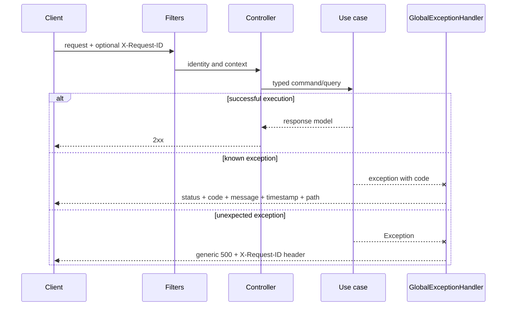

# Errors, transactions and consistency

## Objective

This document explains how the backend preserves invariants from the HTTP
boundary to a committed PostgreSQL change and how it reports failures without
leaking internals. It applies to every module.

## Failure taxonomy

Mappings declared by GlobalExceptionHandler (MVC):
| Exception / condition | HTTP | code |
|---|---|---|
| EntityNotFoundException | 404 | exception code |
| BusinessRuleViolationException: FORBIDDEN / REAUTHENTICATION_REQUIRED | 403 | same code |
| BusinessRuleViolationException: AUTH_FAILED | 401 | AUTH_FAILED |
| BusinessRuleViolationException: other | 422 | exception code |
| DomainException: EMAIL_ALREADY_EXISTS / USERNAME_ALREADY_EXISTS / INVALID_SUBMISSION_TRANSITION / CONCURRENT_UPDATE | 409 | same code |
| DomainException: other | 400 | exception code |
| MethodArgumentNotValidException | 400 | E1001 |
| HttpMessageNotReadableException / MethodArgumentTypeMismatchException / MissingServletRequestParameterException / MissingServletRequestPartException / IllegalArgumentException | 400 | INVALID_REQUEST |
| AccessDeniedException | 403 | FORBIDDEN |
| NoResourceFoundException | 404 | NOT_FOUND |
| HttpRequestMethodNotSupportedException | 405 | METHOD_NOT_ALLOWED |
| HttpMediaTypeNotSupportedException | 415 | UNSUPPORTED_MEDIA_TYPE |
| DataIntegrityViolationException | 409 | DUPLICATE_ENTRY |
| OptimisticLockingFailureException | 409 | CONCURRENT_UPDATE |
| ExternalServiceUnavailableException | 503 | exception code |
| Exception without a specific mapper | 500 | INTERNAL_ERROR |

Authentication, request authorization and quota filters operate before MVC and can write 401/403/429 through their own mechanisms. Advice classification depends on class and code, not a generic description such as conflict or invalid input. For example, EVENT_OWNERSHIP as BusinessRuleViolationException returns 422.

ErrorResponse includes timestamp, path, status, code, message and optional details. Clients branch on status/code; text is descriptive. X-Request-ID is returned as a header and used in MDC/logs.

## HTTP boundary

[View the full “HTTP boundary” diagram](https://images.vinnot.com/docs/diagrams/v1/en/backend-architecture-errors-transactions-and-consistency-9d1737b51aee.svg)

The controller validates DTOs, converts dates/UUIDs and extracts the principal.
It does not catch exceptions to return `200` with an error flag.

## Transaction boundaries

`@Transactional` on an application/adapter method or class defines the unit of work. A Handler class name does not imply a transaction. Controllers delegate without opening one; readOnly queries map results within that scope. `spring.jpa.open-in-view=false` avoids reliance on an open session during serialization.

AI generation separates remote calls from bundle persistence; wine submit/review execute recognition, moderation or storage inside their annotated orchestration. Email and storage do not become transactional resources because an annotated method calls them. See the operation matrix and [consistency diagrams](../diagrams/data-consistency.md).

## Consistency by operation

### Creating a review

1. lock wine statistics through `WineCommandPort.lockRatingStats`;
2. query `existsByWineIdAndUserId` and reject a second review for that user/wine;
3. let `Review.create` and `updateContent` validate domain state and save it `APPROVED`;
4. recalculate average/count of `APPROVED` reviews and update the wine;
5. `CellarCommandPort.syncReviewToCellar` creates or updates personal rating/notes;
6. resolve the public reviewer projection and return `ReviewResponse`.

These writes share the transaction. A statistics or cellar failure propagates
and rolls back the operation. New/edited reviews contribute to the public average and their personal rating
synchronizes with cellar. Earlier pending/rejected rows remain outside the
average until publication. The pre-check
improves the message and the `(wine_id, user_id)` constraint protects uniqueness.
Foreign keys preserve user/wine integrity.

### Registering for an event

`Event` and `EventRegistration` are changed in one transaction so reserving
capacity and creating the request form one decision. Cancellation, hold expiry
or attendance confirmation must release/confirm capacity in the same boundary.

### Publishing a wine proposal

Submit acquires an advisory lock by name/winery/vintage before matching and publication. Review APPROVE_NEW takes an identity lock for effective data and queries the catalog again. The submission row is loaded with findById; the identity lock is not a per-row review lock. Decision, IDs and timestamps are saved in PostgreSQL; file promotion and notification are external operations.

### Generating AI content

The paid call is coordinated through an expiring PostgreSQL lease but does not
hold a business transaction while waiting. The `es`/`en` bundle is persisted as
a set and is complete only when every supported language exists.

Catching a synchronization exception does not establish that a transaction can commit: the final result depends on the resource's transaction state. Row uniqueness alone does not establish operation-wide idempotency.

## Idempotency and concurrency

| Flow | Mechanism |
|---|---|
| Session refresh | rotation/revocation of the presented refresh token |
| Logout | safe revocation while access JWT remains valid until expiry |
| Normal AI generation | complete cache + single-flight lease |
| AI regeneration | exclusive lease and bundle replacement |
| Review like | check + unique user/review constraint |
| Cellar add | check + unique user/wine constraint |
| Registration | active-registration check + capacity consistency/locking |
| Submission | identity advisory lock in Submit/APPROVE_NEW + catalog recheck |

Not every `POST` is idempotent. The contract documents when retries are safe;
clients must not automatically repeat mutations after a timeout when the result
cannot be determined.

## Mapping and lazy loading

JPA entities are persistence models. Adapters rebuild domain objects and
handlers project response models. Before returning:

- required lazy collections are loaded with an appropriate query/fetch;
- no JPA entity is exposed to the controller;
- IDs and derived data from other modules are resolved through ports;
- pagination is converted to `PageResult`;
- AI JSON is copied into controlled/mutable structures when oriented or
  enriched.

## Rollback and external side effects

A database transaction cannot by itself revert a sent email or created R2/S3
object. Ordering must minimize orphan states:

1. validate everything possible without side effects;
2. execute provider/storage only while the case remains viable;
3. persist references and state;
4. apply explicit compensation after a later failure when the port supports it;
5. log enough context without secrets or sensitive content.

Catching an exception does not undo an already executed external effect or
establish guaranteed delivery.

## Frontend contract

Web and mobile normalize errors in infrastructure. Presentation distinguishes at
least:

- offline;
- timeout;
- expired session/`401`;
- forbidden/`403`;
- validation/`400`;
- conflict/`409`;
- quota/`429`, using `Retry-After`;
- provider/`503`;
- unexpected error.

UI may translate messages but retains the domain code to choose actions such as
reauthenticate, correct, retry or contact support.

## Verification

- unit tests for invariants and transitions;
- handler tests for logical rollback, ownership and port ordering;
- PostgreSQL repository tests for constraints and locking;
- MVC tests for status, body and security;
- `spring.jpa.open-in-view=false` in every relevant profile;
- error logs with `requestId` and without tokens, passwords or images.

## References

- `shared/infrastructure/web/GlobalExceptionHandler.java`
- `shared/infrastructure/web/HttpRequestLoggingFilter.java`
- `shared/infrastructure/config/SecurityConfig.java`
- `ai/application/service/AiGenerationCoordinator.java`
- `wine/infrastructure/persistence/adapter/PostgresWineSubmissionLockAdapter.java`
- [Observability](observability.md)
- [Security](security-and-authorization.md)

## Session and effect contracts

[Sessions, publication and external effects](session-and-data-integrity.md) defines credential generation, 409 conflicts, locks, outbox and retries. The email logger does not print recipients, links or tokens; the AI provider logs exception types, not external error bodies.
