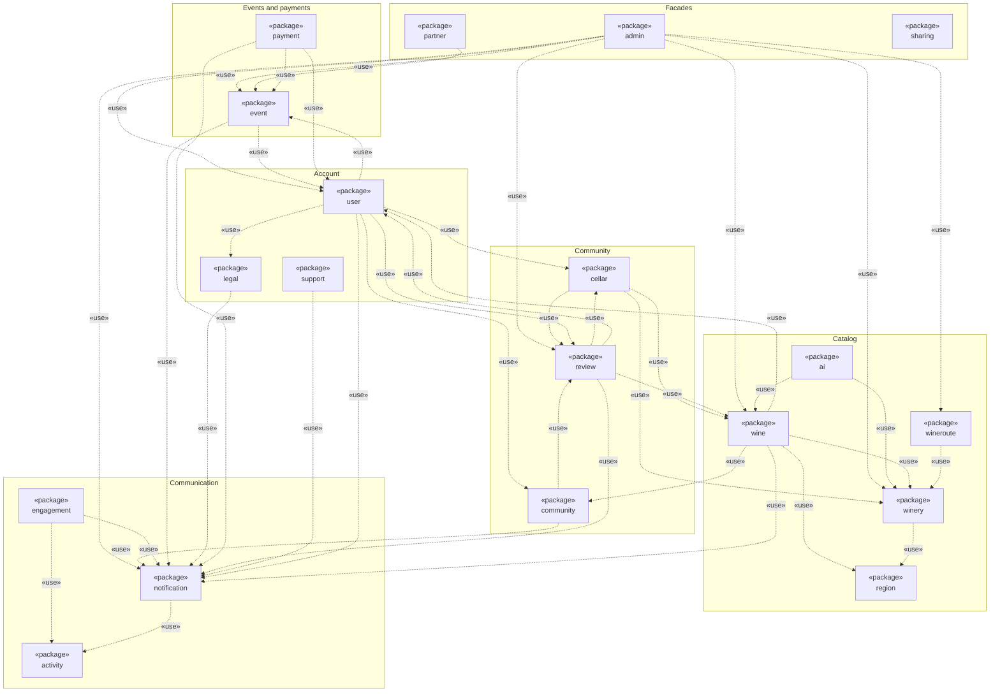
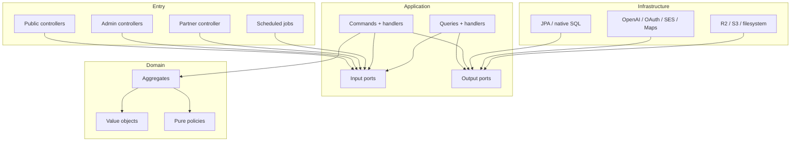
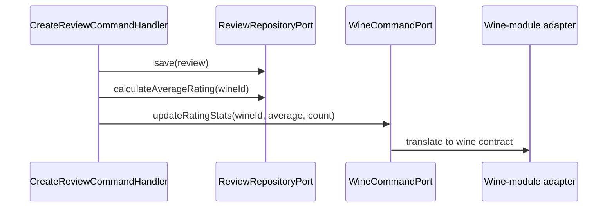

# Backend module boundaries and dependencies

## Purpose

This document defines the actual responsibility of every `com.vinnot` module,
its aggregates, ports and allowed dependencies. It complements the
[architecture overview](overview.md) with a view that can be used to review
imports, place new business rules and prevent modules from becoming accidentally
coupled service collections.

The source of truth is `backend/src/main/java/com/vinnot`. Layer and type names
in this document correspond to code that exists in the repository.

## Module map

| Module | Responsibility | Domain core | Relevant integrations |
|---|---|---|---|
| `wine` | Catalog, search, ranking, scanning and proposals | `Wine`, `WineSubmission`, label normalization and scoring | PostgreSQL, storage, moderation and visual recognition |
| `winery` | Producer identity, location and public data | `Winery`, `Location`, `ContactInfo` | Regions, geocoding and wine catalog |
| `review` | Public reviews, comments and their publication, likes and aggregate reputation | `Review`, `ReviewPublication` | Users, wines and cellar quick-add |
| `community` | Private reports, review and account blocking | `CommunityReport`, `ContentTarget` | JDBC, review/profile visibility and a bridge to deletion use cases |
| `cellar` | Personal inventory and private metadata | `CellarWine` | Wine catalog projection |
| `event` | Events, discovery, capacity, manual payment, registration and tickets | `Event`, `EventRegistration` and their value objects | Location, organizers and time-based automation |
| `payment` | Mercado Pago organizer accounts, checkout, reconciliation, refunds and receipts | `CheckoutAttempt`, `OrganizerPayment`, `RefundIntent`, `SellerCredentials` | `event`/`user` output ports, PostgreSQL and `MercadoPago*Adapter` gateways |
| `wineroute` | Tourism routes and ordered stops | `WineRoute`, `RouteStop` | Wineries and distance service |
| `user` | Identity, session, profile, roles and account lifecycle | `User`, `SocialIdentity`, action tokens, `Role`, `Permission` | OAuth, JWT, email, storage and resource cleanup |
| `ai` | Bilingual profiles and comparisons, caching and single-flight | `WineAiProfile`, `WineComparison`, languages and canonical pair | OpenAI or mock, PostgreSQL and wine catalog |
| `region` | Normalized countries and regions | `Country`, `Region` | PostgreSQL and catalog filters |
| `admin` | Back-office queries and endpoints; the minimum supported mobile app version per platform | Owns no business aggregate; value objects `AppPlatform` and `AppVersion` | Reuses ports/use cases from managed modules; `AppMinimumVersionPort` (JDBC, V69) and the public `GET /app-versions/minimum` |
| `partner` | Organizer-specific HTTP surface | Owns no business aggregate | Reuses `event` use cases |
| `shared` | Truly cross-cutting primitives and adapters | Entity bases, pagination, errors and coordinates | Security, files, email, maps and cross-cutting HTTP |
| `support` | Durable public enquiries | `SupportRequest` | Reception port, PostgreSQL and the notification port |
| `notification` | Outgoing email and push: typed requests, outbox delivery, templates, push devices, preferences and consent, link unsubscribe, administrators' announcements and push controls | `NotificationRequest`, `NotificationType`, `NotificationRecipient`, `PushRequest`, `PushDevice`, `NotificationPreferences`, `Announcement` | `external_effects` outbox, resource bundles, SES or log for email, Expo or log for push; records push opens in `activity` ([notifications](../../modules/notifications/architecture.md)) |
| `legal` | Contract publications and explicit account acceptance | `TermsDocument`, `TermsSelection`, `TermsStatus` | Document/acceptance ports and PostgreSQL; registration depends on its input port |
| `sharing` | Public wine, event and route previews | `SharedContent`, `SharedContentKind` | Minimal JDBC projection and HTML/Open Graph |
| `activity` | Engagement signals: opened details, app opens and their rhythm | `ContentKind`, `ViewedContent`, `OpenHourHistogram`, `ActivityRhythm` | JDBC; `ReadActivitySignalsUseCase` for the push planner; `notification` records push opens through `RecordAppOpenUseCase` ([activity](../../modules/activity/README.md)) |
| `engagement` | Engagement push planning: per-type candidates, selection, shared budget, holdout and metrics | `EngagementCandidate`, `EngagementSelection`, `EngagementPolicy`, `EngagementDecision`, `EngagementHistory`, `Holdout`, `SendTime` | `activity` signals (`ReadActivitySignalsUseCase`), `notification` push ports (`PushNotificationPort`, `PushPlanningUseCase`, `PushOpenUseCase`) and its `EngagementBudgetPort`; JDBC and scheduled jobs; `GET /admin/notifications/push/engagement` ([engagement pushes](../../modules/notifications/architecture.md#engagement-pushes)) |

### Package diagram

Each UML package is a `com.vinnot.<module>` module and each dashed arrow is a
«use» dependency: the source module imports at least one type of the target
module. The dependencies come from the `import com.vinnot.` statements in the
code and are grouped by area only to make the diagram readable.



[View the full “Package diagram” diagram](https://images.vinnot.com/docs/diagrams/v1/en/backend-architecture-module-boundaries-3bddfabbd5f5.svg)

`shared` is left out to keep the diagram readable: almost every module uses it
for its primitives, errors, pagination, security and outbox, and its reference
data adapter reads the `event` and `wine` types and statuses. `sharing` depends
only on `shared`, because it reads its previews through its own JDBC
projection. Some pairs use each other in both directions (`cellar`/`review`,
`user`/`review`, `user`/`event`): each direction reaches a different port of
the other module.

## Dependency topology



[View the full “Dependency topology” diagram](https://images.vinnot.com/docs/diagrams/v1/en/backend-architecture-module-boundaries-e84d1a667a7a.svg)

Arrows show the intended compilation dependencies. An aggregate must not import
a controller, web DTO, JPA, Spring, Axios or an external API. Infrastructure may
know application and domain because it implements inward-defined contracts.

## Anatomy of a write-capable module

Every module owning mutable state uses this shape. A read-only module or a
facade such as `admin` may omit aggregates and commands, but retains ports and
dependency direction:

```text
<module>/
├── domain/
│   ├── model/
│   ├── valueobject/
│   └── service/
├── application/
│   ├── command/model/
│   ├── command/handler/
│   ├── query/model/
│   ├── query/handler/
│   ├── query/response/
│   └── port/{in,out}/
└── infrastructure/
    ├── persistence/{entity,mapper,repository}/
    ├── web/{controller,request}/
    └── <specific provider>/
```

Not every module needs every folder. A missing layer is valid when the module
only adapts another use case. Empty classes created merely to force symmetry do
not improve the architecture.

## Cross-module contracts

A module should not inject another module's concrete repository. When it needs
limited information or behavior, it defines the smallest useful port. Current
examples include:

- `cellar.application.port.out.WineQueryPort` retrieves the projection required
  to display an entry without depending on `WineJpaRepository`.
- `review.application.port.out.WineCommandPort` updates aggregate rating
  statistics after a review is created or removed.
- `wineroute.application.port.out.WineryQueryPort` resolves wineries used by
  route stops.
- `admin.application.port.out.*QueryPort` builds administrative views without
  moving owner-module rules into controllers.
- `wine.application.port.out.WineCatalogReferencePort` resolves references when
  a wine proposal is published.
- `payment` application services use `event` output ports
  (`EventRepositoryPort`, `EventRegistrationRepositoryPort`, `PaidEventAvailability`)
  and `user.application.port.out.UserRepositoryPort`, and invoke the provider
  transitions of `EventRegistration`; `event` does not import `payment`.



[View the full “Cross-module contracts” diagram](https://images.vinnot.com/docs/diagrams/v1/en/backend-architecture-module-boundaries-71472f355872.svg)

A port avoids a technology dependency, but it does not automatically remove
semantic coupling. It must expose stable business operations rather than mirror
the complete API of the remote repository.

## Aggregates and consistency boundaries

- `Wine` owns catalog data, flags and materialized statistics.
- `WineSubmission` owns proposal state, evidence, decision and audit; publishing
  or merging requires application orchestration.
- `Event` owns status, capacity and registration configuration.
- `EventRegistration` owns one request's status, temporary holds and payment.
- `WineRoute` owns stop ordering and validity and cannot be published empty.
- `Review` owns rating and counters, while likes and comments use dedicated
  persistence to enforce uniqueness and authorship.
- `CellarWine` represents the unique user-wine relation and private metadata.
- `User` owns account state and profile; action tokens and sessions have
  independent lifecycles coordinated by application code.

When an operation crosses aggregates, the handler defines ordering and the
transaction boundary. Cross-module navigable JPA references are not introduced
merely to obtain automatic cascades.

## Specialized adapters

### Administration

`admin` is an entry and read facade. Its controllers enforce back-office access
and delegate to existing use cases or administrative queries. It does not own a
copy of `Wine`, `Event` or `User`.

### Partners

`PartnerEventController` translates organizer-specific DTOs into
`CreateEventCommand`, `UpdateEventCommand`, `CancelEventCommand` and
`GetMyEventsQuery`. Ownership and transitions remain in `event`.

### External providers

The concrete provider is selected in infrastructure. For example,
`WineLabelRecognitionPort`, `FileStoragePort`, `NotificationPort` and
`SocialIdentityVerifierPort` keep use cases independent from OpenAI, S3, SES,
Google, Apple or Facebook. `PaymentProviderGateway`, `TicketCheckoutGateway` and
`SellerAuthorizationGateway` isolate Mercado Pago.

## Rules for adding functionality

1. Identify the aggregate that owns the rule.
2. Model intent as a command/query or input-port method.
3. Keep shape validation in the web request and business rules in domain or
   application.
4. Define an output port only when application code needs an external or
   cross-module dependency.
5. Implement the adapter in infrastructure and map into internal types.
6. Place transactions at orchestration points, never in controllers.
7. Mirror production folders in tests for all new business logic.
8. Update affected API, data, security, operations and use-case documents.

## Violation signals

- a controller imports `JpaRepository`, `EntityManager` or a JPA entity;
- an aggregate imports Spring/JPA annotations or a transport DTO;
- a frontend screen or page calls Axios/fetch directly;
- a handler accepts `MultipartFile`, `HttpServletRequest` or `ResponseEntity`;
- one module queries another module's tables incidentally despite an owner port;
- an adapter returns its persistence entity into application code;
- an ownership rule exists only in UI code;
- a `shared` class contains wine- or event-specific behavior.

## Reference files

- `backend/src/main/java/com/vinnot/*/application/port`
- `backend/src/main/java/com/vinnot/*/application/*/handler`
- `backend/src/main/java/com/vinnot/*/domain`
- `backend/src/main/java/com/vinnot/*/infrastructure`
- [Errors and transactions](errors-transactions-and-consistency.md)
- [Testing strategy](../testing/strategy.md)
