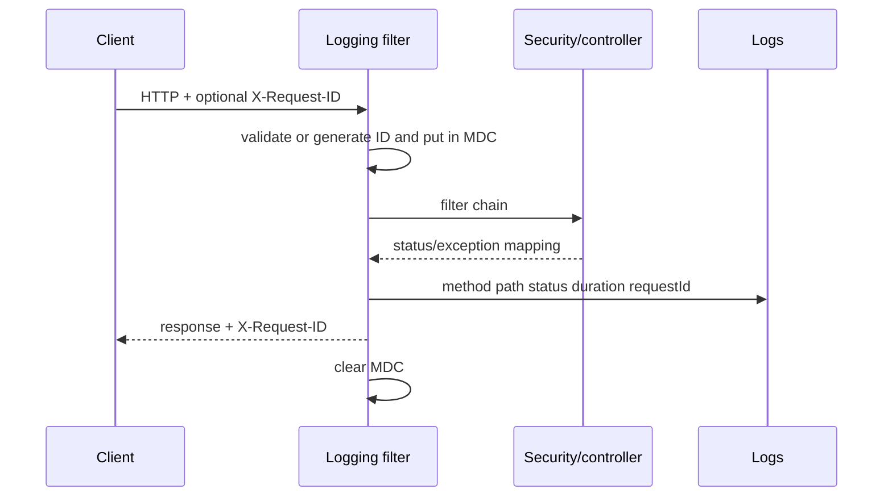

# Backend observability

## Goal

Observability answers which request failed, where, how long it took, which
dependency participated and whether impact is isolated/systemic—without logging
secrets or images. It combines structured logs, request IDs, health/metrics and
aggregated business signals.

## HTTP correlation

`HttpRequestLoggingFilter` accepts `X-Request-ID` only when it matches
`[A-Za-z0-9._-]{1,100}`; otherwise it generates a UUID. It places the value in
MDC and response headers. Logs include method, path, status, duration and request
ID. OPTIONS, health, Swagger and api-docs are skipped.

Slow threshold is configurable (default 1000 ms): slow requests use WARN and 5xx
uses ERROR. Bodies, Authorization, cookies and multipart are never logged.

[View the full “HTTP correlation” diagram](https://images.vinnot.com/docs/diagrams/v1/en/backend-architecture-observability-a89bbad251a8.svg)

## Health and version

- Actuator keeps basic health public; details and other `/actuator/**` endpoints
  require `ROLE_ADMIN`, including for authenticated users and moderators.
- `/health` is a simple public custom-controller response.
- `/version` exposes non-sensitive build/version metadata.

Container health tests enough dependency state for routing but avoids expensive
work. UP does not certify scan accuracy or catalog latency.

## Scan/submission metrics

MicrometerWineLabelMetricsAdapter records these instruments:
| Name | Type / tags | Recording point |
|---|---|---|
| vinnot.wine_label.scan.total | counter; outcome, visual_fallback | built handler response |
| vinnot.wine_label.scan.duration | timer; outcome | same point |
| vinnot.wine_label.scan.stage.duration | timer; stage, outcome=SUCCESS/FAILURE | measured stage return or RuntimeException |
| vinnot.wine_label.submission.total | counter; status | built submit response |
| vinnot.wine_label.submission.duration | timer; status | same point |

Total counters do not increment for an exception before the response point. An internally recovered failure can end as a business response; timers reflect the result observed by their wrapper. Wine/user IDs, OCR and images are not added to tags.

## Stage taxonomy

The `WineLabelMetricsPort.ScanStage` enum contains exactly `LOCAL_CATALOG`, `VISUAL_RECOGNITION`, `VISUAL_WAIT` (waiting for the visual search result), `ENRICHED_CATALOG` and `CANDIDATE_VERIFICATION` (the second vision call that chooses among candidates). HTTP validation, network upload and serialization have no stage in this enum; they contribute to filter HTTP duration. Scoring is part of catalog-matcher calls. SQL hints and visual timeout are described in [scanning](../../modules/wines/architecture.md).

## Application logs

- INFO for relevant start/end without sensitive payload;
- WARN for recovered degradation, timeout/fallback and slow request;
- ERROR for unrecovered failure, with exception types and code locations;
- do not dump exception chains that may contain private messages;
- opaque IDs and enums/causes rather than personal data;
- sanitize provider messages.

`GlobalExceptionHandler` and SES use `SafeFailureDetails`: up to five types
and the first Vinnot location per cause, without messages or serialized causes.
Expected rejections log the code rather than the free-text message. Maps logs
failure type or provider rejection, never the URL, key or body.
See [resource protection](resource-protection.md).

Each label scan writes one INFO line `Label scan finished: outcome=... totalMs=... <STAGE>=<ms>` (see [scanning](../../modules/wines/architecture.md)). A failed OpenAI attempt logs `HTTP <status> <error code>`, and the visual index logs the Gemini status, never the body.

## Symptom diagnosis

| Symptom | First evidence | Next split |
|---|---|---|
| 5xx | request ID + exception mapping | handler/adapter logs |
| slow scan | stage timers + `Label scan finished` line | provider vs DB vs host |
| slow catalog | request duration + query metrics | EXPLAIN/locks/connections |
| 401 spike | auth endpoint/filter metrics | rotation/clock/client |
| health down | container/actuator | DB, memory, migrations |
| stuck submission | state + moderation metric | lease/lock/provider |

## SLO and alerts

Availability, error and latency metrics are operational signals. Instrumentation
alone does not establish that dashboards or alerts are deployed. Scan accuracy
is evaluated through the functional benchmark, separately from service uptime.

## Retention

The low-cost runtime uses bounded local Docker log rotation. This configuration
limits disk usage and local log retention; it is not a centralized historical
archive.

## Local operational snapshot

`OperationalTelemetry` belongs to infrastructure and uses Micrometer. The HTTP
filter records request count, 5xx errors, cumulative seconds and requests over
5 s; an exception escaping the chain counts as an error. Logger exclusions remain,
without URL/user tags. `OpenAiClient` counts attempts through a bounded enum:
success, timeout, rate limit, quota, provider failure, invalid response,
cancellation and admission rejection. Recording failures changes neither retries,
monetary reservations nor return contracts. SES counts transactional delivery
failures without recipients or content.

`OperationalSnapshotWriter` reads those counters and Hikari active/maximum
connections, waiters and timeouts. Every 60 s it writes a mode-0600 file with an
atomic rename at `/tmp/vinnot-operations.json`, including schema, timestamp and a
per-process UUID to distinguish restarts. It queries no entities, providers or
secrets, exposes no endpoint and does not serialize all registry tags. A file
failure preserves the previous version, logs only the error type and does not
fail requests; the monitor detects stale snapshots.

`app.observability.snapshot.enabled=false` disables the writer; path and interval
are configurable under that prefix. Disabling it on a monitored host produces
a missing-telemetry signal. The
[operations runbook](../../infra/operations/observability-and-incidents.md)
defines deltas, thresholds, permissions, alarms and external acceptance limits.

## Testing

Verify valid/invalid request IDs, response propagation, MDC cleanup, skipped
paths, status/latency severity and bounded metric tags. Tests avoid exact times.

## Evidence

- `shared/infrastructure/web/HttpRequestLoggingFilter.java`
- `shared/infrastructure/web/controller/HealthController.java`
- `wine/infrastructure/metrics/*`
- Actuator configuration in `application*.yml`

## Session and effect contracts

[Sessions, publication and external effects](session-and-data-integrity.md) defines credential generation, 409 conflicts, locks, outbox and retries. The email logger does not print recipients, links or tokens; the AI provider logs exception types, not external error bodies.
