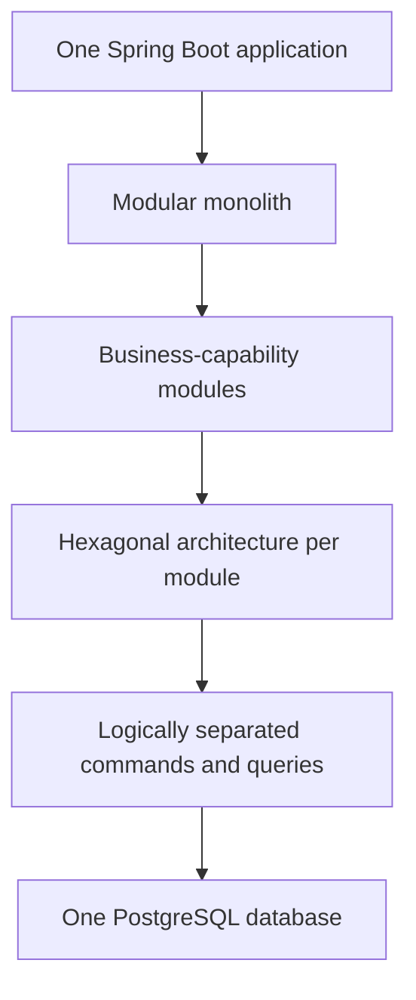
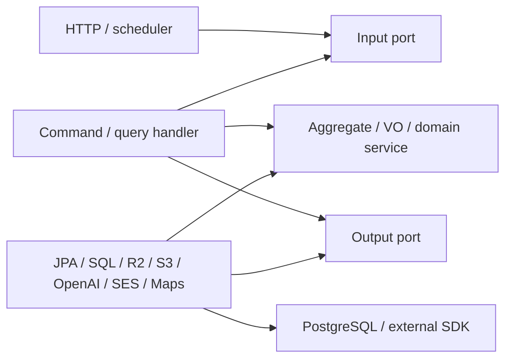
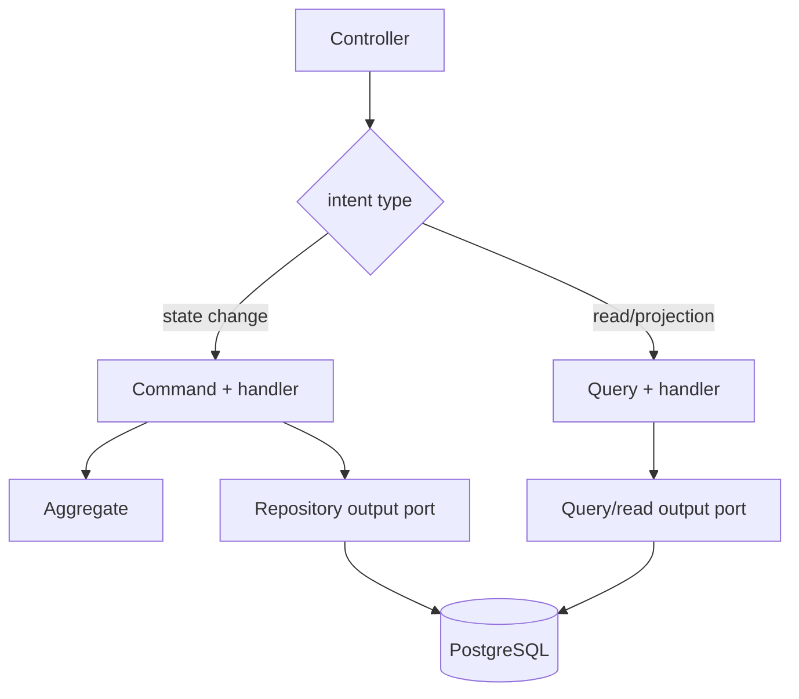
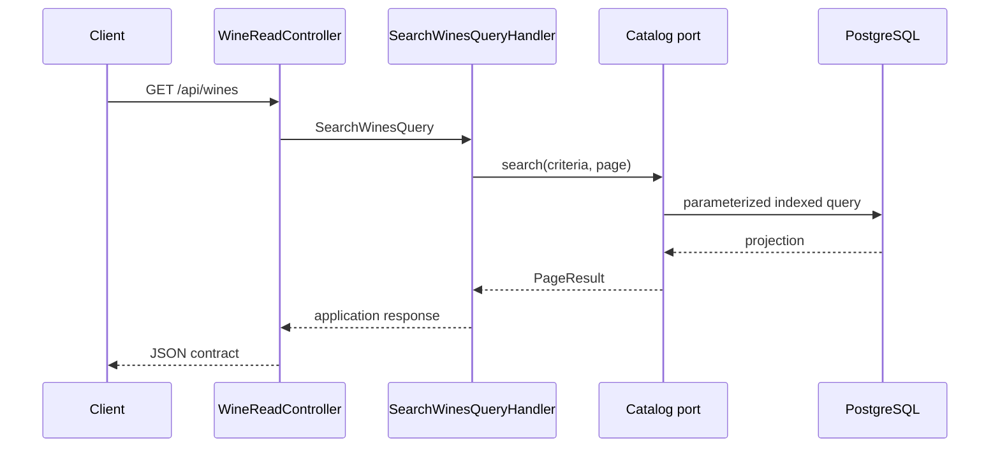
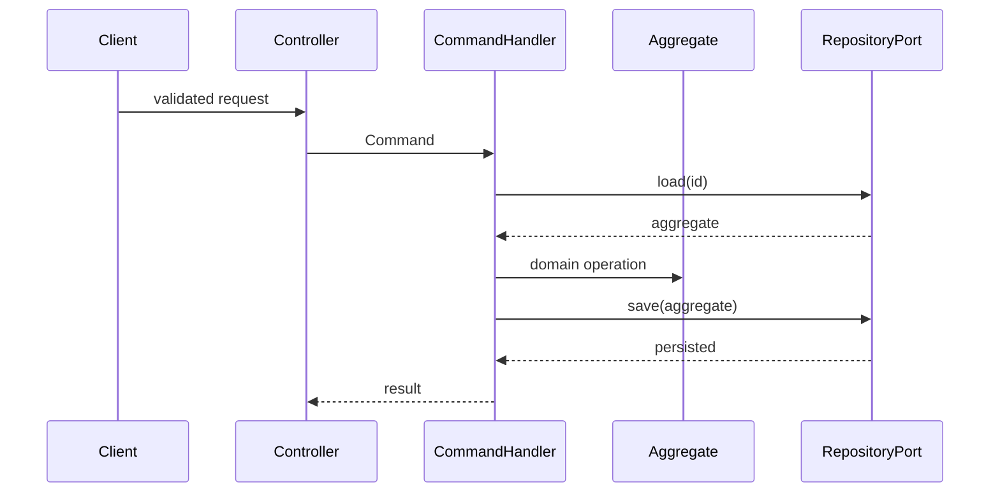

# Backend architecture

## Exact architectural classification

Vinnot backend is a **modular monolith** deployed as one Spring Boot application
and connected to one PostgreSQL database. “Monolith” describes the build and
deployment unit; “modular” describes code separation by business capability.

Each behavior-owning module organizes dependencies using **Hexagonal
Architecture (Ports and Adapters)**: domain/application define inward contracts;
controllers, JPA, SQL and external providers implement them at the edge.
Hexagonal is not an alternative to modular architecture—it is applied inside the
modular monolith.

The application layer uses **logical CQRS**: commands and queries have distinct
models and handlers. There are no separate read/write databases, event sourcing
or distributed command bus. Both paths use PostgreSQL and share transactions
when a use case requires one.

[View the full “Exact architectural classification” diagram](https://images.vinnot.com/docs/diagrams/v1/en/backend-architecture-overview-f684dac30a35.svg)

## Units and boundaries

Primary modules are `wine`, `winery`, `review`, `cellar`, `event`, `wineroute`,
`user`, `ai`, `region`, `community`, `legal`, `support`, `payment`, `sharing`,
`notification`, `activity` and `engagement`. `support` owns public enquiries and delegates
durable delivery to the shared outbox. `payment` owns Mercado Pago accounts,
checkout, reconciliation and refunds over `event` registrations; `sharing`
renders public HTML previews of wines, events and routes. `notification` owns
every outgoing email and push: templates, outbox delivery, push devices,
preferences, link unsubscribe and administrators' announcements. `activity`
records which details each account opens and when it opens the app;
`engagement` uses those signals to plan personalized pushes under a shared
budget and queues them through the `notification` ports. `community` owns reports and blocks;
`legal` owns contractual documents and versioned acceptance. Review/comment
publication, including decisions on legacy pending items, belongs to `review`. `admin` and `partner` are adapters/facades: they expose
actor-specific operations and reuse owning-module use cases. `shared` contains
only cross-cutting primitives/adapters, never ownerless business rules.

| Concept | Meaning in Vinnot | Does not mean |
|---|---|---|
| module | code and business-responsibility boundary | independently deployed service |
| domain | aggregates, value objects, invariants and pure policies | JPA entities or HTTP DTOs |
| application | commands, queries, handlers and ports | controller or web framework |
| infrastructure | HTTP, persistence, security and provider adapters | home for business rules |
| input port | use-case contract invoked by a driving adapter | HTTP endpoint |
| output port | application need toward DB/provider/another module | concrete JPA repository |
| CQRS | logical read/write separation | event sourcing or two data stores |

## Module hexagon

Code dependency view: the handler implements the input port; output adapters implement application ports. Interfaces do not import their implementations.

[View the full “Module hexagon” diagram](https://images.vinnot.com/docs/diagrams/v1/en/backend-architecture-overview-e076bbc7ce61.svg)

At runtime, injection connects driver → input port → handler → output port → adapter. Calls reach infrastructure, but the handler's code dependency ends at the internal interface. Domain does not import Spring, JPA, HTTP or providers.

## Layers and responsibilities

### Domain

- aggregates such as `Wine`, `Event`, `EventRegistration`, `User`, `WineRoute`;
- value objects for money, coordinates, states, capacity and dates;
- invariants requiring no I/O;
- pure normalization and scoring services.

Domain never receives `MultipartFile`, `ResponseEntity`, JPA entities, provider
SDK prompt types or React types.

### Application

- models intent through commands/queries;
- coordinates aggregates and ports;
- establishes order, transaction and compensation;
- projects domain into application responses;
- chooses use-case fallback and errors.

Spring annotations on handlers implement wiring and transaction boundaries.
That framework integration remains in application and never authorizes imports
of controllers, JPA entities, or concrete clients.

### Infrastructure

- HTTP controllers and requests;
- security filters and edge authorization;
- JPA entities/repositories, native SQL and mappers;
- R2/S3/filesystem, OpenAI/mock, OAuth, SES, Maps and Mercado Pago adapters;
- Spring configuration, metrics and health.

Infrastructure validates transport shape and translates technology errors; it
does not redefine domain invariants.

## Logical CQRS

[View the full “Logical CQRS” diagram](https://images.vinnot.com/docs/diagrams/v1/en/backend-architecture-overview-65a6d247cdfa.svg)

Commands load and mutate state under invariants. Queries use projections or
specialized SQL and never mutate domain. Separation optimizes
`wine_catalog_search` without moving SQL into controllers or inflating `Wine`.

## Cross-module relationships

Application expresses collaboration through ports: cellar projects wines through `WineQueryPort`; review updates statistics through `WineCommandPort`; wineroute resolves wineries through its contract; admin reuses the owning modules' use cases. Some application collaborations use another module's ports directly.

In infrastructure, `WinePersistenceAdapter` and `WineryPersistenceAdapter` use `region` repositories/entities to resolve persistent references. This dependency remains in adapters and does not turn domain models into JPA entities. The topology remains a modular monolith over one PostgreSQL.

## Persistence and transactions

Flyway versions PostgreSQL. JPA entities and SQL belong to infrastructure. Annotated handlers/services define the transaction unit; adapters may expose their own transactional operations. Controllers do not open transactions and `spring.jpa.open-in-view=false` prevents reliance on an open session during serialization.

S3, email and OpenAI do not participate in the PostgreSQL commit. Avatar has specific compensation; AI generation coordinates cache/leases without a business transaction during the provider call; submissions use a per-identity advisory lock inside their transactional orchestration. Sending a notification or moving an object is separate from committing the database. See [consistency](errors-transactions-and-consistency.md).

## Representative read flow

[View the full “Representative read flow” diagram](https://images.vinnot.com/docs/diagrams/v1/en/backend-architecture-overview-904b833acb5e.svg)

## Representative write flow

[View the full “Representative write flow” diagram](https://images.vinnot.com/docs/diagrams/v1/en/backend-architecture-overview-36d5d5e5f978.svg)

## Mandatory dependency rules

| Source | Allowed dependencies | Forbidden dependencies |
|---|---|---|
| domain | Java and pure domain/shared types | Spring, JPA, HTTP, storage, external SDKs |
| application | domain, commands/queries and ports | controllers, JPA entities, concrete clients |
| infrastructure | application, domain and frameworks | frontend; new rules unknown to domain |
| controller | requests/mappers and input ports | SQL, JPA repositories, provider SDKs |

## Adding functionality

1. identify owning module and aggregate;
2. define intent as command/query or domain method;
3. keep shape validation in web and invariants in domain/application;
4. create an output port only for a required dependency;
5. implement the infrastructure adapter;
6. define transaction, concurrency, compensation and errors;
7. add mirrored-path tests;
8. update affected API, data, security and documentation.

## Repository evidence

- `backend/src/main/java/com/vinnot/<module>/{domain,application,infrastructure}`;
- interfaces under `application/port/{in,out}`; `shared/application/port` also
  keeps cross-cutting ports such as `FileStoragePort` and `AccountAccessPort`
  directly under `port/` without the in/out split, and `region` has only `port/in`;
- handlers under `application/{command,query}`;
- adapters under `infrastructure`;
- migrations under `backend/src/main/resources/db/migration`.

## Related documents

- [Module boundaries](module-boundaries.md)
- [API](api.md)
- [Errors and transactions](errors-transactions-and-consistency.md)
- [Data model](../data/database-model.md)
- [Testing](../testing/strategy.md)
