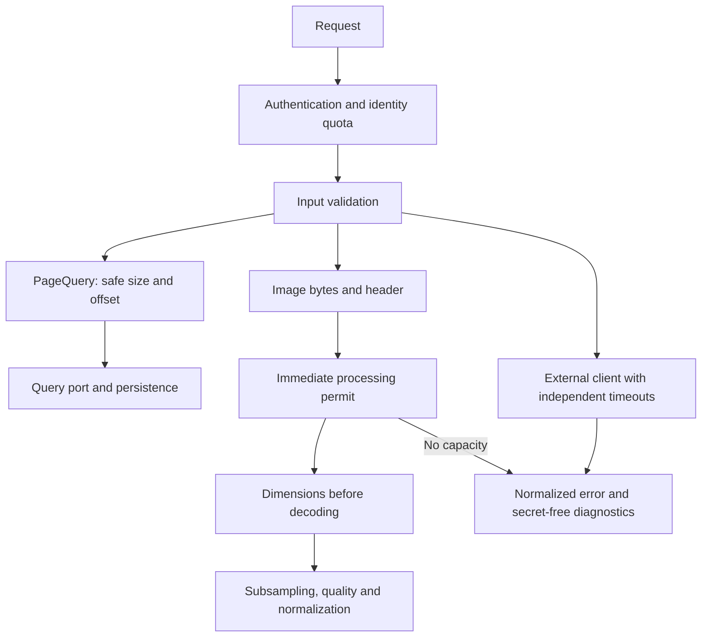
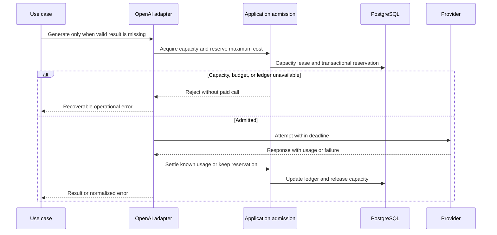

# Resource protection and external transports

## Responsibilities

Pagination limits belong to the query contract and are validated before
constructing a `Pageable`. Image inspection, HTTP transport and safe logging
belong to infrastructure. These mechanisms do not introduce Spring, ImageIO
or HTTP dependencies into the domain.

[View the full “Responsibilities” diagram](https://images.vinnot.com/docs/diagrams/v1/en/backend-architecture-resource-protection-54fb648d86cf.svg)

## Pagination

`PageQuery` requires `page >= 0`, `1 <= size <= 200` and both the offset and
page end to fit a 32-bit integer. Arithmetic uses `long` before comparison.
Invalid requests produce `INVALID_PAGINATION` (422) without executing the
paged repository query. The 200-item limit is a shared safety ceiling, not the
default page size used by screens.

Surface-specific limits are:

| Surface | Limit |
|---|---|
| Public wine catalog | effective page size up to 20, 500-result window |
| Public similar wines | up to 10 |
| Event discovery | page size from 1 to 50; up to 500 candidates |
| Public winery listing | effective page size up to 20, 500-result window |
| Event search, upcoming events, and published routes | maximum 100; default 20 |
| Admin/partner events, registrations, admin routes, users, reviews, cellar, and submissions | ceiling 200; screen defaults 10–50 |
| Queries using `PageQuery` | 200-item ceiling; valid requested sizes are preserved |

Discovery accepts latitude from -90 to 90, longitude from -180 to 180 and
radius from 0 to 500 km. All three must be finite. Zero radius retains the
100 km default. A page beyond the final result returns an empty list with
the calculated total; list indexing does not overflow. These controls do not
transform filters, ordering or valid page contents.

## JSON bodies and collections

`JsonRequestResourceFilter` runs after security and before deserialization.
Ordinary JSON permits 1 MiB; `/admin/catalog-images` permits 8 MiB for the
existing 7,000,000-character base64 contract. Declared length and actual bytes
are both bounded: absent Content-Length and chunked input cannot read more than
the limit plus one detection byte. Oversize returns 413
`REQUEST_BODY_TOO_LARGE` using the standard error contract.

Catalog-image JSON admits two simultaneous requests per instance without
queuing. The permit covers reading, deserialization, and execution, and is
released even if a controller or S3 fails. It complements the decoding limit.
Multipart retains its own reader and limits.

| Mutable content | Maximum |
|---|---:|
| Catalog, event, route, and stop descriptions | 20,000 characters |
| Event payment instructions | 5,000 characters |
| Cellar notes | 10,000 characters |
| Grapes/allergens | 50 items, up to 100 characters each |
| Recommended route wine types | 50 items, up to 50 characters each |
| Stops or winery IDs in an administrative route request | 100 |
| Administrative and organizer `clearFields` | 50 items, up to 64 characters each |

Optional fields retain null and partial-update semantics. Values are not
truncated or completed to pass validation. Text searches/filters permit 512
characters without transforming partial matches. Wine sort options and
ASC/DESC are validated against the declared contract; that validation does
not introduce new sorting behavior.

## Trust boundary and operations

Caddy removes `Forwarded` before forwarding and replaces untrusted
`X-Forwarded-*` values. Spring uses normalized values because ports 8080 and
5432 remain private and only the proxy publishes HTTP/HTTPS. Cloudflare sits in
front of the API: Caddy trusts only the reviewed Cloudflare ranges
(`trusted_proxies`), reads `CF-Connecting-IP` only from them, and sends Spring a
single `X-Forwarded-For` (`{client_ip}`) plus `X-Forwarded-Host`/`Proto` set by
Caddy. `RATE_LIMIT_TRUST_FORWARDED_FOR` is `true` in the deployed compose for
that reason. The same address is stored in the security events
(`security_events`). HTTP identity quotas are per JVM; AI capacity and monetary accounting
are shared through the DB.

AI accounting starts when V23 is enabled; historical OpenAI consumption is not
imported. Operators must account for existing period spending before activation.
When dev and production use separate databases, their limits must be allocated
within the agreed total budget, rather than duplicating it.

The JDBC pool waits up to `DB_CONNECTION_TIMEOUT_MS=3000` to acquire a
connection; `DB_VALIDATION_TIMEOUT_MS=1000` bounds validation. These do not
replace per-query SQL budgets.

The per-IP credential quota is complemented per account: five wrong passwords in
a row lock password sign-in for 15 minutes (HTTP 423 with `Retry-After`), so
guesses spread over many addresses still stop. See
[temporary sign-in lockout](authentication-and-identity.md#temporary-sign-in-lockout).

## Images

`ImageResourceLimits` shares the 24-million-pixel maximum between scanning and
storage. Width-by-height multiplication uses `long`. `readBounded` consumes
at most 8 MiB plus one detection byte, even when the client declares a false
size. Excess bytes are rejected before writing the object to disk or S3.

Storage adapters check actual length, signature, MIME and readable dimensions.
JPEG, PNG and GIF use ImageIO; WebP support is preserved through the
TwelveMonkeys `imageio-webp` plugin. Dimension inspection does not decode the
raster, validate every animation frame or constitute malware scanning.
The set of accepted formats is not expanded.

Scanning and catalog editing retain JPEG/PNG and existing normalization.
Scanning keeps its resolution, brightness and sharpness requirements;
administrative images do not need to satisfy camera-photo conditions.
Subsampling takes place before allocating the full raster, and persisted
images retain a maximum long edge of 1600 pixels.

Heavy processing shares a semaphore per `WineLabelUploadValidator` instance,
with no waiting queue: two operations by default.
`IMAGE_PROCESSING_MAX_CONCURRENT` accepts values from 1 to 8. The permit covers
decoding, analysis/normalization and buffer cleanup; it is always released on
completion or failure. Saturation returns 503 with `IMAGE_PROCESSING_BUSY`.
It is not converted into a wine-not-found result.

## Transport timeouts

| Configuration | Default | Scope |
|---|---|---|
| `GOOGLE_MAPS_CONNECT_TIMEOUT` | `3s` | Directions connection |
| `GOOGLE_MAPS_READ_TIMEOUT` | `5s` | complete Directions request, including its body |
| `SOCIAL_HTTP_CONNECT_TIMEOUT` | `3s` | Facebook, Apple and JWK connection |
| `SOCIAL_HTTP_READ_TIMEOUT` | `5s` | complete Facebook, Apple or JWK request, including its body |

Budgets range from 1 ms to 60 s. `DeadlineHttpRequestFactory` preserves the
RestClient/RestTemplate contract and limits requests and responses to 1 MiB.
It follows no redirects and adds no application retries. It waits for the
complete body within the deadline and cancels the transfer on expiry or
interruption; receiving fragments does not restart the clock.

Additionally, `HttpOperationDeadline` allows 15 s to verify a social identity
or revoke Apple authorization: all requests share the remaining time, including
code exchange, JWK and revocation. The context is restored in `finally`, without
inheriting budgets from a previous request. This adapter deadline does not
measure human login interaction or the rest of the business use case. Maps and
moderation use separate instances of the same transport; chat/vision retains
its specialized client.

Directions is not called with fewer than two or more than 27 stops, missing
or out-of-range coordinates, or no API key. Its optional result is preserved:
failures return unavailable distance, not an invented distance. Request URLs,
API keys and provider error bodies are not logged.

## AI admission, spending, and transport

Valid cached results are resolved before contacting the provider.
`AiProviderAdmissionService` orchestrates two ports: it reuses
`AiGenerationLeasePort` for distributed capacity and uses `AiSpendingLedgerPort`
for monetary reservations. The OpenAI adapter implements transport and pricing;
handlers and domain code do not depend on its SDK or SQL.

[View the full “AI admission, spending, and transport” diagram](https://images.vinnot.com/docs/diagrams/v1/en/backend-architecture-resource-protection-dda9372c3ef1.svg)

| Variable | Default | Meaning |
|---|---:|---|
| `AI_MAXIMUM_CONCURRENT_REQUESTS` | 3 | simultaneous paid attempts across replicas sharing a DB; range 1–20 |
| `AI_MONTHLY_LIMIT_USD` | 10 | UTC calendar-month window |
| `AI_DAILY_LIMIT_USD` | 0 | optional UTC daily window; 0 disables only this additional limit |
| `AI_PAID_CALLS_ENABLED` | true | pauses new paid calls without invalidating cache |
| `AI_PROFILE_REFRESH_ENABLED` | true | background regeneration of stale AI profiles; never runs in mock mode |
| `AI_PROFILE_REFRESH_INTERVAL` | 2m | delay between refresh runs |
| `AI_PROFILE_REFRESH_PROFILES_PER_RUN` | 1 | maximum profiles regenerated per run; range 1–20 |
| `AI_PROFILE_REFRESH_BUDGET_SHARE` | 0.5 | share of `AI_MONTHLY_LIMIT_USD` after which the refresh stops for the month |
| `OPENAI_CONNECT_TIMEOUT` | 10s | connection establishment |
| `OPENAI_READ_TIMEOUT` | 30s | entire text operation, including attempts and backoff |
| `AI_IMAGES_ENABLED` | false | social illustrations with OpenAI; off uses the pillar vignette at no cost |
| `AI_IMAGES_MAX_COST_USD` | 0.25 | flat cost every image attempt reserves and settles against the monthly and daily caps |
| `AI_IMAGES_TIMEOUT` | 110s | whole image call with retries; at most 115 s so it never outlives the 2-minute lease |
| `AI_IMAGES_MAX_ATTEMPTS` | 2 | image attempts; only 429 and 5xx are retried, never a timeout or a rejected image |

Capacity acquisition has no queue: unavailable slots cause immediate rejection.
The `provider-capacity:<slot>` leases last two minutes, above the 60-second
maximum for one OpenAI operation. They differ from per-wine/pair single-flight,
which retains its finite wait to reuse an ongoing generation.

V23 creates windows, reservations, and their association. A conditional UPDATE
checks `spent + reserved + maximum <= limit` transactionally. Daily rejection
also rolls back the monthly reservation. Each retry reserves its own cost.
Settlement is idempotent and uses the original windows even when the response
arrives after a day/month boundary.

The policy prices `gpt-6-luna` (text) and `gpt-4o-mini`/`gpt-4o-mini-2024-07-18`
(vision) with one conservative pair: USD 0.25 per million input tokens and USD
1.00 for output, the most expensive accepted tier of those models. Text
completions request `service_tier=priority` (the response reports `fast`);
vision requests `service_tier=default`. Only the tiers in
`services.openai.pricing.service-tiers` (`default,priority,fast`) settle actual
usage. The policy reserves the full input context (128,000 tokens)
plus requested output (up to 16,384), without optimistic image-token estimates.
Models without reviewed pricing are not executed. The
`services.openai.pricing.*` properties allow updating rates and limits with the
model. [Pricing source](https://developers.openai.com/api/docs/pricing).

Valid `usage` releases the difference; cached input is conservatively charged
at the ordinary input rate. Missing, contradictory, out-of-bounds usage or an
unrecognized model/tier retains the entire reservation. Timeouts, process
crashes, and settlement failure do not release money. Lease expiration only
restores capacity. Operational settlement requires provider evidence:
reservations must not be deleted merely to simulate available funds.

The cutoff applies per DB/environment and to calls through this adapter, not
billing for other keys, tools, projects, or environments. Configured prices
must remain current. AWS Budgets does not limit OpenAI. Content moderation has
a separate adapter and is not recorded as paid chat/vision generation.

Submission moderation admits two simultaneous reviews per instance, before
image encoding. Saturation reports automatic review as unavailable; it never
marks content safe because of load. Capacity is released on completion or
failure, preserving manual review. The total deadline is 30 s, connection up to
10 s, request up to 12 MiB and response up to 1 MiB; it covers the entire download
and does not retry the review. A response without a valid boolean `flagged`
field cannot automatically approve content either.

Transport does not follow credential redirects. The deadline covers response
body download, attempts, and backoff; vision retains the scanner-specific
budget. Requests and responses are limited to 12 MiB and 1 MiB respectively.
There are at most three attempts. Billing/quota errors and permanent HTTP
failures are not retried. Temporary 429 or 5xx failures may retry within the
deadline. `Retry-After` is a minimum: if it exceeds the permitted wait, the
failure is returned without retrying early. Ambiguous timeouts are not
automatically replayed. Interruption cancels HTTP waiting and preserves the flag.

The codes `AI_CAPACITY_EXCEEDED`, `AI_BUDGET_EXHAUSTED`,
`AI_PAID_CALLS_PAUSED`, `AI_ADMISSION_UNAVAILABLE`, and `AI_PRICING_UNAVAILABLE`
are operational failures, not “no match.” Stored profiles/comparisons remain
available without generating new calls.

## AWS clients and nearby events

S3 and SES use Spring-managed clients with lifecycle cleanup. Each pool permits
20 connections: up to 2s acquisition, 3s connection, and 10s socket timeout.
`AWS_API_CALL_TIMEOUT` is 15s and `AWS_API_ATTEMPT_TIMEOUT` is 12s; configuration
requires `10s <= attempt <= call <= 60s`. Ambiguous mutations are not
automatically replayed. The budget covers one SDK operation, not a use case
with several operations or an entire S3 paginator traversal.

`/events/nearby` validates finite coordinates, positive radius up to 500 km,
and `PageQuery` before querying. It retains 500 candidates and distance order;
in-memory pagination cannot overflow. Unlike discovery, radius zero is not
a default value.

## Diagnostics and compatibility

`SafeFailureDetails` retains up to five exception types and their first
Vinnot code location. It does not concatenate messages, serialized causes or
suppressed exceptions. The HTTP boundary retains method, path, status, code
and request ID; SES does not log recipient, subject or message contents.

Login, file and catalog response contracts remain unchanged. These controls
require V23 for monetary admission. Configuration applies when each backend
starts and can differ between environments. Identity quotas and AI generation
coordination retain their contracts documented in
[security](security-and-authorization.md) and
[profiles and comparisons](../../modules/ai/architecture.md).
