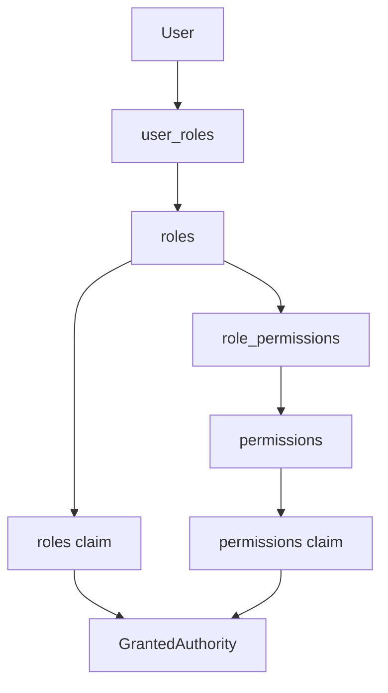

# Security, authorization, and abuse protection

## Identity-based resource visibility

`ResourceReader` is a domain value built by the adapter from the real principal:
visitor, identified user or catalog staff (ADMIN/MODERATOR). Query/body cannot
supply that privilege. Handlers filter before projecting data; hidden and missing
resources both return 404.

| Resource | Published read (with session) | Authorized private read |
|---|---|---|
| Wine | active | createdBy, ADMIN, MODERATOR |
| Event | publishedOnce and status other than DRAFT | organizer, ADMIN, MODERATOR |
| Route | PUBLISHED | createdBy, ADMIN, MODERATOR |

Published events retain their link when completed, postponed or cancelled.
Cancelled drafts with no publication history stay private. Returning to DRAFT
hides detail even with prior publication. Event lists retain discovery filters;
a historical link does not make an event upcoming.

Route geography is derived only from PUBLISHED routes, matching the public
catalog. Administrative queries retain their own filters. Nested wine endpoints
(AI profile, reviews, similar, label-image) check read access through an MVC
interceptor and input port; comparison checks both wines before invoking its
use case. A blanket wildcard does not interfere with private submissions.

Previously public image URLs do not become private objects when deactivating
a wine: the rule controls API responses, not public media copies. Quarantine
retains its separate authorized workflow.

Sensitive ADMIN actions, and every account holder's own email change and
permanent deletion, additionally require recent reauthentication under
[the identity contract](authentication-and-identity.md#admin-reauthentication).
`REAUTHENTICATION_REQUIRED` is 403, not an automatic 401-refresh loop.

## Objective

Vinnot security is implemented through complementary layers. The HTTP boundary
authenticates and applies an initial access policy; use cases re-check ownership
and state; domain objects preserve invariants; PostgreSQL closes uniqueness and
integrity races; adapters validate files and external providers.

No single layer is the complete authorization model.

## Actual HTTP pipeline

```mermaid
flowchart LR
    REQ["Request"] --> RID["Request ID + MDC"]
    RID --> CORS["CORS / Spring Security"]
    CORS --> JWT["JwtAuthenticationFilter"]
    JWT --> RATE["RateLimitingFilter"]
    RATE --> URL["Method and path rules"]
    URL --> METHOD["@PreAuthorize"]
    METHOD --> CTRL["Controller"]
    CTRL --> USECASE["Use case + ownership"]
    USECASE --> DOMAIN["Invariants"]
    DOMAIN --> RESPONSE["Normalized response or error"]
```

[View the full “Actual HTTP pipeline” diagram](https://images.vinnot.com/docs/diagrams/v1/en/backend-architecture-security-and-authorization-cbcbc9615403.svg)

`HttpRequestLoggingFilter` has highest precedence. It accepts `X-Request-ID`
only when it matches `[A-Za-z0-9._-]{1,100}`; otherwise it generates a UUID,
stores it in MDC, and returns it as a response header. It does not log bodies,
tokens, or images.

The business API authenticates through bearer tokens without a server HTTP session.
The `/auth/web/**` adapter does use a refresh cookie: `BrowserSessionPolicy`
requires an explicitly allowed `Origin` and `X-Vinnot-Web-Session: 1` before
processing the operation, with HttpOnly, `SameSite=Strict` and Secure for remote
environments. Spring CSRF is disabled; this browser transport policy forms part
of current protection and must be reviewed when cookies, domains or origins change.
See [identity](authentication-and-identity.md) for the complete contracts.

JWT and rate-limit filters disable automatic servlet registration and are
inserted once in `SecurityFilterChain`. Rate limiting runs after JWT so it can
use `user:<uuid>` for authenticated calls and `ip:<addr>` for anonymous calls.

## Bearer-token authentication

`JwtAuthenticationFilter` only processes `Authorization: Bearer <token>`. A
valid token needs a correct HMAC signature, valid structure, and a future
expiration. The subject is converted to UUID; roles and permissions become
Spring Security authorities:

- the four values admitted by `Role` become `ROLE_USER`, `ROLE_ADMIN`,
  `ROLE_MODERATOR`, and `ROLE_PARTNER`;
- every permission code loaded from `role_permissions` becomes an unprefixed,
  uppercase authority, for example `WINE_UPDATE` or `EVENT_CREATE`;
- the principal exposed to controllers and handlers is the serialized UUID.

A missing or invalid bearer does not create an authentication. If the route
requires one, `RestAuthenticationEntryPoint` returns `401` with the standard
contract and `AUTHENTICATION_REQUIRED`. An authenticated user without authority
receives `403`; these states are not conflated.

Before accepting a valid JWT, the filter checks `AccountAccessPort`: the
account must exist, be active and unlocked, and its current roles must match
the claims. The adapter performs an indexed UUID lookup of users/roles without
hydrating aggregates. Role changes, bans, deactivation and deletion reject the
next request with 401. `/auth/refresh` delegates validation to the refresh flow
without blocking it on the previous access token; that use case checks account
state.

Cryptography and rotation details are documented in
[Authentication and identity](authentication-and-identity.md).

## Public and authenticated boundary

`SecurityConfig` applies deny-by-default through
`anyRequest().authenticated()`. Public exceptions are explicit:

| Surface | Access |
|---|---|
| login, registration, refresh, recovery, verification | public |
| `/health`, `/version`, actuator health | public |
| OpenAPI (`/api-docs`, `/api-docs.yaml`, `/api-docs/**`) and Swagger UI (`/swagger-ui/**`, `/swagger-ui.html`, `/webjars/swagger-ui/**`) | browser username and password of an active, verified, unlocked ADMIN account (own chain, `ApiDocumentationSecurityConfig`) |
| `/actuator/**` except basic health | `ROLE_ADMIN` only; health details also require ADMIN |
| GET current/versioned terms; POST support | public |
| GET `/app-versions/minimum` | public, the mobile app update policy |
| GET/HEAD `/share`, `/share/en`, `/share/*/*` and `/share/*/*/en` | public, HTML link previews |
| POST `/payments/mercadopago/webhooks[/*]` | public, Mercado Pago signature verified |
| POST `/payments/mercadopago/connection/callback`; GET `/payments/receipt` | public, single-use state or receipt token |
| GET avatar/label under `/uploads/**` | public, validated filename |
| POST `/uploads/covers` | kind-specific create/update method permission |
| GET `/uploads/covers/{id}.webp` | use-case visibility/ownership, no cache |
| GET grape types, regions, and reference data | authenticated |
| GET wine, winery, event, and route catalogs | authenticated |
| GET published profile `/users/{id}/profile` | authenticated |
| `/wines/submissions/**` | authenticated before `/wines/**` is evaluated |
| `/admin/users` and `/admin/users/**` | `ROLE_ADMIN` only |
| `/admin/notifications/**` | `ROLE_ADMIN` only |
| `/admin/app-versions` and `/admin/app-versions/**` | `ROLE_ADMIN` only |
| `/admin/**` | `ROLE_ADMIN` or `ROLE_MODERATOR`; catalog DELETE is ADMIN-only |
| everything else | authenticated |

Matcher order is security-sensitive. Submissions precede the wine wildcard; both
require a session. Anonymous reads return 401 before visibility/ownership checks.
Published-content rules do not imply anonymous access.

The wine catalog retains a web-adapter exposure policy:

- maximum page size: 20;
- maximum window per search: 500 results;
- maximum similar results: 10;
- negative pages, non-positive sizes, or an exceeded window produce a domain
  error.

This policy limits the catalog surface, not internal ports or administrative use
cases.

## Roles, permissions, and ownership

Vinnot combines RBAC with granular permissions:

[View the full “Roles, permissions, and ownership” diagram](https://images.vinnot.com/docs/diagrams/v1/en/backend-architecture-security-and-authorization-b57d7ba7317e.svg)

Permissions are loaded when a session is issued or renewed and are embedded in
the access token. Changing database permissions does not mutate an issued JWT;
the change converges on renewal or expiration.

### Product roles

| Role | Current intent |
|---|---|
| `USER` | catalog, own reviews, cellar, and normal authenticated operations |
| `PARTNER` | creation and ownership-based management of events plus base access |
| `MODERATOR` | content moderation according to seeded permissions |
| `ADMIN` | global access and the `/admin/**` surface |

The Java operational-role enum is `USER`, `PARTNER`, `MODERATOR` and `ADMIN`.
Effective endpoint authority is determined by SecurityConfig and its
PreAuthorize, not the role's functional label.

### Permissions per role

The table lists the 31 permissions each role holds in the database as they stand
after [V76](../../../../backend/src/main/resources/db/migration/V76__remove_unused_roles_and_permissions.sql). The seed lives in [V2](../../../../backend/src/main/resources/db/migration/V2__seed_reference_data.sql); no other migration adds grants
to `role_permissions`. V76 removed the unused roles `ROLE_TOURISM_OPERATOR` and
`ROLE_VERIFIED_EXPERT` and the `ARTICLE_*` permissions, and it stops if any
account still holds one of those roles.
[UnusedRolesRemovalMigrationPostgresIntegrationTest](../../../../backend/src/test/java/com/vinnot/user/infrastructure/persistence/UnusedRolesRemovalMigrationPostgresIntegrationTest.java) verifies the result.

| Permission | `USER` | `PARTNER` | `MODERATOR` | `ADMIN` | Checked by the backend |
|---|:-:|:-:|:-:|:-:|---|
| `WINE_READ` | ✓ | ✓ | ✓ | ✓ | no; only carried in the token |
| `WINE_CREATE` |  |  | ✓ | ✓ | yes, `hasAuthority` |
| `WINE_UPDATE` |  |  | ✓ | ✓ | yes, `hasAuthority` |
| `WINE_DELETE` |  |  |  | ✓ | yes, `hasAuthority` |
| `WINERY_READ` | ✓ | ✓ | ✓ | ✓ | no; only carried in the token |
| `WINERY_CREATE` |  |  | ✓ | ✓ | yes, `hasAuthority` |
| `WINERY_UPDATE` |  |  | ✓ | ✓ | yes, `hasAuthority` |
| `WINERY_DELETE` |  |  |  | ✓ | yes, `hasAuthority` |
| `EVENT_READ` | ✓ | ✓ | ✓ | ✓ | no; only carried in the token |
| `EVENT_CREATE` |  | ✓ | ✓ | ✓ | yes, `hasAuthority` |
| `EVENT_UPDATE` |  |  | ✓ | ✓ | yes, `hasAuthority` |
| `EVENT_UPDATE_OWN` |  | ✓ |  | ✓ | yes, `hasAuthority` |
| `EVENT_DELETE` |  |  |  | ✓ | yes, `hasAuthority` |
| `EVENT_DELETE_OWN` |  | ✓ |  | ✓ | yes, `hasAuthority` |
| `WINE_ROUTE_READ` | ✓ | ✓ | ✓ | ✓ | no; only carried in the token |
| `WINE_ROUTE_CREATE` |  |  | ✓ | ✓ | yes, `hasAuthority` |
| `WINE_ROUTE_UPDATE` |  |  | ✓ | ✓ | yes, `hasAuthority` |
| `WINE_ROUTE_UPDATE_OWN` |  |  |  | ✓ | yes, `hasAuthority` |
| `WINE_ROUTE_DELETE` |  |  |  | ✓ | no; only carried in the token |
| `WINE_ROUTE_DELETE_OWN` |  |  |  | ✓ | no; only carried in the token |
| `REVIEW_CREATE` | ✓ | ✓ | ✓ | ✓ | yes, `hasAuthority` |
| `REVIEW_UPDATE_OWN` | ✓ | ✓ | ✓ | ✓ | yes, `hasAuthority` |
| `REVIEW_DELETE` |  |  | ✓ | ✓ | yes, `hasAuthority` |
| `REVIEW_DELETE_OWN` | ✓ | ✓ | ✓ | ✓ | yes, `hasAuthority` |
| `USER_READ` |  |  | ✓ | ✓ | no; only carried in the token |
| `USER_UPDATE` |  |  |  | ✓ | no; only carried in the token |
| `USER_BAN` |  |  |  | ✓ | no; only carried in the token |
| `USER_DELETE` |  |  |  | ✓ | no; only carried in the token |
| `ROLE_ASSIGN` |  |  |  | ✓ | no; only carried in the token |
| `CELLAR_MANAGE_OWN` | ✓ | ✓ |  | ✓ | yes, `hasAuthority` |
| `ADMIN_DASHBOARD_READ` |  |  | ✓ | ✓ | no; only carried in the token |

Totals: `USER` 8, `PARTNER` 11, `MODERATOR` 18 and `ADMIN` 31 (all of them).

What to keep in mind when reading the table:

- An account's effective permissions are the union of its roles. Assigning a role
  from Admin keeps `ROLE_USER` ([`User.replaceRole`](../../../../backend/src/main/java/com/vinnot/user/domain/model/User.java)), so a `MODERATOR`,
  `PARTNER` or `ADMIN` account also gets the `USER` permissions.
- The `MODERATOR` role alone has no `CELLAR_MANAGE_OWN`. All of
  [`/cellar`](../../../../backend/src/main/java/com/vinnot/cellar/infrastructure/web/controller/CellarController.java) requires that permission, so a moderator account uses its
  cellar through `ROLE_USER`; without that role it could not.
- The `*_READ`, `USER_*`, `ROLE_ASSIGN`, `ADMIN_DASHBOARD_READ`,
  `WINE_ROUTE_DELETE` and `WINE_ROUTE_DELETE_OWN` permissions are seeded, but no
  controller checks them. Reads require a session, not a permission; user, role
  and dashboard administration is guarded by `hasRole('ADMIN')` or
  `hasAnyRole('ADMIN', 'MODERATOR')`; and deleting a wine route is
  `DELETE /admin/routes/{id}` with `hasRole('ADMIN')` in
  [`WineRouteAdminController`](../../../../backend/src/main/java/com/vinnot/admin/infrastructure/web/controller/WineRouteAdminController.java).
- Review and comment moderation combines `REVIEW_DELETE` with the role:
  `hasAnyRole('ADMIN','MODERATOR') and hasAuthority('REVIEW_DELETE')`.

### Controller permissions

| Family | Relevant permissions |
|---|---|
| wines | `WINE_CREATE`, `WINE_UPDATE`, `WINE_DELETE` |
| wineries | `WINERY_CREATE`, `WINERY_UPDATE`, `WINERY_DELETE` |
| events | `EVENT_CREATE`, `EVENT_UPDATE`, `EVENT_UPDATE_OWN`, `EVENT_DELETE`, `EVENT_DELETE_OWN` |
| routes | `WINE_ROUTE_CREATE`, `WINE_ROUTE_UPDATE`, `WINE_ROUTE_UPDATE_OWN` |
| reviews | `REVIEW_CREATE`, `REVIEW_UPDATE_OWN`, `REVIEW_DELETE`, `REVIEW_DELETE_OWN` |
| cellar | `CELLAR_MANAGE_OWN` |
| administration | catalog/moderation ADMIN or MODERATOR; users and catalog DELETE ADMIN |

### Ownership

PreAuthorize controls authority; use cases apply the resource check shown below.
A session alone does not describe a query's scope.

| Operation | Identity / effective control |
|---|---|
| GET /cellar, /cellar/stats | principal UUID |
| GET /cellar/user/{userId}[/stats] | CELLAR_MANAGE_OWN; path UUID |
| PATCH/DELETE /cellar/{id} | principal and entry owner |
| own submissions | submittedBy = principal |
| administrative review | ROLE_ADMIN or ROLE_MODERATOR |
| partner/event mutations | organizer or command admin exception |
| edit review | author or admin flag; command reviewId |
| delete comment | author or global permission; command commentId |
| confirm/report payment | registration owner |

## Rate limiting

Protection uses Bucket4j buckets stored in Caffeine. Each policy has configurable
capacity, refill tokens, and refill period:

| Policy | Main routes | Default |
|---|---|---:|
| `credential` | login, social login, `/auth/web/login`, `/auth/web/social` and `/auth/reauthenticate` | 10/min |
| `account-action` | reset/verification/change/account deletion; POST Mercado Pago connection callback | 5/15 min |
| `registration` | registration | 5/h |
| `support` | POST support; shares registration configuration | 5/h |
| `report` | POST community reports (`/community/reports`) | 10/h |
| `refresh` | renewal | 60/min |
| `ai` | profiles, generation, comparisons | 20/h |
| `wine-scan` | label scanning | 30/h |
| `wine-submission` | submissions or label image | 10/day |
| `media-upload` | POST covers; wine-submission configuration, separate counters | 10/day |
| `wine-catalog` | GET under /wines | 60/min |
| `public-catalog` | GET/HEAD wineries, events, routes and `/share/**` | 180/min |
| `wine-catalog-daily` | same routes as `wine-catalog`, on top of the minute limit | 1500/day |
| `public-catalog-daily` | same routes as `public-catalog`, on top of the minute limit | 1500/day |
| `api-documentation` | OpenAPI and Swagger UI, per address, before credentials are checked | 30/min |
| `general` | remaining requests | 300/min |

These environment-overridable defaults are operational limits, not commercial
plans or contractual product quotas. For example, `report` uses
`RATE_LIMIT_REPORT_CAPACITY` (10), `RATE_LIMIT_REPORT_REFILL_TOKENS` (10) and
`RATE_LIMIT_REPORT_REFILL_PERIOD` (`1h`).

A limited response returns HTTP 429, `X-RateLimit-Limit`,
`X-RateLimit-Remaining`, `Retry-After`, and a body with
`RATE_LIMIT_EXCEEDED`. Health, version, and OPTIONS preflight do not consume
buckets.

### Daily catalog quota

The two daily policies cap how much of the catalog one account or address can
read in a day, so the catalog cannot be copied in bulk. A person browsing never
comes close. ADMIN and MODERATOR accounts are exempt, and the caller's own data
(paths ending in `/me` or `/mine`, such as the registration the web polls while a
payment is pending) never counts. When a signed-in account
runs out of a daily quota, the API answers 429 and locks the account through
`AutomatedAccountSuspensionPort`, implemented by the user module: the same
permanent lock as an administrative suspension, with reason
`TERMS_VIOLATION: Automatic suspension: daily catalog quota exceeded`, the
suspension email and the push devices forgotten. The next request with that
session is rejected. An administrator lifts the lock from the users panel; the
quota then starts again from zero. An anonymous address that runs out only
receives 429. The quotas use `RATE_LIMIT_WINE_CATALOG_DAILY_*` and
`RATE_LIMIT_PUBLIC_CATALOG_DAILY_*`. Counters live in the backend memory, so a
restart resets them.

### Bucket identity

- Authenticated request: `user:<uuid>`.
- Anonymous request: `ip:<remote-address>`.
- With `trust-forwarded-for=true`, the last reported hop is used.

Only trust X-Forwarded-For behind controlled proxies that replace or sanitize
that header. Direct Internet clients must not supply trusted identity.

Idle expiration must be at least the longest refill period.
`RateLimitProperties` rejects startup configuration that would allow premature
idle expiration to reset a quota.

### Bucket scope

Buckets live in the JVM. Each replica has its own state and refill; configured
quota is per process. Client identity depends on proxy configuration and the
available principal.

## CORS and browser exposure

CORS uses the exact `app.cors.allowed-origins` allowlist,
`GET,POST,PUT,PATCH,DELETE,OPTIONS`, open request headers, and credentials. It
exposes `X-Request-ID`, rate-limit headers, and `Retry-After`.

Consequences:

- a new frontend requires its exact origin in environment configuration;
- `allowCredentials=true` must not be combined with a wildcard origin;
- CORS protects browsers, not the API itself;
- native applications do not depend on CORS but still require TLS and bearer
  tokens.

## Uploads and untrusted content

General upload validates a JPEG/PNG/GIF/WebP allowlist, up to 8 MiB, signature/MIME and filename/path. Avatar uses that storage and its use case coordinates the user reference and cleanup; it does not use label re-encoding.

WineLabelUploadValidator accepts JPEG/PNG, validates signatures, decodes and checks dimensions/quality. /scan receives validated bytes without re-encoding. Submissions and label-image call validateAndSanitizeForPersistence: they produce RGB JPEG up to a 1600-pixel long edge without copying source metadata. Quarantine has its own namespace and administrative access. Moderation evaluates content; it does not replace structural validation or catalog-identity decisions.

Details: [uploads](../use-cases/uploads-and-reference-data.md) and [scanning](../../modules/wines/architecture.md).

## Sensitive data and logging

HttpRequestLoggingFilter records method, path, status, duration and requestId, not bodies or Authorization headers. This scope applies to the filter, not every application adapter. Email adapters are selected by configuration: the log provider only logs that a message was requested (no recipient, link or token), while SES sends through its client. Provider selection and log destinations belong to environment configuration.

Secrets are injected through environment/secret stores. Rotating JWT_SECRET changes the access-JWT verification key and affects issued tokens. Examples and documentation do not contain real credentials or user payloads.

## Security error contract

SecurityConfig and filters can reject requests before the controller. In MVC, AUTH_FAILED as BusinessRuleViolationException maps to 401; FORBIDDEN and REAUTHENTICATION_REQUIRED to 403; other codes of that class, including specific ownership errors, to 422. DomainException normally produces 400; data integrity, 409; missing entity, 404. Rejected quota uses 429 and Retry-After. Exact fields and mappings are in [errors](errors-transactions-and-consistency.md). Clients must not repeatedly refresh sessions for permission or business-rule errors.

## Threat review by flow

| Threat | Current control |
|---|---|
| account enumeration | neutral login/forgot/resend errors and messages |
| session table disclosure | hashed refresh and action tokens |
| refresh replay | rotation and revocation |
| link replay | typed token, expiration, and `usedAt` |
| resource authorization | operation-specific principal and ownership matrix above |
| role escalation | protected admin endpoints and assignment handlers |
| forged social token | server-side signature/issuer/audience/subject verification |
| disguised upload | MIME/signature; decode and re-encode for persisted labels |
| path traversal | sanitized name and server-generated key/path |
| AI/cost abuse | dedicated per-user/IP quota |
| bulk catalog extraction | page/window cap plus read quota |
| HTTP log payload exposure | request filter excludes bodies and Authorization headers |

## Required tests

### Route configuration

Every new endpoint needs cases for:

1. anonymous request;
2. invalid or expired token;
3. authenticated user without permission;
4. owner with an `*_OWN` permission;
5. user with global permission;
6. administrator where applicable.

`SecurityConfigAccessTest` is the regression net for the boundary. Controller
tests do not replace ownership tests in handlers.

### Rate limit tests

- exact policy resolution by method/path;
- user and IP bucket separation;
- `429` headers and body;
- health/docs/OPTIONS exclusions;
- `bucket-idle-expiration` validation;
- trusted and untrusted `X-Forwarded-For`.

### Uploads

- allowed MIME with an invalid signature;
- truncated or undecodable content;
- exact size boundary and oversized content;
- extreme dimensions;
- re-encoding without metadata;
- storage rollback/compensation;
- one user's access to another user's media.

## Checklist for a new operation

- [ ] Public or authenticated access is explicit.
- [ ] It declares the exact granular permission or role required for the actor
  and operation; own-resource and administrative access are not conflated.
- [ ] The handler validates ownership against the real principal.
- [ ] It does not accept `userId` as a replacement for identity.
- [ ] Rate-limit and cost policies are defined.
- [ ] Errors preserve the common contract.
- [ ] No secrets, sensitive bodies, or binary content are logged.
- [ ] File inputs are validated and use compensation.
- [ ] Access, ownership, and abuse tests exist.
- [ ] ES/EN documentation and the API catalog are updated together.

## References

- `backend/src/main/java/com/vinnot/shared/infrastructure/config/SecurityConfig.java`
- `backend/src/main/java/com/vinnot/shared/infrastructure/security`
- `backend/src/main/java/com/vinnot/shared/infrastructure/storage`
- `backend/src/main/java/com/vinnot/wine/infrastructure/web/WineLabelUploadValidator.java`
- `backend/src/main/resources/application.yml`
- [API catalog](api.md)
- [Authentication and identity](authentication-and-identity.md)
- [Observability](observability.md)

## Session and effect contracts

[Sessions, publication and external effects](session-and-data-integrity.md) defines credential generation, 409 conflicts, locks, outbox and retries. The email logger does not print recipients, links or tokens; the AI provider logs exception types, not external error bodies.
