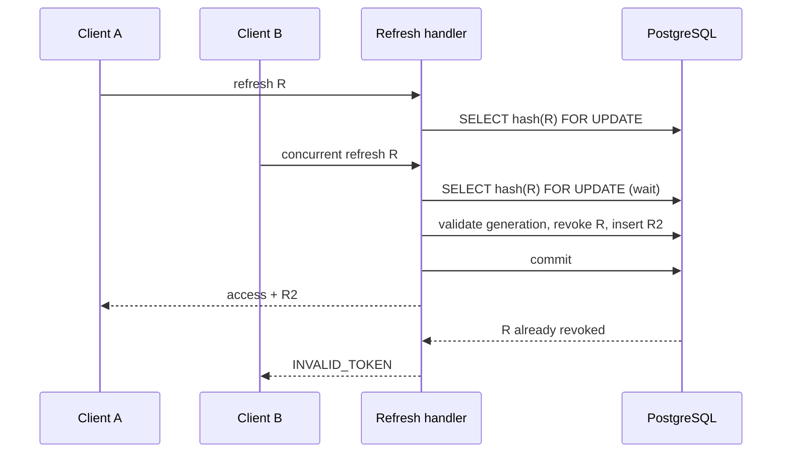
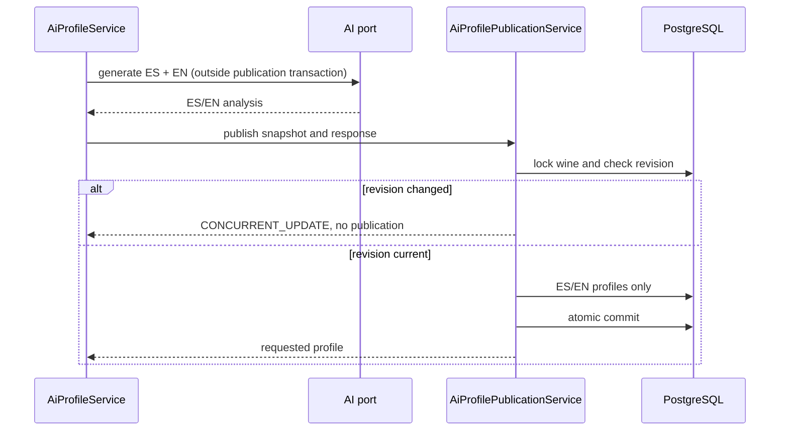
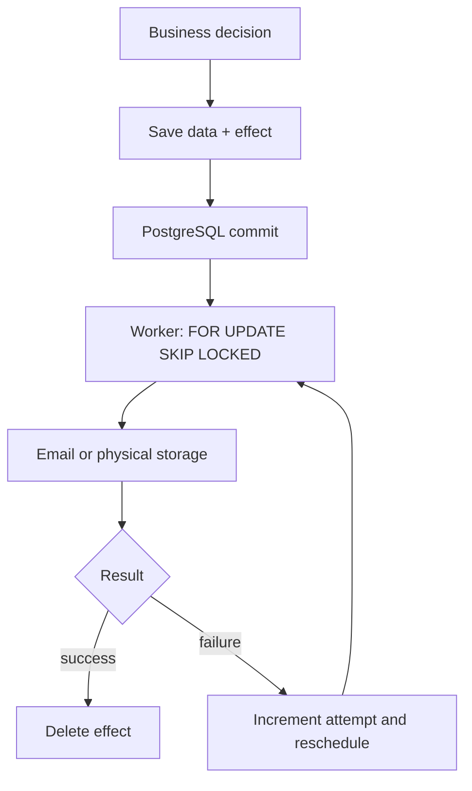
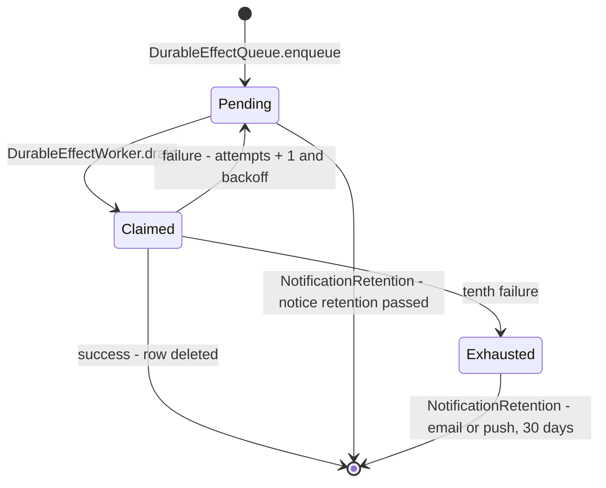

# Sessions, publication and external effects

## Responsibilities and boundaries

Use cases coordinate rules and ports; adapters implement locks, versioning, SQL
and storage. The `User` domain maintains session generation without depending on
JWT/JPA. `Wine` and `User` carry an opaque revision; their persistence entities
implement optimistic concurrency with `@Version`. Conflicts are not reported as
success or missing resources: `409 CONCURRENT_UPDATE` requires reloading before
retrying an edit.

## Versioned sessions

`users.session_version` identifies the credential generation. Access JWTs include
`sessionVersion`; every `refresh_tokens` row stores its snapshot. Password changes,
confirmed email changes, role changes, deactivation and locking increment the
generation. A JWT without the claim is interpreted as version 0 for compatibility;
this does not bypass the current-account check.

`JwtAuthenticationFilter` consults `AccountAccessPort` for existence, activity,
lock state, roles and generation. A valid signature and unexpired token are not
sufficient after the account changes. Renewal also compares the refresh snapshot
with the current user; a mismatch returns `INVALID_TOKEN`.

[View the full “Versioned sessions” diagram](https://images.vinnot.com/docs/diagrams/v1/en/backend-architecture-session-and-data-integrity-5039952c1e00.svg)

Logout with a token also revokes its known rotation descendants. A logout waiting
for a renewal lock therefore does not leave the successor active. Logout without
a token acknowledges the operation but cannot identify a remote session. Logout
does not increment the global generation or terminate other sessions; an issued
access JWT may remain valid until expiry if the account does not change.

## Profile and comparison publication

New content includes `_generation`, with `source` (`provider`, `mock` or `manual`)
and a SHA-256 context/configuration fingerprint. Historical `catalog` provenance
remains readable, but sparse-pair templates are no longer generated. This metadata is owned by the
backend, not trusted to the provider. Comparisons include the entire prompt and
model; profiles include prompt version, model and supplied wine data.

A generation command reuses the requested profile only if the ES/EN bundle exists
and its provenance is compatible with current context; manual edits are explicitly
recognized. Profile `GET` and status retain access to historical content without
implicit paid calls. Comparisons require valid structure and current fingerprints
in both languages. Switching language adds no call when a reusable bundle exists.

[View the full “Profile and comparison publication” diagram](https://images.vinnot.com/docs/diagrams/v1/en/backend-architecture-session-and-data-integrity-ea69ffc6f5a5.svg)

A real provider failure does not activate simulated content: it returns
`503 AI_PROFILE_UNAVAILABLE` or `503 AI_COMPARISON_UNAVAILABLE`. Profile mock
generation requires explicit `AI_PROVIDER=mock`, does not enrich the catalog and
is marked as simulated. Optional `null` fields represent missing information, not
a parsing error. Structural validation does not establish factual accuracy; the
prompt requests complete analysis using context and model knowledge, distinguishes
sensory estimates and consumption advice, and prioritizes known facts. Estimated
scores stay in the report rather than becoming catalog measurements. Normal publication
preserves manually edited translations; explicit forced regeneration replaces
the bundle.

## Write ordering and aggregates

| Operation | Coordination | Commit invariant |
|---|---|---|
| Confirm, review or expire registration | Event before registration | Capacity and registration agree |
| Cancel event | Event lock and active-registration cancellation | Counters released; refunds are not simulated |
| Moderate proposal | Submission lock and `NEEDS_REVIEW` check | One decision; competitor receives conflict |
| Create/update/delete review | Wine before review | Average/count derive from persisted reviews |
| Like/unlike | Review lock | Counter and like rows coordinated |
| Delete account | User and affected wines/events/reviews | Recompute projections after cascades |

`WineCommandAdapter` writes rating columns only; ORM catalog updates do not write
those columns. Review-to-cellar synchronization and rating updates belong to the
use-case transaction: failures propagate and roll back the operation. Account
deletion locks the user first to prevent new FK references while discovering
affected aggregates. PostgreSQL constraints remain the final integrity barrier.

## External-effect outbox

`external_effects` stores durable notification and cleanup attempts.
`DurableEffectQueue.enqueue` participates in the business transaction. Rollback
also discards the effect; the worker only sees committed rows.

[View the full “External-effect outbox” diagram](https://images.vinnot.com/docs/diagrams/v1/en/backend-architecture-session-and-data-integrity-9b7d66728c13.svg)

### Row lifecycle

[View the full “Row lifecycle” diagram](https://images.vinnot.com/docs/diagrams/v1/en/backend-architecture-session-and-data-integrity-26e7caae42d4.svg)

The table has no status column: the state follows from `attempts`, `next_attempt_at`
and whether the row exists.

A drain claims up to `app.effects.batch-size` (20) due rows in one short
transaction that leases them (`next_attempt_at` moves `app.effects.lease`, 15
minutes, ahead) and commits, runs them on virtual threads (at most
`app.effects.concurrency`, 4, at once) and keeps claiming until nothing is due or
`app.effects.drain-budget` (60 s) is spent. A transactional handler runs in its
own transaction that also locks the row; the push handler runs outside any
transaction so no connection waits on Expo. A row left by a worker that died is
due again when its lease ends. Drains start on a commit notification (V65,
`DurableEffectWakeUp` listening on `external_effects`) and on the
`app.effects.poll-ms` poll (30 seconds by default) as the fallback. Backoff starts
at 30 seconds and grows to one hour; after ten failures the row is retained. An
exhausted email or push is never sent again, because it may have arrived, and is
deleted after 30 days (`app.notifications.exhausted-retention`). It records the
exception type, not payloads, recipients or credentials in logs. Email delivery is
**at least once**: a crash between sending and committing can repeat a
notification. Pushes follow the guarantees in the
[notification architecture](../../modules/notifications/architecture.md#outbox-throughput-and-guarantees).

`TransactionalFileStorageAdapter` decorates local/S3 physical storage. Before an
image write, it records a two-hour-delayed reconciliation in an independent
transaction. That record survives business rollback. The worker only deletes
managed objects that are no longer referenced. Avatars must also be at least one
hour old. Promotion copies the image; quarantine deletion occurs after commit
and reference revalidation. An approved wine may keep its image after deletion
of the submitting user: the catalog reference prevents removal.

Every email uses this outbox through the [notification module](../../modules/notifications/architecture.md)
(`NotificationEffectHandler`): account actions, submission decisions, public
support and registration changes. Registration changes still enter through
`EventRegistrationEffectHandler`, which hands the notice to the module inside
the same worker transaction. No account email is sent synchronously. Apple revocation
precedes transactional local deletion and is not part of a distributed transaction.

## Persistence and references

- `V17__version_account_sessions.sql`: session generation and user revision.
- `V18__durable_external_effects.sql`: outbox and partial managed-image index.
- `V19__version_wine_catalog.sql`: catalog revision.
- `shared/infrastructure/effects`: queue, worker and strategies.
- `shared/infrastructure/storage`: decorator and reference checks.
- `user/infrastructure/persistence/adapter/AccountDeletionIntegrity.java`: cascades and projections.
- [Authentication](authentication-and-identity.md), [consistency](errors-transactions-and-consistency.md),
  [data model](../data/database-model.md), [diagrams](../diagrams/data-consistency.md).
