# Data model and persistence

## Event publication history

V22 adds `events.published_once BOOLEAN NOT NULL DEFAULT FALSE`. The domain sets
it on publication and retains it through cancellation/completion/postponement.
Public reads require this flag and a status other than DRAFT. Migration marks
preexisting non-DRAFT events to preserve historically public links; it does not
reconstruct unknown publication dates. New drafts cancelled without publication
remain private. The column is additive; the backend using this policy must be
deployed after Flyway.

V44 adds `events.schedule_version BIGINT NOT NULL DEFAULT 0`. The domain raises
it when start, end or the readable venue changes, and change notices are keyed on
it. The previous binary never writes it and keeps working. V44 also redefines
`enqueue_event_registration_change()` so a cancellation cascade queues no generic
attendee copy: the application sends `EVENT_CANCELLED_ATTENDEE` instead.

V45 adds nullable `event_registrations.reminded_at` and the partial index
`idx_event_registrations_reminder_pending` (`event_id`, confirmed and not yet
reminded). It records the event reminder (#301) so it is sent once; the outbox
key alone cannot, because delivered rows are deleted. Setting it does not change
`notification_version`, so the registration trigger stays silent. Additive: the
previous binary ignores it. V48 adds `reminded_soon_at` and
`idx_event_registrations_soon_reminder_pending` the same way, for the push-only
reminder about two hours before (#304). V49 adds `organizer_push_digests`
(`event_id` primary key and `organizer_id`, both cascading, counters `confirmed`,
`requested`, `cancelled`, and `due_at`; indexes on `due_at` and `organizer_id`): open organizer push digests,
deleted when sent. New table: the previous binary ignores it. V50 adds
`user_event_areas` (#305): one row per user who opted in to "events near you",
either `region_id` (catalogue region) or `latitude`/`longitude` rounded to 0.1°
(`numeric(4,1)`, about 11 km), never both (check constraint) and never a precise
position; it cascades with the user and the region, with partial indexes on
`region_id` and on the rounded location. V51 indexes `push_sends(user_id,
category, sent_at)` for per-category push limits. V52 adds
`user_taste_affinities` (#306): per user, one row per grape (normalised name and
most common label) and per wine type, with `score` (average rating, 0 to 5),
`rated_wines` and `computed_at`; replaced nightly from review and cellar
ratings, cascades with the user, indexed on `(kind, value)` for matching.
V53 adds the nullable `review_publication_decisions.reason_code` (#307: the
preset rejection reason told to the author; approvals and earlier decisions have
none). V54 adds `moderation_digest_cursor`, a single row (`id = 1`) with
`covered_until`, started at the migration, so the moderation team's digest
reports each window of new work once. Both are additive. V55 adds
`review_like_summary_cursor` (#308): one row per cadence (`DAILY`, `WEEKLY`) with
`covered_until`, started at the migration, so each likes summary reports a window
once and existing likes are never announced. New table only. V56 adds
`legal_terms_announcements` (#309): one row per acceptance revision with
`last_user_id`, `started_at` and `completed_at`, the cursor of the terms update
email. New table only. V57 widens `users.lock_reason` to 300 characters so a
suspension keeps its reason code before a 255-character detail (`CODE: detail`).
V58 adds the nullable `payment_accounts.reconnect_notified_for`: the credential
expiry of the connection whose organizer was already asked to reconnect, cleared
when the account reconnects or renews. Both are additive. V61 adds
`idx_wines_inactive_name_page`, a partial name index (with `id`) over inactive
wines, for the staff listing that includes inactive wines. V85 adds
`idx_wines_inactive_name_trgm` and `idx_wineries_inactive_name_trgm`, partial trigram
GIN indexes over inactive wine and winery names, for the fuzzy tier of the staff
search; both are additive. V86 adds the trigger-maintained read models
`wine_catalog_filter_search`, `wine_grape_search` and `wine_grape_keys` for searches
with filters (see below); existing tables are unchanged. V62 adds
`users.password_set` (`boolean NOT NULL`, default `true`): whether the stored
password was chosen by its owner. The backfill sets it to `false` when the first
social identity was saved together with the account, or was linked to a local
account that had not yet proven its email, and the person did not use a password
reset afterwards. V63 adds the `REJECTED` state, `rejection_reason` and `rejections`
(`integer NOT NULL`, default 0) to `payment_refund_intents`. All three changes are
additive.

V46 creates `push_devices` (Expo push token as primary key, `user_id` with
`ON DELETE CASCADE`, platform, locale, created and last-seen times) and
`idx_push_devices_user`. New table: the previous binary never touches it.

V47 creates `push_sends` (`dedupe_key`, `user_id` with `ON DELETE CASCADE`,
`category`, `capped`, `sent_at`; primary key `(dedupe_key, user_id)`) and
`push_receipts` (`ticket_id`, `token`, `created_at`). `push_sends` lets a retried
push job skip accounts it already reached and is what the daily cap counts (kept
7 days); `push_receipts` holds Expo tickets until their receipt is read (kept 24
hours). New tables only.

V59 (#310) creates `push_type_switches` (`notification_type` as primary key,
`enabled`, `updated_at`, `updated_by` with `ON DELETE SET NULL`): staff turn each
push type on or off without a deploy, and a type without a row is on. Each change
lands in `push_type_switch_changes` (sequential `id`, `notification_type`,
`previous_enabled`, `enabled`, `changed_by` with `ON DELETE SET NULL`,
`changed_by_email`, and `changed_at`); the email keeps the record after the account
is deleted. `push_delivery_outcomes` (primary key `day, notification_type,
outcome`, with `count`) counts per UTC day the accounts, or device messages for
`FAILED`, of each type and outcome for the staff metrics. V59 also adds the
optional `push_receipts.notification_type`, so a failed receipt is counted against
its type; older rows have none. Indexes cover `changed_at DESC` and the author
columns when set. New tables and an optional column: the previous binary ignores
them and keeps sending every type.

V60 (#310) creates `announcements`, one row per manual staff send (who, what, when,
and how many recipients), which is also the cursor of its batched delivery
(`last_user_id`, `completed_at`). It stores `kind` (`NEWS` or `SERVICE`), `test`,
the `send_email`/`send_push` channels (a `CHECK` requires at least one), the
optional audience (`audience_language` `es`/`en`, `audience_region_id`,
`audience_country_id`, `audience_role` `PARTNER`/`MODERATOR`/`ADMIN`),
`destination`, per-language titles and bodies (a `CHECK` requires at least one
title), `recipients`, `sent_by` with `ON DELETE SET NULL`, `sent_by_email`, and
`created_at`. Region and country have no foreign key: if one disappears, nobody
matches instead of the audience widening. The `id` may be the client's request id,
so a repeated request finds the first one. Indexes cover pending rows,
`created_at DESC`, and `sent_by`. New table only.

V65 (#405) adds `push_devices.channels` (`boolean NOT NULL`, default `false`: the
app created the per-category Android channels), `idx_push_devices_last_seen` for
the purge of devices not registered for 120 days, and the
`external_effects_wake_up` trigger (`notify_external_effect_due()`): inserting a job
that is due at once runs `pg_notify('external_effects', '')`, delivered when the
transaction commits, so the listening worker drains it without waiting for its
poll. Additive: the previous binary ignores the column, index and notifications.

V68 (#405) sets `push_devices.last_seen_at = greatest(last_seen_at, now())` on
every existing device, once. App builds older than #405 only register their device
when the token or the language changes, so their `last_seen_at` is stale even while
in use, and the first 120-day purge (V65) would forget them. With this reset the
retention starts at deploy; from then on the app registers on every cold start.
Data-only: the previous binary reads the same column. Side effect: the engagement
planner takes an account's last visit from its devices too, so for about 14 days
after deploy no account counts as away and winback starts 14 days later. This is
accepted: without the reset, active members on old builds (which send no app
opens) would wrongly get "We miss you".

V69 (#428) creates `app_minimum_versions` (`platform` as primary key, `IOS` or
`ANDROID`; optional `minimum_version`; `updated_at` and `updated_by` with
`ON DELETE SET NULL`, both empty until a value is first set). It holds the oldest
mobile app version each store platform still supports; older builds show the
update-required screen. A platform without a row, or with an empty
`minimum_version`, blocks no build. A `CHECK` accepts only `major.minor.patch`,
each part 1 to 4 digits. Each real change lands in `app_minimum_version_changes`
(sequential `id`, `platform`, `previous_minimum_version` and `minimum_version`,
both empty for "no minimum", `changed_by` with `ON DELETE SET NULL`,
`changed_by_email`, and `changed_at`); the email keeps the record after the account
is deleted. Saving the same value records nothing. Concurrent changes of one
platform wait on its row (`SELECT … FOR UPDATE`). Indexes cover `changed_at DESC`
and the author columns when set. New tables only: the previous binary ignores them.

V70 (#455) creates `user_points`, `user_point_awards`, `user_point_movements` and
`wine_label_scans`, the [points and seals](../../modules/gamification/README.md)
storage: a per-person entry log (source, source key, points and date; revocations are
negative entries and each award is unique per person, source and source key), each
person's state (celebrated tier and welcome card) and a new per-person record of
exact-match label scans. The same migration backfills historical points from existing
data with the same sources, keys and daily caps, sends no push, marks the backfilled
tier as already celebrated and leaves the welcome card pending; scans have no history.
Permanent account deletion removes that person's points. V71 (#455) adds
`cellar_wines.rating_decimal` (one decimal from 0.1 to 5.0) next to the kept
`rating` integer 1–5, as an expand/contract change (see `cellar_wines` below).

V72 (#482) adds the temporary sign-in lockout to `users` (see below). V73 (#482)
creates `security_events`, the account security audit (see
[Identity and authorization](#security_events-v73)). Both are additive: the
previous binary ignores them.

## Source of truth and evolution strategy

The production schema is managed exclusively through Flyway under
`backend/src/main/resources/db/migration`. `V1__baseline_schema.sql` is the
consolidated legacy schema, while subsequent versions add social identity,
action tokens, onboarding, the event workflow, submissions, bilingual AI caches,
and the catalog search read model.

Operational rules:

1. an applied migration is immutable;
2. every change is introduced by a new ordered version;
3. JPA entities map the final state, not an intermediate migration;
4. constraints and indexes are part of persistent rules and are reviewed with
   their use case;
5. expensive migrations are tested with catalog-scale volume;
6. local/development validate and apply Flyway at startup; production applies
   and validates migrations through the separate runner, then starts with Flyway
   disabled and JPA schema validation enabled.

PostgreSQL enables `unaccent` and `pg_trgm`. The former supports linguistic
normalization; the latter enables indexed similarity and partial search.

## Global relationship map

### Identity and access

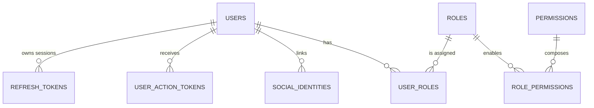

[View the full “Identity and access” diagram](https://images.vinnot.com/docs/diagrams/v1/en/backend-data-database-model-05d57531013d.svg)

### Catalog

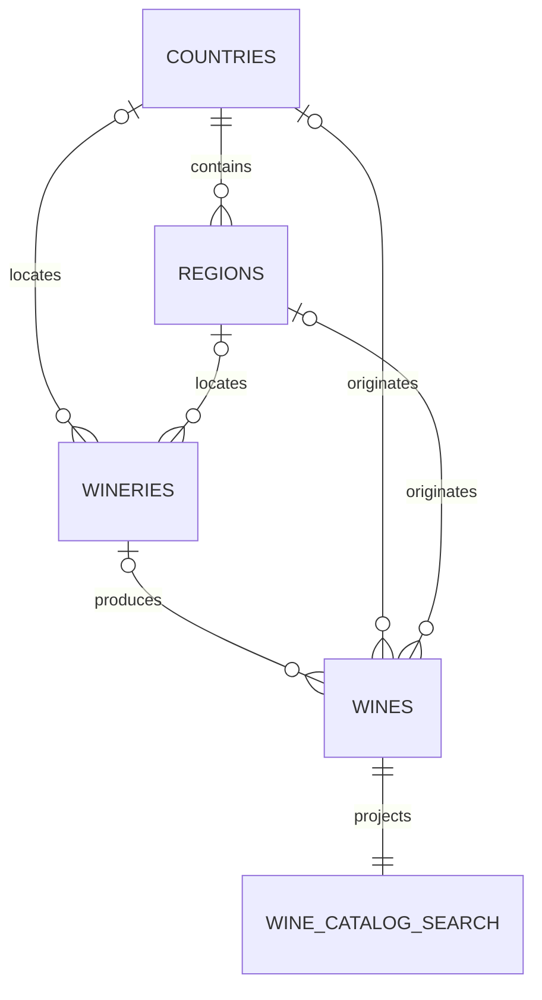

[View the full “Catalog” diagram](https://images.vinnot.com/docs/diagrams/v1/en/backend-data-database-model-0b05e1ee8568.svg)

### Reviews and cellar

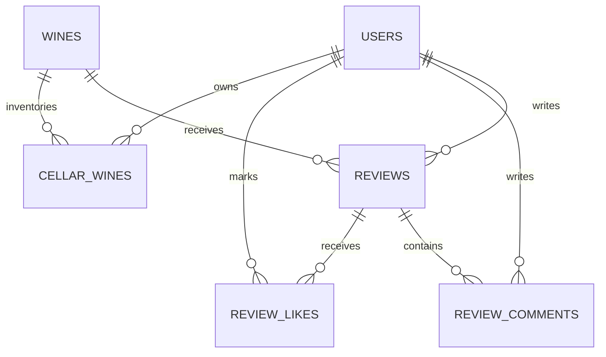

[View the full “Reviews and cellar” diagram](https://images.vinnot.com/docs/diagrams/v1/en/backend-data-database-model-bdfffd3facfd.svg)

### Events and payments

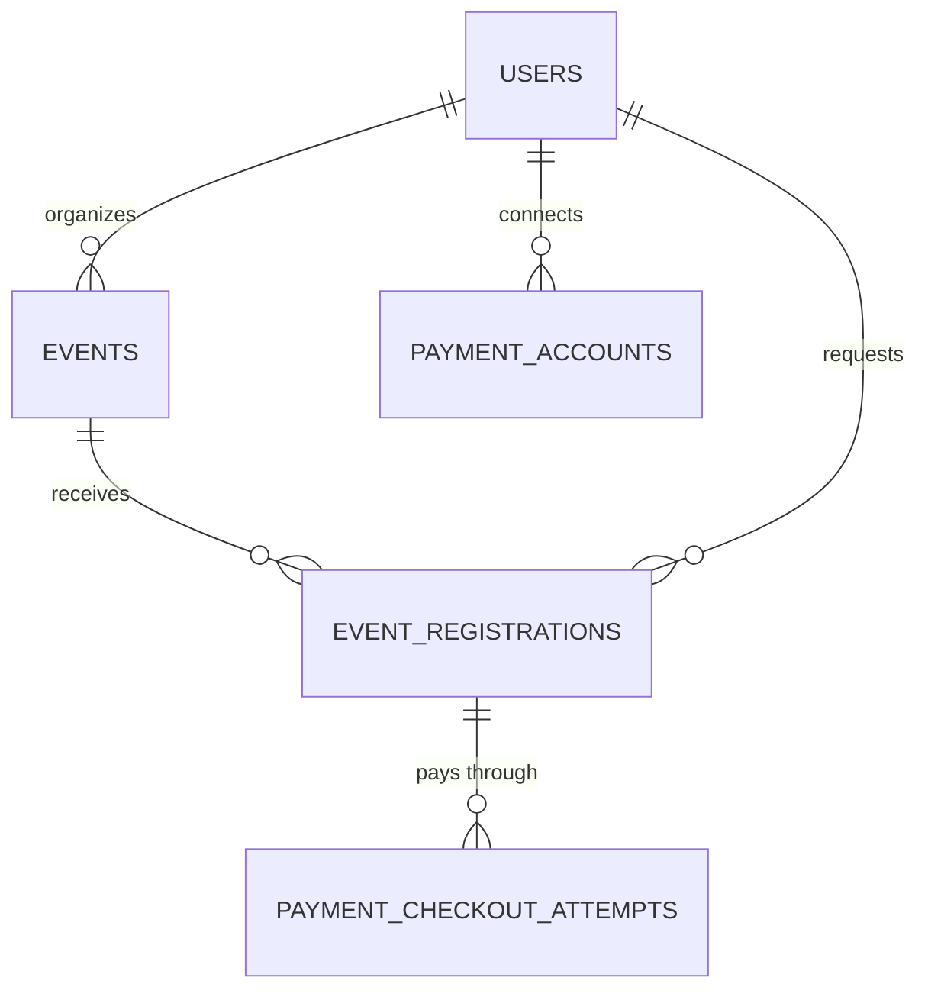

[View the full “Events and payments” diagram](https://images.vinnot.com/docs/diagrams/v1/en/backend-data-database-model-ef5fdd455508.svg)

### Routes

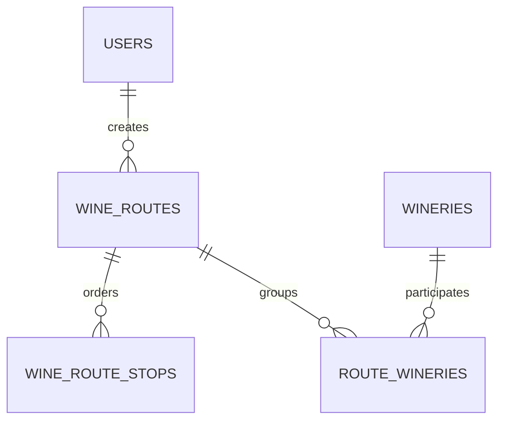

[View the full “Routes” diagram](https://images.vinnot.com/docs/diagrams/v1/en/backend-data-database-model-13a709ff6db3.svg)

### AI and submissions

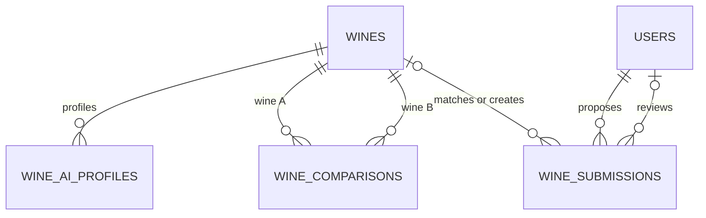

[View the full “AI and submissions” diagram](https://images.vinnot.com/docs/diagrams/v1/en/backend-data-database-model-5c06753fcfac.svg)

## Cross-cutting conventions

- Business aggregates use UUIDs.
- Fields persisted as `timestamp with time zone` map to `Instant` in Java
  entities/adapters; date-only values retain a date type instead of being
  artificially converted to `Instant`.
- `created_at` and `updated_at` provide basic traceability but are not an audit
  log.
- Composition relationships generally use `ON DELETE CASCADE`.
- Historical relationships that may outlive a referenced row use
  `ON DELETE SET NULL`.
- Extensible catalogs store `code`, ES/EN labels, `active`, and `sort_order`.
- JSONB is reserved for variable or generated structures, not to hide
  relationships that need referential integrity.
- Domain code does not depend on JPA entities; adapters map both models.

## Identity and authorization

### `users`

This is the persistent identity root. It stores unique email and username,
hashed password, name, avatar, `active`, `locked`, and `email_verified` flags,
lock reason, last authentication, onboarding state, and timestamps. V28 adds an
optional private `phone_number` checked against `^\+[1-9][0-9]{6,14}$`;
existing users remain without a number. V39 adds `preferred_language`
(`varchar(8)`, default `es`, checked against `es`/`en`) and `timezone`
(`varchar(64)`, IANA identifier, default `America/Argentina/Buenos_Aires`),
both `NOT NULL`; existing users receive the defaults. V62 adds `password_set`
(`boolean NOT NULL`, default `true`), false when the stored password is a random
secret nobody knows. V72 adds `failed_login_attempts` (`integer NOT NULL`,
default 0, `CHECK >= 0`) and `login_locked_until` (`timestamptz`, empty or past
means no lock): the temporary sign-in lockout, separate from the administrative
`locked` flag. Only atomic statements of `LoginAttemptPersistenceAdapter` write
them; JPA maps them read-only and they never change the row version.

Email and username have unique constraints and lower-case indexes for normalized
queries. Primary normalization remains in value objects and handlers; indexes do
not replace that rule.

### `roles`, `permissions`, `user_roles`, `role_permissions`

They implement RBAC with granular permissions. `roles.name` and
`permissions.code` are unique. `role_permissions` uses a composite primary key. `user_roles` uses the unique index
`uq_user_roles_user_role` over `(user_id, role_id)`.

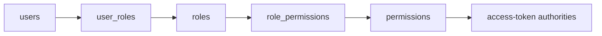

[View the full “roles, permissions, user_roles, role_permissions” diagram](https://images.vinnot.com/docs/diagrams/v1/en/backend-data-database-model-8fc196e2acff.svg)

### `social_identities`

Links a user to a verified Google, Apple, or Facebook subject. Two uniqueness
rules protect the model:

- `(provider, provider_subject)` prevents one external identity from belonging
  to two users;
- `(user_id, provider)` limits one identity per provider and user.

Provider email is metadata; provider + subject is the stable identity.

### `refresh_tokens`

Uses an internal sequential ID and stores only `token_hash`, never the opaque
token. It includes expiration, revocation, reason, replacement hash, device info,
and IP. `replaced_by_token_hash` makes token rotation and replay observable. A
replayed rotated token revokes its successor chain with reason `reuse` (#482).

### `security_events` (V73)

One row per security event of an account: sequential `id`, `user_id`
(`ON DELETE SET NULL`), `event_type` (`varchar(40)` with a `CHECK` over the
twelve types: `LOGIN_SUCCEEDED`, `LOGIN_FAILED`, `LOGIN_LOCKED`,
`REFRESH_REUSE_DETECTED`, `PASSWORD_CHANGED`, `PASSWORD_RESET`, `EMAIL_CHANGED`,
`ROLE_CHANGED`, `ACCOUNT_BANNED`, `ACCOUNT_UNBANNED`, `ACCOUNT_DELETED`,
`ACCOUNT_AUTO_SUSPENDED`), optional `ip_address` (45) and `user_agent` (256),
and `created_at`. Indexes cover `(user_id, created_at)` and `created_at` for the
daily purge of rows older than 180 days. A failed sign-in for an unknown
identifier is stored without `user_id`. `SET NULL` instead of `CASCADE`: deleting
an account removes the link to the person at once, while the unlinked rows stay
until the purge as evidence of attacks; a cascade would also erase the deletion
event itself.

### `user_action_tokens`

Stores one-time token hashes for email verification, password reset, and email
change. It includes type, expiration, consumption, and action context. Cascade
deletion removes pending credentials when the user disappears.

### `notification_preferences` and `marketing_consent_events` (V42)

`notification_preferences` holds one row per user, category and channel
(primary key `user_id, category, channel`), with `CHECK` constraints on the
known categories and channels. A missing row means the category default. Only
optional and promotional categories are stored. `marketing_consent_events` is an
append-only history of consent decisions (`granted`, `source`, `occurred_at`); a
trigger rejects updates, and `idx_marketing_consent_events_user (user_id,
occurred_at DESC)` serves the current-decision lookup. Both cascade when the user
is deleted. V66 adds `REMINDERS` to the `CHECK` categories. A missing row means the
category is on, promotional ones included: an account with no recorded marketing
decision counts as consenting (#347).

### Activity signals (V66)

Four tables hold the signals that personalise suggestions and choose push send
times ([activity](../../modules/activity/README.md)). All have a cascading
`user_id` and are purged in batches after 180 days.

| Table | Primary key | Content |
|---|---|---|
| `content_views` | `user_id, kind, entity_id, view_day` | Opened details: `kind` is `WINE`, `ROUTE`, `EVENT` or `WINERY` (`CHECK`), `entity_id` the content UUID without a foreign key, `views` how often it was opened that UTC day and `last_viewed_at` the latest. One row per day bounds growth. Indexes `(kind, view_day)` and `(view_day)` |
| `user_activity` | `user_id` | `last_active_at`, the last recorded open. It also limits opens to one every 30 minutes through a conditional upsert |
| `app_opens` | `user_id, opened_at` | Recorded opens; their hour in `users.timezone` gives the usual open hour. Index `(opened_at)` |
| `push_opens` | `user_id, ref` | Opened pushes (`ref` up to 180 characters, `type`, `opened_at`), one per `ref`. Index `(opened_at)` |

### Engagement engine (V67)

The ledger, planning marks and lease of the engagement planner
([engagement pushes](../../modules/notifications/architecture.md#engagement-pushes)).
Additive: a previous binary ignores them.

| Table | Primary key | Content |
|---|---|---|
| `engagement_sends` | `user_id, dedupe_key` | One row per engagement push and account (`notification_type`, `content_ref` up to 120 characters such as `WINE:<id>`, `sent_at`, `holdout`), written by delivery while it holds the account's reservation lock, so the budget holds however many pushes race. `holdout` rows record a push the measurement group would have received; nothing was sent. Kept a year (`app.engagement.ledger-retention`), deleted in batches of 5000. `user_id` cascades. Indexes `(user_id, sent_at DESC)`, `(user_id, content_ref)` where `content_ref` is set, `(notification_type, sent_at)` and `(sent_at)` |
| `engagement_planning` | `user_id` | `planned_at`, when the planner last planned the account; a conditional upsert claims an account once per local day. `user_id` cascades |
| `engagement_planner_lease` | `name` | The single `planner` row (`holder`, `lease_until`): one planner run at a time across instances |

V67 also adds `idx_users_timezone_id (timezone, id)`, the index the planner's
keyset pages walk.

### `email_suppressions` (V43)

Addresses that hard-bounced or complained. The primary key `address_hash` is the
SHA-256 hex of the trimmed, lower-cased address, so the table holds no readable
email. `reason` is `HARD_BOUNCE` or `COMPLAINT` (`CHECK`) and keeps the first
reason; `last_event_at` records the latest event. V43 also adds
`idx_external_effects_exhausted_notifications (created_at)` for exhausted
notification jobs, which retention deletes after 30 days.

## Wine catalog

### `wines`

Stores commercial identity and product attributes:

- `name`, `vintage`, `wine_type`, and `style`;
- optional winery, country, and region relationships;
- `grapes` and `allergens` JSONB;
- ES/EN descriptions;
- alcohol, serving temperature, and price range;
- main image, bottle image, and external URL;
- rating aggregates;
- featured, active, and natural flags;
- imported counters and best vintage;
- pairing and SEO name;
- acidity, tannin, body, and sweetness scores;
- creator and timestamps.

Public catalog queries require `is_active=true`. `created_by`, `country_id`,
`region_id`, and `winery_id` use `SET NULL` to retain imported wines after the
referenced row is removed.

There is no hard `(name, winery, vintage)` uniqueness rule: heterogeneous data
sources require normalization and fuzzy identity. Duplicate prevention lives in
use cases and transactional submission locks.

### `wineries`

Stores legal/commercial identity, unique slug, ES/EN content, location, contact,
media, year, status, claim state, imported statistics, and optional country and
region. Removing a location retains the winery through `SET NULL`; removing a
winery retains wines with `winery_id=NULL`.

### Catalogs and geography

| Table | Identity and invariants |
|---|---|
| `wine_types` | unique `code`, ES/EN labels, active, order |
| `grape_types` | unique `name`, Spanish name, category, active |
| `countries` | unique `code` |
| `regions` | unique `(name, country_id)`; required country |
| `event_types` | unique `code`, ES/EN labels, active, order |
| `event_statuses` | same as types plus `is_terminal` |

### `wine_catalog_search`

This is a narrow one-to-one read model for `wines`, designed to search more than
one million rows without bloating the wide catalog heap. It contains:

- `wine_id` as PK and cascade FK;
- `search_vector`, with wine name weight A and winery name weight B;
- lower-case `search_text` concatenating wine and winery.

Two triggers keep it synchronized:

1. wine insert or name/winery update performs an upsert;
2. winery name updates refresh every related wine.

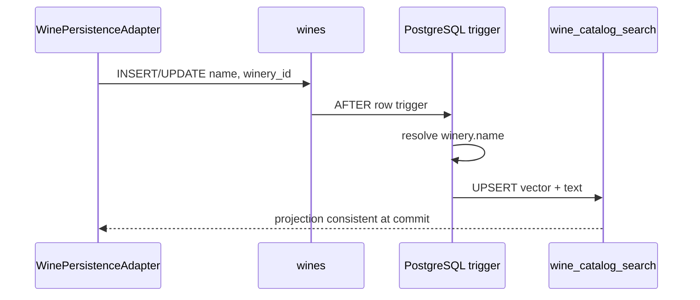

[View the full “wine_catalog_search” diagram](https://images.vinnot.com/docs/diagrams/v1/en/backend-data-database-model-9ce6db6496cb.svg)

Full-text search uses GIN over `tsvector`; partial similarity uses trigram GIN
over `search_text`. See [Query performance](query-performance.md).

### `wine_catalog_filter_search`, `wine_grape_search` and `wine_grape_keys`

V86 adds two read models for searches with filters, also one-to-one or one-to-many
with `wines` and kept in sync by triggers in the same transaction:

- `wine_catalog_filter_search`: `wine_id` (PK, cascade FK), `search_vector`,
  `search_text`, `name`, `is_active`, `winery_id`, `country_id`, `region_id`,
  `wine_type` and `grapes_text`, with one multicolumn GIN over text and filters;
- `wine_grape_search`: one row per wine and grape key (lower-cased, trimmed), with
  the wine name and its filter attributes; PK `(wine_id, grape_key)`, cascade FK and
  a B-tree on `(grape_key, name, wine_id)`;
- `wine_grape_keys`: the distinct grape keys, only added to.

A wine insert, or a change of name, winery, activity, country, region, type or
grapes, refreshes both; a winery rename refreshes the search text of its wines. The
foreign keys were added `NOT VALID` because the rows were loaded from `wines` under
lock; they are enforced for every new row. See
[Query performance](query-performance.md#text-with-filters).

## Community and cellar

### `reviews`

A `(wine_id, user_id)` unique constraint permits one review per user and wine.
It stores decimal rating, title, comment, verification, helpful/like counters,
and timestamps. User and wine FKs cascade. V64 adds the optional tasted `vintage`
(integer, CHECK 1800–2100, no backfill), independent from `wines.vintage`.

### `review_comments`

Every comment belongs to a review and user. Both links cascade. Review/date
indexes support ordered conversations.

### Publication status and decisions (V26)

`reviews` and `review_comments` include `publication_status` with a
`PENDING/APPROVED/REJECTED` CHECK and `PENDING` default; migration preserves
existing records as `APPROVED`. Partial date/ID indexes support the pending queue.
Only approved reviews contribute to public statistics.
The domain explicitly writes `APPROVED` for new reviews (an edit keeps `APPROVED` and returns a pending or rejected one to `PENDING`), and the comment adapter for new comments; the SQL default does not define that policy, and neither change updates existing rows.

`review_publication_decisions` stores type+ID without a content FK, reviewer with
`ON DELETE SET NULL`, final status, reason, exact revision and time. Reviewer,
target and purge-date indexes support access. Audit retention is 90 days.

V25 adds a partial closed-case index on `community_reports` for hourly purging
90 days after closure; actions are cascade-deleted. Open cases are retained.
[Review and retention contract](../../modules/community/architecture.md).

### `review_likes`

`(review_id, user_id)` uniqueness makes likes idempotent at the data layer and
protects races. Denormalized review counters must be updated in the same
transaction as the association.

### `cellar_wines`

Models user-to-wine inventory with purchase price, notes, rating, and timestamps.
`(user_id, wine_id)` is unique, so one logical wine is one aggregated entry, not
multiple lots. V64 adds the optional tasted `vintage` (integer, CHECK 1800–2100,
no backfill); a review with a vintage copies it here. V71 (#455) adds
`rating_decimal numeric(2,1)` (CHECK 0.1–5.0), backfilled from `rating`, and keeps
`rating integer` with its 1–5 CHECK so the previous backend revision still boots
and works. The current backend reads `rating_decimal` and writes both columns on
every save (`rating` gets the decimal rounded half up, kept between 1 and 5, or
null); the sync from a review keeps the decimal. A trigger copies a whole rating
written alone (by the previous revision) into `rating_decimal`, leaving it untouched
when the same whole value is written again. A later migration may drop `rating` and
the trigger once no previous revision can run.

## Events and registrations

### `events`

Besides content, location, price, capacity, and organizer, it stores:

- confirmed `current_attendees`;
- temporary `held_attendees`;
- currency;
- registration deadline;
- per-registration ticket limit;
- manual or automatic approval;
- attendee confirmation requirement;
- hold minutes;
- payment instructions;
- SQL `version` column with default `0`; workflow coordination uses `PESSIMISTIC_WRITE` locks;
- V40 `timezone` (`varchar(64)`, IANA identifier, `NOT NULL`): existing events
  take their organizer's `users.timezone` (or `America/Argentina/Buenos_Aires`),
  and a `BEFORE INSERT` trigger fills it from the organizer when an insert does
  not name one. Event emails show dates in this zone.

Constraints prevent negative holds, capacity usage above `max_attendees`, ticket
limits outside 1–20, holds outside 5–10080 minutes, and unknown approval modes.

### `event_registrations`

Each registration has a UUID, attendee count, contact, JSONB companions, status,
payment status/method, amount, currency, notes, expiration, decision timestamps,
and `version`.

Allowed states are `REQUESTED`, `AWAITING_PAYMENT`,
`AWAITING_ATTENDEE_CONFIRMATION`, `CONFIRMED`, `WAITLISTED`, `REJECTED`,
`CANCELLED`, and `EXPIRED`.

Payment states are `NOT_REQUIRED`, `PENDING`, `REPORTED`, `APPROVED`, `REJECTED`,
`PAY_AT_VENUE`, and `REFUNDED`.

A partial unique index over `(event_id, user_id)` prevents multiple active
registrations while retaining and allowing repeated terminal history. Expiration
indexes support scheduled hold maintenance.

Later additions:

- V31 `externally_managed_payment BOOLEAN NOT NULL DEFAULT false`: only
  server-side checkout preparation transfers payment authority to the provider;
  legacy registrations remain manual.
- V34 `idx_event_registrations_attendee` over `(user_id, created_at DESC, id DESC)`
  supports the attendee's ticket list.
- V35 `notification_version` (`bigint`, default `0`) and `notification_language`
  (`es|en`, default `es`). A `BEFORE` trigger sets the version to 1 on insert
  and increments it when `(status, payment_status)` changes; an `AFTER` trigger
  enqueues two `EVENT_REGISTRATION_CHANGED` rows in `external_effects`
  (`ATTENDEE` and `ORGANIZER`) per new version, deduplicated by
  `event-registration:<id>:<version>:<recipient>`. No provider call runs in
  the database.
- V40 `last_actor_id` (`uuid`, nullable, no foreign key): the user who made the
  latest change, written on every save (NULL when no user acted). The V35
  trigger function is replaced with the same kind, keys and payload, but it
  skips the `ORGANIZER` row when the organizer made the change or when a bulk
  event cancel cancels the registration.

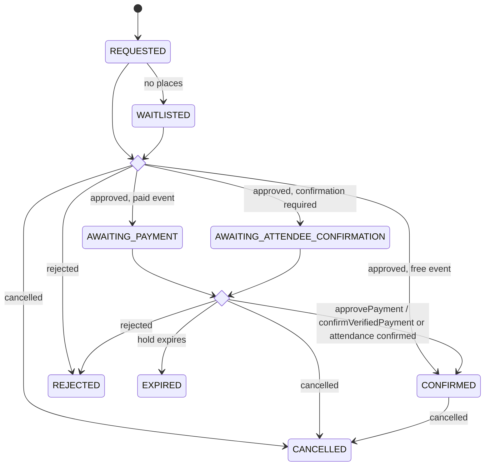

[View the full “event_registrations” diagram](https://images.vinnot.com/docs/diagrams/v1/en/backend-data-database-model-93494c6f563a.svg)

## Online payments (V29–V38)

The `payment` module persists Mercado Pago state separately from event
publication and registration state. Accounts, connection attempts and checkout
attempts carry `environment`
(`SANDBOX` or `LIVE_PILOT` since V33) so pilot records never replace sandbox
records. Tables store no payer or card data.

- `payment_accounts` (V29): organizer authorization per
  `(owner_id, provider, environment)` PK; provider is only `MERCADO_PAGO`.
  Stores `pending_state_hash`, `seller_id`, encrypted access/refresh tokens and
  `expires_at`; a check requires all credential columns to be present or all
  absent. V34 adds `renewal_lease_id`, `renewal_lease_until`,
  `renewal_retry_at`, `reconnect_required` and a partial renewal index. The user
  FK cascades.
- `payment_connection_attempts` (V29): pending OAuth with unique `state_hash`,
  encrypted verifier and `expires_at`. V33 changes the PK to
  `(owner_id, environment)`; V36 adds `return_to_app` and a unique
  `(state_hash, environment)` index. The user FK cascades.
- `payment_checkout_attempts` (V30): one immutable attempt per
  `(registration_id, provider, environment)`, with buyer, organizer, seller,
  title, unit price, quantity 1–20, `ARS` currency, total, commission
  (`commission_amount`, `commission_basis_points`, `commission_policy`),
  expiration and status `PREPARED|CREATING|READY|UNCERTAIN`. V30 pinned 3%
  (300, `VINNOT_3_PERCENT_V1`); V74 generalises it: basis points from 1 to 3000,
  `commission_amount = round(total_amount * commission_basis_points / 10000.0, 2)`
  and policy `^VINNOT_[0-9]+(_[0-9]+)?_PERCENT_V[0-9]+$`. Each row keeps the
  policy it was created with. Only READY carries
  `provider_reference` and `checkout_url`. V37 adds `return_to_app`
  (presentation destination only). Partial indexes support reconciliation.
  V77 makes `buyer_id`, `organizer_id`, `registration_id` and `event_id`
  optional and recreates their FKs (`payment_checkout_attempts_<column>_fkey`)
  with `ON DELETE SET NULL`: when an account is deleted the attempt stays and only
  loses those links.
- `payment_reconciliation_jobs` (V32): one leased job per attempt with
  `next_check_at`, failures and the last failure type. `next_check_at` uses two
  sentinels: `-infinity` for a job woken by a notification (claimed first) and
  `infinity` for a parked job (never polled until woken). V38 adds triggers on
  `event_registrations` (CONFIRMED to another status) and `events` (to
  CANCELLED) that wake jobs of credited payments; no column or data changes.
- `payment_observations` (V32): provider payment evidence keyed by
  `payment_id`, with amount, application fee, refunded amount, provider status
  (`PENDING`, `APPROVED`, `REJECTED`, `CANCELLED`, `REFUNDED`, `CHARGED_BACK`,
  `IN_MEDIATION`), `credited` and `needs_review`. The unique partial index
  `idx_payment_one_credit` allows one credited payment per attempt, even after
  reversal.
- `payment_refund_intents` (V32): one refund per payment with status
  `PREPARED|SENDING|UNCERTAIN|SUCCEEDED|REVIEW|REJECTED`; V63 adds `REJECTED`,
  `rejection_reason` (short code, up to 64 characters) and `rejections` (how many times
  Mercado Pago rejected it, the basis of each retry's key).

Observations, refunds and jobs reference attempts without cascade, and attempts
reference registrations, events and users with `SET NULL` (V77): financial
history is never deleted implicitly. When a buyer's account is deleted (their
registrations cascade) or an organizer's (their events and registrations too),
the attempt and everything attached to it are kept as the financial history of
the operation, with no link to the deleted account. The organizer's payment
account (`payment_accounts`) is deleted with the account.

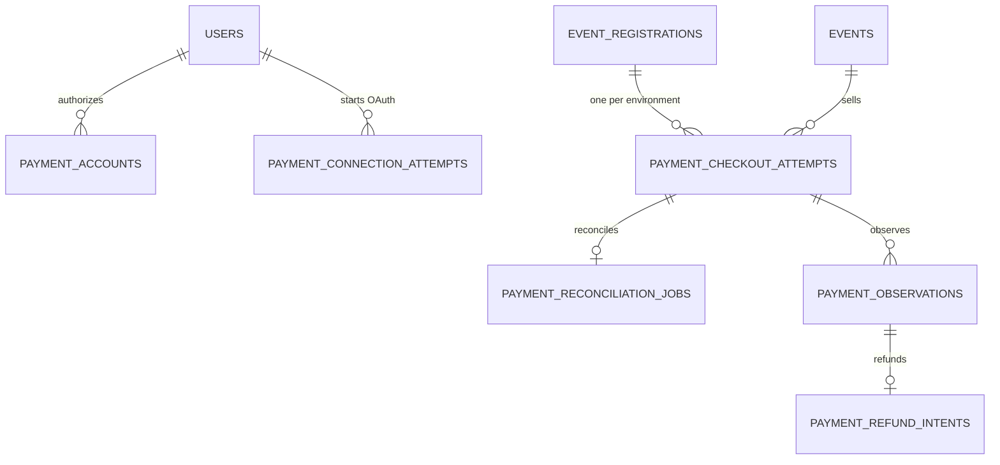

[View the full “Online payments (V29–V38)” diagram](https://images.vinnot.com/docs/diagrams/v1/en/backend-data-database-model-e79c9961880d.svg)

## Wine routes

`wine_routes` stores description, textual geographic hierarchy, duration,
distance, difficulty, media, status, recommended types JSONB, map, creator, and
timestamps.

`wine_route_stops` is the aggregate's ordered collection, with name,
description, type, address, coordinates, `stop_order`, and duration. The route
FK cascades and `(wine_route_id, stop_order)` supports ordered reads.

`route_wineries` retains the historical many-to-many route/winery association.
The current stop model is the richer representation; this association must not
be used to reconstruct details that only exist on a stop.

## AI and distributed coordination

### `wine_ai_profiles`

Stores `profile_json` by `(wine_id, language)`. Language is canonicalized to
`es` or `en`; uniqueness prevents two active versions of one language. JSONB
allows the sensory contract to evolve without one relational column per
generated field.

### `wine_comparisons`

Stores `comparison_json` by canonical `(wine_a_id, wine_b_id, language)`. Both
FKs cascade. The service sorts UUIDs before persistence and reverses orientation
when serving a B/A request.

### `ai_generation_leases`

An ephemeral coordination table with `lock_key`, `owner_id`, and `expires_at`.
`INSERT ... ON CONFLICT` lets one instance generate a bundle while peers wait
and reread cache. The expiration index supports takeover of stale leases.

### AI spending ledger (V23)

`ai_spending_windows` identifies UTC windows by `window_key` and tracks
`reserved_usd` and `spent_usd` as nonnegative NUMERIC(18,8).
`ai_spending_reservations` stores a UUID, model, reserved maximum, optional
observed cost, timestamps, and PENDING, UNKNOWN, or ACCOUNTED outcome.
`ai_spending_reservation_windows` relates each reservation to its windows; the
composite primary key prevents duplicate associations. Both references are FKs
without cascading deletion: deleting a user does not delete accounting history.

Admission uses short REQUIRES_NEW transactions and conditional window updates
in deterministic lock order. A rejected reservation rolls back all windows.
Settlement locks the reservation, is idempotent, and retains unknown costs as
reserved money. Process crashes do not free budget. No prompts, images,
authentication tokens, or user IDs are stored.

These tables complement `provider-capacity:<slot>` leases in
`ai_generation_leases`; they do not change profile/comparison uniqueness.
V23 is additive. Restoring a version that ignores this ledger would remove
spending control for new calls even if the tables remain intact.
[Operational policy](../architecture/resource-protection.md).

## Image inventory and budgets (V27)

`storage_operation_budgets` has primary key `(scope, period)` and nonnegative
`operations`/`bytes_reserved` counters. JDBC adapters reserve balances in
independent transactions so a business rollback or remote failure does not
release uncertain consumption. It accounts for environment and per-user limits.

`managed_cover_images` stores UUID, `owner_id`, `ready`, provider `local|s3|r2`,
kind `EVENT|WINE_ROUTE`, unique URL and creation date. The `(owner_id, created_at)`
index supports inventory/cleanup. `r2_avatar_inventory` uses `image_url` as its
primary key and stores owner/date with the same owner/date index. Owner references
have no foreign key to `users`: inventory must survive resource deletion/rollback
until reconciliation retires the object. These are not catalogue tables and do
not automatically change `wines.image_url`.

Authorization and active references are rechecked against users, events, routes,
wines and submissions before delivering/removing media. Deleting a business row
or knowing a URL does not authorize object deletion. Adapters are
`JdbcCoverImageRegistry`, `R2AvatarInventory` and `R2OperationBudget`; cleanup uses
the durable outbox. [Contract](../use-cases/uploads-and-reference-data.md) and
[R2 operations](../../infra/operations/user-images-r2.md).

## Wine submissions

`wine_submissions` preserves an untrusted proposal without immediately
contaminating the catalog. It includes author, proposed identity, optional
attributes, image URL, status, review reason/confidence, matched wine, created
wine, reviewer, and timestamps.

Allowed states:

- `PENDING`;
- `APPROVED`;
- `DUPLICATE`;
- `REJECTED`;
- `NEEDS_REVIEW`;
- `CHANGES_REQUESTED`.

`matched_wine_id` and `created_wine_id` use `SET NULL`; `submitted_by` cascades;
`reviewed_by` uses `SET NULL`. `image_quarantined` distinguishes media that is
not yet public.

Indexes cover user history, status/date inbox, match lookup, reviewer, and
administrative name/winery searches.

V41 adds the catalog references `country_id`, `region_id`, and `winery_id`
(foreign keys to `countries`, `regions`, and `wineries` with `ON DELETE SET NULL`,
plus partial indexes when set) and `proposed_grapes` (`jsonb NOT NULL`, default
`[]`). The backfill links the country by name or code and the region within that
country, ignoring accents and case; the winery only when the name matches a single
winery; and keeps in `proposed_grapes` the `grapes` entries missing from
`grape_types`.

## Referential deletion policy

| Relationship | Action | Rationale |
|---|---|---|
| user → sessions/roles/tokens | cascade | ownerless credentials are useless |
| user/wine → reviews/cellar | cascade | personal or dependent data |
| event → registrations | cascade | registrations are part of event |
| wine → profiles/comparisons/search | cascade | derived content |
| country/region/winery → wine | set null | retain imported catalog |
| creator → wine | set null | retain product |
| reviewer/match → submission | set null | retain proposal history |
| country/region/winery → submission | set null | retain the proposal |
| author → push switches/changes/announcements | set null | the stored email keeps the audit |
| author → minimum app versions/changes | set null | the stored email keeps the audit |
| user → security events | set null | the link to the person goes at once; the unlinked rows are purged after 180 days |
| user → payment accounts/connection attempts | cascade | credentials without an owner are useless |
| registration/event/user → checkout attempts and payment evidence | no action | financial history is retained |

Technical cascade does not replace privacy rules. Every deletion use case must
declare and implement exactly one semantic: deactivation, anonymization, or
physical deletion. Own-account and wine behavior are specified in their
respective use-case documents.

## Domain/database integrity

A critical rule may live at several levels when each protects a different
threat:

- value objects provide early domain-language errors;
- handlers coordinate ownership and concurrency;
- constraints protect other writers and races;
- unique indexes provide atomicity;
- integration tests prove actual PostgreSQL behavior.

Not every rule belongs in SQL. Complex transitions stay in aggregates; the
database constrains closed sets and essential arithmetic.

## Local data and imports

Large dumps and datasets are local Git-ignored inputs. External dumps are not
executed directly against the destination because they may contain destructive
DDL or incompatible configuration. `scripts/import_vinnot_dump_data.sh` uses a
staging database and loads transformed data into the Flyway-governed schema.

`scripts/import_wines.py` is a separate procedure: it imports winery/wine JSON
through `psycopg2`, with `--wineries-dir` and `--wines-dir` (defaulting to the
Git-ignored `docs/wineries/` and `docs/wines/`). It reads `DB_HOST`, `DB_PORT`,
`DB_NAME`, `DB_USER` and **`DB_PASS`** from the private environment. It inserts
and enriches existing data, committing by phase/batch; it has no dry-run or
whole-run rollback. Test it against a disposable copy and back up the target
before use. New records receive new UUIDs: independent imports do not guarantee
matching IDs across environments. Do not use it to synchronize dev/prod images;
that procedure requires snapshots and identity reconciliation in the
[R2 catalogue runbook](../../infra/operations/catalog-images-r2.md).

Import validation:

1. verify source checksums and encoding;
2. restore to staging;
3. normalize IDs and relationships;
4. run counts and orphan checks;
5. batch-load the target;
6. refresh/analyze projections and indexes;
7. compare functional API samples.

## Schema-change checklist

1. Identify the owning aggregate and consuming use case.
2. Design cardinality, nullability, deletion policy, and concurrency.
3. Add a new migration; never edit applied history.
4. Backfill before adding `NOT NULL`.
5. Build indexes safely for table size.
6. Update JPA, mapper, adapter, and affected ports.
7. Test a clean database and an upgrade from the prior version.
8. Run tests against real PostgreSQL, not only H2 or mocks.
9. Inspect `EXPLAIN (ANALYZE, BUFFERS)` for critical queries.
10. Update this document, API, and runbooks when operations change.

## Source references

- `backend/src/main/resources/db/migration/*.sql`;
- `*/infrastructure/persistence/entity/*JpaEntity.java`;
- `*/infrastructure/persistence/repository/*Repository*.java`;
- `infra/aws-low-cost/docker-compose.yml`;
- `scripts/import_vinnot_dump_data.sh`.

## Relational diagrams by context

The [detailed ERD](../diagrams/relational-model.md) distinguishes primary and
foreign keys, optional relationships, composite uniqueness, and deletion rules.

## Aggregate versions and outbox

users.session_version and refresh_tokens.session_version coordinate revocation. users.revision and wines.revision implement optimistic concurrency. external_effects is a technical queue without an FK to the deletable entity: its payload retains identifiers required for post-deletion reconciliation.

| Column | Contract |
|---|---|
| id | UUID PK |
| kind | handler strategy |
| deduplication_key | UNIQUE |
| payload | JSONB |
| attempts | failed attempts |
| next_attempt_at | next eligibility |
| last_error_type | error class without sensitive content |
| created_at | timestamptz |

The pending partial index covers next_attempt_at, id for attempts < 10; the wines.image_url partial index limits checks to managed labels. [Protocol](../architecture/session-and-data-integrity.md).

## Public support enquiries

`support_request_receipts` contains a UUID PK, a 64-character SHA-256
`content_hash` and `created_at`. It stores no name, email or text. The
`created_at` index supports 30-day expiry. Pending messages live in
`external_effects` as notifications and are discarded after 7 days if
undelivered; the partial index on `created_at WHERE kind = 'SUPPORT_REQUEST'`
only serves rows from before the notifications module.
Receipt and enqueue are atomic, without user FKs because visitors may contact
support. [Contract](../../modules/support/architecture.md).

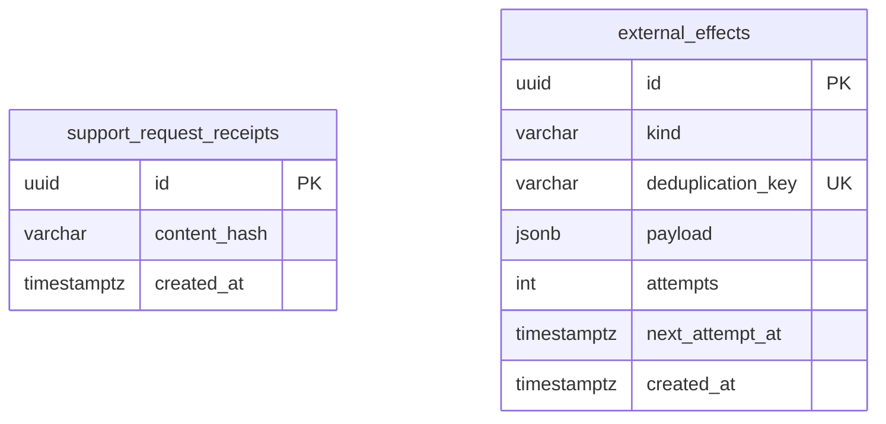

[View the full “Public support enquiries” diagram](https://images.vinnot.com/docs/diagrams/v1/en/backend-data-database-model-04d4822fbfcc.svg)

The link is a logical `support:<UUID>` key rather than an FK: delivery removes
the job while the receipt preserves deduplication.

## Contractual evidence

V21 adds `legal_documents` and `user_legal_acceptances`. The relation to
`users` removes evidence upon permanent account erasure. A composite FK binds
acceptance to exact version, revision, language and hash; the account/type/revision
key prevents duplicates. Historical acceptance is never inferred.

[ER diagram, indexes, triggers and revision semantics](../../modules/legal/architecture.md#relational-model).
