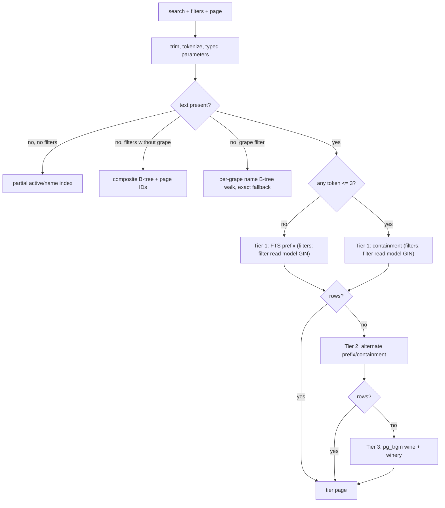
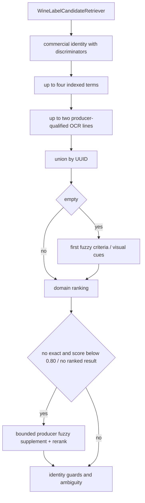

# Query performance and indexing

## Goal

Optimization starts from the actual query and its cardinality. An “important”
column does not justify an index by itself: predicate, ordering, selectivity,
join pattern, and pagination shape must align.

The combined sources of truth are:

- query handlers and ports;
- `WineSearchNativeRepository` and Spring Data repositories;
- migrations `V3`, `V4`, `V14`, `V15`, `V16`, `V61`, `V85`, and `V86`;
- PostgreSQL `EXPLAIN (ANALYZE, BUFFERS)` plans;
- reproducible tests and benchmarks at representative volume.

Concrete measurements are published as reproducible acceptance artifacts; this
document defines the stable method for producing and evaluating new evidence.

## Catalog search pipeline

Public search preserves the product expectation: three characters can recover
wine and winery matches, multiple words and filters work, and reasonable typos
are tolerated. A tiered chain prevents every query from paying fuzzy-search cost.



[View the full “Catalog search pipeline” diagram](https://images.vinnot.com/docs/diagrams/v1/en/backend-data-query-performance-cde93ad50490.svg)

### Prefix tier

Builds `to_tsquery('simple', 'token:* & ...')` against
`wine_catalog_search.search_vector`. Wine name has weight A and winery name has
weight B. Exact full-name matches receive a relevance bonus. The vector GIN
index selects candidates before wide rows are loaded.

### Containment tier

Uses `search_text LIKE '%token%'` for every word. This preserves short-fragment
UX. Text is normalized and trigram indexed; values are bound parameters and are
never interpolated into SQL.

### Fuzzy tier

Runs only when selective stages return no content. It combines two bounded
branches:

- `wines.name` similarity with a 1.0 base;
- `wineries.name` similarity with a 0.75 base.

The name trigram indexes are partial: `idx_wines_active_name_trgm` and
`idx_wineries_active_name_trgm` (V3) cover active rows, and
`idx_wines_inactive_name_trgm` and `idx_wineries_inactive_name_trgm` (V85) cover
inactive rows. The public catalog reads active rows only. The staff search
(`includeInactive=true`) splits each branch into one for active rows and one for
inactive rows, joined with `UNION ALL`, so each uses its partial index. A single
branch over every row compared every catalog name, exceeded the 3000 ms timeout, and
an unmatched search answered 500.

IDs are grouped by maximum relevance before entities are hydrated. The final order is descending relevance, name, and ID over selected candidates;
it does not create a snapshot shared by successive requests.

### Text with filters

When a text search also carries a type, winery, country, region, or grape filter,
every tier selects its candidates from `wine_catalog_filter_search` (V86) instead of
joining `wine_catalog_search` to `wines`. That read model repeats the search vector
and text, and adds the wine name, `is_active`, `winery_id`, `country_id`,
`region_id`, `wine_type`, and `grapes_text` (the grapes JSON as text). One
multicolumn GIN, `idx_wine_catalog_filter_search` (with `btree_gin`), indexes the
vector, the trigrams of the search text, the wine name and the grapes, and the four
equality filters, so PostgreSQL intersects text and filters inside the index and
reads only matching rows:

- country and region names are resolved to ids before the scan
  (`country_id = ANY(ARRAY(SELECT ...))`), which makes them index conditions;
- the grape filter keeps its meaning, `grapes_text ILIKE '%value%'`;
- the typo-tolerant tier compares the read model's wine name, and joins similar
  winery names to the read model's filtered rows;
- every candidate carries its wine name, so the page is ordered by relevance, name,
  and ID before only its wines are loaded.

The previous statements let PostgreSQL walk every wine of a country and probe the
catalog for each one, or read every text match and every filter row. In production
(#531) “merlot” in Argentina exceeded the 2000 ms budget and answered 500; on a
production-shaped copy of the catalog it read up to 162,000 pages, and now reads
about 640. Searches without filters keep their previous statements.

### Queries without text

With no filters, active IDs/names are selected and ordered before a PK join
hydrates only the page. Total count uses `pg_class.reltuples` as an estimate and
falls back to `COUNT(*)` only when no estimate is available.

Filtered queries request `pageSize + 1` rows to determine `hasNext` without an
exact count across millions of wines. The `PageResult.total` is therefore a
minimum estimate for incremental navigation, not an exact-cardinality promise.

### Grape filter without text

A grape filter without text pages wines in name order through `wine_grape_search`
(V86): one row per wine and grape key, the key being the grape lower-cased and
trimmed, with the wine name and its filter attributes. `wine_grape_keys` holds the
distinct keys. The repository:

1. resolves the keys that match the filter with `grape_key ILIKE '%value%'`, the
   per-element version of the previous `CAST(grapes AS TEXT) ILIKE '%value%'`: a
   value with quotes, commas, leading spaces or `null` no longer matches the JSON
   text between elements;
2. walks each key in name order through `idx_wine_grape_search_name_page`
   (`grape_key, name, wine_id`, including the filter attributes), at most 4000
   entries per key, checking the other filters on the index entry;
3. merges the first `offset + size + 1` matches of every key, which contain the
   page, and orders them by name and ID.

A common grape therefore reads a page's worth of entries instead of a lossy bitmap
over every wine of the grape followed by a sort (on the production-shaped copy,
Cabernet Sauvignon went from 69,800 pages to 14). When a key reaches the walk limit with fewer matches,
the other filters are sparse within that grape: the page then comes from the exact
filtered set of `wine_catalog_filter_search`. That set is small when the other
filters are sparse; a page beyond the first 4000 entries of a grape also takes this
path and reads the whole grape (page 210 of a common grape: about 1.3 s). The exact
set still matches the grape on the JSON text, so quoted input can match differently
there than on the walked pages. Filters
without a grape keep their composite name indexes.

### Read model maintenance

Triggers on `wines` and `wineries` maintain both read models in the same transaction
as the write, for every write path:

- inserting a wine, or changing its name, winery, activity, country, region, type,
  or grapes, upserts its `wine_catalog_filter_search` row and replaces its
  `wine_grape_search` rows; new keys are added to `wine_grape_keys`;
- an entity save that rewrites unchanged values does not refresh them;
- renaming a winery refreshes the search vector and text of its wines;
- deleting a wine cascades to both read models.

Keys are never removed from `wine_grape_keys`: a key without wines matches nothing.

## Filter-to-index contract

| Runtime predicate/order | Main support |
|---|---|
| active + name | partial `idx_wines_active_name_page` |
| text + type, winery, country, region, or grape (every tier) | multicolumn GIN `idx_wine_catalog_filter_search` over `wine_catalog_filter_search` |
| grape without text + name, with or without other filters | `idx_wine_grape_search_name_page`; sparse combinations fall back to `idx_wine_catalog_filter_search` |
| staff listing with inactive wines, no filters | `idx_wines_active_name_page` plus the partial `idx_wines_inactive_name_page` |
| staff fuzzy tier with inactive wines | active branches through `idx_wines_active_name_trgm` and `idx_wineries_active_name_trgm`, inactive branches through `idx_wines_inactive_name_trgm` and `idx_wineries_inactive_name_trgm` |
| active + country + name | `idx_wines_active_country_name_page` |
| active + region + name | `idx_wines_active_region_name_page` |
| active + type + name | `idx_wines_active_type_name_page` |
| country + region + type + name | equivalent partial composite index |
| active + rating | `idx_wines_active_type_rating` and rating/popular indexes |
| featured | partial `idx_wines_active_featured_only` |
| wine/winery identity | vector and trigram GIN on `wine_catalog_search` |
| active winery + name | ordering B-tree plus name trigrams |
| public event window | `(status, end_date, start_date)` |
| event registrations | event/status/date and user/status/date |
| expired holds | partial `expires_at` index |
| wine reviews | wine/date, likes, and rating |
| comments | review/date |
| published routes by geography | status/country/region and hierarchy |
| submissions | status/updated, user/created, name/winery trigrams |

A change in `WHERE`, `JOIN`, `ORDER BY`, nullability, or data distribution
requires an index review. Index existence does not guarantee planner usage.

## Label matching

The application retriever first uses commercial identity when discriminators exist, up to four indexed views and up to two complementary OCR lines qualified by producer. It unions by UUID. An empty union triggers the first fuzzy criterion. A nonempty union with no usable or sufficiently strong ranking can trigger one producer-focused fuzzy supplement. SQL retrieves candidates; it does not decide EXACT_MATCH.

### Queries and weights

| Method | Selection | Per-query hint |
|---|---|---|
| findByCommercialIdentity | product/discriminator containment | 1500 ms |
| findByIndexedIdentity | FTS over at most 2000 matches + wines of the 50 most similar wineries | 750 ms |
| findByFuzzyMatch | ILIKE over at most 2000 wine names + pg_trgm or ILIKE over winery (50 most similar) | 1500 ms |
| findByProducerIdentity | ILIKE and FTS over at most 500 wineries each, 5 most similar whole-word producers | 750 ms |
| findByVisualCues | type/grape/vintage, no readable terms | 1500 ms |

Fuzzy compares each term against both fields; its SQL score weights best wine similarity 0.55 and winery similarity 0.35, plus vintage 0.05, grape 0.05 and type 0.03 when evidence exists. The prefilter keeps at least 200 candidates or five times the requested limit; final selection orders by match_score and ID. Indexed branches have LIMIT before the outer sort: final tie-breaking orders already retrieved candidates, not an exhaustive selection. A common word ("malbec", "reserva") matches a large share of the catalog; ranking every match read hundreds of MB from disk and exceeded the hint in production (2.8 to 8.3 s). The FTS branch therefore ranks at most 2000 matches (twice the limit before inactive wines are dropped), and the fuzzy wine branch finds the term with ILIKE over at most 2000 names, without the `%` operator on `wines.name`, which scanned the table (3.4 to 4.9 s). Below 2000 matches the result is unchanged; typo tolerance stays in the winery branch. A generic label phrase ("Single Vineyard", "Bodega") also resembles thousands of winery names: joining the wines of all 1,877 wineries similar to "Single Vineyard" took 4.4 s in production. Both winery branches therefore expand only the 50 most similar wineries (ties broken by ID) into their wines. Over 75 real catalog labels and generic phrases the top 60 stayed identical except for ties between equally similar wineries in single words ("Reserva", "Chateau", "Domaine"), and the expected wine was never lost.



[View the full “Queries and weights” diagram](https://images.vinnot.com/docs/diagrams/v1/en/backend-data-query-performance-cbc9a580ad19.svg)

Label query timeouts are translated to WineLabelCatalogSearchTimeoutException and the retriever decides whether to continue. Hints apply to each submitted query; the application separately checks a shared monotonic deadline between stages and queries. An optional supplement timeout preserves usable suggestions, but an unrecovered catalog failure is not NO_MATCH. OCR, aliases, scoring and response details are maintained in [backend scanning](../../modules/wines/architecture.md).

## Avoiding N+1 and wide-row work

- Catalog pages select IDs before hydrating `wines.*`.
- Route details explicitly fetch stops.
- Likes for several reviews use `reviewId IN (...)`, not one query per row.
- Comment counts aggregate by review ID.
- Administrative responses use query projections/adapters when no aggregate is
  required.
- Dashboard counts per module without materializing entities.

Every lazy relationship must be evaluated from the serialization boundary. A
controller must not depend on an open Hibernate session; projections are built
inside transactional adapters or handlers.

## Pagination and deterministic order

The wine-controller policy validates page/size and limits the public window; `PageQuery` carries parameters and `PageMapper` builds Pageable. Using these types does not imply universal validation across modules.

Browse and filtered no-text queries order by name. Text tiers order output by relevance, name and ID. PREFIX/CONTAINMENT limit candidates before the outer order; FUZZY also orders its branches. The first tier with content on the requested page determines the response. These queries neither maintain a cross-request snapshot nor union all tiers.

Reading size+1 produces a lower-bound navigation total; browse uses reltuples estimates with COUNT fallback. Public API clips the total to 500. Interpret it as an estimate/window, not an exact global count. See [search contract](../../modules/wines/architecture.md).

## Timeouts and degradation

JPA hints express per-operation budgets:

| Operation | Current budget |
|---|---:|
| label fuzzy/commercial/visual | 1500 ms |
| indexed/producer label fallback | 750 ms |
| catalog prefix/no text | 2000 ms |
| catalog containment/fuzzy fallback | 3000 ms |

A timeout is a protection limit, not a latency target. Increasing it without
examining the plan can turn isolated degradation into pool exhaustion. Every
fallback must preserve sufficient semantics and emit telemetry that separates
“no results” from “degraded query.”

## Planner statistics

`V16` increases statistics where combined distributions need them and runs
`ANALYZE`. Statistics must be refreshed after a bulk import or read-model
rebuild. Stale statistics can choose sequential scans despite correct indexes.

The low-cost host configures PostgreSQL with constrained memory:
`shared_buffers=96MB`, `effective_cache_size=768MB`, `work_mem=2MB`, and 20 maximum
connections. Queries must work within that budget; a sort/hash that is cheap on
a workstation may spill to disk in runtime.

## Analysis method

For every critical query:

```sql
EXPLAIN (ANALYZE, BUFFERS, VERBOSE, SETTINGS)
SELECT ...;
```

Inspect:

- estimated versus actual rows;
- index, bitmap, or sequential scans;
- buffers hit/read/dirtied;
- sort method and disk spill;
- internal-node loops;
- rows removed by filter;
- planning and execution time;
- parameters and selectivity of a real case.

Never run `EXPLAIN ANALYZE` for production `UPDATE/DELETE` without a reversible
transaction or representative copy.

## Acceptance gates

Semantic tests verify results; benchmarks verify cost. A serious gate includes:

- empty, small, and production-scale catalogs;
- exact terms, prefixes, three characters, multiple words, and typos;
- wine and winery names;
- isolated and combined filters;
- early and deep pages;
- Argentinian, global, negative, and repeated labels;
- p50/p95/p99 and timeout rate;
- exact match, top-3 recall, and false positives;
- stability across repetitions;
- query-plan evidence and schema version.

Latency cannot be optimized by degrading accuracy. Scanning and manual search
have separate metrics because their contracts and budgets differ.

## Forbidden anti-patterns

- `LOWER(column)` without an equivalent expression index on critical paths;
- `%term%` over a large table without trigrams;
- exact count on every page when product does not require it;
- sorting wide rows before limiting IDs;
- lazy fetch from serializers;
- concatenating user input into SQL;
- redundant “just in case” indexes;
- increasing global timeouts to hide poor plans;
- benchmarking only in memory/H2;
- caching without invalidation strategy.

## Change checklist

1. Capture the real query and parameters.
2. Run the baseline plan.
3. Confirm volume, cardinality, and distribution.
4. Design query and index together.
5. Preserve contract results and ordering.
6. Test migration and index-build cost.
7. Run PostgreSQL tests and benchmarks.
8. Compare before/after plans.
9. Review write amplification and index size.
10. Update documentation and alerts.

## Search contract and limit audit (#165)

The 2026-10-01 audit follows controller → query → handler → port →
`WineSearchNativeRepository`, plus both clients' mappers. It introduces no
optimizations, indexes, ranking changes or count changes.

| Input | Observed behavior |
|---|---|
| text, type, winery, country, region and grape | The handler forwards these filters to the port; current browse UIs expose text/type/country/region/grape |
| vintage, minimum/maximum price, minimum rating, featured and sorting | Controller/query accept these fields, but `SearchWinesQueryHandler` does not forward them to `searchAdvanced`; they are not effective filters of that endpoint |
| frontend filter arrays | Mappers select the first value in several fields; there is no general multiselect contract |
| frontend sorting | Web maps price/rating to backend names; mobile omits `createdAt`. The handler does not apply those orders |
| exclusively non-Latin text or punctuation | `parseSearchWords` discards tokens without ASCII characters accepted by `\p{Alnum}`; no tokens means browse with filters retained |
| accents | Prefix strips characters outside that pattern; containment retains the original token. `Éxito` matches through fallback without guaranteeing uniform Unicode normalization |
| candidates and pages | PREFIX/CONTAINMENT limit before ordering; browse ties only by name. Neither cross-request stability nor exhaustive candidate selection follows from outer tie-breaking |
| totals | size+1 is a navigation lower bound; reltuples estimates the entire table and may include inactive rows. The controller window remains capped at 500 |

**Authorized bug fix:** PREFIX joined its last predicate directly to `LIMIT`,
producing, for example, `:wineryIdLIMIT`. Only the separating space was added.
`WinePersistenceAdapterPostgresIntegrationTest` reproduces text + winery, two
pages, distinct IDs and the fixture total; it also characterizes accents,
punctuation and non-Latin text against real local PostgreSQL.

Accepted but ignored fields are a backend contract mismatch, rather than proof
of a broken visible control in current browse UIs. Parser, ordering, totals and
partial URL state are verified limitations requiring a separate decision before
behavior changes. Local index/EXPLAIN tests do not certify production-volume
latency or stability. No AWS load test was run.

Sources: `wine/infrastructure/web/controller/WineReadController.java`,
`wine/application/query/model/SearchWinesQuery.java`,
`wine/application/query/handler/SearchWinesQueryHandler.java` and
`wine/infrastructure/persistence/search/WineSearchNativeRepository.java` under
`backend/src/main/java/com/vinnot/`; web `wines.service.helpers.ts` and mobile
`wines.service.ts` in their application services.
