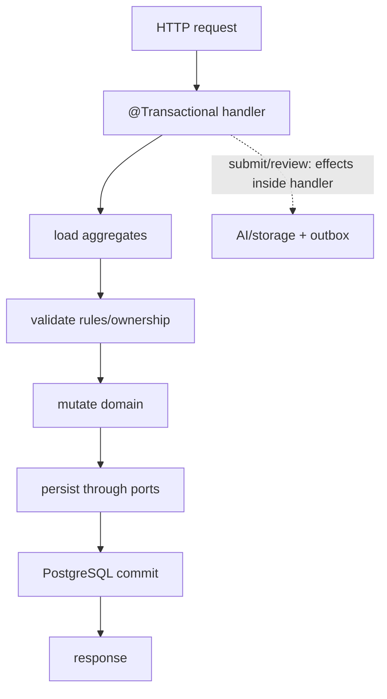
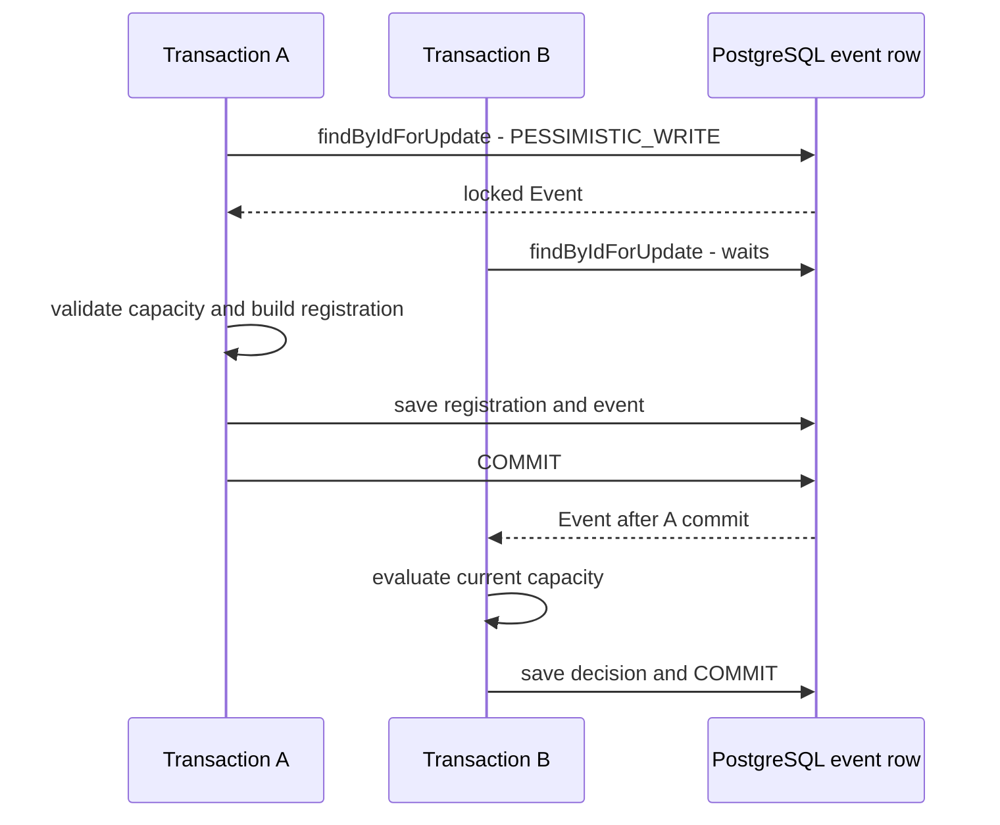
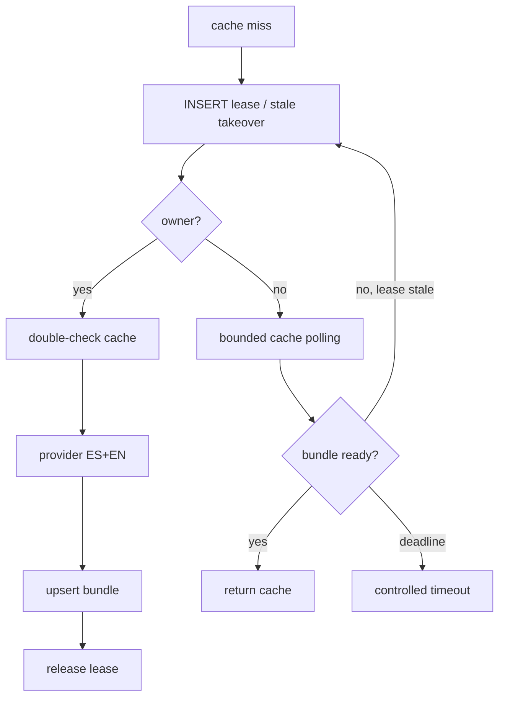
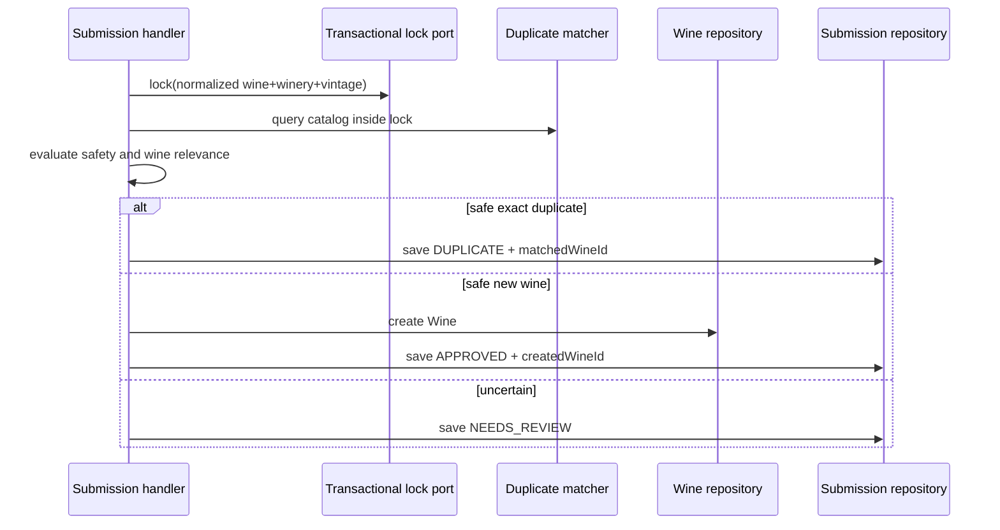
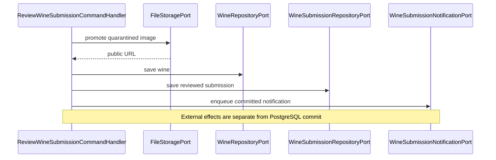

# Data, locks, and consistency

## Transaction boundaries

[View the full “Transaction boundaries” diagram](https://images.vinnot.com/docs/diagrams/v1/en/backend-diagrams-data-consistency-f8d379869e8d.svg)

Annotated handlers define transactions; the proxy commits after normal return.
Submit/review perform recognition, moderation, storage, or notification within
that orchestration. AI coordination and account-avatar cleanup have their own
boundaries described in the corresponding use cases.

## Event capacity under concurrency

[View the full “Event capacity under concurrency” diagram](https://images.vinnot.com/docs/diagrams/v1/en/backend-diagrams-data-consistency-2cc32188a433.svg)

This sequence represents two registrations locking the same Event. No @Version column is involved. Constraints protect counters >= 0 and current_attendees + held_attendees <= max_attendees when a maximum exists. Review, confirmation and expiry lock event before registration. Expiry uses one short transaction per hold.

## AI single-flight

[View the full “AI single-flight” diagram](https://images.vinnot.com/docs/diagrams/v1/en/backend-diagrams-data-consistency-1dcb1e42f4d9.svg)

Leases expire for crash recovery. Keys distinguish profiles by wine and
comparisons by canonical pair. A comparison without a reusable bundle requires
a validated provider response even for sparse pairs; it does not create a catalog
template. Generation failure never publishes a partial bundle.

## Submission identity coordination

[View the full “Submission identity coordination” diagram](https://images.vinnot.com/docs/diagrams/v1/en/backend-diagrams-data-consistency-c420b39ced00.svg)

The recheck is mandatory even if scanning found no match: another request may
have created the wine between both operations.

## Database versus storage

[View the full “Database versus storage” diagram](https://images.vinnot.com/docs/diagrams/v1/en/backend-diagrams-data-consistency-60eb895c021d.svg)

Promotion copies the image. TransactionalFileStorageAdapter records reconciliation before writing and enqueues deletions; the worker checks references and cleans up after commit. Every email, account emails included, goes through the [notification module](../../modules/notifications/architecture.md), which writes it to the same outbox inside the business transaction; no business transaction waits on the email provider. PostgreSQL and storage do not share a distributed transaction.

## Search projection consistency

Triggers update `wine_catalog_search` inside the same transaction as wine or
winery-name changes. The read model is therefore commit-consistent without
asynchronous consumer lag.

## Review rules

- document isolation/locking when a rule depends on concurrency;
- use unique/check constraints as the final barrier;
- never map `OptimisticLockException` to “not found”;
- avoid irreversible effects before validation;
- make retries idempotent;
- observe lock wait and conflict rates;
- test two real transactions, not only mocks.

## Sessions and publication

Concurrent refresh, atomic publication and outbox sequences are documented in [sessions and external effects](../architecture/session-and-data-integrity.md).
