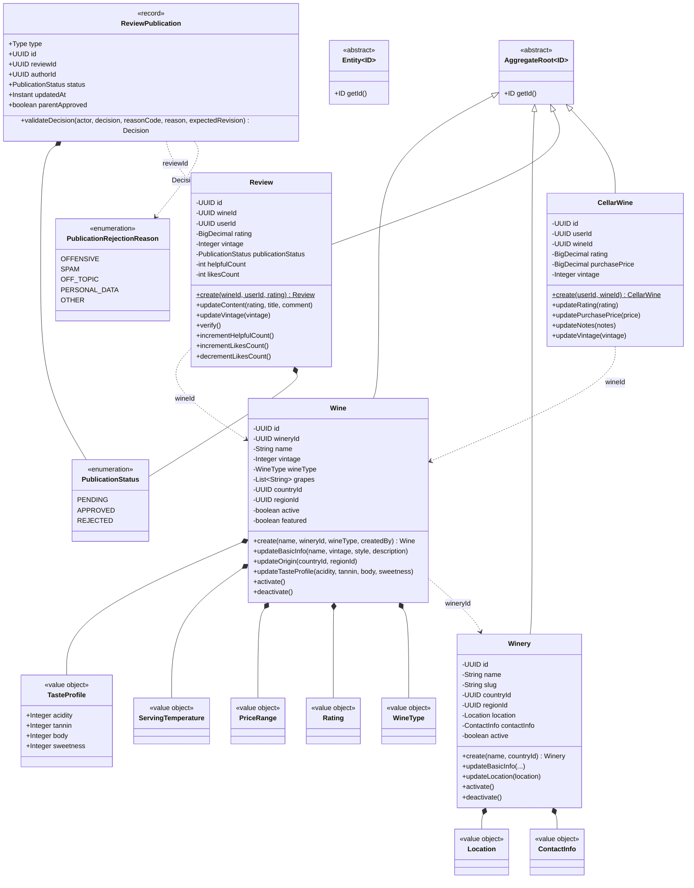
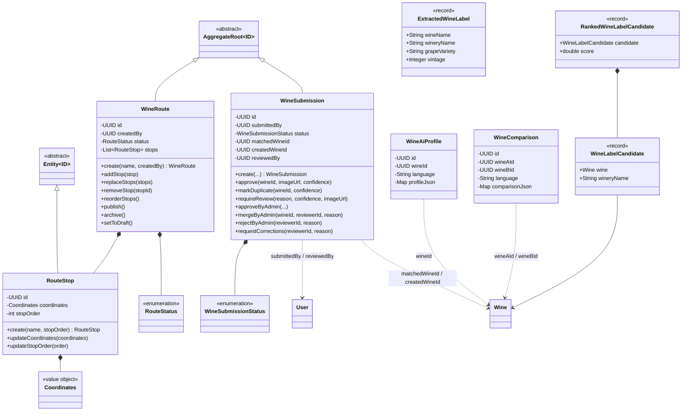
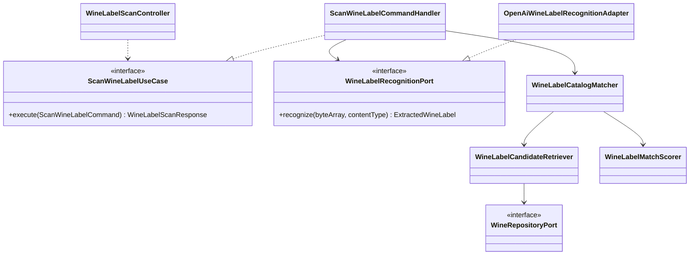
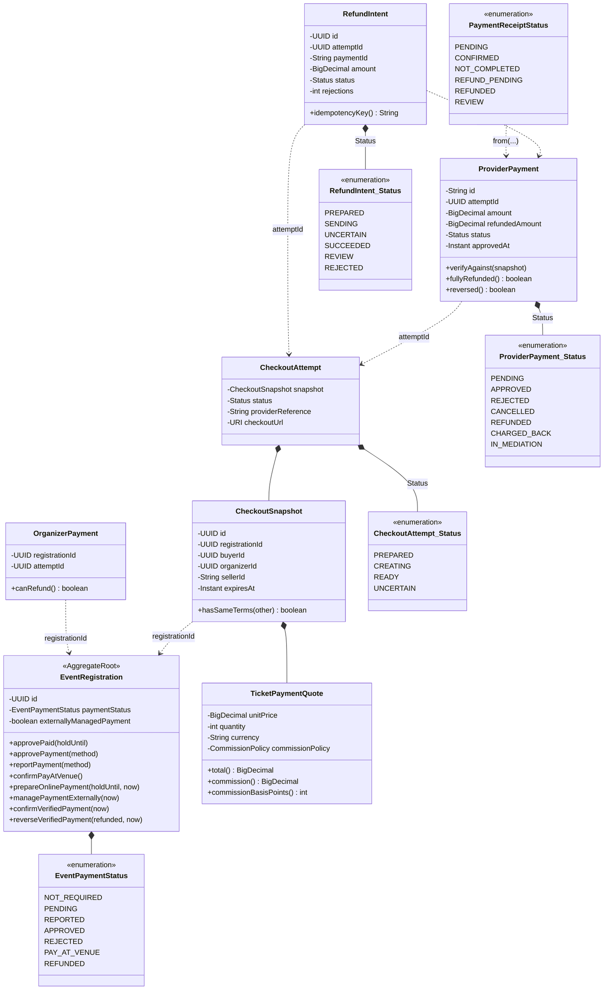
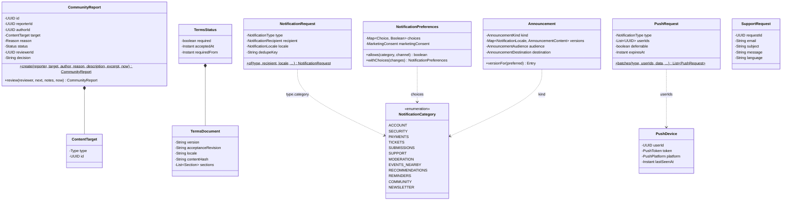
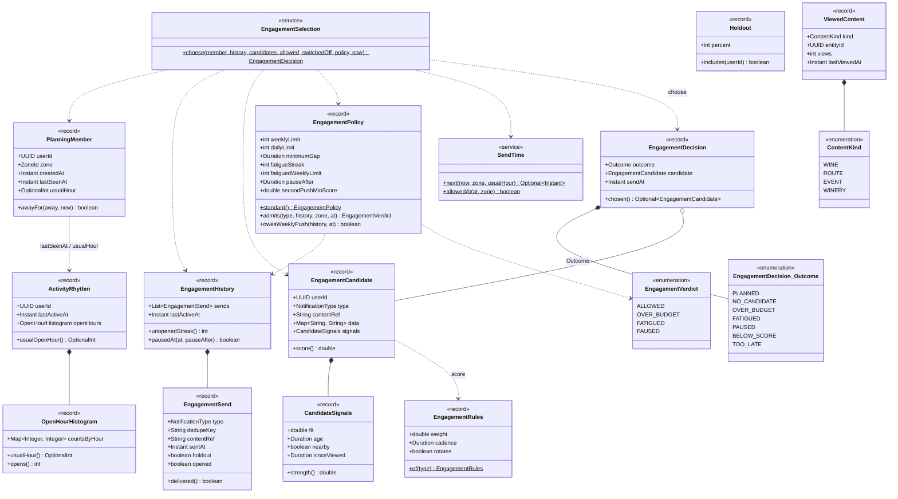

# UML domain model

## Scope and notation

These class diagrams represent the domain model implemented under
`backend/src/main/java/com/vinnot`. They do not represent JPA entities or
database tables. Their purpose is to show aggregates, entities, value objects,
behavior, and identity dependencies across modules.

- `AggregateRoot` and `Entity` are shared domain abstractions.
- Composition (`*--`) means that the aggregate owns the in-memory object
  lifecycle.
- A dotted dependency (`..>`) means that the model stores a UUID or uses a type
  from another concept; it does not imply JPA navigation between aggregates.
- Getters, builders, and projection-only fields are omitted for readability.
  Included attributes and operations express identity, invariants, or relevant
  transitions.

## Foundations, catalog, and community

[View the full “Foundations, catalog, and community” diagram](https://images.vinnot.com/docs/diagrams/v1/en/backend-diagrams-domain-class-model-ddb7b886d63b.svg)

`Wine`, `Winery`, `Review`, and `CellarWine` belong to separate modules.
Dependencies between them are resolved by use cases through ports; the diagram
does not authorize direct references across repositories or JPA entities.
A new review starts as `PublicationStatus.APPROVED`; `ReviewPublication` is the
shared view of reviews and comments a moderator decides, and a rejection carries
a `PublicationRejectionReason`. `vintage` on `Review` and `CellarWine` is the
optional vintage the person tasted, independent of the catalog wine vintage.

## Identity and events

```mermaid
classDiagram
    class AggregateRoot~ID~ {
        <<abstract>>
    }
    class User {
        -UUID id
        -String username
        -Email email
        -Password password
        -long sessionVersion
        -Set~Role~ roles
        -boolean passwordSet
        -boolean active
        -boolean locked
        -String lockReason
        -boolean emailVerified
        -boolean onboardingCompleted
        -PreferredLanguage preferredLanguage
        -UserTimezone timezone
        +create(email, password, firstName, lastName)$ User
        +createSocial(...)$ User
        +changePassword(password)
        +revokePassword(unusablePassword)
        +verifyEmail()
        +updatePreferences(language, zone) boolean
        +completeOnboarding()
        +addRole(role)
        +lock(reason)
        +unlock()
        +recordLogin()
    }
    class SuspensionReason {
        <<enumeration>>
        SPAM
        HARASSMENT
        FRAUD
        IMPERSONATION
        TERMS_VIOLATION
        OTHER
    }
    class SocialIdentity {
        <<record>>
        +UUID userId
        +SocialProvider provider
        +String providerSubject
    }
    class UserActionToken {
        <<record>>
        +UUID userId
        +UserActionTokenType type
        +Instant usedAt
        +Instant expiresAt
    }
    class Event {
        -UUID id
        -EventDateRange dateRange
        -EventCapacity capacity
        -EventRegistrationSettings registrationSettings
        -EventStatus status
        -boolean publishedOnce
        -long scheduleVersion
        -UUID organizerId
        +create(title, type, dateRange, organizerId)$ Event
        +publish()
        +cancel()
        +complete()
        +transitionTo(status)
        +holdAttendees(count)
        +confirmHeldAttendees(count)
        +releaseHeldAttendees(count)
    }
    class EventCancellation {
        <<value object>>
        +EventCancellationReason reason
        +String note
        +unspecified()$ EventCancellation
    }
    class EventCancellationReason {
        <<enumeration>>
        UNFORESEEN_CIRCUMSTANCES
        SCHEDULING_CONFLICT
        VENUE_UNAVAILABLE
        INSUFFICIENT_ATTENDANCE
        WEATHER
        HEALTH_AND_SAFETY
        OTHER
    }
    class EventRegistration {
        -UUID id
        -UUID eventId
        -UUID userId
        -int attendeeCount
        -EventRegistrationStatus status
        -EventPaymentStatus paymentStatus
        +request(...) EventRegistration
        +approveFree(holdUntil, confirmationRequired)
        +approvePaid(holdUntil)
        +confirmAttendance()
        +approvePayment(method)
        +waitlist(reason)
        +reject(reason)
        +cancel()
        +expire(now)
    }
    class Email { <<value object>> }
    class Password { <<value object>> }
    class Role { <<value object>> }
    class EventDateRange { <<value object>> }
    class EventCapacity { <<value object>> }
    class EventRegistrationSettings { <<value object>> }

    AggregateRoot <|-- User
    AggregateRoot <|-- Event
    AggregateRoot <|-- EventRegistration
    User *-- Email
    User *-- Password
    User o-- Role
    User ..> SuspensionReason : lockReason
    SocialIdentity ..> User : userId
    UserActionToken ..> User : userId
    Event *-- EventDateRange
    Event *-- EventCapacity
    Event *-- EventRegistrationSettings
    Event ..> User : organizerId
    EventCancellation *-- EventCancellationReason
    EventCancellation ..> Event : saveCancelled
    EventRegistration ..> Event : eventId
    EventRegistration ..> User : userId
```

[View the full “Identity and events” diagram](https://images.vinnot.com/docs/diagrams/v1/en/backend-diagrams-domain-class-model-1d904310f025.svg)

Capacity is protected by the `Event` aggregate; request and payment state belong
to `EventRegistration`. IDs connect aggregates without turning the model into a
single mutable object graph. `publishedOnce` is explained in
[state machines](domain-state-machines.md#events); `scheduleVersion` only grows
and counts the changes attendees are told about (start, end or the venue as
people read it, name and address), so it keys each change notice.
`EventCancellation` is a cancellation's reason, which
`EventCancellationService.saveCancelled` stores with the event. On `User`,
`passwordSet` tells whether the person chose the password, and a suspension is
`lock` with `lockReason` = the `SuspensionReason` code or `CODE: detail`
([account axes](domain-state-machines.md#account-independent-axes)).

## Routes, submissions, and AI

[View the full “Routes, submissions, and AI” diagram](https://images.vinnot.com/docs/diagrams/v1/en/backend-diagrams-domain-class-model-86cd31c4bed7.svg)

Profiles and comparisons are persisted content models in the `ai` module;
generation, leases, and caching are coordinated in the application and
infrastructure layers. Label matching uses pure models and services from the
`wine` module, while OCR/vision adapters remain outside the domain.

## Application collaboration: scanning

This UML supplements domain classes with a concrete application collaboration.
Realization points from handler/adapter to its interface; dependencies point to
the used type. It does not represent execution order, which is covered by the
[scan workflow](../../modules/wines/architecture.md).

[View the full “Application collaboration: scanning” diagram](https://images.vinnot.com/docs/diagrams/v1/en/backend-diagrams-domain-class-model-a1851891c215.svg)

The controller adapts multipart; the handler orchestrates and measures; the
matcher applies normalization/ranking; the retriever uses the catalog port; the
scorer remains in domain; the visual adapter implements the external contract.
The handler also uses `WineLabelScanPolicy` and `WineLabelMetricsPort`, omitted
from this diagram to keep the view readable.

## Payments

[View the full “Payments” diagram](https://images.vinnot.com/docs/diagrams/v1/en/backend-diagrams-domain-class-model-fd184b63d3e6.svg)

The `payment` module types are immutable records: a status change builds a new
record in the service or the persistence layer. The registration
(`EventRegistration`, `event` module) is the only aggregate that payments change.
`CheckoutAttempt.Status`, `ProviderPayment.Status` and `RefundIntent.Status` are
enums nested in their record: the chart names them `CheckoutAttempt_Status`,
`ProviderPayment_Status` and `RefundIntent_Status` because Mermaid does not
accept the UML qualified name `CheckoutAttempt::Status`; each record's `status`
attribute has that nested type. `OrganizerPayment` is a read
view for the organizer. The states are described in
[Payments](../../modules/payments/README.md) and in [state machines](domain-state-machines.md#registration-payment).

## Community, legal, notifications, and support

[View the full “Community, legal, notifications, and support” diagram](https://images.vinnot.com/docs/diagrams/v1/en/backend-diagrams-domain-class-model-e443a8d1bd3b.svg)

These modules have no aggregates either: their domain types are immutable records
and orchestration lives in application services and ports. `CommunityReport.review`
returns a new report and applies the moderation rules. `ContentTarget` points by
UUID to content owned by other modules (review, comment, user, event or route).
User blocks, terms acceptance and push type switches exist only as ports and
adapters, with no domain class. `NotificationType` sets each notice's category; the
category decides whether it is transactional, optional or promotional.

## Engagement and activity

[View the full “Engagement and activity” diagram](https://images.vinnot.com/docs/diagrams/v1/en/backend-diagrams-domain-class-model-003c0d31fa12.svg)

The `engagement` and `activity` types are immutable records with no aggregate:
the planner run builds them in `EngagementPageService` and stores the outcome
through ports. `EngagementSelection.choose` filters the account's candidates by
allowed category and type, cadence and category limit, picks the best score
(`EngagementRules.weight` times the `CandidateSignals` strength) and asks
`EngagementPolicy` for the budget verdict. `SendTime` sets the send time between
09:00 and 21:59 local time; with no possible time the outcome is TOO_LATE.
`Holdout` sets apart a stable percentage of accounts by hashing the UUID.
`PlanningMember` is built from `ActivityRhythm`: its last open and its usual
hour. `ViewedContent` feeds the candidate sources for wines viewed without a
review and for winback. `EngagementDecision.Outcome` is a nested enum, named
like the payment ones. The full flow is in
[engagement pushes](../../modules/notifications/architecture.md#engagement-pushes)
and [activity](../../modules/activity/README.md).

## Related diagrams

- [ERD and relational model](../data/database-model.md)
- [State machines](domain-state-machines.md)
- [Module map and hexagonal slice](system-map.md)
- [Consistency, locks, and caches](data-consistency.md)
