# Domain state machines

## Scope

These views distinguish persisted states, independent flags and protocol steps. Arrows represent existing methods, not actions exposed by every screen. Tables specify guards that do not fit in the diagram.

## Events

`publishedOnce` is independent of status: publication sets it, while cancellation,
postponement and completion retain it. Public reads require this flag and a
status other than DRAFT. Cancelling a new draft therefore does not publish it;
cancelling a published event preserves its historical link. V22 initializes
legacy non-DRAFT events to preserve already exposed links.

Typical lifecycle; the following table defines the calls allowed by the aggregate:

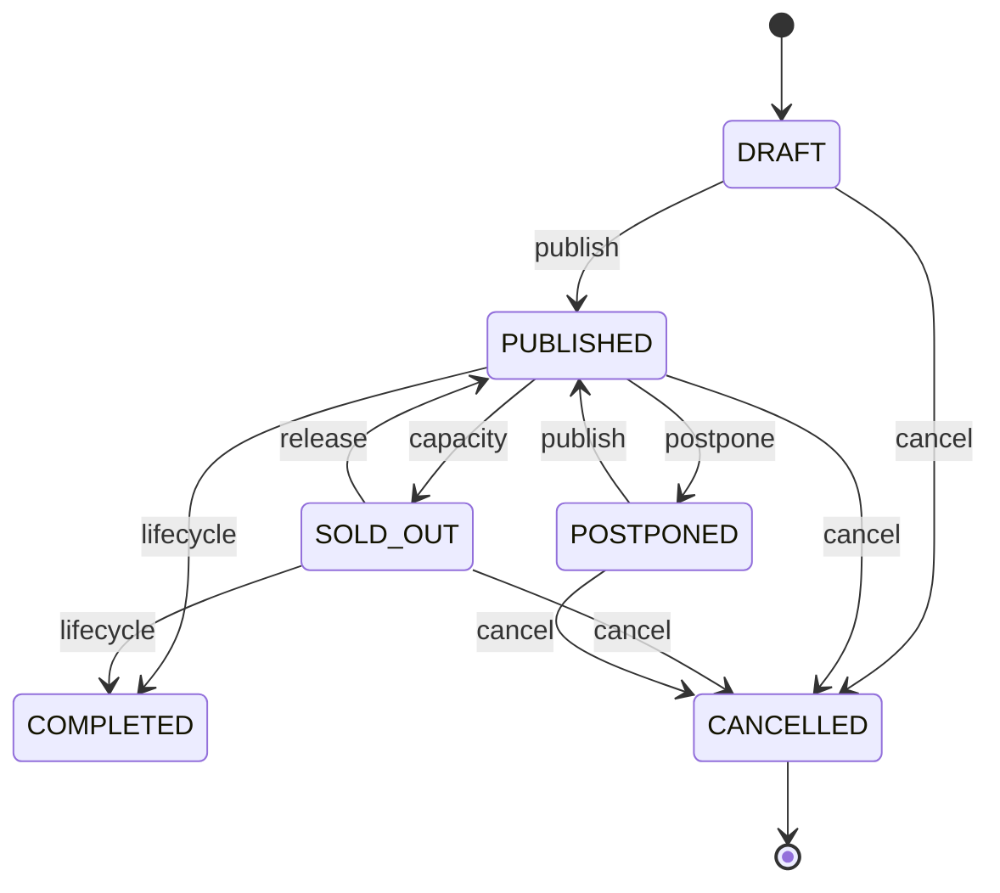

[View the full “Events” diagram](https://images.vinnot.com/docs/diagrams/v1/en/backend-diagrams-domain-state-machines-5163bf32b834.svg)

CANCELLED is terminal: no managed transition leaves it (`CANNOT_PUBLISH`,
`CANNOT_DRAFT`, `CANNOT_POSTPONE`, `CANNOT_COMPLETE`), so a cancelled event
cannot be completed and then republished.

| Method | Aggregate guard | Result |
|---|---|---|
| `publish` | status != CANCELLED | PUBLISHED |
| `cancel` | status != COMPLETED | CANCELLED |
| `complete` | status != CANCELLED (`CANNOT_COMPLETE`) | COMPLETED |
| `transitionTo(DRAFT)` | status != CANCELLED | DRAFT |
| `transitionTo(POSTPONED)` | status != CANCELLED && status != COMPLETED | POSTPONED |
| `transitionTo(SOLD_OUT)` | not allowed manually | INVALID_EVENT_STATUS |

Capacity updates set SOLD_OUT when exhausted; releasing seats changes SOLD_OUT to PUBLISHED. EventStatus has no ARCHIVED value. Lifecycle maintenance completes elapsed events through a bulk repository update, not an Event.complete invocation per row.

## Registrations and payment

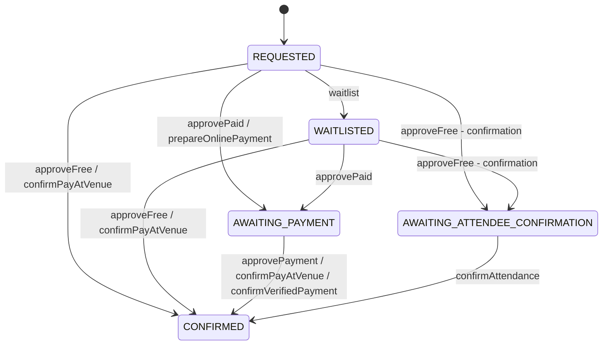

[View the full “Registrations and payment” diagram](https://images.vinnot.com/docs/diagrams/v1/en/backend-diagrams-domain-state-machines-69d3d3253e91.svg)

The graph separates approval/confirmation from terminal exits to avoid crossing
all transition arrows. Terminal exits are specified in this table:

| Operation | Source state | Target |
|---|---|---|
| `reject` | REQUESTED, WAITLISTED, AWAITING_PAYMENT, AWAITING_ATTENDEE_CONFIRMATION | REJECTED |
| `cancel` | any of those states or CONFIRMED | CANCELLED |
| `expire` | AWAITING_PAYMENT or AWAITING_ATTENDEE_CONFIRMATION, expired hold | EXPIRED |
| `reverseVerifiedPayment` | provider-managed registration; no previous-state guard | CANCELLED, payment REFUNDED or REJECTED |

approvePaid, approveFree and waitlist require REQUESTED or WAITLISTED; confirmPayAtVenue accepts REQUESTED, AWAITING_PAYMENT or WAITLISTED. reject accepts nonterminal states other than CONFIRMED; cancel accepts any nonterminal state. EXPIRED, REJECTED and CANCELLED are terminal. Attendance confirmation and payment approval require an active hold. Payment approval confirms directly, without a second attendee confirmation.

Payment is a separate axis: NOT_REQUIRED for free registration; PENDING when payment is requested; REPORTED after reporting TRANSFER, QR or MERCADO_PAGO; APPROVED after approval; PAY_AT_VENUE when confirming CASH. REJECTED and REFUNDED are set only by `reverseVerifiedPayment`. Reporting payment preserves AWAITING_PAYMENT.

## Registration payment

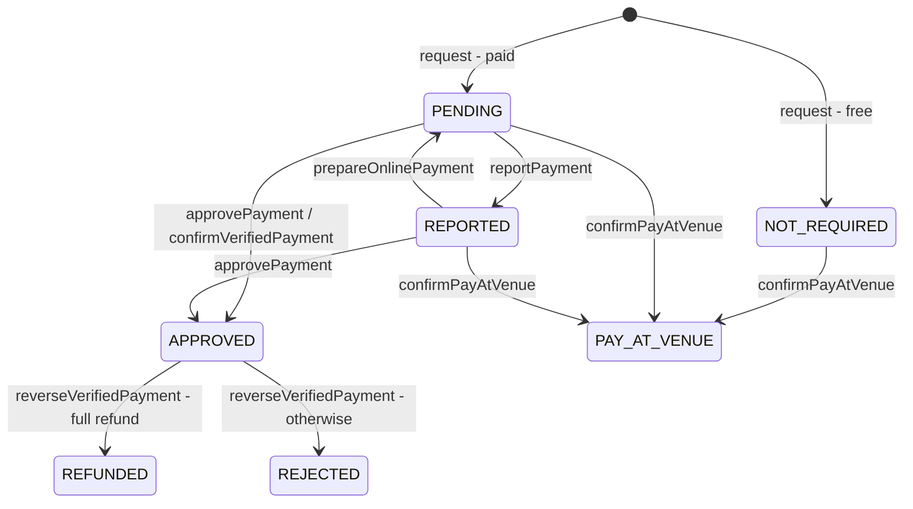

[View the full “Registration payment” diagram](https://images.vinnot.com/docs/diagrams/v1/en/backend-diagrams-domain-state-machines-ef69dbcd0bfe.svg)

`approvePaid` keeps the payment PENDING. `approvePayment`, `reportPayment` and
`confirmPayAtVenue` do not check the previous payment status, only the
registration status and that the provider does not manage the payment.
`reverseVerifiedPayment` has no source guard either; the chart shows the real case,
an approved payment the provider reports as refunded, charged back or in mediation.

Provider-driven transitions (Mercado Pago, `payment` module): `prepareOnlinePayment` approves REQUESTED as paid or returns a manually REPORTED payment to PENDING, then requires AWAITING_PAYMENT, PENDING payment and an active hold, and marks the registration as externally managed with method MERCADO_PAGO. From then on, approvePayment, reportPayment and confirmPayAtVenue fail with PAYMENT_PROVIDER_VERIFICATION_REQUIRED. `confirmVerifiedPayment` requires provider authority and the same eligibility, and sets CONFIRMED/APPROVED after server-side verification. `reverseVerifiedPayment` (refund, chargeback or mediation reported by the provider) sets CANCELLED with REFUNDED when fully refunded, otherwise REJECTED.

Handlers coordinate held_attendees/current_attendees within the transaction using PESSIMISTIC_WRITE repositories and capacity constraints. See [consistency](data-consistency.md) and [events](../../modules/events/architecture.md#backend).

## Checkout attempt

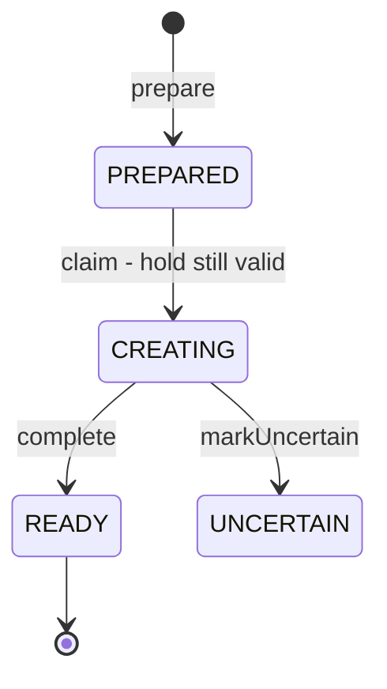

[View the full “Checkout attempt” diagram](https://images.vinnot.com/docs/diagrams/v1/en/backend-diagrams-domain-state-machines-d9404a68b01f.svg)

`CheckoutAttempt.Status` is an enum nested in the `CheckoutAttempt` record;
`PostgresCheckoutAttemptStore` makes each change with an `UPDATE` conditioned on
the previous state, so two requests never create two checkouts.
`DispatchTicketCheckoutService` claims a PREPARED attempt whose hold has not
expired (`claim`), creates the Mercado Pago checkout and stores it as READY. If
the response fails or cannot be confirmed, the attempt stays UNCERTAIN: a
failure does not prove the checkout does not exist. A READY attempt returns its
stored URL; a CREATING or UNCERTAIN one does not create another. Reconciliation
picks up CREATING and UNCERTAIN attempts and reads their payments from the
provider; it does not change the attempt state.

## Payment reported by the provider

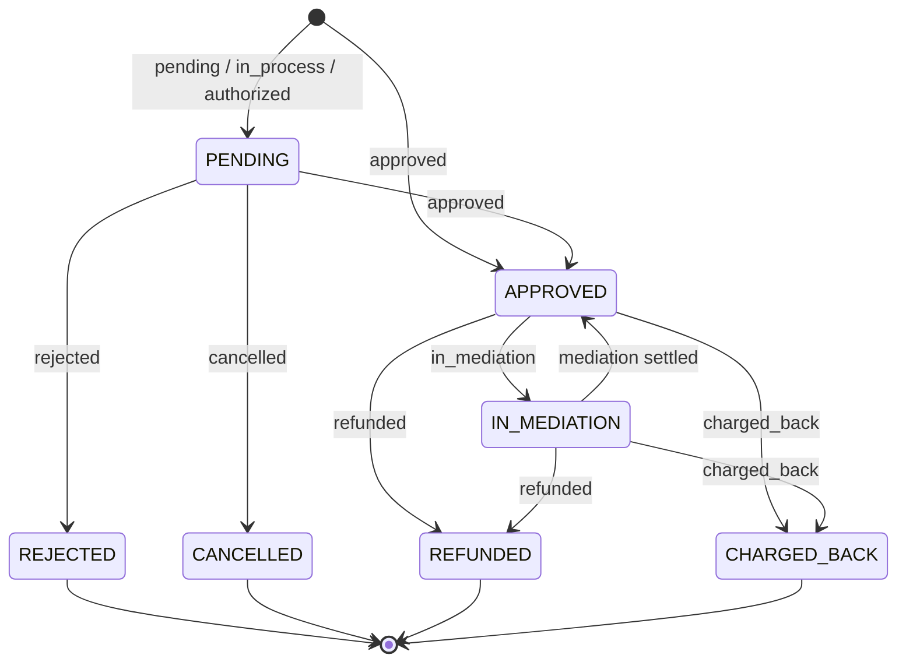

[View the full “Payment reported by the provider” diagram](https://images.vinnot.com/docs/diagrams/v1/en/backend-diagrams-domain-state-machines-6bd5c7c676a1.svg)

Vinnot does not change `ProviderPayment.Status`: `MercadoPagoPaymentAdapter`
maps the status Mercado Pago reports and `ApplyProviderPaymentService` applies
each reading. The payment ledger drops a reading older than the stored one, one
with a smaller refunded amount or one that stops being reversed. A payment is
reversed when it is fully refunded or charged back; reversed, REJECTED and
CANCELLED are final for reconciliation (`ReconciliationSchedule.isFinal`).
APPROVED confirms the registration when the payment is the credited one. A
partial refund, REFUNDED, CHARGED_BACK or IN_MEDIATION call
`reverseVerifiedPayment`; when the payment is not reversed, the entry stays in
review.

## Refund intent

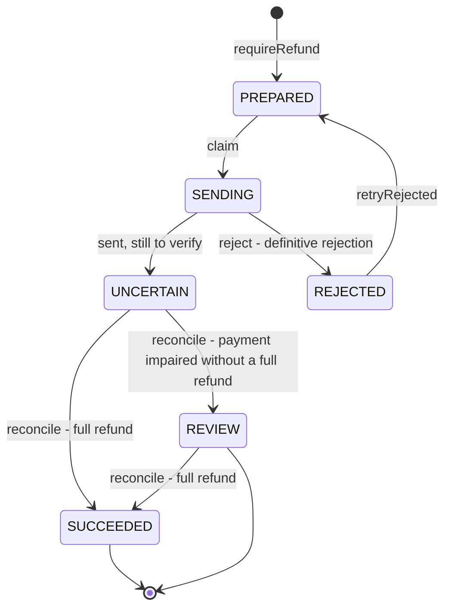

[View the full “Refund intent” diagram](https://images.vinnot.com/docs/diagrams/v1/en/backend-diagrams-domain-state-machines-f57db9369fb3.svg)

`RefundIntent.Status` is an enum nested in the `RefundIntent` record;
`PostgresRefundStore` makes each change with a conditioned `UPDATE`.

| Operation | From | To | Called by |
|---|---|---|---|
| `requireRefund` | no intent for that payment | PREPARED | `ApplyProviderPaymentService` and `RequestPaymentRefundService` |
| `claim` | PREPARED | SENDING | `ReconcilePaymentsService`, only while the payment is still APPROVED and not refunded |
| `uncertain` | SENDING | UNCERTAIN | `ReconcilePaymentsService` after sending, even on a 2xx response |
| `reject` | SENDING | REJECTED, adds to `rejections` | `RefundRejectionRecorder`, when Mercado Pago rejects and the payment was not refunded another way |
| `retryRejected` | REJECTED | PREPARED | `RequestPaymentRefundService`, when the organizer asks again |
| `reconcile` | anything but SUCCEEDED | SUCCEEDED or REVIEW | `ApplyProviderPaymentService` on each payment reading |

The diagram shows the usual path; `reconcile` also closes a PREPARED, SENDING or
REJECTED intent when the payment already shows as refunded. A rejection tells
only the organizer, once per rejection, and the retry uses a different
`idempotencyKey`.

## Wine submissions

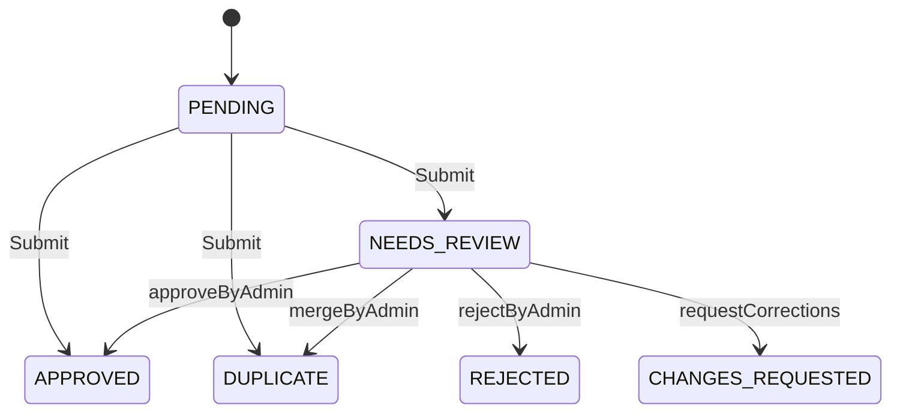

[View the full “Wine submissions” diagram](https://images.vinnot.com/docs/diagrams/v1/en/backend-diagrams-domain-state-machines-a5cc30549e33.svg)

This graph represents the submit/review workflow. The aggregate also exposes reject from PENDING, but the creation handler does not use it as an automatic branch. Administrative decisions require NEEDS_REVIEW, a reviewer and reason; they record reviewedBy, reviewedAt and updatedAt. Users can read CHANGES_REQUESTED. Administrative decisions do not apply to already decided states.

## Sessions and tokens

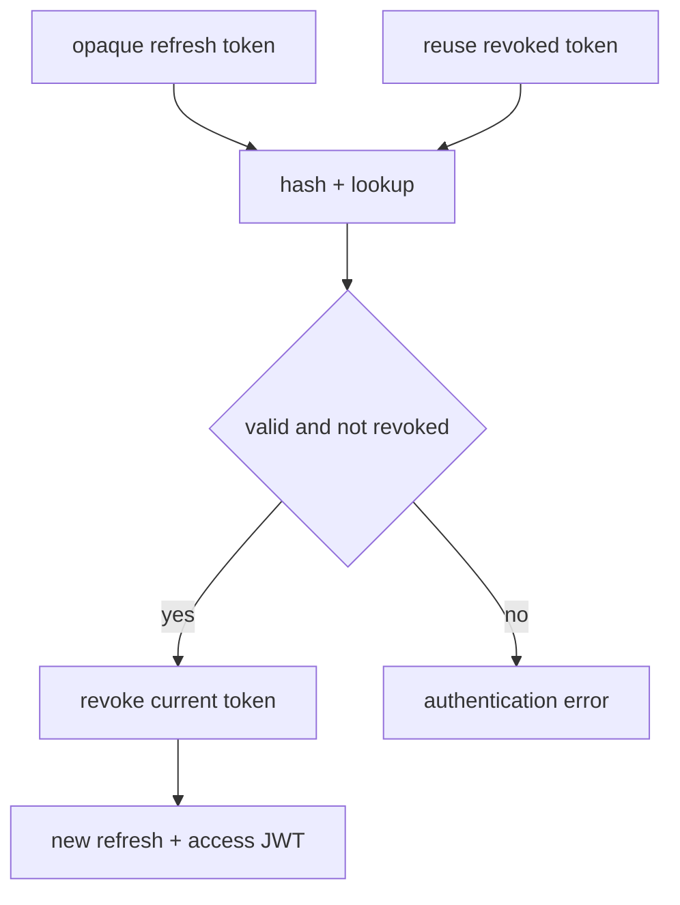

[View the full “Sessions and tokens” diagram](https://images.vinnot.com/docs/diagrams/v1/en/backend-diagrams-domain-state-machines-3ebe679eeeca.svg)

Validity/revocation are row properties, not an ACTIVE/REPLAYED enum. This graph describes one renewal execution, not exclusion between concurrent requests. Account action tokens use separate row-locking consumption. An issued access JWT retains its own expiration.

## Account action tokens

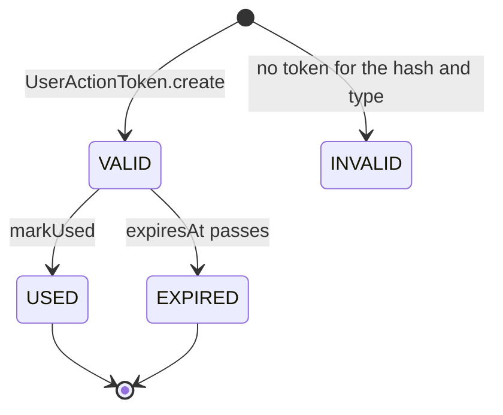

[View the full “Account action tokens” diagram](https://images.vinnot.com/docs/diagrams/v1/en/backend-diagrams-domain-state-machines-114e0746d7f5.svg)

`UserActionTokenStatus` is not stored: `AccountActionTokenService.getStatus` works it
out when the token is read. USED is checked before EXPIRED, so a used token never
reports expired. The only domain state change is `markUsed`, which requires
`isUsableAt`.

## Community reports

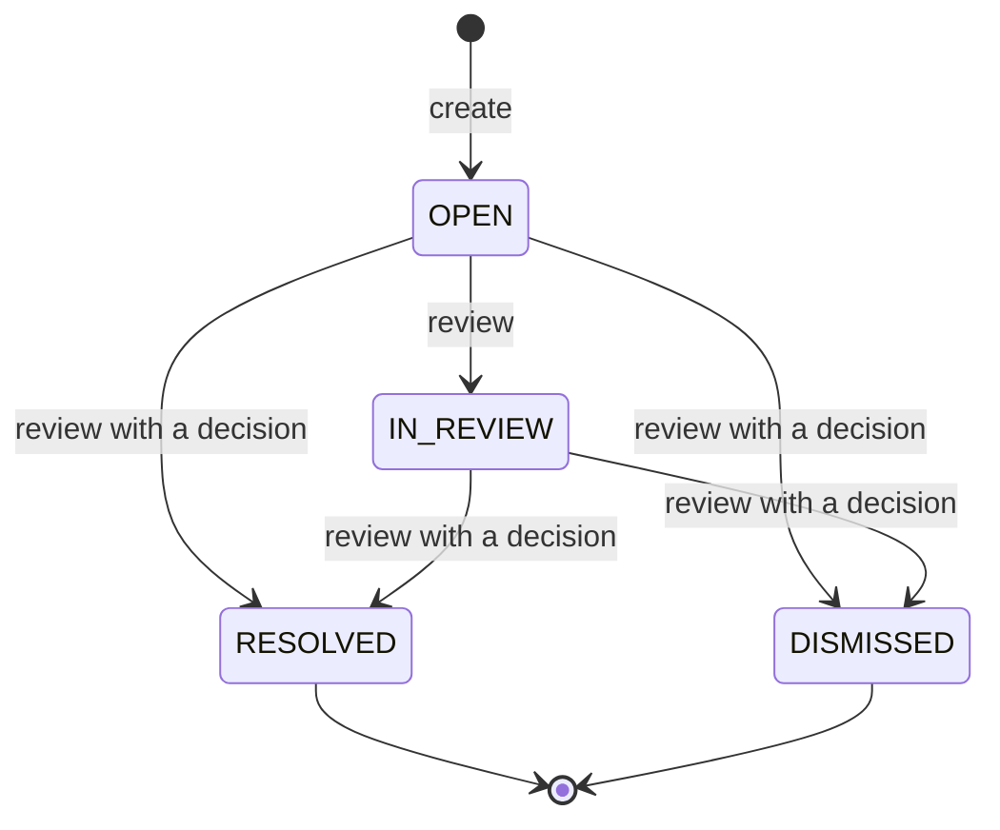

[View the full “Community reports” diagram](https://images.vinnot.com/docs/diagrams/v1/en/backend-diagrams-domain-state-machines-9e47e6481a58.svg)

`CommunityReport.review` returns a new report. RESOLVED and DISMISSED are terminal
and a report never goes back to OPEN (`REPORT_TRANSITION`). The moderator who took
the report is the only one who can keep reviewing it (`REPORT_ASSIGNED`), and cannot
be the reporter or the content author (`REPORT_CONFLICT_OF_INTEREST`). Closing needs
a written decision (`REPORT_DECISION_REQUIRED`). Removing the reported content also
resolves it.

## Review and comment publication

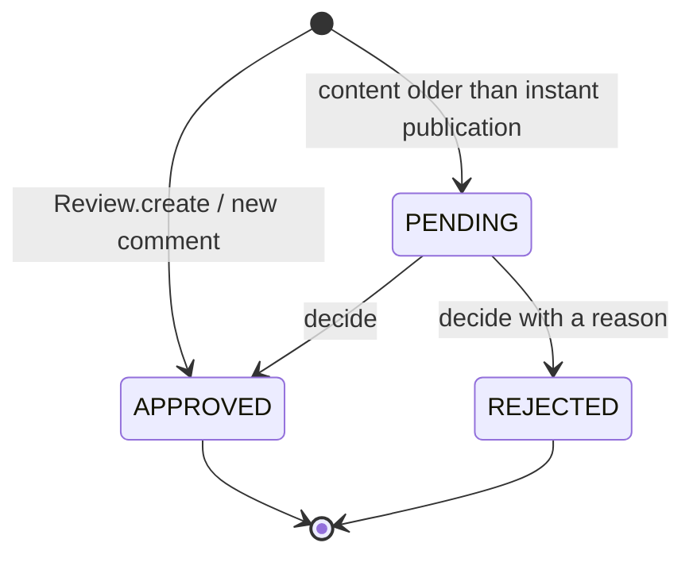

[View the full “Review and comment publication” diagram](https://images.vinnot.com/docs/diagrams/v1/en/backend-diagrams-domain-state-machines-852597edb410.svg)

New reviews and comments are published when created
(`PublicationStatus.APPROVED`). PENDING remains only on older content, which a
moderator decides through `DecideReviewPublicationCommandHandler`;
`ReviewPublication.validateDecision` applies the guards:

| Guard | Code |
|---|---|
| the moderator is not the author | `PUBLICATION_SELF_REVIEW` |
| the content is PENDING and the decision is not PENDING | `PUBLICATION_TRANSITION` |
| the content did not change since it was read | `PUBLICATION_CHANGED` |
| approving a comment needs its review approved | `PUBLICATION_PARENT_PENDING` |
| rejecting needs a `PublicationRejectionReason` or a note; approving carries no reason; the note has up to 2000 characters | `PUBLICATION_REASON` |

Only APPROVED content counts toward the wine average and shows to other people;
its author still sees their own.

## Wine routes

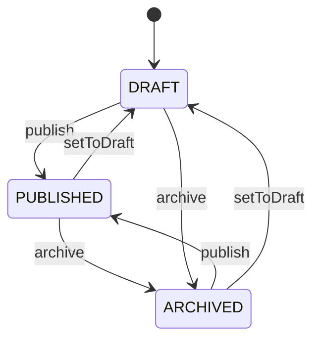

[View the full “Wine routes” diagram](https://images.vinnot.com/docs/diagrams/v1/en/backend-diagrams-domain-state-machines-6a61dd80c002.svg)

publish requires a nonempty stop list. archive and setToDraft assign state without a previous-state guard; repeating the assignment is allowed.

## Account: independent axes

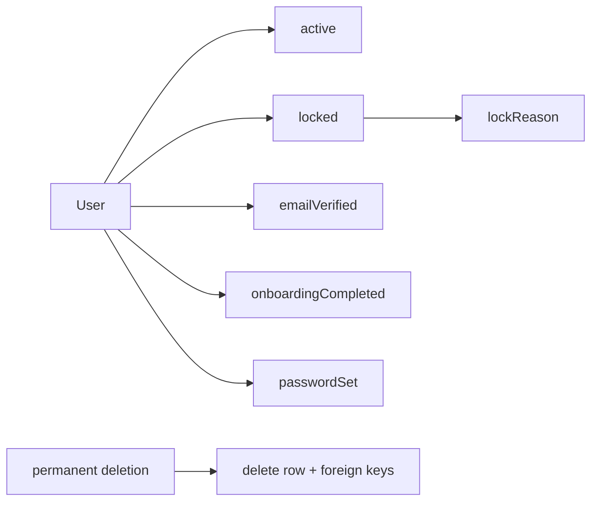

[View the full “Account: independent axes” diagram](https://images.vinnot.com/docs/diagrams/v1/en/backend-diagrams-domain-state-machines-7cbfadcecd87.svg)

There is no ACTIVE_VERIFIED enum: an account can be verified and inactive, or verified and locked. Reactivation, email verification and onboarding modify different flags.

`passwordSet` (V62) tells whether the stored password is one the person chose.
An account created by a social sign-in, or a local one without a verified email
whose password was revoked when a provider was linked, stores the hash of a
random secret and `passwordSet = false`: clients offer to set a password instead
of changing it. `changePassword` sets it to true and `revokePassword` to false.

Suspending an account is `lock`: `locked = true`, `sessionVersion` goes up and
ends the sessions, and `lockReason` stores the `SuspensionReason` code alone or
`CODE: detail` when there is a note (for example `SPAM: repeated links`).
Without a code OTHER is used. Reactivating is `unlock`, which clears
`lockReason`.

Authentication conditions are described in [identity](../architecture/authentication-and-identity.md).

## Sources

Paths relative to `backend/src/main/java/com/vinnot/`:

- `event/domain/model/Event.java`, `EventRegistration.java`, `event/domain/valueobject/EventStatus.java`, `EventRegistrationStatus.java`, `EventPaymentStatus.java`.
- `event/infrastructure/persistence/jpa/EventJpaRepository.java`.
- `payment/application/service/EventCheckoutReservationService.java`, `ApplyProviderPaymentService.java`, `DispatchTicketCheckoutService.java`, `ReconcilePaymentsService.java`, `RequestPaymentRefundService.java`, `RefundRejectionRecorder.java`, `ReconciliationSchedule.java`.
- `payment/domain/model/CheckoutAttempt.java`, `ProviderPayment.java`, `RefundIntent.java`; `payment/infrastructure/persistence/PostgresCheckoutAttemptStore.java`, `PostgresRefundStore.java`; `payment/infrastructure/gateway/MercadoPagoPaymentAdapter.java`.
- `review/domain/model/PublicationStatus.java`, `ReviewPublication.java`, `Review.java`; `review/application/command/handler/DecideReviewPublicationCommandHandler.java`.
- `user/domain/model/UserActionToken.java`, `user/application/service/AccountActionTokenService.java`, `community/domain/model/CommunityReport.java`.
- `wine/domain/model/WineSubmission.java`, `wineroute/domain/model/WineRoute.java`.
- `user/domain/model/User.java`, `user/domain/valueobject/SuspensionReason.java`, `user/application/command/handler/BanUserCommandHandler.java`, `user/application/command/handler/RefreshTokenCommandHandler.java`.
