# Detailed ERD by context

## Notation and scope

This ERD describes the accumulated Flyway V1–V69 schema. It selects columns
relevant to identity, relationships, and invariants; the full attribute overview
is in the [data model](../data/database-model.md) and migrations. It is not a JPA
class diagram.

`PK` = primary key; `FK` = foreign key; `UK` = individual uniqueness.
A `NULL` comment marks an optional column. Composite unique keys are explained
below each block without marking each component independently unique.
`||` means exactly one; `|o`, zero or one; `o{`, zero or many.
Anchor tables repeated across blocks represent the same physical table.

## Identity and credentials

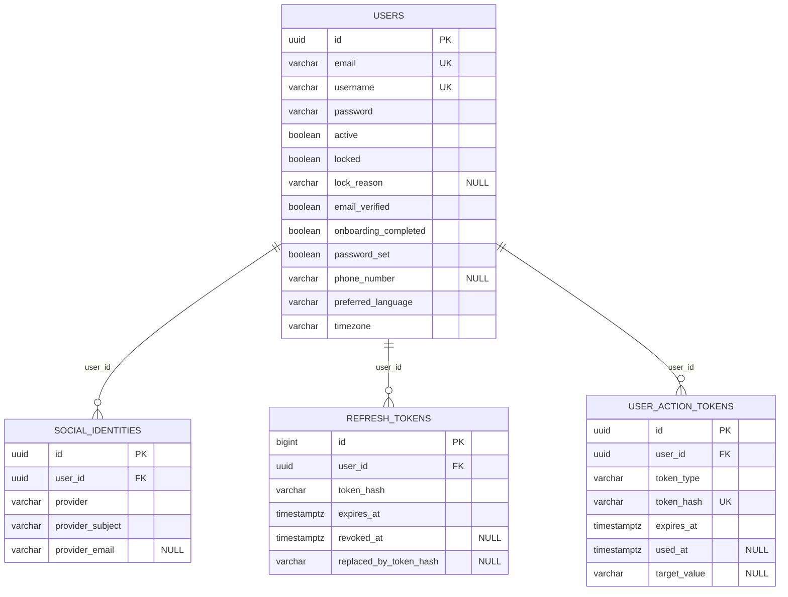

[View the full “Identity and credentials” diagram](https://images.vinnot.com/docs/diagrams/v1/en/backend-diagrams-relational-model-26f47df18d72.svg)

All user references in this block use `ON DELETE CASCADE`. Social identity has composite uniqueness on `(provider, provider_subject)` and `(user_id, provider)`. Action tokens store `used_at`, not a status enum. V7 adds `target_value` for email changes. V57 widens `lock_reason` to 300 characters. Refresh stores a hash and replacement hash; the replacement reference is text, not a FK.

## Authorization

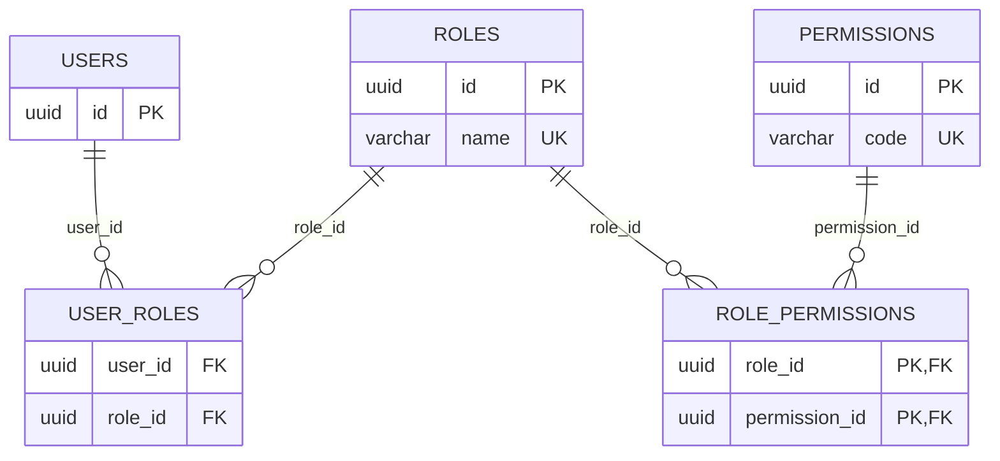

[View the full “Authorization” diagram](https://images.vinnot.com/docs/diagrams/v1/en/backend-diagrams-relational-model-e4c9f095fc58.svg)

`role_permissions` has a composite PK. `user_roles` has a unique `(user_id, role_id)` index introduced in V15; it is not represented as a PK. All association FKs use CASCADE. Permission loading for authorities is described in [security](../architecture/security-and-authorization.md).

## Geography and catalog

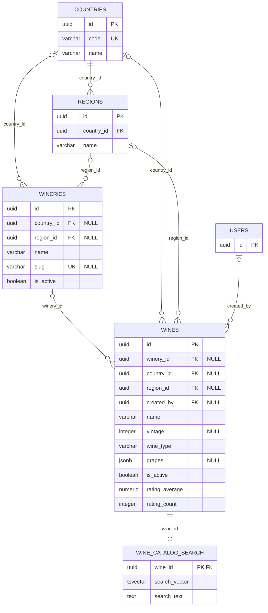

[View the full “Geography and catalog” diagram](https://images.vinnot.com/docs/diagrams/v1/en/backend-diagrams-relational-model-db8bbc28fc03.svg)

`regions(name, country_id)` is unique. Deleting a country cascades to its regions; wine/winery geography, wine-to-winery, and wine-to-creator references become NULL. The read model cascades with its wine. The FK allows zero or one projection per wine; backfill and triggers maintain one row per wine during ordinary writes. `wine_type` and JSONB grapes are not catalog FKs.

## Community and cellar

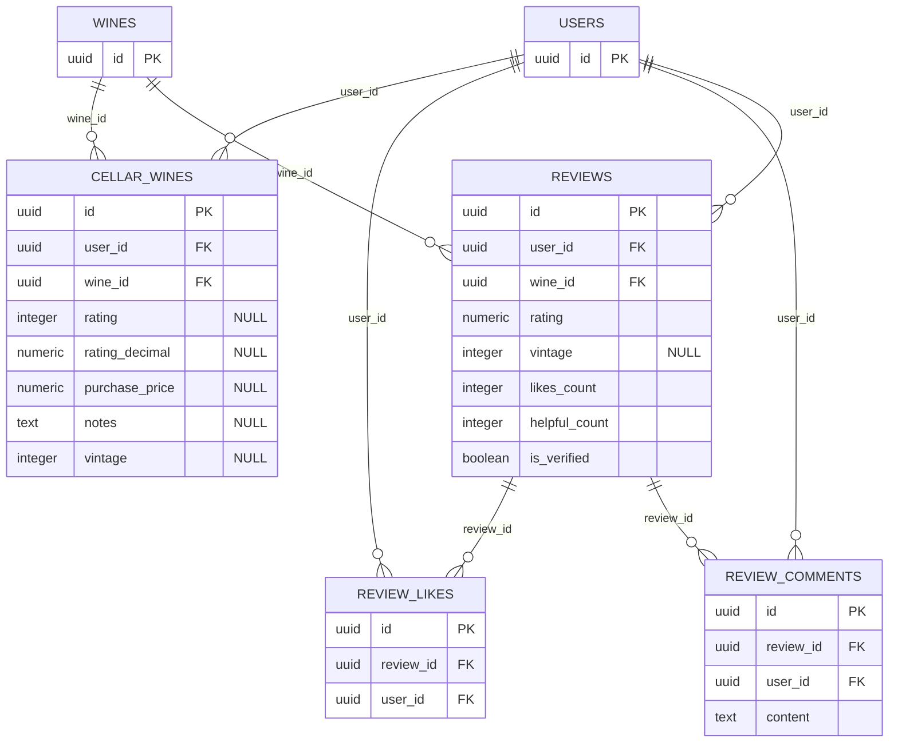

[View the full “Community and cellar” diagram](https://images.vinnot.com/docs/diagrams/v1/en/backend-diagrams-relational-model-9012f62031fb.svg)

All these FKs use CASCADE. Composite unique keys: review `(wine_id, user_id)`, like `(review_id, user_id)`, and cellar `(user_id, wine_id)`. Cellar rating is optional and review rating is required; both go from 0.1 to 5.0 with one decimal (the cellar one lives in `rating_decimal`, added by V71 in #455; the integer `rating` 1–5 is kept and written alongside it for the previous backend revision). Both tables keep an optional tasted `vintage` (V64) with a 1800–2100 CHECK. Counts and averages are derived data coordinated by use cases, not additional relationships.

## Events and registrations

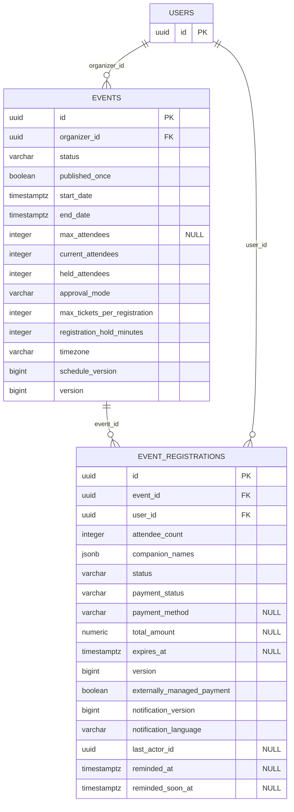

[View the full “Events and registrations” diagram](https://images.vinnot.com/docs/diagrams/v1/en/backend-diagrams-relational-model-09b1a26a986f.svg)

All FKs use CASCADE. V8 replaces the original `(event_id, user_id)` PK with `id`. Partial unique index `uk_event_registrations_active_user` covers REQUESTED, AWAITING_PAYMENT, AWAITING_ATTENDEE_CONFIRMATION, CONFIRMED, and WAITLISTED. It permits terminal history for the same user/event. SQL `version` columns exist; workflow repositories use `PESSIMISTIC_WRITE`. Status and payment have independent CHECK constraints; see [state machines](domain-state-machines.md). V40 adds `events.timezone` and `last_actor_id`, without an FK; V44, `schedule_version`; V45 and V48, the `reminded_at` and `reminded_soon_at` reminders.

## Routes and stops

```mermaid
erDiagram
 USERS { uuid id PK }
 WINERIES { uuid id PK }
 WINE_ROUTES {
  uuid id PK
  uuid created_by FK
  varchar name
  varchar status
  varchar country "NULL"
  varchar region "NULL"
  float total_distance_km "NULL"
  jsonb recommended_wine_types "NULL"
 }
 WINE_ROUTE_STOPS {
  uuid id PK
  uuid wine_route_id FK
  varchar name
  integer stop_order
  numeric latitude "NULL"
  numeric longitude "NULL"
 }
 ROUTE_WINERIES {
  uuid route_id PK,FK
  uuid winery_id PK,FK
 }
 USERS ||--o{ WINE_ROUTES : created_by
 WINE_ROUTES ||--o{ WINE_ROUTE_STOPS : wine_route_id
 WINE_ROUTES ||--o{ ROUTE_WINERIES : route_id
 WINERIES ||--o{ ROUTE_WINERIES : winery_id
```

[View the full “Routes and stops” diagram](https://images.vinnot.com/docs/diagrams/v1/en/backend-diagrams-relational-model-a8c49df0b8a7.svg)

All FKs use CASCADE. Route country and region are text, not geographic IDs. `wine_route_stops` has no winery FK: it represents a stop with its own data. `route_wineries` is a separate association with a composite PK; it does not replace stop order or attributes.

## Submissions and generated content

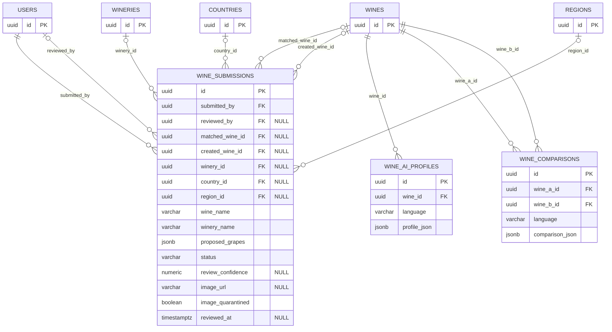

[View the full “Submissions and generated content” diagram](https://images.vinnot.com/docs/diagrams/v1/en/backend-diagrams-relational-model-5a99d81b2c69.svg)

Submission author uses CASCADE; reviewer and resulting wines use SET NULL. V41 adds catalog country, region, and winery, also SET NULL, and `proposed_grapes`, the grapes missing from `grape_types`. Confidence accepts NULL or [0,1]. Profile is unique by `(wine_id, language)` and comparison by `(wine_a_id, wine_b_id, language)`; their FKs use CASCADE. The application canonicalizes the pair before persistence. Lease `owner_id` identifies the coordinated execution, not a user FK. A lease row contains neither the AI result nor image bytes.

### Coordination without a user relationship

`ai_generation_leases` has no FKs; its independence is represented in this table:

| Column | Type | Constraint |
|---|---|---|
| `lock_key` | varchar(255) | PK |
| `owner_id` | uuid | NOT NULL, execution identifier |
| `expires_at` | timestamptz | NOT NULL, expiration index |

## AI monetary reservations

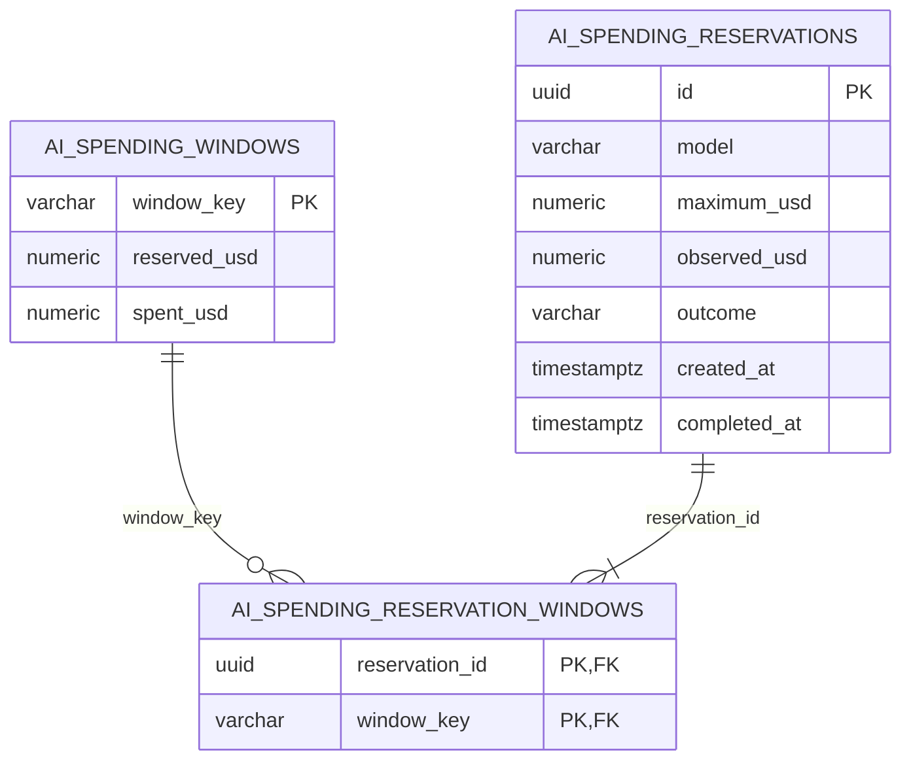

[View the full “AI monetary reservations” diagram](https://images.vinnot.com/docs/diagrams/v1/en/backend-diagrams-relational-model-38f405abb9f8.svg)

V23 enforces nonnegative amounts and PENDING, UNKNOWN, or ACCOUNTED outcomes.
Monetary reservations are durable; capacity leases are temporary. No FKs
connect this ledger to users or catalog contents.

## Catalogs without business FKs

`wine_types`, `event_types`, and `event_statuses` have a UUID `id` PK, unique
`code`, `name_es`/`name_en` labels, `active`, and `sort_order`; statuses add
`is_terminal`. `grape_types` has an `id` PK, unique name, `name_es`, `category`,
and `is_active`. They are queried as reference data; business type/status
columns and JSONB grape lists do not reference them through FKs.

## Traceability

- V1: base tables, PK/FK, uniqueness, and deletion actions.
- V5–V7: social identities, action tokens, onboarding, and target email.
- V8–V9: registrations, capacity constraints, and event location.
- V10–V11: submissions, reviewer, quarantine, and statuses.
- V12–V13: canonical languages, comparisons, and leases.
- V14–V16: read model, search indexes, and statistics.
- V28: private user phone number.
- V29–V38: online payments, provider-managed registrations, attendee index, registration notifications, return channels, and reconciliation wake triggers.
- V39: user preferred language and time zone.
- V40: event time zone and the acting user of registration changes.
- V41: catalog references (country, region, winery) and proposed grapes on submissions.
- V42–V43: notification preferences, marketing consent history, and email suppressions.
- V44: event schedule version and cancellation notices.
- V45, V48: registration reminders.
- V46–V47, V51: push devices, deduplicated sends, receipt tickets, and the per-category index.
- V49: organizer push digests.
- V50: the user's nearby event area.
- V52: taste affinities by grape and type.
- V53: reason code of publication decisions.
- V54–V55: moderation and like digest cursors.
- V56: terms-update email cursor.
- V57: suspension reason up to 300 characters.
- V58: payment account reconnect notice.
- V59: per-type push switches, their history, and daily delivery outcomes.
- V60: staff announcements.
- V61: inactive-wine index for the staff listing.
- V62: password chosen by its owner.
- V63: rejected refunds.
- V64: tasted vintage on reviews and cellar.
- V65: device push channels, device retention, and outbox wake-up notice.
- V66: activity signals and the REMINDERS category.
- V67: engagement engine and user time zone index.
- V68: one-time reset of `push_devices.last_seen_at`.
- V69: minimum app version per platform and its change history.
- V78–V81: social media agent (wine days, pillars, posts, media and bilingual copy); see [Social media marketing](../../modules/marketing/README.md#data).
- V82: per-network publications, daily metrics, connected accounts with encrypted tokens, pillar auto-approval and publishing record.
- V83: pillars that can be switched off.
- V84: six refined pillars and `HUMOR` inactive.
- V85: trigram indexes on inactive wine and winery names for the staff typo-tolerant search.
- V86: filtered search read models (`wine_catalog_filter_search`, `wine_grape_search`, `wine_grape_keys`) maintained by triggers.

Sources: `backend/src/main/resources/db/migration/`. SQL indexes and budgets
are covered in [query performance](../data/query-performance.md). Code dependency
direction is documented in the [domain UML](domain-class-model.md) and
[system map](system-map.md).

## Session and external-effect control

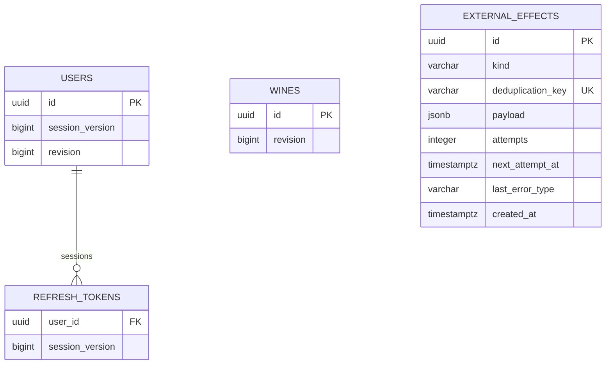

[View the full “Session and external-effect control” diagram](https://images.vinnot.com/docs/diagrams/v1/en/backend-diagrams-relational-model-1f72df54a46a.svg)

EXTERNAL_EFFECTS has no FK to the business resource: it must survive deletion to clean up external references.

## Contractual evidence

V21 adds `legal_documents` and `user_legal_acceptances`. The relation to
`users` removes evidence upon permanent account erasure. A composite FK binds
acceptance to exact version, revision, language and hash; the account/type/revision
key prevents duplicates. Historical acceptance is never inferred.

[ER diagram, indexes, triggers and revision semantics](../../modules/legal/architecture.md#relational-model).

## Community and private evidence (V24)

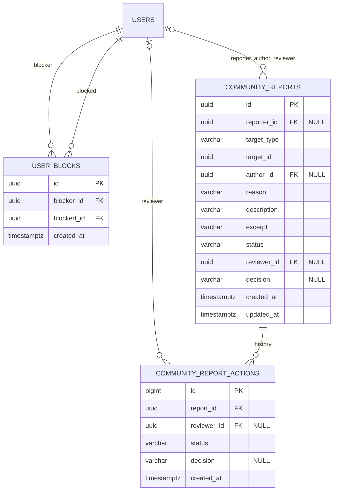

[View the full “Community and private evidence (V24)” diagram](https://images.vinnot.com/docs/diagrams/v1/en/backend-diagrams-relational-model-7599bd3b8e12.svg)

Block pairs are unique and cannot reference the same account twice. Partial report uniqueness covers `(reporter_id, target_type, target_id)` in OPEN/IN_REVIEW. `target_id` is polymorphic, without an FK: deleting content does not delete case evidence. The three optional user-to-report relations represent distinct FKs with ON DELETE SET NULL; blocks use CASCADE.

## Publication decisions (V26)

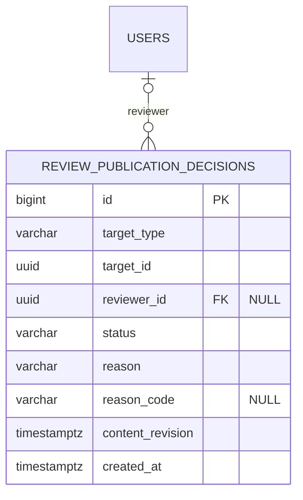

[View the full “Publication decisions (V26)” diagram](https://images.vinnot.com/docs/diagrams/v1/en/backend-diagrams-relational-model-63c344d89ff6.svg)

`target_type/target_id` identifies a review or comment without a FK so decisions survive content deletion. Hourly purging removes decisions after 90 days; current states live in `reviews.publication_status` and `review_comments.publication_status`. V53 adds an optional `reason_code`, with a CHECK of OFFENSIVE, SPAM, OFF_TOPIC, PERSONAL_DATA, or OTHER.

## Image inventory and budgets (V27)

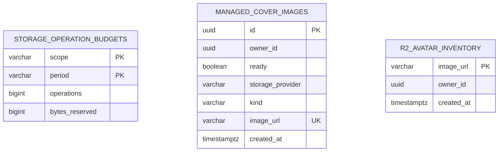

[View the full “Image inventory and budgets (V27)” diagram](https://images.vinnot.com/docs/diagrams/v1/en/backend-diagrams-relational-model-d0ebb4f60963.svg)

These tables define no foreign keys to users/events/routes. Adapters recheck
owners and URLs to preserve durable cleanup after cascades or rollback.
Keys/constraints/indexes come from `V27__managed_image_storage.sql`.
[Inventory and budgets](../data/database-model.md#image-inventory-and-budgets-v27).

## Online payments (V29–V38)

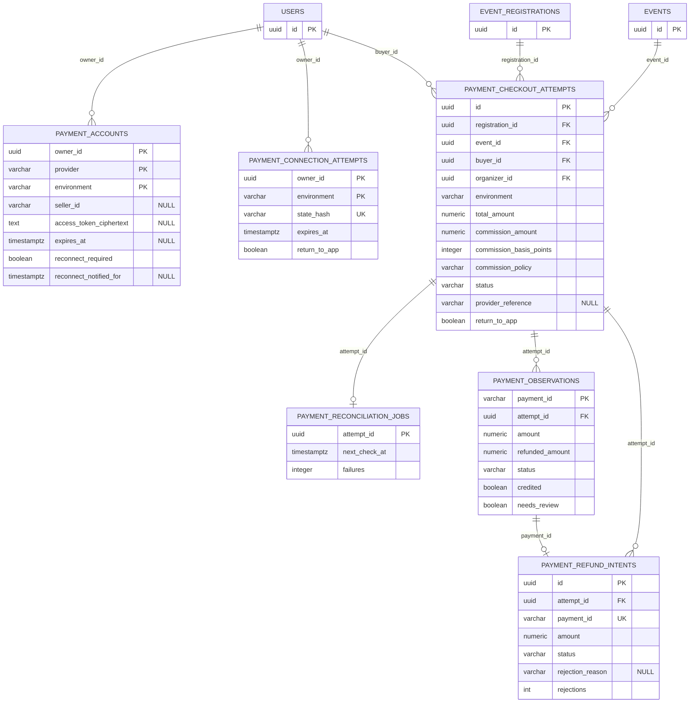

[View the full “Online payments (V29–V38)” diagram](https://images.vinnot.com/docs/diagrams/v1/en/backend-diagrams-relational-model-5a97fb37e649.svg)

Only the `users` FKs of accounts and connection attempts cascade; checkout
attempts, observations and refund intents keep financial history without
cascade. `(registration_id, provider, environment)` and
`(provider, environment, provider_reference)` are unique on checkout attempts;
`idx_payment_one_credit` allows one credited observation per attempt.
`environment` is `SANDBOX` or `LIVE_PILOT` (V33). V58 adds
`reconnect_notified_for` and V63, the REJECTED status with `rejection_reason` and
`rejections`. Keys/constraints/indexes come from `V29`–`V38`, `V58`, and `V63`. [Payment data](../data/database-model.md).

## Notifications and push (V42–V68)

### Preferences, consent, and suppressions (V42–V43)

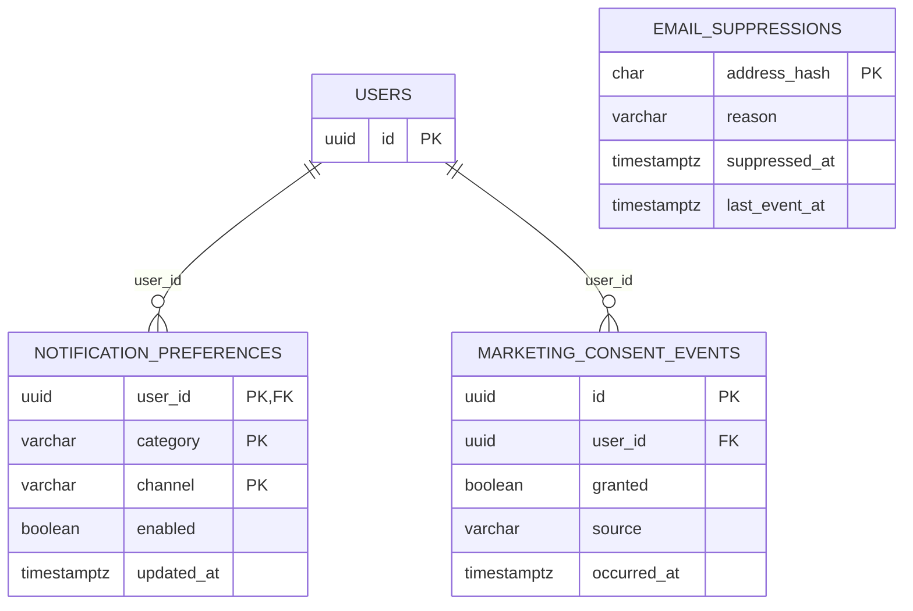

[View the full “Preferences, consent, and suppressions (V42–V43)” diagram](https://images.vinnot.com/docs/diagrams/v1/en/backend-diagrams-relational-model-9b8441edb199.svg)

User FKs use CASCADE. `notification_preferences` has a composite `(user_id, category, channel)` PK; the category CHECK accepts EVENTS_NEARBY, COMMUNITY, RECOMMENDATIONS, NEWSLETTER and, since V66, REMINDERS; the channel CHECK accepts EMAIL or PUSH. A missing row means the default value. `marketing_consent_events` is insert-only: a trigger rejects UPDATE; `source` accepts WEB, MOBILE, or EMAIL_UNSUBSCRIBE. `email_suppressions` has no FK: `address_hash` is the SHA-256 of the normalized address and `reason` accepts HARD_BOUNCE or COMPLAINT.

### Push devices and delivery (V46–V68)

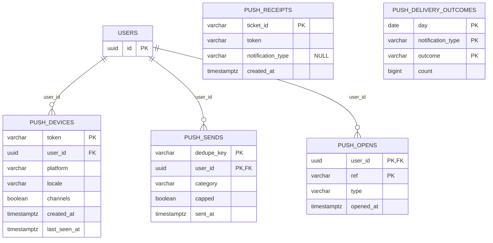

[View the full “Push devices and delivery (V46–V68)” diagram](https://images.vinnot.com/docs/diagrams/v1/en/backend-diagrams-relational-model-5be85e9231b7.svg)

User FKs use CASCADE. `platform` accepts IOS or ANDROID and `locale`, es or en. Composite PKs: send `(dedupe_key, user_id)`, open `(user_id, ref)`, and daily outcome `(day, notification_type, outcome)`. `push_receipts.token` is text, without a device FK; V59 adds its optional `notification_type`. V51 indexes `push_sends(user_id, category, sent_at)`. V65 adds `channels` and the `last_seen_at` index used by the 120-day retention; V68 resets `last_seen_at` once. `push_delivery_outcomes` counts per type, outcome, and UTC day, without FKs.

### Per-type push switches (V59)

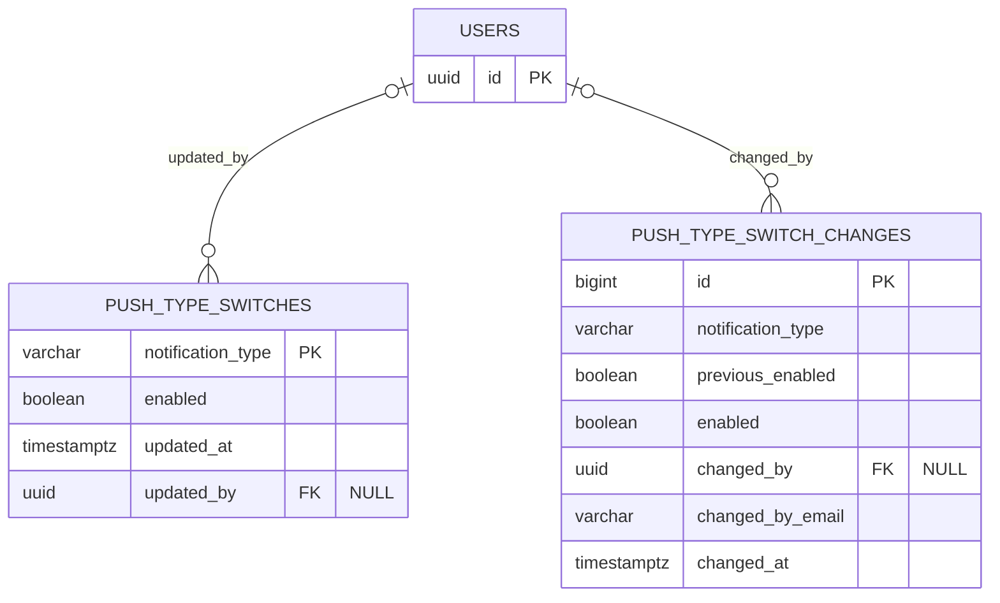

[View the full “Per-type push switches (V59)” diagram](https://images.vinnot.com/docs/diagrams/v1/en/backend-diagrams-relational-model-87268c486537.svg)

Both user FKs use SET NULL. A type without a `push_type_switches` row is on. `push_type_switch_changes` is the change history: `notification_type` is text without a switch FK, and `changed_by_email` keeps the author after account deletion.

### Announcements and digests (V49, V56, V60)

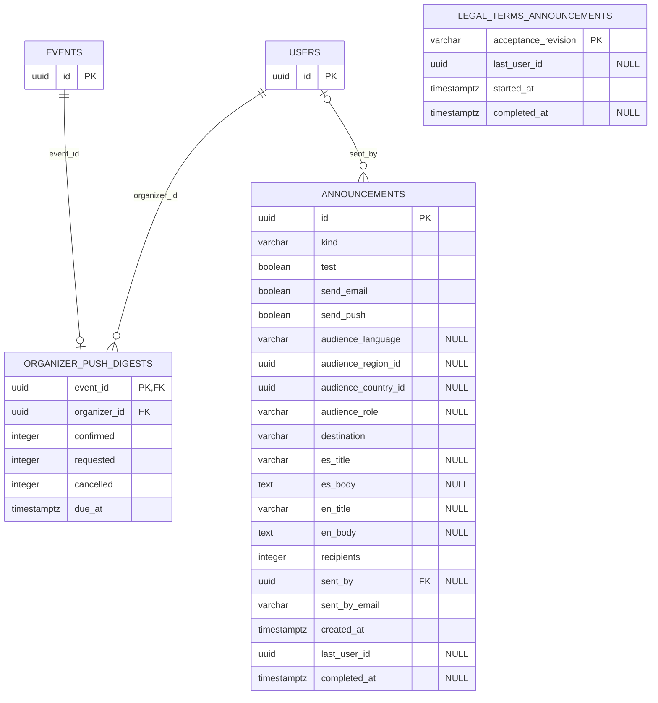

[View the full “Announcements and digests (V49, V56, V60)” diagram](https://images.vinnot.com/docs/diagrams/v1/en/backend-diagrams-relational-model-3a7ecdb819d5.svg)

`organizer_push_digests` has CASCADE FKs to event and organizer, counters with a nonnegative CHECK, and is deleted once sent. `announcements` records each staff send and is the cursor of its batched delivery (`last_user_id`, `completed_at`): `kind` accepts NEWS or SERVICE, and a CHECK requires at least one channel and at least one title. `audience_region_id` and `audience_country_id` have no FK; `sent_by` uses SET NULL and `sent_by_email` keeps the author. `legal_terms_announcements` has no FKs: one row per acceptance revision keeps the cursor of the terms-update email.

## Nearby event areas (V50)

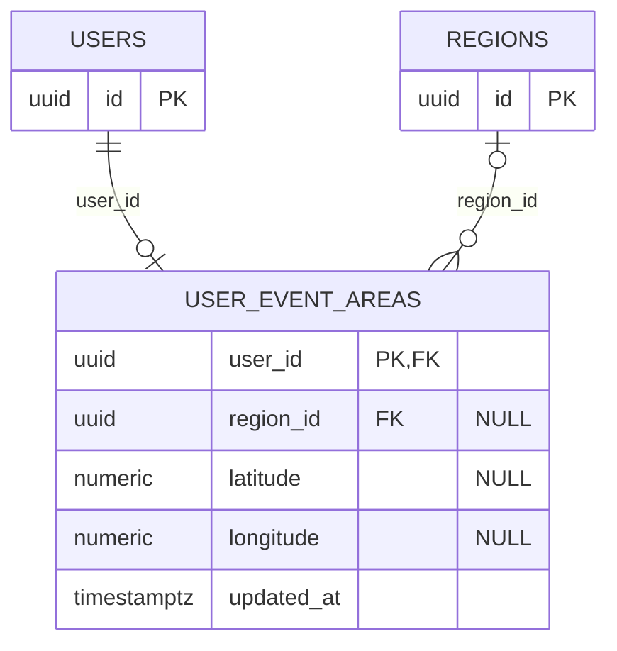

[View the full “Nearby event areas (V50)” diagram](https://images.vinnot.com/docs/diagrams/v1/en/backend-diagrams-relational-model-0d07022dfb95.svg)

Both FKs use CASCADE. A CHECK requires a region or coordinates, never both; coordinates are `numeric(4,1)`, rounded to 0.1°, with range CHECKs. Partial indexes cover `region_id` and the location.

## Engagement and activity (V52, V66–V67)

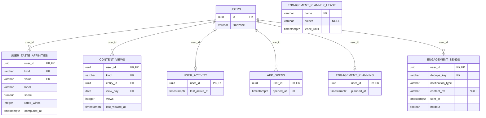

[View the full “Engagement and activity (V52, V66–V67)” diagram](https://images.vinnot.com/docs/diagrams/v1/en/backend-diagrams-relational-model-87a111131e72.svg)

All user FKs use CASCADE. `user_taste_affinities` has a `(user_id, kind, value)` PK, `kind` GRAPE or TYPE, `score` between 0 and 5, and positive `rated_wines`. `content_views` has a `(user_id, kind, entity_id, view_day)` PK; `kind` accepts WINE, ROUTE, EVENT, or WINERY and `entity_id` is polymorphic, without an FK. `app_opens` has a `(user_id, opened_at)` PK and `engagement_sends`, `(user_id, dedupe_key)`. `engagement_planner_lease` has no FKs: its single `planner` row coordinates the planner across instances. V67 adds `idx_users_timezone_id (timezone, id)`.

## Digest cursors (V54–V55)

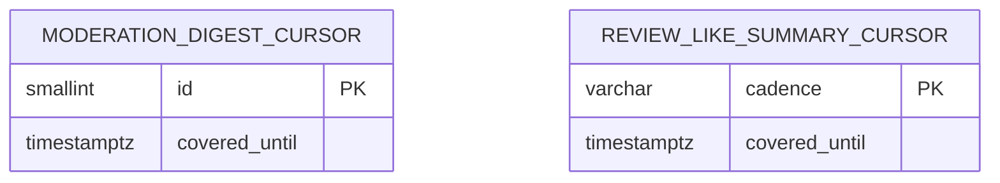

[View the full “Digest cursors (V54–V55)” diagram](https://images.vinnot.com/docs/diagrams/v1/en/backend-diagrams-relational-model-8501fce73e74.svg)

No FKs; the migration inserts the initial rows. `moderation_digest_cursor` has a single row (CHECK `id = 1`); `review_like_summary_cursor`, one per DAILY or WEEKLY `cadence`.

## Minimum app versions (V69)

```mermaid
erDiagram
 USERS { uuid id PK }
 APP_MINIMUM_VERSIONS {
  varchar platform PK
  varchar minimum_version "NULL"
  timestamptz updated_at "NULL"
  uuid updated_by FK "NULL"
 }
 APP_MINIMUM_VERSION_CHANGES {
  bigint id PK
  varchar platform
  varchar previous_minimum_version "NULL"
  varchar minimum_version "NULL"
  uuid changed_by FK "NULL"
  varchar changed_by_email
  timestamptz changed_at
 }
 USERS |o--o{ APP_MINIMUM_VERSIONS : updated_by
 USERS |o--o{ APP_MINIMUM_VERSION_CHANGES : changed_by
```

[View the full “Minimum app versions (V69)” diagram](https://images.vinnot.com/docs/diagrams/v1/en/backend-diagrams-relational-model-0cc49c7565e6.svg)

Both user FKs use SET NULL. `platform` accepts IOS or ANDROID. A platform without a row, or with a NULL `minimum_version`, has no minimum; the row is created on the first change. A CHECK limits `minimum_version` to `major.minor.patch`, with one to four digits per part. `app_minimum_version_changes` is the change history: `platform` is text without an FK to the current row, and `changed_by_email` keeps the author after the account is deleted. Indexes: `app_minimum_version_changes(changed_at DESC)` and the partial ones on `updated_by` and `changed_by`.

## Social publishing (V82–V84)

```mermaid
erDiagram
 SOCIAL_POSTS {
  uuid id PK
  varchar status
  varchar pillar_code FK
  jsonb publishing "NULL"
 }
 CONTENT_PILLARS {
  varchar code PK
  smallint weight
  boolean auto_approve
  boolean active
 }
 SOCIAL_PUBLICATIONS {
  uuid id PK
  uuid post_id FK
  varchar network
  varchar status
  varchar external_id "NULL"
  text permalink "NULL"
  int attempts
  varchar error "NULL"
  timestamptz created_at
  timestamptz updated_at
  timestamptz published_at "NULL"
 }
 SOCIAL_POST_METRICS {
  uuid publication_id PK
  date captured_on PK
  bigint views "NULL"
  bigint reach "NULL"
  bigint likes "NULL"
  bigint comments "NULL"
  bigint saves "NULL"
  bigint shares "NULL"
  bigint follows "NULL"
  timestamptz captured_at
 }
 SOCIAL_ACCOUNTS {
  varchar network PK
  varchar account_id
  varchar display_name "NULL"
  text access_token_ciphertext
  text refresh_token_ciphertext "NULL"
  timestamptz access_expires_at "NULL"
  timestamptz refresh_expires_at "NULL"
  varchar status
  varchar last_error "NULL"
  uuid connected_by "NULL"
  timestamptz connected_at
  timestamptz updated_at
  timestamptz refresh_claimed_until "NULL"
 }
 CONTENT_PILLARS ||--o{ SOCIAL_POSTS : pillar_code
 SOCIAL_POSTS ||--o{ SOCIAL_PUBLICATIONS : post_id
 SOCIAL_PUBLICATIONS ||--o{ SOCIAL_POST_METRICS : publication_id
```

[View the full “Social publishing (V82–V84)” diagram](https://images.vinnot.com/docs/diagrams/v1/en/backend-diagrams-relational-model-5fdf7a8bfdbf.svg)

The foreign keys `social_publications.post_id` and `social_post_metrics.publication_id` are `ON DELETE CASCADE`. `social_publications` has one row per post and network (UNIQUE `post_id, network`, which also indexes the foreign key) and indexes on `status` and `published_at`; CHECKs on `network` (INSTAGRAM, FACEBOOK, THREADS, TIKTOK) and `status` (QUEUED, PUBLISHING, PUBLISHED, DRAFT_SENT, FAILED). `social_post_metrics` keeps one snapshot per publication and day (PK `publication_id, captured_on`); a null metric is one the network does not give. `social_accounts` has one row per network connected with OAuth (Threads and TikTok), CHECKs on `network` and `status` (CONNECTED, REFRESH_FAILED); tokens are stored encrypted with AES-256-GCM, `connected_by` is the administrator's id without a foreign key and `refresh_claimed_until` is the refresh lease. V82 adds `content_pillars.auto_approve` (`false`) and `social_posts.publishing` (JSONB `{startedAt, finishedAt, error}`, null until it starts); V83 adds `content_pillars.active` (`true`); V84 inserts the `TERROIR`, `WINEMAKING`, `HISTORY`, `REGION`, `TASTING` and `SERVICE` pillars, rewrites the `QUIZ` and `CURIOUS_FACT` briefs and switches `HUMOR` off. All three migrations are additive.
