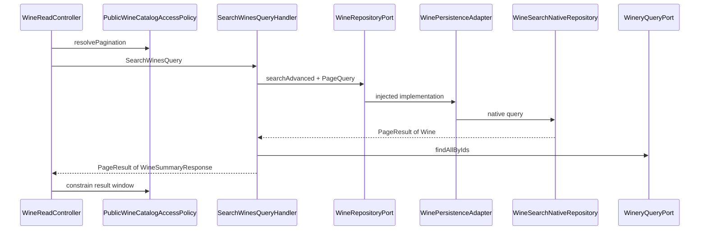
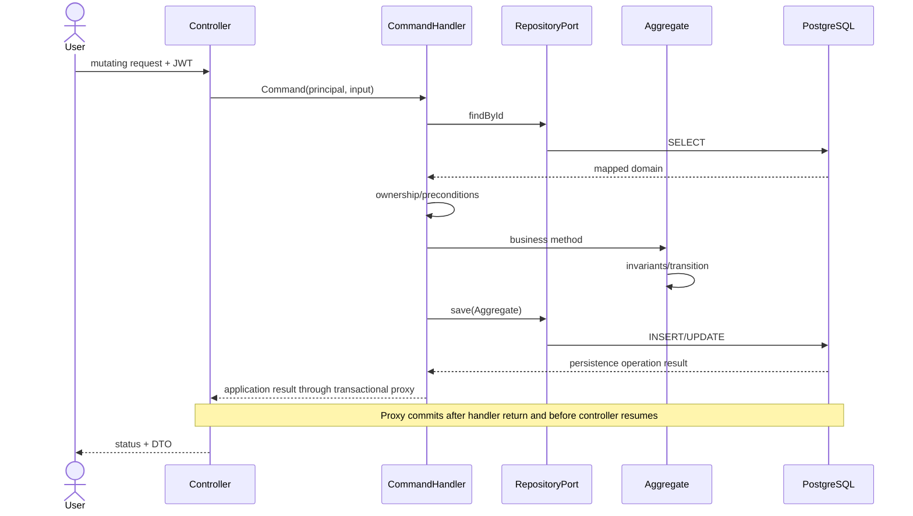
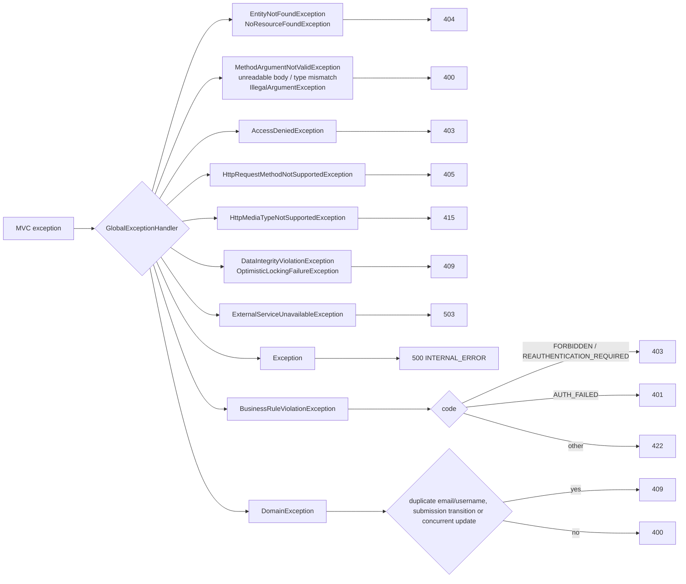
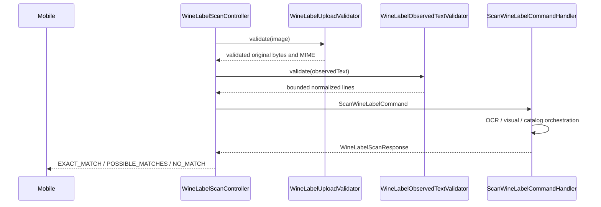
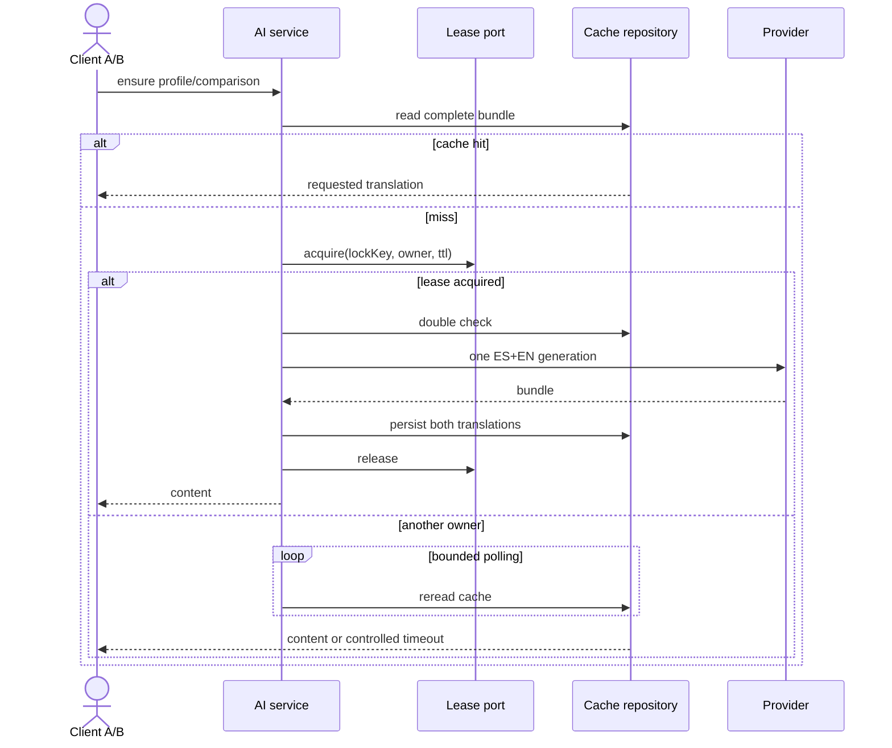

# Request and use-case lifecycle

## Public paginated read

[View the full “Public paginated read” diagram](https://images.vinnot.com/docs/diagrams/v1/en/backend-diagrams-request-lifecycle-7ac2b62e5023.svg)

The public edge limits size/window; PageQuery represents application parameters. The SQL read model selects and hydrates entities, the adapter maps domain models and the handler projects DTOs. Page<JpaEntity> is not exposed. Effective filters and totals are detailed in [search](../../modules/wines/architecture.md).

## Transactional command

[View the full “Transactional command” diagram](https://images.vinnot.com/docs/diagrams/v1/en/backend-diagrams-request-lifecycle-3d15f6ef7577.svg)

## Stable errors

[View the full “Stable errors” diagram](https://images.vinnot.com/docs/diagrams/v1/en/backend-diagrams-request-lifecycle-a994706dc54c.svg)

The advice body contains timestamp, path, status, code, message and details. X-Request-ID belongs to the header/MDC, not that record. Security/rate-limit filters can terminate requests before MVC and write their own responses. The advice does not imply a specific mapper for every framework exception.

## Scan multipart

[View the full “Scan multipart” diagram](https://images.vinnot.com/docs/diagrams/v1/en/backend-diagrams-request-lifecycle-bbcc8227266e.svg)

The full pipeline, errors and distinction between validation and persistence sanitization are documented in [backend scanning](../../modules/wines/architecture.md).

## Distributed cached generation

[View the full “Distributed cached generation” diagram](https://images.vinnot.com/docs/diagrams/v1/en/backend-diagrams-request-lifecycle-ab02478c7639.svg)

## Related documents

- [API](../architecture/api.md)
- [Errors, transactions, and consistency](../architecture/errors-transactions-and-consistency.md)
- [Security](../architecture/security-and-authorization.md)
- [Wine search](../../modules/wines/architecture.md)
- [Mobile scanning](../../modules/wines/architecture.md)
