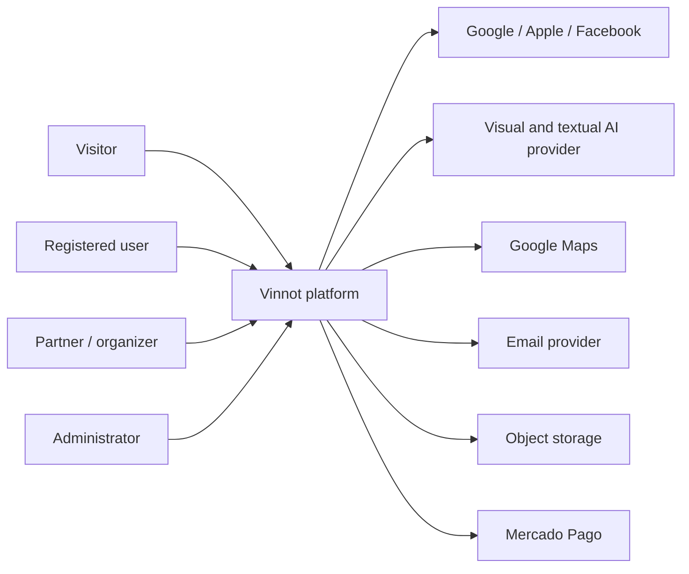
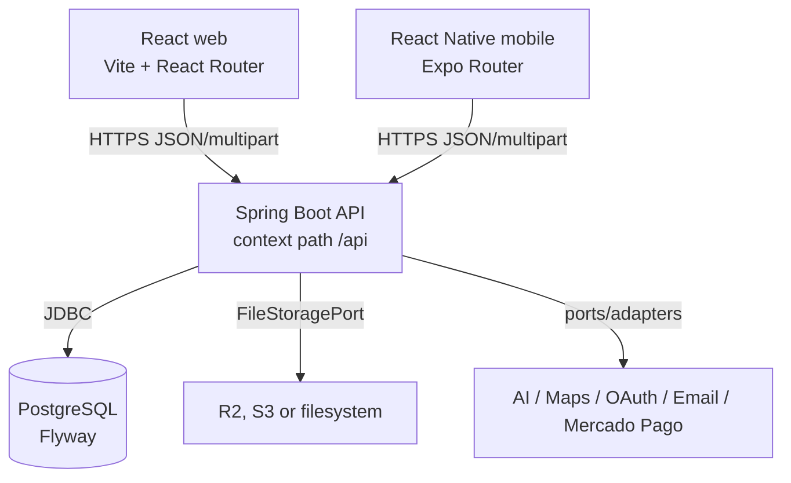
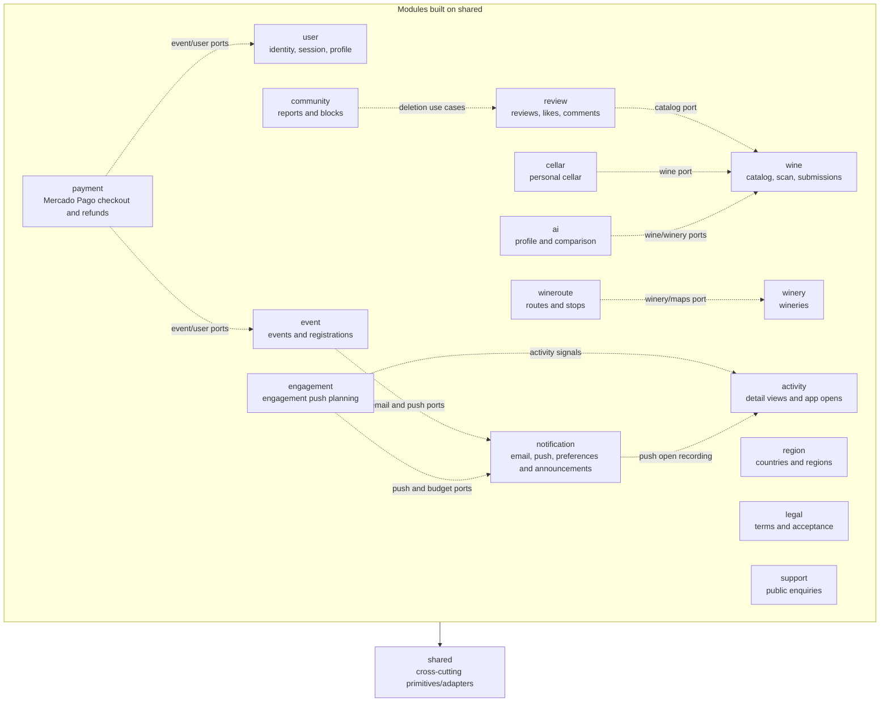
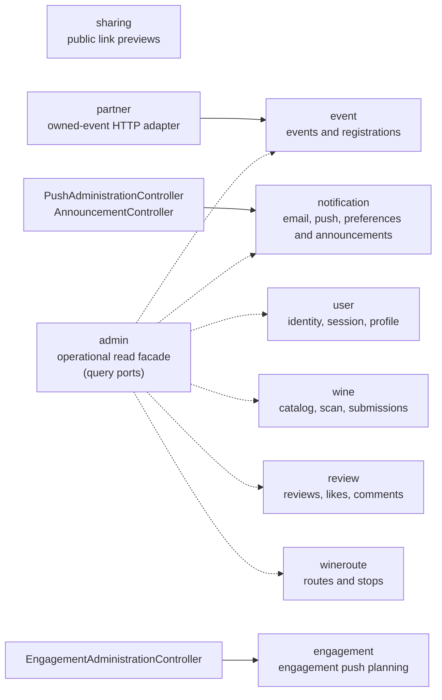
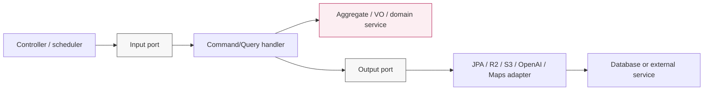
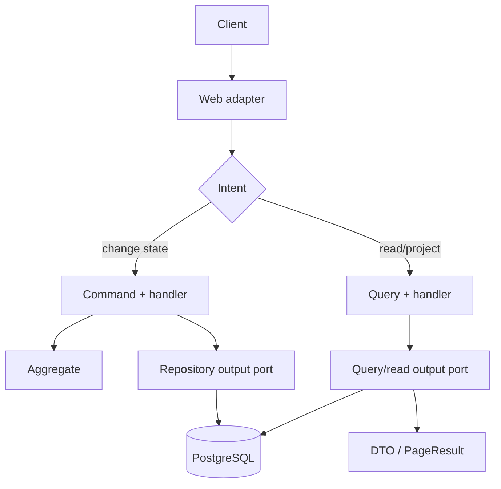
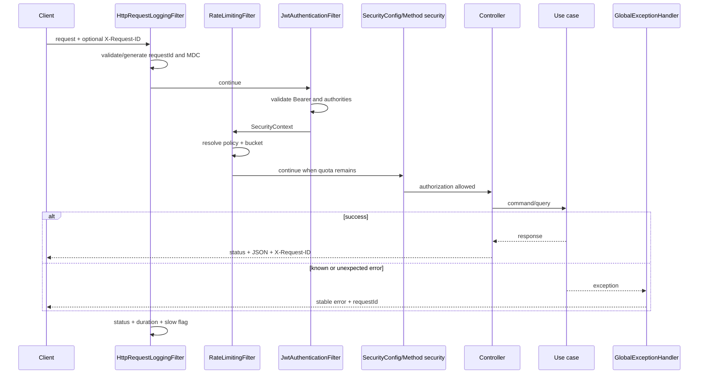
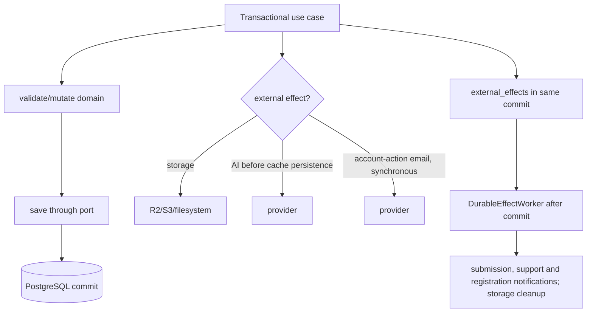

# Backend system maps

## How to read these diagrams

Each view answers a different question. Context shows actors and external
systems; containers show deployable processes; modules show ownership; layers
show dependency direction. They should not be mixed as one abstraction level.

## Product context

[View the full “Product context” diagram](https://images.vinnot.com/docs/diagrams/v1/en/backend-diagrams-system-map-5283bea9fed9.svg)

## Logical containers

[View the full “Logical containers” diagram](https://images.vinnot.com/docs/diagrams/v1/en/backend-diagrams-system-map-806e67e7556f.svg)

## Bounded contexts and ownership

### Domain modules

[View the full “Domain modules” diagram](https://images.vinnot.com/docs/diagrams/v1/en/backend-diagrams-system-map-a3aaf3f5a200.svg)

### Facades and adapters

[View the full “Facades and adapters” diagram](https://images.vinnot.com/docs/diagrams/v1/en/backend-diagrams-system-map-2ca720ce7890.svg)

Dashed arrows are contract collaboration, not access to another module's JPA
repository. `admin` and `partner` do not own operated aggregates. `sharing`
reads a minimal JDBC projection and imports no other module. `event` stands
for the modules that send email or push: `review`, `community`, `payment`,
`user`, `wine`, `legal`, `support` and `admin` use the same `notification`
ports. The `/admin/notifications/**` endpoints do not live in `admin`: the push
and announcement controllers belong to `notification` and the engagement
metrics one to `engagement`; `admin` only uses `NotificationPort` for the
moderation digest.

## Hexagonal slice of one module

This view shows runtime execution, not import arrows.

[View the full “Hexagonal slice of one module” diagram](https://images.vinnot.com/docs/diagrams/v1/en/backend-diagrams-system-map-48a93654a7c0.svg)

Code dependencies point inward toward domain/application. Runtime execution may
continue outward through a port, but handlers only know the interface.

## Logical CQRS separation over one database

[View the full “Logical CQRS separation over one database” diagram](https://images.vinnot.com/docs/diagrams/v1/en/backend-diagrams-system-map-db3065d6867e.svg)

CQRS here does not imply two databases or event sourcing. Write intent and read
projection have different contracts, enabling optimized read models without
polluting aggregates.

## Cross-cutting HTTP pipeline

[View the full “Cross-cutting HTTP pipeline” diagram](https://images.vinnot.com/docs/diagrams/v1/en/backend-diagrams-system-map-265852f60e49.svg)

## Persistence and external effects

[View the full “Persistence and external effects” diagram](https://images.vinnot.com/docs/diagrams/v1/en/backend-diagrams-system-map-fc755744ee5c.svg)

PostgreSQL shares no transaction with S3, email, or AI. The avatar flow has
specific compensation for a new object when persistence fails; this is not a
general guarantee for all uploads. AI profiles use cache/leases; submissions
coordinate writes through an advisory lock per identity key. Account-action email
is synchronous and separate from the PostgreSQL commit; submission, support and
registration notifications are delivered through the durable `external_effects`
outbox.

## Documentation navigation

- [UML domain model](domain-class-model.md)
- [Detailed request lifecycle](request-lifecycle.md)
- [Domain state machines](domain-state-machines.md)
- [Data, locks, and consistency](data-consistency.md)
- [Module boundaries](../architecture/module-boundaries.md)
- [Errors and transactions](../architecture/errors-transactions-and-consistency.md)
- [ERD and relational model](../data/database-model.md)
- [Security](../architecture/security-and-authorization.md)
