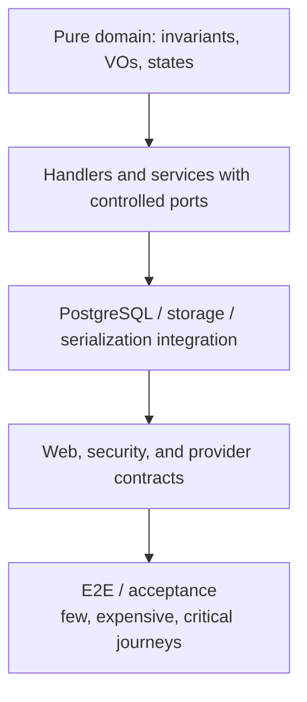
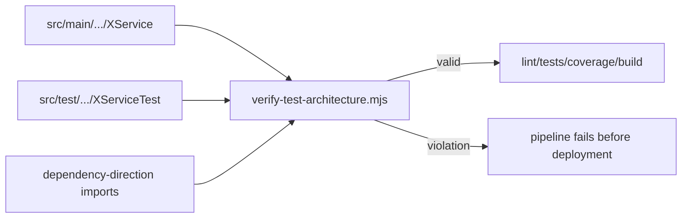
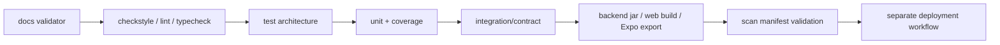

# Comprehensive testing strategy

## Quality objective

backend/pom.xml configures JaCoCo in verify. Thresholds are gate configuration, not measured results for the current branch.

CI runs `mvn -B clean verify`. The JaCoCo agent uses `append=false`: each execution replaces previous coverage, preventing manual or opt-in tests from masking scenarios missing from the automated suite. The current configuration uses a single test process; if parallel forks are introduced, separate files per fork must be generated and merged only within the same run.
| Element | Selection | Threshold |
|---|---|---|
| BUNDLE | included classes | LINE >= 90%, BRANCH >= 65% |
| PACKAGE | com.vinnot.*.application.service, com.vinnot.*.domain.service | LINE = 100%, METHOD = 100% |
| CLASS | com.vinnot.*.application.command.handler.*, com.vinnot.*.application.query.handler.* | LINE = 100% |

Instrumentation covers domain/model, domain/valueobject, domain/service, application/service, command/handler, query/handler, query/*Handler* and application/util. The CLASS rule uses only its two patterns; bundle inclusion does not automatically apply the per-class gate. There is no universal 100% branch threshold. Web/mobile have separate selections outside JaCoCo.

Beyond coverage, evaluation includes invariants, errors, ownership, concurrency, contracts and persistence. A mirrored test file alone does not establish behavior coverage.

## Pyramid and responsibilities



[View the full “Pyramid and responsibilities” diagram](https://images.vinnot.com/docs/diagrams/v1/en/backend-testing-strategy-da799d1f6c1a.svg)

| Level | What it proves | Allowed dependencies |
|---|---|---|
| domain | invariants and transitions | JUnit/Jest/Vitest; no framework or I/O |
| application | orchestration, order, errors, compensation | mocked/fake ports |
| persistence | mapping, SQL, constraints, locks, indexes | real PostgreSQL |
| web | validation, auth, status, headers, JSON | MVC/focused context |
| provider | parsing and degradation | fixture, fake server, or bounded sandbox |
| presentation | states and user events | Testing Library |
| E2E | journey integration | controlled deployable stack |
| benchmark | latency, accuracy, stability, cost | versioned dataset and gates |

Legal acceptance and self-deletion are also tested with the full Spring context,
real loopback HTTP and Testcontainers PostgreSQL. The test enables enforcement:
login, refresh and locale changes never create consent; acceptance requires the
current hash and is idempotent. Deletion remains available without accepting
terms, revokes sessions, recalculates review aggregates and retains private
report evidence with the deleted authorship removed. AI and email are substituted
in this isolated environment; these tests do not certify external providers or
the interface on a physical device.

## Mirrored test architecture

For example (illustrative names), a logic class at:

```text
src/main/java/com/vinnot/wine/application/service/ExampleService.java
```

must have:

```text
src/test/java/com/vinnot/wine/application/service/ExampleServiceTest.java
```

The same rule applies to `domain/service` and frontend services:

```text
frontend-mobile/src/application/services/wines.service.ts
frontend-mobile/src/application/services/wines.service.test.ts
```

Handlers may share a suite in the same package if the test explicitly references
every handler. `scripts/verify-test-architecture.mjs` enforces:

- mirrored tests for application/domain services;
- a same-package test reference for every handler;
- a test for every frontend service;
- tests for validators and mappers;
- no empty tests;
- no infrastructure/Spring/JPA dependencies inside domain;
- no controllers depending on output ports.



[View the full “Mirrored test architecture” diagram](https://images.vinnot.com/docs/diagrams/v1/en/backend-testing-strategy-331d7e8bcd19.svg)

## Backend: domain

Domain tests are pure unit tests. They do not start Spring, mock value objects, or
serialize HTTP. They cover:

- valid construction and every invalid invariant;
- boundary values and Unicode/case normalization;
- value-object equality;
- allowed and forbidden state-machine transitions;
- idempotency when part of the contract;
- capacity, rating, and counter arithmetic;
- ownership in domain when the aggregate carries its owner; when requester
  identity exists only in the command, handler tests cover the ownership matrix;
- dates before, on, and after boundaries.

Critical examples:

- `Event` and `EventRegistration`: capacity, holds, approval, payment,
  confirmation, cancellation, and expiration;
- `WineSubmission`: terminal states and valid decisions;
- `WineLabelMatcher`: positive evidence, contradictions, threshold, and margin;
- `User`: roles, lock, activation, onboarding, and identity;
- `Review`: authorship, rating, and counters;
- `WineRoute`: stops, order, publication, and archive.

## Backend: application

A handler is tested with mocked ports or deterministic fakes. Tests verify not
only output but relevant interactions:

1. which repository is queried;
2. which validation occurs before effects;
3. which aggregate is mutated;
4. which data is persisted;
5. which external port is called and how many times;
6. what compensation runs after a later failure;
7. which exception/code propagates.

Queries cover filters, pagination normalization, projection order, and not-found.
Commands cover success, every precondition, and partial failures.

### AI

- complete versus incomplete cache;
- atomic ES+EN generation;
- ensure versus force;
- canonical comparison pair and reversed response;
- lease acquisition, wait, stale takeover, and timeout;
- invalid JSON, missing language, and fallback;
- profile generation without catalog-field mutation;
- disabled or unavailable provider.

### Scanning and submissions

- invalid image, insufficient quality, and EXIF;
- JPEG/PNG header pixel limits before decoding and bounded subsampling;
- OCR/vision with terms, no terms, and contradictions;
- exact, suggestions, and no-match;
- SQL timeout with indexed fallback;
- fail-closed moderation;
- duplicate recheck under lock;
- image promotion and compensation;
- exact-identity publication, concurrent image preservation and changed revisions;
- provider/catalog failures distinct from no-match, with shared deadlines;
- retention by state;
- ownership when reading submissions.

### Identity

- duplicate registration and normalization;
- local password versus social account;
- cryptographic provider verification;
- secure linking;
- refresh rotation/replay and logout;
- used, expired, or wrong-type action tokens;
- email change and session revocation;
- Apple deletion with recent authorization.

## Backend: PostgreSQL persistence

Database-specific SQL is never certified with H2. Tests use real PostgreSQL,
ideally Testcontainers or an ephemeral instance compatible with runtime.

Minimum cases:

- Flyway from scratch and upgrade from the previous version;
- unique review, like, cellar, identity, and active-registration constraints;
- event, submission, and rating check constraints;
- expected `ON DELETE CASCADE` and `SET NULL`;
- trigram/FTS queries with accents and multiple tokens;
- trigger synchronization of `wine_catalog_search`;
- filters and stable ordering;
- PESSIMISTIC_WRITE locks for events/registrations;
- submission and AI advisory/distributed locks;
- ES/EN JSONB and comparison orientation;
- multipart + metadata + storage lifecycle.

Repository tests verify semantics. Plans and latency are separate benchmarks so
the unit suite does not become timing-fragile.

No test waits forever on the database. `src/test/resources/org/postgresql/driverconfig.properties`
gives every test connection (Hikari, Flyway and plain `DriverManager`) a 10 s connect,
15 s login and 120 s read timeout, so a dropped Docker connection fails the test in
seconds instead of hanging the build. `PostgresTestConnectionTimeoutsTest` pins it with a
server that accepts the connection and never answers. As a last resort, Surefire stops a
test JVM still running after 20 minutes, the same limit as the CI job. Production
connections do not use these files.

### Suites and evidence scope

DatabaseIndexContractPostgresIntegrationTest, WineSubmissionPostgresIntegrationTest and WinePersistenceAdapterPostgresIntegrationTest use PostgreSQL Testcontainers with disabledWithoutDocker=true. Inspect skipped tests: a build without Docker does not certify those integrations. WineSubmissionMultipartContractTest covers web-adapter multipart. OpenAiClientContractTest uses a local fake HTTP server, not the real provider. SecurityConfigAccessTest uses probe controllers and mocked filters, so it does not replace real-endpoint ownership tests. JacksonJsonContractTest pins the HTTP JSON wire format of the application mapper (ISO dates, enum names, explicit nulls, BigDecimal scale, `isActive` naming, declaration order, null primitives, trailing content); a Jackson or Spring Boot upgrade must keep it green. On Spring Boot 4 the slices live in their technology modules (`spring-boot-webmvc-test`, `spring-boot-data-jpa-test`, `spring-boot-jdbc-test`), `@SpringBootTest` needs `@AutoConfigureTestRestTemplate` for `TestRestTemplate`, and Testcontainers 2 uses `org.testcontainers.postgresql.PostgreSQLContainer`.

## Backend: web, security, and contracts

Every endpoint family requires:

- valid and invalid requests;
- missing authentication (`401`);
- insufficient role/authority (`403`);
- foreign resource despite authority (`403` or defined business error);
- status and headers;
- normal and paginated wrappers;
- stable error shape with `code`, `message`, `requestId`, and fields;
- `Content-Type`, multipart limits, and cache headers;
- language/locale when payload changes;
- no quarantine-image exposure;
- rate limits and `429`.

`SecurityConfig` tests protect matcher order. A new route absent from the access
matrix should fail review or a test.

## Web frontend

Vitest + jsdom cover logic and focused presentation; Testing Library asserts
what users observe. MSW tests HTTP contracts without coupling tests to Axios.

### Domain and application

- DTO-to-model mappers;
- validators and field messages;
- page normalization;
- services invoking the correct client;
- error propagation/classification;
- language in profiles and comparisons;
- admin/partner operations and payloads.

### Presentation

- route guards and redirects;
- loading, empty, error, and success;
- debounced filters and query parameters;
- TanStack Query invalidation after mutations;
- forms, confirmations, and keyboard accessibility;
- language changes without AI regeneration;
- wine selection/replacement in comparison.

### Web E2E

Playwright is configured for high-value journeys: authentication, search,
details, cellar, event, administration, and partner. It should not duplicate
every unit branch; it proves wiring, navigation, and integrated contracts.

## Mobile frontend

Jest Expo and Testing Library cover services, hooks/view models, and screens.
Native APIs are isolated behind mockable adapters rather than scattered UI
conditions.

Critical cases:

- session restoration and refresh;
- auth/app/onboarding routes and roles;
- language persistence;
- denied camera and back button;
- frozen capture, cancellation, and ignored late response;
- offline, timeout, expired session, and provider classification;
- temporary image retained through search/submission;
- submission form and later status;
- language-specific cached profile/comparison;
- safe area and bottom bar not covering content;
- complete non-overlapping loading transitions.

JS tests cannot certify camera hardware, SecureStore entitlements, native
Google/Apple sign-in, maps, or device performance. Those risks belong to native
preflight and the physical matrix.

## Scan benchmarks

The automated benchmark uses a versioned manifest and separates Argentinian,
global, and negative cohorts. Each case states expected identity and whether
exact, top-3, or rejection is valid.

Metrics:

- exact precision;
- top-1 recall (exact or correct first suggestion);
- top-3 recall;
- false-exact rate;
- safe rejection;
- repetition stability;
- p50, p95, and maximum latency;
- technical errors;
- estimated provider consumption/cost.

Normal CI validates structure without provider spend. A real run requires
explicit opt-in, controlled credentials and budget, and preserves output as a
CI/release artifact rather than dated narrative in architecture docs.

`scripts/data/wine-label-variety-regression-v1.json` fixes expected IDs for reported
labels and varietal siblings before evaluation. Its gates include top-1 recall,
exact precision, technical errors, latency and repeated-result stability. Scores
are ranking evidence, not calibrated probability. Report wrong exact matches on
known wines as well as false exacts on negative controls.

`VINNOT_SCAN_INTERVAL_MS` spaces requests outside measured latency; it does not
retry failed scans. Timing starts after fixture preparation and measures the API
round trip, not native capture/OCR or source-image download. Preserve the target
environment with the report: a local restored catalog does not certify AWS latency.
`VINNOT_SCAN_PROGRESS_FILE` optionally records per-case JSONL checkpoints outside
official documentation. Reference images validate retrieval against the catalog;
independent photos and physical-device cases validate different conditions.

## Physical matrix

At minimum:

| Platform | Risks |
|---|---|
| iOS simulator | routing, layout, JS bundle; no real camera |
| physical iPhone | permissions, camera, memory, network, SecureStore, OAuth |
| Android emulator | routing, back button, layout, bundle |
| physical Android | camera, permissions, vendors, memory, deep links |

Camera scenarios include curved label, glare, low light, small type, movement,
complex background, no text, orientation, and cancellation. Evidence records app
version, OS, device, and outcome; physical acceptance is never implied.

## CI and gate order



[View the full “CI and gate order” diagram](https://images.vinnot.com/docs/diagrams/v1/en/backend-testing-strategy-441582a65b68.svg)

Main commands:

```bash
python3 scripts/validate_documentation.py
node scripts/verify-test-architecture.mjs

cd backend && mvn clean verify
cd frontend-react && npm ci && npm run lint && npm run test:coverage && npm run build
cd frontend-mobile && npm ci && npm run lint && npm run typecheck && npm run test:coverage
```

Before consuming EAS for iOS:

```bash
cd frontend-mobile
npm run preflight:ios:native
```

## Designing a good test

Names express condition, action, and observable result. AAA may be used without
redundant comments. Rules:

- one failure reason per test;
- small fixtures and explicit builders;
- injectable clocks/UUIDs/providers for nondeterminism;
- never mock the class under test;
- avoid irrelevant implementation assertions;
- avoid large snapshots as the only assertion;
- cover boundaries and negative branches;
- reproduce a bug with a test before fixing it;
- keep tests independent and clean data.

## Flake policy

A flaky test is not retried indefinitely or ignored. Classify it as:

- time/clock;
- concurrency;
- shared order/state;
- network/provider;
- animation/waiting;
- reused data or ports.

The fix removes the nondeterminism source. Retries are acceptable only for
explicit external tests and must be measured.

## Definition of done

A feature is not complete until:

1. invariants and application branches are tested;
2. mirrored test architecture passes;
3. coverage passes without opportunistic exclusions;
4. SQL/constraints are tested on PostgreSQL;
5. security and HTTP contracts are covered;
6. client loading/error/retry/cancel paths are tested;
7. critical journeys have risk-proportional acceptance;
8. documentation and diagrams reflect proven behavior.
