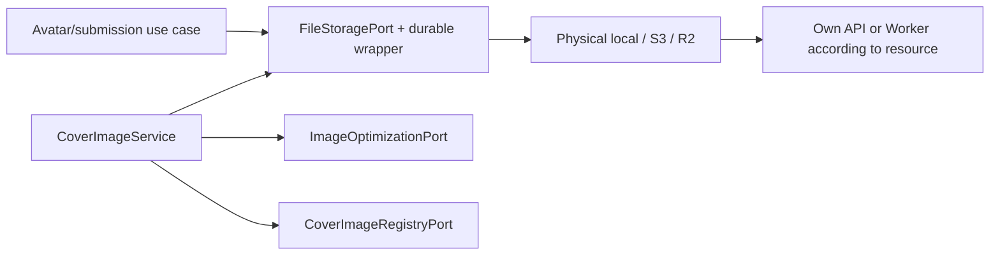
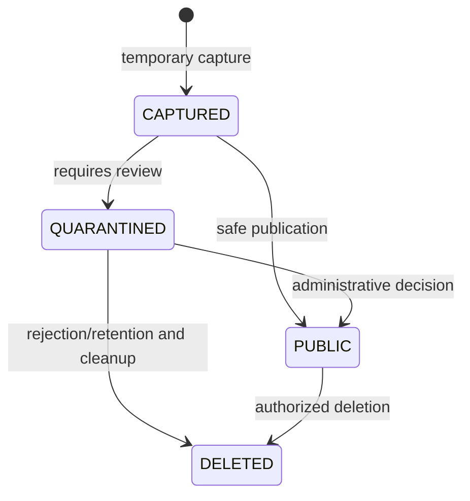
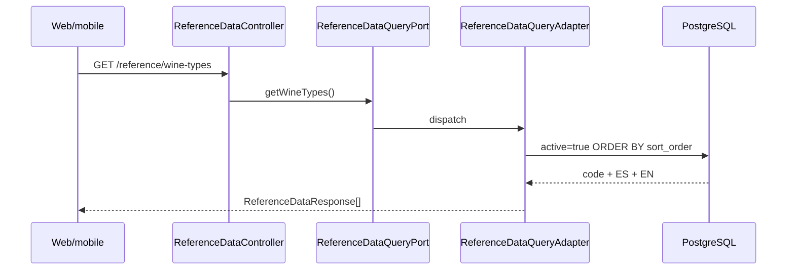

# Public files, quarantine and reference data

## Scope and composition

Shared images are orchestrated through application ports: `FileStoragePort`
handles avatars, public/quarantined labels and cover bytes; `CoverImageUseCase`,
`ImageOptimizationPort` and `CoverImageRegistryPort` coordinate event/route covers.
Each module's use cases decide when to attach, promote or retire an image.
The second capability is reading reference catalogues and geography.

`TransactionalFileStorageAdapter` is the primary port wrapper and delegates to
the physical provider selected by `app.storage.provider`:

| Provider | Implementation | Use |
|---|---|---|
| `local` or absent | `FileStorageService` | local filesystem |
| `s3` | `S3FileStorageService` | AWS storage compatible with historical URLs |
| `r2` | `R2FileStorageService` | new WebP uploads, with a separate S3 adapter for earlier references |

`R2StorageConfiguration` configures the R2-compatible S3 client and
`legacyFileStorage`; using the S3 protocol does not mean storing the object in
AWS. Handlers depend on ports, not SDKs, buckets or physical paths.

[View the full “Scope and composition” diagram](https://images.vinnot.com/docs/diagrams/v1/en/backend-use-cases-uploads-and-reference-data-2232c3da9d0e.svg)

## Validation and persisted format

The server validates positive size up to 8 MiB, declared MIME, signature/content
and generated names; it does not accept arbitrary client keys. Supported input
formats are JPEG, PNG, GIF and WebP. Recognition validation preserves input
bytes. `WineLabelUploadValidator.validateAndSanitizeForPersistence` decodes labels and
produces RGB JPEG up to 1600 pixels without copying metadata.

With `provider=r2`, the adapter optimizes avatars and labels to WebP through
`WebpImageOptimizer`. Covers pass through that optimizer in `CoverImageService`
for all three providers. It checks MIME against content, a 24-million-pixel
maximum, EXIF orientation, bounded decoding and the first GIF frame. It writes
a new raster and runs `cwebp` with `-metadata none`, without a shell or user-supplied
arguments.

| Purpose | Maximum long edge | Maximum WebP bytes |
|---|---|---|
| Avatar | 512 px | 128 KiB |
| Label | 1600 px | 512 KiB |
| Event/route cover | 1600 px | 512 KiB |

Exceeding the output bound rejects the upload; oversized images are not silently
stored. The encoder is a host/container infrastructure dependency, not a domain
dependency. Invalid files are client errors; an unavailable encoder/storage is
an infrastructure failure without exposing credentials.

## Names, ownership and delivery

Avatars include user and random UUIDs; labels include the submission UUID. R2
uses the `.r2.webp` suffix and `uploads/{environment}/` namespace. Covers use
`/api/uploads/covers/{UUID}.webp`, with private objects and inventory. Dev/prod
uploads are isolated; the catalogue has one independent shared copy.

| Resource | Delivery | Cache and access |
|---|---|---|
| Historical/local avatar or label | `UploadController`, `/uploads/avatars/{filename}` and `/uploads/wine-labels/{filename}` | public 30 days, validated filename |
| New R2 avatar/label | `images.vinnot.com` Worker | public 60 s, explicit key formats |
| Quarantined label | `/admin/wine-submissions/{id}/image` | ADMIN/MODERATOR, `no-store` |
| Managed cover | `CoverImageController`, `/uploads/covers/{id}.webp` | visibility/ownership checked per request, `no-store` |

Buckets remain private. The Worker exposes neither quarantine nor covers and
permits no uploads/deletes/listing. API delivery includes MIME and length;
historical public endpoints add `Content-Disposition: inline`. Immutable names
allow caching; retirement cannot revoke bytes already downloaded or cached.

## Event and route covers

`POST /uploads/covers` accepts multipart `kind=EVENT|WINE_ROUTE` and `file`.
The controller requires create/update permission for the selected kind. The use
case records owner/kind and reserves quota before processing; it marks `ready`
after storing. It returns ID, URL, dimensions and bytes without publishing the
resource.

Event/route commands validate the reference through `CoverImageUseCase`: a new
cover must be ready, match the kind and belong to the actor or authorized staff.
Retaining an existing reference also locks/checks its inventory. External URLs
retain the earlier contract; naming that domain does not turn an external image
into a managed object.

`JdbcCoverImageRegistry.permitsRead` allows owners to read unattached uploads,
authorized staff and resource owners. Public readers can only access events
published at least once and outside DRAFT, or PUBLISHED routes. Other cases
return 404. An expired Bearer returns 401 to enable refresh; it never degrades
to anonymous draft access.

Web and mobile download managed covers with the session (`useCoverImagePreview`).
While the download runs, `CoverImage` shows a neutral placeholder of the same
size; the bundled illustration appears only when there is no cover or it cannot
load. Each app keeps the downloaded covers in session memory (40 entries, never
on disk) and stores the file it just uploaded under the returned URL, so the
new cover opens at once. The memory is cleared when the session ends or the
user changes. The client sends credentials only to the Vinnot API hosts or to
the configured API origin.

## Adjusting the photo before uploading

Since #516, every photo upload on web and mobile goes through an adjust step
before anything is sent: event and route covers, the profile photo, admin wine
images and winery logo/cover images. After picking the file (or taking the
photo on mobile), the app shows it inside the frame where it will be displayed.
The photo always fills the frame. The person drags it to move it and zooms up to
4x (mouse wheel, slider or `+`/`-` keys on web; pinch on mobile). **Use photo**
uploads exactly what the frame shows; **Cancel** uploads nothing and keeps the
previous image.

| Image | Frame |
|---|---|
| Event and route cover | 16:9, with the 21:8 strip of the web detail header marked as always visible |
| Profile photo | 1:1, round mask |
| Wine image | 3:4 |
| Winery logo / cover | 1:1 / 16:9 |

The crop happens on the device: the existing size and format checks run on the
picked file first, then the app exports the chosen area as JPEG (quality 0.9,
long edge at most 2400 px, 1200 px for profile photos and logos on mobile, never upscaled, EXIF orientation applied; mobile keeps PNG for catalog images so transparency survives) and sends
it through the same endpoints. The backend is unchanged and stores no crop
metadata. Event and route cards and the mobile detail headers show covers at
16:9, so the chosen area is what people see.

- Web: `ImageCropDialog` → `useImageCropEditor` → `imageCropService` →
  `canvasImageCropper`, geometry in `src/domain/media/imageCrop.ts`.
- Mobile: `ImageCropModal` (gesture-handler + reanimated) → the image picker
  gateway crop (`expo-image-manipulator`), geometry in
  `src/domain/media/imageCrop.ts`. No native dependency was added.

## Quarantine, promotion and compensation

[View the full “Quarantine, promotion and compensation” diagram](https://images.vinnot.com/docs/diagrams/v1/en/backend-use-cases-uploads-and-reference-data-be21d461c9cf.svg)

Local copies to its public directory; S3 copies to its public prefix with AES-256.
R2 publishes WebP bytes and also converts legacy S3 quarantine when promoted.
Private-copy deletion is scheduled after persisting the decision, rather than
before committing its transaction.

PostgreSQL and storage share no transaction. The wrapper records durable
reconciliation before writing/promoting in an independent transaction with a
two-hour grace period. Deletion requests join the business outbox.
`StorageCleanupEffectHandler` rechecks user, submission and wine references;
an orphan avatar must also be older than one hour. Avatar cleanup only deletes
files stored for that user (`avatar_<userId>_…`); an external picture URL saved
by social sign-in is not a stored file and finishes without deleting anything.
Cleanup is idempotent and retains retries. Replaced, abandoned or cascade-orphaned covers are reconciled
through inventory/outbox with references rechecked under lock.

V27 preserves quotas and inventories across business rollbacks. The API limits
operations/bytes per environment and uploads per user; disabling writes preserves
existing-object reads. Concrete limits, activation, CAS migration and rollback
are maintained in the [WebP/R2 runbook](../../infra/operations/user-images-r2.md).
The [external-effect contract](../architecture/session-and-data-integrity.md)
describes the worker, retries and reference protection.

## Reference catalogs

`ReferenceDataController` exposes PostgreSQL-backed catalogs:

- `GET /reference/wine-types`;
- `GET /reference/event-types`;
- `GET /reference/event-statuses`.

Each item returns `code`, `nameEs`, and `nameEn`. Adapters filter `active=true`
and order by `sort_order`. This avoids hardcoded presentation enums and permits
new rows without client deployments, provided the backend supports their
semantics.

[View the full “Reference catalogs” diagram](https://images.vinnot.com/docs/diagrams/v1/en/backend-use-cases-uploads-and-reference-data-ec3ccfd918a0.svg)

The shared adapter knows `wine` and `event` JPA repositories, making it a
deliberate read-only cross-module projection. It must not evolve into a
cross-module write service.

## Countries, regions, and grapes

Geography owns its own module:

- `GET /regions/countries`;
- `GET /regions`;
- `GET /regions/country/{countryId}`.

Handlers query domain repositories and project DTOs. `countries.code` is unique,
as is `(regions.name, country_id)`. The by-country endpoint avoids filtering the
entire catalog on clients.

`GET /grape-types` returns the active grape catalog through `wine`. Forms retain
the domain ID/code and localize only the visible label; translated text is never
persisted as identity.

## Cache and internationalization

Catalogs change infrequently and fit client-side TanStack Query caching.
Responses contain both languages, avoiding calls on locale changes. The
client chooses `nameEs` or `nameEn`; adding another language requires an
expanded persistent contract rather than ad-hoc UI translation.

## Required tests

### Storage contract

The same suite runs against local, S3 and R2 fake/integration adapters:

- every valid MIME;
- fake MIME and invalid magic bytes;
- zero and over-limit size;
- filename/path traversal;
- avatar ownership;
- idempotent store/load/delete;
- quarantine, promotion, and cleanup;
- preserved content type and size;
- missing object.

### Web

- cache and inline headers;
- invalid filename and not-found;
- quarantine restricted to administrators/moderators and `no-store`;
- multipart limits;
- no bucket/key exposure.

### Reference data

- active-only and stable order;
- ES/EN names;
- country without regions;
- missing country;
- PostgreSQL unique constraints;
- clients selecting locale without altering identity.

## Operational contract

- Local storage belongs to the instance filesystem; it is not automatically
  shared across nodes.
- Writing/copying an R2/S3 object and committing PostgreSQL are independent operations.
- Historical API caching (30 days) and Worker caching (60 s) require immutable filenames; covers/quarantine use `no-store`.
- General uploads accept GIF; labels use their own image validation and
  normalization.
- Adapters load complete objects into memory, subject to the configured size
  limit.
- Localized catalogs contain ES/EN fields.

## Source files

- `shared/application/port/FileStoragePort.java`;
- `shared/infrastructure/storage/FileStorageService.java`;
- `shared/infrastructure/storage/S3FileStorageService.java`;
- `shared/infrastructure/storage/R2FileStorageService.java`;
- `shared/infrastructure/storage/TransactionalFileStorageAdapter.java`;
- `shared/application/media/CoverImageService.java`;
- `shared/infrastructure/media/{WebpImageOptimizer,JdbcCoverImageRegistry}.java`;
- `shared/infrastructure/web/controller/CoverImageController.java`;
- `shared/application/service/PublicUploadService.java`;
- `shared/infrastructure/web/controller/UploadController.java`;
- `shared/infrastructure/web/ReferenceDataController.java`;
- `shared/infrastructure/persistence/ReferenceDataQueryAdapter.java`;
- `region/**` and `wine/.../GrapeTypeController.java`.
