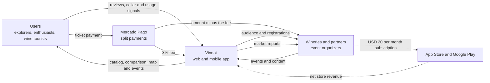

# Business model

This chapter explains how Vinnot creates, offers and captures value: whom it
serves, which alternatives it competes with, how it earns money today, what it plans
to charge and what it costs to run at different scales. It brings the competitive
analysis, the Business Model Canvas, the SWOT analysis and the platform economics
together in one place, without repeating what the modules already document.

## Executive summary

**Value proposition.** "Discover wines you like and connect them with their origin:
compare labels, save experiences, follow wineries and find where to live the wine."
The full development is in the [Business Model Canvas](business-model-canvas.md#value-proposition).

**For whom.** Four prioritized segments: explorers and occasional consumers,
enthusiasts, travelers and wine tourists, and wineries and professional partners. The
first commercial version prioritizes end users and wineries
([segments and focus decision](business-model-canvas.md#prioritized-segments)).

**Positioning: from catalog to ecosystem.** Vinnot does not compete by having more
features than the global platforms, but by connecting decisions that are fragmented
today: discovering a wine, understanding it, comparing it, saving it, getting to
know its winery and turning that interest into a physical experience, such as a
visit, a tasting or an event. The product is global; the first stage is Argentina, where
the product and wine tourism are closely related ([competitive analysis](competitive-analysis.md) and
[market context](swot.md#market-context)).

**How it earns money.**

| Source | Status | Detail |
|---|---|---|
| Fee on paid event tickets | Implemented | 3% of the ARS total, charged with Mercado Pago's split ([Payments](../modules/payments/README.md)) |
| Increase of that fee | Planned | 8% once the user base grows and 12% within a one-year horizon ([Monetization and plans](monetization.md)) |
| Winery subscription | Planned | Free plan to edit the profile, upload and edit their own wines, create events and see basic metrics; Pro plan at USD 20 per month, billed through the App Store or Google Play, with a weekly pulse and a monthly report on the interest, opinion and audience of their wines; target launch on 2027-03-01 ([Monetization and plans](monetization.md)) |

**How it is measured.** The north-star metric is the number of monthly active users
who perform at least two value actions related to wine
([Key metrics](key-metrics.md#north-star-metric)).

## Ecosystem and value flows

Solid arrows are flows that already exist in the product; dashed arrows are planned
flows.

[View the full “Ecosystem and value flows” diagram](https://images.vinnot.com/docs/diagrams/v1/en/business-readme-3dd8d9b7475f.svg)

## How to read this chapter

| Page | What it answers |
|---|---|
| [Competitive analysis](competitive-analysis.md) | What five international wine platforms do, how they earn money and what Vinnot learns from each |
| [Business Model Canvas](business-model-canvas.md) | The nine blocks of Vinnot's model, its hypotheses and the sequence of business stages |
| [SWOT analysis](swot.md) | The Argentine market context, strengths, weaknesses, opportunities and threats, and the action plan |
| [Key metrics](key-metrics.md) | The north-star metric, the indicators by dimension and which signals the platform already records |
| [Monetization and plans](monetization.md) | The ticket fee, its planned increase and the winery subscription |
| [Current costs](costs.md) | What it costs to run Vinnot today, per month and per year |
| [12-month user projection](user-acquisition-projection.md) | How many users Vinnot can gain in a year and through which channel, with public data and assumptions |
| [Winery pricing roadmap](winery-pricing-roadmap.md) | The founder winery offer, how the Pro plan price rises and what the winery gets |
| [Winery reports](winery-reports.md) | What the Pro plan reports contain, which data they come from, which privacy rules they follow and how they are validated |
| [Capacity and cost projections](capacity-and-cost-projections.md) | How many users the current plans support and what changes at a larger scale |
| [Revenue simulator](revenue-simulator.mdx) | An interactive calculation of fee and subscription revenue |
| [Cost simulator by scale](cost-simulator.mdx) | An interactive calculation of costs by number of users |

## Status of the information

This chapter mixes product facts with business decisions, plans and estimates. To
keep them apart, every statement carries one of these statuses:

| Status | Meaning |
|---|---|
| Implemented | Exists in the code, and the source is linked |
| Planned | A business decision not implemented yet |
| Hypothesis | A model idea to validate before it is planned |
| Estimate | A calculated or projected figure, not a measured one |
| Pending instrumentation | The product does not record the data yet |

The competitive analysis and the market context come from public sources consulted in
October 2026. Product statuses reflect the code as of October 2026; if the code
changes, the code wins.
