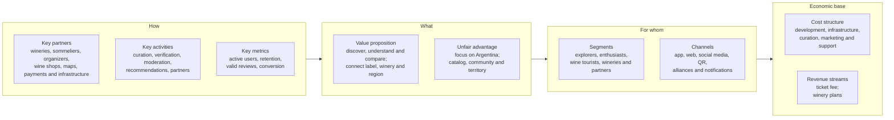
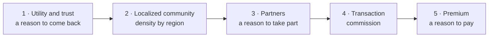

# Business Model Canvas

Vinnot's business model in the nine Canvas blocks, plus its unfair advantage. It takes
the lessons from the [competitive analysis](competitive-analysis.md) and orders them
into a global proposal that starts with the Argentine market, with the hypotheses to validate and the
sequence in which it makes sense to build and monetize.

## Positioning: from catalog to ecosystem

Vinnot occupies a middle ground that none of the five competitors analyzed covers in
the same way: helping a person discover a wine, understand it, compare it, save it,
get to know its winery and turn that interest into a physical experience, such as a
visit, a tasting or an event. The point is not to have more features, but to better
connect decisions that are fragmented today.

## Prioritized segments

| Segment | Main need |
|---|---|
| Explorers | Choose better without advanced technical knowledge |
| Enthusiasts | Rate, compare and save wines, and go deeper |
| Travelers and wine tourists | Find wineries, routes, tastings and events |
| Wineries and partners | Digital presence, verified content and demand generation |

**Focus decision.** The first commercial version prioritizes end users and verified
wineries. Wine shops, agencies and B2B monetization come later. This sequence keeps
the platform from depending on too many sides of the market at once.

## Value proposition

> "Discover wines you like and connect them with their origin: compare labels, save
> experiences, follow wineries and find where to live the wine."

Almost the whole sentence is implemented: the [catalog](../modules/wines/README.md),
the [AI comparison](../modules/ai/README.md), the [cellar](../modules/cellar/README.md),
[wineries and regions](../modules/wineries/README.md),
[wine routes](../modules/wine-routes/README.md) and
[events](../modules/events/README.md). Following wineries is pending: Vinnot has no
followers today ([Community](../modules/community/README.md)).

## The proposed Canvas

### How

| Block | Content |
|---|---|
| Key partners | Wineries and producers; sommeliers and specialists; event and experience organizers; selected wine shops and partners; map, payment and infrastructure providers |
| Key activities | Catalog curation and normalization; verification of wineries and events; review moderation; recommendation development; partner onboarding; product, security and analytics |
| Key metrics | Monthly active users; share of users who save or rate; valid reviews per wine; 30- and 90-day retention; active verified wineries; conversion to an event or booking. The detail is in [Key metrics](key-metrics.md) |

### What

| Block | Content |
|---|---|
| Unique value proposition | Discover and compare wines in one place; understand wine without technical barriers; connect each label with its winery, region and experiences; build a personal taste profile; find relevant events and routes |
| Unfair advantage | Deep focus on Argentina and Latin America; integration of catalog, community and territory; own database and relationships with wineries; a visual and editorial experience consistent with the world of wine |

### For whom

| Block | Content |
|---|---|
| Customer segments | Explorers and occasional consumers; enthusiasts; wine tourists; wineries and professional partners |
| Channels | Mobile app; web and SEO; social media and content; QR codes at wineries and events; alliances with wineries and sommeliers; notifications and recommendations |

### Economic base

| Block | Content |
|---|---|
| Cost structure | Development and maintenance; infrastructure, maps and storage; data curation and moderation; marketing and acquisition; partner support and operations; payment services for transactions. The amounts are in [Current costs](costs.md) |
| Revenue streams | Commission on bookings and experiences; Premium subscription for users; professional plans for wineries and partners; clearly labeled featured promotion; B2B presence and aggregated analytics services. The status of each source is in the next table |

### The Canvas as a board

[View the full “The Canvas as a board” diagram](https://images.vinnot.com/docs/diagrams/v1/en/business-business-model-canvas-e2a202c6a2ce.svg)

## Status of revenue sources

| Canvas source | Status in October 2026 | Detail |
|---|---|---|
| Commission on bookings and experiences | Implemented for event tickets | 3% of each paid ticket's total, charged with Mercado Pago's split ([Payments](../modules/payments/README.md)). The increase to 8% and to 12% is planned ([Monetization and plans](monetization.md)). Booking winery visits does not exist |
| Professional plans for wineries and partners | Planned | Free plan with profile, own wines, events and basic metrics, and a Pro plan at USD 20 per month with reports; target launch on 2027-03-01 ([Monetization and plans](monetization.md)) |
| B2B presence and aggregated analytics services | Planned within the paid plan | A weekly pulse and a monthly report on the interest, opinion and audience of each winery's wines; no figure is presented as a sale ([Winery reports](winery-reports.md)) |
| Premium subscription for users | Hypothesis | Not planned; it depends on first validating a Premium tier |
| Labeled featured promotion | Hypothesis | Not planned; it requires keeping promotion apart from the organic ranking ([SWOT](swot.md#strategic-crossover)) |

## Hypotheses the Canvas must validate

1. Users value an integrated experience more than several specialized apps.
2. Wineries find it worth taking part when the platform generates measurable
   discovery or demand.

Both hypotheses must be tested before increasing marketplace, booking or professional
plan costs.

## Business sequence

What to build and monetize first, and what to leave for later.

| Stage | What to build | What to measure | Status in October 2026 |
|---|---|---|---|
| 1 · Utility and trust | Catalog, comparison, favorites, reviews, map and verified wineries | Activation, retention, records viewed, saves and reviews | Implemented: catalog, AI comparison, cellar ("My Cellar"), reviews, wineries and routes on the map. Pending: winery verification; the team manages wineries today |
| 2 · Localized community | Events, following wineries, recommendations and regional content | Returning users, participation, active regions | Implemented: events by proximity, regions in the filters and personalized push suggestions ([`UC-NOT-07`](../modules/notifications/use-cases/uc-not-07-receive-suggestions.md)). Pending: following wineries |
| 3 · Partners | Professional profiles, manageable events, leads and basic analytics | Active partners, leads, published events and conversion | Implemented: the partner role publishes and manages its events and registrations ([Partners](../modules/partner/README.md)). Planned: winery reports |
| 4 · Transaction | Experience bookings and, later, affiliation or commerce | GMV, booking rate, commission, repeat purchases | Implemented: paid event tickets with a fee. Pending: visit bookings and commerce |
| 5 · Premium | Advanced cellar, personalization or assistance features | Premium conversion, churn and use of paid features | Planned: winery subscription. Hypothesis: Premium for users |

Ticket payments were implemented before stages 2 and 3 were complete: they are the
only active transaction and do not depend on own stock.

[View the full “Business sequence” diagram](https://images.vinnot.com/docs/diagrams/v1/en/business-business-model-canvas-3de61ee8071b.svg)

**Why this sequence.** Vivino shows the value of the network effect; Wine-Searcher,
the value of information; CellarTracker, retention through history; Winedering,
transactional monetization; and Viniou, the freemium logic. Vinnot's proposal orders
those lessons so it does not try to monetize five models at once.

**Decision criterion.** If a feature does not improve activation, trust, recurrence or
a clear path to monetization, it stays out of the immediate priority.

## Conclusion

Vinnot can stand out not by replicating every competitor feature, but by connecting
wine with its context: label, personal taste, winery, territory and experience. That
integration fits a market like Argentina especially well, where the product and wine
tourism are closely related.

The main condition is to keep focus. The Canvas prioritizes discovery, trust and
community; then it adds partners and, only when there is enough demand,
transactional monetization and Premium. That way the model grows on usage evidence
and not on assumptions.

**Synthesis.** Vinnot first builds a clear reason to come back; then, a clear reason
for wineries and partners to take part; and only then, a clear reason to pay.
