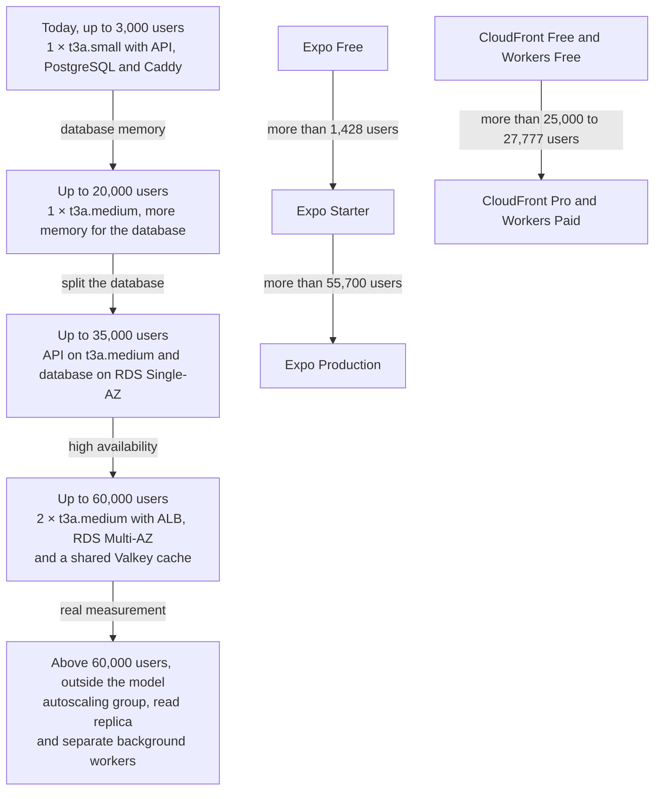

# Capacity and cost projections

How many users Vinnot supports with the plans it has today, which limit it hits first,
and what must change, and at what cost, to reach 1,000, 5,000, 10,000 and 50,000 users.
Every figure on this page is an **estimate** with prices and costs read on 2026-10-29;
it depends on the [assumptions](#assumptions), not on a load test, which does not exist
yet.

The tables come from the same model as the
[cost simulator by scale](cost-simulator.mdx)
([`projection.mjs`](../../../docs-site/src/components/CostProjection/projection.mjs)),
and an automated test pins its numbers: if they change, they change here and in the
simulator. The starting point is in [Current costs](costs.md).

## At a glance

On this page, "users" means monthly active users (MAU).

| Scale | Do today's plans hold? | What changes | USD per month | USD per year |
|---|---|---|---:|---:|
| Today | Yes | — | 83.31 (measured) | 999.74 to 1,066.94 |
| 1,000 | Yes | Nothing | 80.68 | 968.16 |
| 5,000 | No | Expo Starter, a t3a.medium host and a higher AI cap | 124.71 | 1,496.52 |
| 10,000 | No | Same as at 5,000, with more usage | 153.21 | 1,838.52 |
| 50,000 | No | Two hosts behind a load balancer, an RDS Multi-AZ database, a shared cache, CloudFront Pro, Workers Paid and paid web maps | 716.89 | 8,602.68 |

- **Today, without buying anything new:** about **1,000 to 1,400 monthly active users**,
  that is, about 200 to 290 users per day.
- **First bottleneck:** the Expo Free plan, with 1,000 app update users per month. If
  the whole audience used the app, the limit would be exactly 1,000.
- **The API is not the first limit.** Under the assumptions, the t3a.small host serves
  about **3,000 monthly active users**; what runs out first is memory for the database,
  not CPU.

## Assumptions

| Assumption | Value | Why |
|---|---:|---|
| Daily active users over monthly users | 20% | A usual ratio for consumer apps not used every day |
| API requests per daily active user per day | 50 | About two sessions browsing, wine details, reviews and cellar; images do not go through the API |
| Share of daily traffic in the peak hour | 12% | Usage concentrates in the afternoon and evening |
| CPU per API request (backend and database) | 30 ms | Simple JPA and SQL queries, JSON serialization and security filters |
| Users on the web | 30% | The rest use the mobile app |
| CloudFront requests per web user per month | 120 | HTML, JS and CSS bundles and fonts, with browser caching |
| Images that reach the Worker per daily active user per day | 20 | The rest come from the device cache |
| Map loads per web user per month | 2 | Route and event maps on the web |
| Emails per user per month | 2 | Verification, password recovery and notices |
| AI spend per user per month | USD 0.002 | AI profiles are stored per wine and language, so most reads do not call OpenAI; new wines, new comparisons and the scanner pay |
| Images uploaded per user per month | 0.3 | Avatars, labels and covers; average size about 300 KB (at most 128 KiB per avatar and 512 KiB per label) |
| Frequently read data per user | 50 KB | 180 days of detail views, app opens, reviews, cellar and points |
| Catalog, search index and reference data | 100 MB | Fixed size, independent of users |
| Session length, only to estimate concurrency | 8 minutes | — |

Formulas the model uses:

- daily users = monthly users × 20%;
- requests per second in the peak hour = monthly users × 0.20 × 50 × 0.12 / 3,600
  = monthly users / 3,000;
- app users = monthly users × 70%;
- concurrent sessions at peak ≈ daily users × 12% × 8 / 60.

## Platform limits today

Values from the code and the production configuration. The full infrastructure is in
[AWS deployment](../infra/architecture/aws-deployment.md).

| Resource | Current limit | Source |
|---|---|---|
| Production host | One EC2 t3a.small: 2 vCPU, 2 GiB of RAM, CPU credits in `standard` mode | [`production-stack.json`](../../../infra/aws-low-cost/production-stack.json) |
| Sustained CPU | 20% per vCPU (0.4 vCPU in total); earns 24 credits per hour and accrues up to 576. Without credits, CPU drops to that 20% | [AWS, burstable performance instances](https://docs.aws.amazon.com/AWSEC2/latest/UserGuide/burstable-credits-baseline-concepts.html) |
| Container memory | Backend 768 MiB (JVM with `-Xmx512m`), PostgreSQL 384 MiB, Caddy 96 MiB; 1.25 GiB of the host's 2 GiB, plus 2 GiB of swap | [`docker-compose.yml`](../../../infra/aws-low-cost/docker-compose.yml), [`compose.postgres.yml`](../../../infra/aws-low-cost/compose.postgres.yml) |
| Connections | Hikari with at most 6 connections; Tomcat with 30 threads; PostgreSQL with `max_connections = 20` and `shared_buffers = 96MB` | [`docker-compose.yml`](../../../infra/aws-low-cost/docker-compose.yml), [`compose.postgres.yml`](../../../infra/aws-low-cost/compose.postgres.yml) |
| Rate limits | General 300 per minute; public catalog 180 per minute and 1,500 per day; AI 20 per hour; scanner 30 per hour; in each instance's memory | [`application.yml`](../../../backend/src/main/resources/application.yml), [Resource protection](../backend/architecture/resource-protection.md) |
| Images | Up to 2 WebP conversions at a time, 10 seconds per conversion | [User images](../infra/operations/user-images-r2.md) |
| CloudFront | Free plan: 1 million requests and 100 GB per month | [`production-web-stack.json`](../../../infra/aws-low-cost/production-web-stack.json) |
| R2 | Free allowance of 10 GB, 1 million class A and 10 million class B operations per month. The app adds per-environment guard rails: 512 MiB reserved, 5,000 writes and 100,000 reads per month | [`application.yml`](../../../backend/src/main/resources/application.yml) (`APP_STORAGE_R2_MAX_*`) |
| Images Worker | Workers Free: 100,000 requests per day | [Catalog images on R2](../infra/operations/catalog-images-r2.md) |
| Expo | Free plan: 1,000 update users per month; above that a paid plan is needed | [Expo](https://expo.dev/pricing) |
| Google Maps | Mobile SDK free; on the web, 10,000 free map loads per month | [Google Maps Platform](https://developers.google.com/maps/billing-and-pricing/pricing) |
| OpenAI | App cap `AI_MONTHLY_LIMIT_USD = 15` in production; USD 15 limit on the OpenAI project | [Resource protection](../backend/architecture/resource-protection.md) |

## How many users it supports today

### CPU: not the limit

Under the assumptions, at 3,000 monthly users the peak hour brings 1 request per second,
which uses 0.03 vCPU. The host sustains 0.4 vCPU without spending credits. At 50,000
users it would be 16.67 requests per second and 0.5 vCPU. Tomcat threads and Hikari
connections do not run out at that volume either. What does use CPU bursts is image
conversion and scheduled jobs; that is why an alarm fires when credits fall below 12
([Observability](../infra/operations/observability-and-incidents.md)).

### Database memory: the API's limit

PostgreSQL runs in a 384 MiB container. After its own overhead, about 250 MB remain to
keep frequently read data in memory. The catalog takes about 100 MB and each user adds
about 50 KB, so:

(250 − 100) MB / 50 KB = **3,000 users**.

Above that, the database starts reading from disk and the API slows down before it
fails. A t3a.medium (4 GiB, same CPU) leaves about 1,100 MB for the database:
(1,100 − 100) MB / 50 KB = **20,000 users**.

### Every limit, in the order it is reached

| Limit | Monthly users that still fit | Kind of change | What to do |
|---|---:|---|---|
| Expo Free: 1,000 update users per month | 1,428 | Plan change | Move to Expo Starter (USD 19 per month plus USD 0.005 per user above 3,000) |
| Database memory on the t3a.small host | 3,000 | Plan change | Move the host to t3a.medium |
| AI cap `AI_MONTHLY_LIMIT_USD = 15` | 7,500 | Configuration change | Raise the cap in the app and the project limit at OpenAI; otherwise AI features are refused once the cap is reached |
| R2 guard rail of 5,000 writes per month | 16,666 | Configuration change | Raise `APP_STORAGE_R2_MAX_MONTHLY_WRITES` and the other guard rails; R2 stays free up to 1 million writes |
| Google Maps JavaScript free allowance | 16,666 | Variable cost | Pay USD 7 per 1,000 extra loads, or replace the web map with an option without a per-load cost |
| Database on the same host as the API | 20,000 | Plan change | Move the database to RDS |
| Workers Free: 100,000 requests per day | 25,000 | Plan change | Move to Workers Paid (USD 5 per month, 10 million requests) |
| CloudFront Free: 1 million requests per month | 27,777 | Plan change | Move to CloudFront Pro (USD 15 per month, 10 million requests) |
| A single API instance, no high availability | 35,000 | Plan change | Two instances behind a load balancer, a Multi-AZ database and a shared cache |

**Result for today:**

| Measure | Estimate |
|---|---|
| Monthly active users without buying anything new | 1,000 to 1,428 (the limit is Expo Free) |
| Equivalent daily active users | 200 to 286 |
| Monthly active users the API supports on the current host | About 3,000 (600 per day) |
| Requests per second in the peak hour at 3,000 users | 1 |
| Concurrent sessions at peak at 3,000 users | About 10 |
| First bottleneck | Expo Free, from 1,429 monthly users |

Above 1,000 update users, Expo requires a paid plan. The limit affects over-the-air
(OTA) updates, not the installed app, which keeps working with the version it has.

## Scenarios from 1,000 to 50,000 users

Plan needed per service and its cost in USD per month. The model assumes the leftover
RDS instance has already been deleted ([savings opportunities](costs.md#savings-opportunities)).

| Service | 1,000 | 5,000 | 10,000 | 50,000 |
|---|---|---|---|---|
| API server (EC2) | 1 × t3a.small, API and database together: 19.93 | 1 × t3a.medium, API and database together: 33.66 | 1 × t3a.medium, API and database together: 33.66 | 2 × t3a.medium behind an ALB: 94.33 |
| Database | PostgreSQL on the same host: 0 | PostgreSQL on the same host: 0 | PostgreSQL on the same host: 0 | RDS db.t4g.medium Multi-AZ, 50 GB: 105.67 |
| Shared cache | In instance memory: 0 | In instance memory: 0 | In instance memory: 0 | ElastiCache Valkey t4g.micro: 9.34 |
| Web CDN (CloudFront) | Free plan: 0 | Free plan: 0 | Free plan: 0 | Pro plan: 15.00 |
| Images (Worker and R2) | Workers Free: 0 | Workers Free: 0 | Workers Free: 0 | Workers Paid: 5.00 |
| App updates (Expo) | Free plan: 0 | Starter plan: 21.50 | Starter plan: 39.00 | Starter plan: 179.00 |
| AI (OpenAI) | Current USD 15 cap: 2.00 | Current USD 15 cap: 10.00 | USD 20 cap: 20.00 | USD 100 cap: 100.00 |
| Email (SES) | 2,000 emails: 0.20 | 10,000 emails: 1.00 | 20,000 emails: 2.00 | 100,000 emails: 10.00 |
| Maps on the web | 600 loads, free: 0 | 3,000 loads, free: 0 | 6,000 loads, free: 0 | 30,000 loads, 20,000 paid: 140.00 |
| CI (GitHub Actions) | 33.05 | 33.05 | 33.05 | 33.05 |
| Fixed (development, other AWS, Apple, domain) | 25.50 | 25.50 | 25.50 | 25.50 |
| **Total per month** | **80.68** | **124.71** | **153.21** | **716.89** |
| **Total per year** | **968.16** | **1,496.52** | **1,838.52** | **8,602.68** |

### How each cost is calculated

| Line | Arithmetic |
|---|---|
| 1 × t3a.small | 13.72 + 32 GB × 0.08 + 3.65 of IPv4 = 19.93 |
| 1 × t3a.medium | 27.45 + 32 GB × 0.08 + 3.65 = 33.66 |
| 2 × t3a.medium and ALB | 2 × 27.45 + 2 × 16 GB × 0.08 + 4 IPv4 × 3.65 (two hosts and two ALB nodes) + 16.43 + 730 h × 0.008 per LCU = 94.33 |
| RDS db.t4g.medium Multi-AZ | 94.17 + 50 GB × 0.23 = 105.67 |
| Expo Starter | 19 + 0.005 × (app users − 3,000); at 50,000 users, 35,000 use the app: 19 + 0.005 × 32,000 = 179.00 |
| Maps on the web | (loads − 10,000) / 1,000 × 7 |
| Fixed | Development 14.65 (t3a.small for about 517 hours: 9.72; 16 GB: 1.28; IPv4: 3.65) + other AWS 1.67 (Secrets Manager, ECR, CloudWatch and S3) + Apple 8.25 + domain 0.93 (USD 11.17 ÷ 12) |

At 1,000 users the model comes out below today's cost (80.68 against 83.31) because it
assumes the leftover RDS instance is gone. GitHub Actions does not grow with users: it
grows with development work, so it stays constant.

### What changes at each scale

**1,000 users.** Today's plans hold. It is worth buying Expo Starter a little before
reaching 1,400 users, so app updates are not held back.

**5,000 users.** Two limits are crossed: Expo Free (move to Starter) and host memory
(move to t3a.medium, 4 GiB, and give the PostgreSQL container more memory). The USD 15
AI cap still covers it (AI spends USD 10). CloudFront,
Workers, R2 and Google Maps stay within their free allowances.

**10,000 users.** The same architecture as at 5,000. Expo (USD 39), AI (USD 20, with the
`AI_MONTHLY_LIMIT_USD` cap and the OpenAI limit raised to USD 20) and SES grow. This is the time to prepare the next step: measure with a load test and plan the
database split before 20,000 users.

**50,000 users.** The architecture changes:

- **Two API instances behind an Application Load Balancer**, so the service no longer
  depends on a single host. Rate limits live in each instance's memory today
  ([Resource protection](../backend/architecture/resource-protection.md)); with two
  instances, each would count separately. That is why a **shared cache** (ElastiCache
  Valkey) comes in for the limits and the caches.
- **Database on RDS db.t4g.medium Multi-AZ**: 4 GiB for about 2.6 GB of frequently read
  data, a copy in another zone and managed backups with point-in-time restore. Today the
  backup is daily, with up to 24 hours of data loss
  ([Backup and recovery](../infra/operations/backup-and-disaster-recovery.md)).
- **CloudFront Pro** (1.8 million requests per month) and **Workers Paid** (200,000
  requests per day).
- **Maps on the web**: 30,000 loads per month, of which 20,000 are paid (USD 140). It is
  the fastest-growing line; an option without a per-load cost is worth evaluating.
- **Expo**: Starter is still cheaper than Production (USD 179 against 199). Production
  pays off from about 55,700 users.

### Alternatives and options

| Option | Effect | Tradeoff |
|---|---|---|
| Graviton: t4g.medium instead of t3a.medium | USD 24.53 instead of 27.45 per host | The backend image must be built for arm64 |
| CPU credits in `unlimited` mode | CPU does not drop to 20% during long bursts | Each CPU hour above baseline is billed (USD 0.05 per vCPU-hour on T3; the T3a rate is not confirmed) |
| RDS Single-AZ instead of Multi-AZ at 50,000 users | USD 53.20 instead of 105.67 | No copy in another zone: a zone failure takes the service down |
| Expo Production instead of Starter | More included users and more builds | USD 199 fixed; only pays off from about 55,700 users |

## Revenue to cover the costs

How many tickets or how many Pro wineries are needed to cover **the platform costs** at
each scale. It excludes salaries, marketing and taxes.

Assumptions you can edit in the [revenue simulator](revenue-simulator.mdx):

- average ticket price: ARS 20,000;
- exchange rate: ARS 1,450 per USD (an assumption, not a quote);
- 30 tickets per event;
- commission per ticket: USD 0.41 at 3%, USD 1.10 at 8% and USD 1.66 at 12%;
- net per Pro winery: USD 17 with a 15% store fee and USD 14 with 30%
  ([Monetization and plans](monetization.md#store-economics)).

| Scale | USD per month | Tickets at 3% | Tickets at 8% | Tickets at 12% | Pro wineries (15%) | Pro wineries (30%) |
|---|---:|---:|---:|---:|---:|---:|
| Today | 83.31 | 202 (7 events) | 76 (3 events) | 51 (2 events) | 5 | 6 |
| 1,000 | 80.68 | 195 (7 events) | 74 (3 events) | 49 (2 events) | 5 | 6 |
| 5,000 | 124.71 | 302 (11 events) | 114 (4 events) | 76 (3 events) | 8 | 9 |
| 10,000 | 153.21 | 371 (13 events) | 139 (5 events) | 93 (4 events) | 10 | 11 |
| 50,000 | 716.89 | 1,733 (58 events) | 650 (22 events) | 434 (15 events) | 43 | 52 |

How to read it:

- Moving from 3% to 12% cuts the tickets needed to cover the costs to a quarter.
- The sources add up. For example, at 10,000 users, four events of 30 tickets at 8%
  bring USD 132.41; the missing USD 20.80 is covered by 2 Pro wineries.
- The commission is collected in pesos and the costs are paid in dollars: a devaluation
  without a matching rise in ticket prices lowers the revenue in dollars.
- The seller pays Mercado Pago's fee, which does not reduce Vinnot's commission.

## Architecture evolution

[View the full “Architecture evolution” diagram](https://images.vinnot.com/docs/diagrams/v1/en/business-capacity-and-cost-projections-248b4d7ed840.svg)

## Sensitivity

The limits move with the assumptions. The most sensitive ones:

| If this changes… | Effect |
|---|---|
| Data per user: 100 KB instead of 50 KB | The memory limits halve: 1,500 users on t3a.small and 10,000 on t3a.medium |
| Web usage: 50% instead of 30% | Expo Free holds up to 2,000 users; CloudFront Free up to 16,666 and the maps allowance up to 10,000 |
| AI spend: USD 0.005 per user instead of 0.002 | The USD 15 cap covers 3,000 users; at 50,000 users AI costs USD 250 per month |
| API requests: twice as many | CPU stays far from the limit (1 vCPU at 50,000 users, split across two hosts) |
| Ticket price or exchange rate | The tickets needed change in inverse proportion |

Before deciding a plan change from these figures, measure: there are no load tests in
the repository, and production telemetry
([Observability](../infra/operations/observability-and-incidents.md)) gives real memory,
CPU and connection figures.

## Sources

Public prices checked on 2026-10-29, region us-east-1, 730 hours per month:

- AWS EC2 on-demand: https://aws.amazon.com/ec2/pricing/on-demand/
- AWS, CPU credits of burstable instances: https://docs.aws.amazon.com/AWSEC2/latest/UserGuide/burstable-credits-baseline-concepts.html
- AWS EBS: https://aws.amazon.com/ebs/pricing/
- AWS VPC, public IPv4: https://aws.amazon.com/vpc/pricing/
- AWS RDS for PostgreSQL: https://aws.amazon.com/rds/postgresql/pricing/
- AWS Elastic Load Balancing: https://aws.amazon.com/elasticloadbalancing/pricing/
- AWS ElastiCache: https://aws.amazon.com/elasticache/pricing/
- AWS SES: https://aws.amazon.com/ses/pricing/
- CloudFront flat-rate plans: https://aws.amazon.com/cloudfront/pricing/ and https://docs.aws.amazon.com/AmazonCloudFront/latest/DeveloperGuide/flat-rate-pricing-plan.html
- Cloudflare R2: https://developers.cloudflare.com/r2/pricing/
- Cloudflare Workers: https://developers.cloudflare.com/workers/platform/pricing/
- Expo: https://expo.dev/pricing
- Google Maps Platform: https://developers.google.com/maps/billing-and-pricing/pricing
- OpenAI: https://developers.openai.com/api/docs/pricing
- Mercado Pago: https://www.mercadopago.com.ar/herramientas-para-vender/check-out
