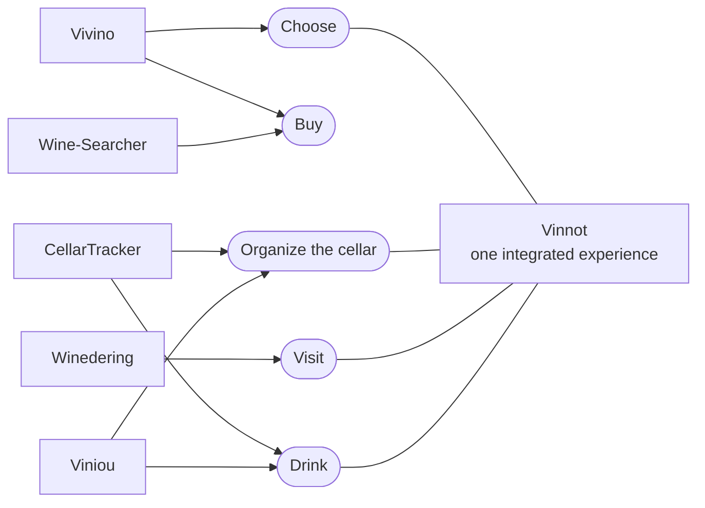

# Competitive analysis

Five international platforms from the wine ecosystem, each from a different country,
analyzed with public information consulted in October 2026. The goal is not to copy
an existing model, but to find business patterns that help design a consistent
proposal for Vinnot. The resulting proposal is in
[Vinnot's Business Model Canvas](business-model-canvas.md).

## Cases analyzed

| # | Case | Country | Value core | Why it matters for Vinnot |
|---|---|---|---|---|
| 01 | Vivino | Denmark | Community, discovery and marketplace | Community scale and personalization |
| 02 | Wine-Searcher | New Zealand | Global search and price comparison | Data, prices and traffic to third parties |
| 03 | CellarTracker | United States | Cellar management and community | Retention through recurring utility |
| 04 | Winedering | Italy | Wine tourism marketplace | Experience bookings and partners |
| 05 | Viniou | France | Freemium cellar management with AI | Freemium for personal utility |

Each case is described with the Canvas blocks: key partners, key activities, unique
value proposition, unfair advantage, customer segments, channels, revenue streams,
cost structure and key metrics. The blocks are grouped into **How** (partners,
activities, metrics), **What** (proposition and advantage) and **For whom**
(segments, channels), with costs and revenue as the economic base. That grouping
helps read each model as a system rather than a list of boxes.

## Five models for different problems

Vinnot's competition is not a single app. A person can solve each need with a
different product: look up a label, compare prices, record a cellar, book a visit or
get recommendations. That is why it pays to look at specialized models before
deciding which combination Vinnot offers.

| Case | Main problem | Observable advantage | Monetization |
|---|---|---|---|
| Vivino | Discover, rate and buy wines | Massive community, scanning and personalization | Premium and marketplace |
| Wine-Searcher | Find where to buy and at what price | Global offer base and comparison | PRO account, cost per click and API data |
| CellarTracker | Manage a collection and decide what to drink | Inventory depth and notes | Subscription |
| Winedering | Discover and book wine experiences | Vertical marketplace with a curated offer | Booking commission |
| Viniou | Manage a personal cellar simply | Freemium with automation and AI | Premium subscription |

**Central finding.** The five cases show that specialization works when each product
turns wine data into a concrete decision: choose, buy, organize, visit or drink.
Vinnot can stand out by joining several decisions in one experience without losing
focus.

### Which decision each platform solves

Each competitor specializes in one or two decisions; Vinnot aims to connect several of
them around the same wine.

[View the full “Which decision each platform solves” diagram](https://images.vinnot.com/docs/diagrams/v1/en/business-competitive-analysis-30d4e5c662bc.svg)

Today Vinnot covers choosing (catalog, reviews, AI comparison), organizing (the
cellar, "My Cellar") and visiting (wineries, routes and events with tickets). Buying
bottles is not part of the product.

## Canvas of each competitor

In each case the proposition, segments, channels and revenue rest on public sources;
unpublished internal partners, costs and metrics are reasonable strategic
inferences, not confidential company information.

### Vivino · Denmark

Community, scanning, recommendations and marketplace. Sources: [1], [2], [3].

| Block | Content |
|---|---|
| Key partners | Independent shops and retailers; user community and review creators; payment, logistics and data providers |
| Key activities | Wine identification and enrichment; review moderation and aggregation; personalization and recommendation; marketplace operation |
| Value proposition | Identify a bottle instantly; decide with ratings and reviews; get recommendations based on personal taste; buy from an integrated catalog |
| Unfair advantage | Community scale and wine database; behavior and preference history; established label recognition |
| Segments | Occasional consumers; wine enthusiasts; frequent buyers; retailers and merchants |
| Channels | iOS and Android app; web and SEO; label and list scanning; notifications and recommendations |
| Cost structure | Product, infrastructure and data; image recognition and personalization; support, moderation and acquisition; commercial marketplace operation |
| Revenue streams | Premium subscription; marketplace intermediation; promotions and commercial agreements |
| Key metrics | Active users and scans; ratings and reviews per wine; purchase conversion; retention and Premium adoption |

**Strategic reading.** Vivino combines immediate utility with a network effect: every
scan can end in information, community or a purchase. Its main lesson for Vinnot is
that the habit is built around one simple, repeatable action (identifying and rating
a bottle) and then extended to other features.

### Wine-Searcher · New Zealand

Global search and price comparison. Sources: [4], [5].

| Block | Content |
|---|---|
| Key partners | Shops, brokers, auctions and producers; critics and editorial sources; data providers and API customers |
| Key activities | Collecting and normalizing price lists; product and vintage matching; ranking and search; market intelligence |
| Value proposition | Find availability and the best prices; compare global offers; look up regions, critics and trends; access market data |
| Unfair advantage | Historical depth of prices and availability; international retailer coverage; specialization in search and comparison |
| Segments | Wine buyers; collectors and enthusiasts; retailers and producers; professional data customers |
| Channels | Web; mobile apps; SEO; API and B2B services |
| Cost structure | Search and data infrastructure; price processing and cleaning; editorial and technical team; acquisition and commercial support |
| Revenue streams | PRO account; cost per click charged to merchants; APIs and data services; market reports and intelligence |
| Key metrics | Searches performed; merchant and offer coverage; click-through rate to merchants; PRO subscriptions and API usage |

**Strategic reading.** Wine-Searcher shows that a platform does not need to sell the
bottle to capture value: it can monetize information, traffic and data. For Vinnot it
opens a B2B path: becoming discovery infrastructure without depending on its own
stock from the start.

### CellarTracker · United States

Deep cellar management and community knowledge. Sources: [6], [7], [8].

| Block | Content |
|---|---|
| Key partners | Collector community; publications and professional critics; Wine Market Journal and Wine-Searcher; payment services and integrations |
| Key activities | Bottle inventory management; tasting notes and community; ratings and drinking windows; decision tools |
| Value proposition | Know exactly what is in the cellar; decide what to drink and when; record purchases, consumption and notes; consult the community and professional references |
| Unfair advantage | Depth of personal history; large volume of recorded notes and bottles; cumulative utility: the product improves with every data point entered |
| Segments | Collectors; advanced enthusiasts; restaurants and wineries; users who need inventory |
| Channels | Web; mobile app; integrations with critics and Wine-Searcher; community and specialized support |
| Cost structure | Infrastructure and storage; product and search development; content licenses and integrations; support and security |
| Revenue streams | Annual subscription by cellar size; Premium features and advanced tools |
| Key metrics | Bottles managed; active users and notes; subscription conversion; collector retention |

**Strategic reading.** CellarTracker shows another kind of retention: the cost of
leaving grows because the person accumulates inventory, history, notes and
decisions. Vinnot can include a lightweight personal cellar to drive recurrence,
without the complexity that would push casual users away. That cellar already exists
in the product as "My Cellar" ([Cellar](../modules/cellar/README.md)).

### Winedering · Italy

International wine tourism marketplace. Sources: [9], [10].

| Block | Content |
|---|---|
| Key partners | Wineries and estates; tour operators and guides; travel agencies and affiliates; booking engines and destinations |
| Key activities | Onboarding and curating experiences; multilingual translation and publishing; bookings and support; marketing, SEO and B2B distribution |
| Value proposition | Discover authentic wine experiences; book online simply; access a verified, multilingual offer; for providers, visibility and sales without a fixed fee |
| Unfair advantage | Vertical specialization in wine tourism; manual curation and direct supplier relationships; international catalog of experiences |
| Segments | Travelers and wine tourists; wineries and providers; agencies and tour operators; professional buyers |
| Channels | Web marketplace; international SEO; B2B portal; affiliates, Google Things to do and partners |
| Cost structure | Demand acquisition; onboarding and curating the offer; multilingual support; payments, product and integrations |
| Revenue streams | Commission on completed bookings; B2B distribution and related agreements |
| Key metrics | Active experiences; confirmed bookings; GMV and commission revenue; conversion and verified reviews |

**Strategic reading.** Winedering confirms that experiences can be a business unit
independent of bottle sales. For Vinnot, the map and the agenda should not be just
content: they can evolve into a booking flow with a commission once there is a
sufficient and reliable offer. Vinnot already charges a fee on paid event tickets
([Payments](../modules/payments/README.md)); booking winery visits does not exist
yet.

### Viniou · France

Freemium cellar management enriched with AI. Sources: [11], [12], [13].

| Block | Content |
|---|---|
| Key partners | Users and rating community; price sources and critics; mobile stores and AI and infrastructure providers |
| Key activities | Inventory and label management; automatic enrichment of wine records; recommendations, pairings and maturity; Premium feature development |
| Value proposition | Manage the cellar for free in the essentials; add bottles quickly by scanning; know value, maturity and pairings; get personalized assistance |
| Unfair advantage | A very clear freemium model; automation of cellar tasks; AI integrated with the user's real data |
| Segments | Enthusiasts with a personal cellar; collectors; users who want simple assistance |
| Channels | Web; iOS and Android; content SEO; connectors with AI assistants |
| Cost structure | Infrastructure and image processing; data enrichment with AI; development and support; mobile distribution and marketing |
| Revenue streams | Monthly or annual Premium subscription |
| Key metrics | Registered users; Premium conversion; bottles entered or scanned; retention and use of advanced features |

**Strategic reading.** Viniou shows that a freemium proposal is viable when the free
tier solves the basic job and Premium adds intelligence, not artificial locks. It is a
reference for Vinnot if it decides to monetize recommendations, personal organization
or advanced features.

## Comparative learnings

| Pattern | Implication for Vinnot |
|---|---|
| One anchor action | Strong platforms have a recognizable main action: scan, look up a price, manage the cellar or book. Vinnot needs an equally clear first gesture |
| Community needs prior utility | Reviews add value, but they should not be the only reason to come in. A person must get utility even while there are few opinions |
| Data can be the product | Wine-Searcher and CellarTracker show that normalizing information and accumulating history create assets that are hard to replicate |
| Monetize after proving value | Freemium and commissions work once the main job is solved. Charging before building recurrence can slow adoption |
| The professional offer matters | Wineries, shops and organizers can contribute verifiable content and later become B2B customers or distribution partners |
| Do not mix models without priority | Marketplace, community, tourism, cellar and recommendations can coexist, but each adds operating costs. Vinnot needs a sequence, not everything at once |

**Synthesis.** The digital wine ecosystem supports very different sustainable models:
Vivino scales community and commerce; Wine-Searcher organizes information and routes
demand; CellarTracker monetizes depth and recurrence; Winedering turns experiences
into transactions; Viniou combines free utility with a Premium tier.

**Comparative conclusion.** Vinnot's opportunity is not to be another Vivino. It is
to combine wine discovery, territory and experiences with a community layer designed
from Argentina, building trust and recurrence first and monetization afterwards. How
that sequence is ordered is in the
[Business Model Canvas](business-model-canvas.md#business-sequence).

## Methodological note

- Each platform's official sources were prioritized to reconstruct its value
  proposition, features, monetization and country of operation.
- The visible elements of each model (users, features, channels and monetization)
  rest on those public sources.
- Unpublished components, especially cost structure, internal partners and metrics,
  are strategic inferences and not company data.
- The information is as of October 2026; competitors' prices, plans and features may
  change.

## Sources

1. Vivino. "Download the Vivino App": features, community, scanning, cellar and
   marketplace. <https://www.vivino.com/en/app>
2. Vivino. "Vivino Premium": benefits and subscription logic.
   <https://www.vivino.com/en/premium>
3. Vivino. Legal Center: Vivino ApS, Denmark; marketplace and subscription terms.
   <https://www.vivino.com/en/legal>
4. Wine-Searcher. Media Kit: search, comparison, PRO account and cost per click.
   <https://www.wine-searcher.com/images/press/media-kit-booklet.pdf>
5. Wine-Searcher. API Order Form: Wine-Searcher Limited, Auckland, New Zealand; API
   services. <https://www.wine-searcher.com/images/for-trade/WS-3-API-Order-3.pdf>
6. CellarTracker. Mobile: community, inventory, reviews and scale of use.
   <https://www.cellartracker.com/m/>
7. CellarTracker. Subscription: subscription model and Seattle headquarters, United
   States. <https://support.cellartracker.com/article/80-cellartracker-subscription>
8. CellarTracker. "What you can track": inventory, ratings and drinking windows.
   <https://support.cellartracker.com/article/32-what-can-be-tracked>
9. Winedering. About: history, Italian headquarters and experience catalog.
   <https://www.winedering.com/es/about>
10. Winedering. Partners / Wineries: commission on completed bookings and B2B
    channels. <https://www.winedering.com/es/partners/wineries>
11. Viniou. Cellar management app: features, users and proposition.
    <https://www.viniou.fr/>
12. Viniou. Prix et abonnement: freemium and Premium subscription.
    <https://www.viniou.fr/prix>
13. Viniou. Politique de confidentialité: country of operation, France.
    <https://www.viniou.fr/politique-confidentialite>
