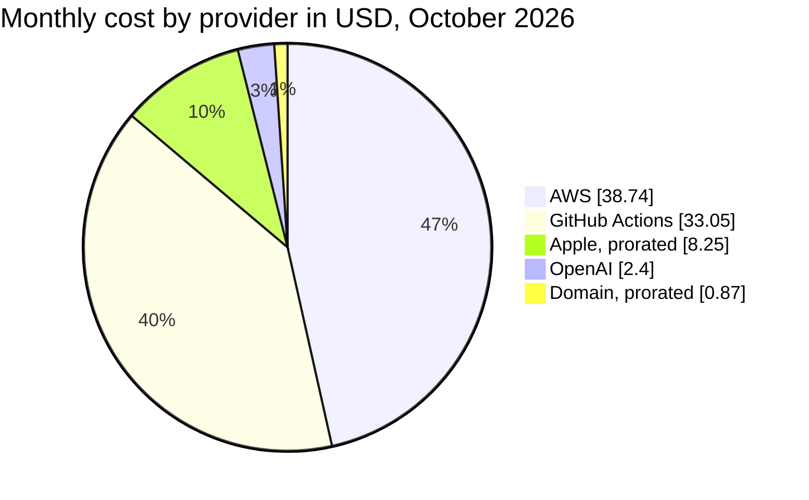
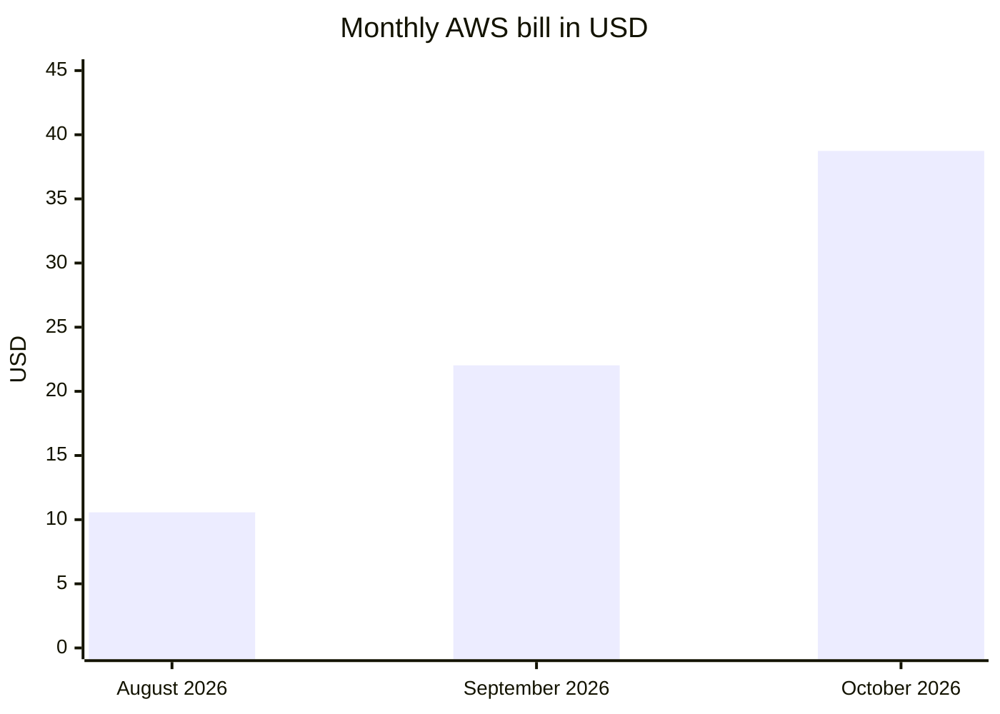

# Current costs

How much it costs to run Vinnot today, per month and per year. The figures were read on
2026-10-29 from each provider's console (AWS, GitHub, Cloudflare, OpenAI, Google Cloud,
Expo and Apple). They are an **estimate** of recurring spend: October had not closed yet
and some items are variable. For how this changes at larger scale, see
[Capacity and cost projections](capacity-and-cost-projections.md).

## At a glance

- **Per month:** about **USD 83 to 96** (83.31 with October's AI spend; 95.91 if AI
  reaches its cap).
- **Per year:** about **USD 1,000 to 1,151**, plus a one-time USD 25 for Google Play.
- **The two largest items:** AWS (about USD 39 per month) and GitHub Actions minutes
  (about USD 33 per month).
- **Free by plan or allowance:** CloudFront, Cloudflare (DNS, Workers, R2, Access),
  Google Maps, Expo and push notifications.

## Monthly cost

Read on 2026-10-29. Apple and the domain are paid yearly; here they are prorated per
month.

| Item | Provider | USD per month | Type | Detail |
|---|---|---:|---|---|
| Infrastructure | AWS | 38.74 | Fixed and variable | Full-month projection: USD 36.24 from October 1 to 29 × 31 / 29 ([breakdown](#aws-breakdown)) |
| Continuous integration | GitHub Actions | 33.05 | Variable | USD 45.45 gross minus USD 12.40 included in the Free plan |
| Artificial intelligence | OpenAI | 2.40 | Variable, capped | October spend; the app stops at USD 15 (`AI_MONTHLY_LIMIT_USD`) |
| Developer account | Apple | 8.25 | Fixed | USD 99 per year ÷ 12 |
| `vinnot.com` domain | Cloudflare Registrar | 0.87 | Fixed | USD 10.46 per year ÷ 12 |
| DNS, Workers, R2 and Access | Cloudflare | 0.00 | — | Free plans; R2 within the free allowance |
| Maps | Google Maps Platform | 0.00 | — | USD 0 over the last 30 days |
| App builds and updates | Expo EAS | 0.00 | — | Free plan |
| Ticket payments | Mercado Pago | 0.00 | — | No fixed cost; the fee is deducted from the seller on each sale |
| **Total** | | **83.31** | | |

Arithmetic: 38.74 + 33.05 + 2.40 + 8.25 + 0.87 = **83.31**. If AI uses its whole USD 15
cap: 83.31 − 2.40 + 15.00 = **95.91**.

### Monthly cost split

[View the full “Monthly cost split” diagram](https://images.vinnot.com/docs/diagrams/v1/en/business-costs-61327c877ee3.svg)

## AWS breakdown

October 2026 bill, still open, from October 1 to 29, region us-east-1. The architecture
behind these costs is in
[AWS deployment](../infra/architecture/aws-deployment.md#persistence-and-cost) and in
[Low-cost development](../infra/operations/low-cost-dev.md).

| Service | USD | Detail |
|---|---:|---|
| EC2 | 24.58 | Two t3a.small hosts at USD 0.0188 per hour (production around the clock; development stops at night), 1,176.6 hours: 22.12. EBS gp3 disks at USD 0.08 per GB-month, 43.4 GB-months: 3.47. Promotional credit: −1.01 |
| Public IPv4 (VPC) | 6.78 | USD 0.005 per hour per address: 1,179.7 hours in use and 176.7 idle |
| RDS | 3.20 | Development `db.t4g.micro` instance, **stopped and unused**: gp3 storage 2.09, backups 1.05 and 0.06 of instance hours ([savings opportunity](#savings-opportunities)) |
| Secrets Manager | 0.73 | 1.82 secret-months at USD 0.40 |
| ECR | 0.47 | 4.7 GB-months of images at USD 0.10 |
| S3 | 0.41 | 15 GB-months at USD 0.023, minus 5 GB included with the CloudFront Free plan; 56,000 PUT/LIST and 36,000 GET requests |
| CloudWatch | 0.06 | 10 free alarms and 0.57 paid alarm-months |
| SES | 0.01 | 89 emails at USD 0.0001 each |
| CloudFront, Lambda, SNS, SQS, KMS, Glue and data transfer | 0.00 | CloudFront on the flat-rate Free plan; the rest within free allowances |
| **Total from October 1 to 29** | **36.24** | Full-month projection: **38.74** |

The account still has USD 1.01 of a promotional AWS credit, expiring 2027-06-11. No
AWS free-tier allowance is left.

### AWS bill over time

| Month | USD | What changed |
|---|---:|---|
| April to July 2026 | 0.00 | No spend |
| August 2026 | 10.57 | First month with spend |
| September 2026 | 22.03 | Includes ECS (2.17) and an ELB load balancer (1.69), which went away with the move to one host per environment |
| October 2026 | 38.74 (projection) | First full month with two hosts: the production host was launched on 2026-09-29 |

[View the full “AWS bill over time” diagram](https://images.vinnot.com/docs/diagrams/v1/en/business-costs-20a5b6a6c176.svg)

The rise from August to October does not come from usage: it comes from turning on the
production infrastructure (a second host, its disk and its public IPv4) and from using
up the credits.

## Annual cost

| Item | USD per year | Arithmetic |
|---|---:|---|
| AWS | 464.88 | 38.74 × 12 |
| GitHub Actions | 396.60 | 33.05 × 12 |
| OpenAI | 28.80 to 96.00 | 2.40 × 12 at October's spend; 8.00 × 12 at the cap |
| Apple Developer Program | 99.00 | Renews on 2027-07-22 |
| `vinnot.com` domain | 10.46 | Renews on 2027-04-23; Cloudflare notes that .com rises to USD 11.17 from 2026-11-01 |
| **Total** | **999.74 to 1,066.94** | |

Arithmetic: 464.88 + 396.60 + 28.80 + 99.00 + 10.46 = **999.74**; with AI at its cap,
464.88 + 396.60 + 96.00 + 99.00 + 10.46 = **1,066.94**. With the domain at USD 11.17 from
the next renewal, the total rises by USD 0.71.

## One-time payments

| Item | USD | When |
|---|---:|---|
| Google Play Console registration | 25.00 | Once, when the developer account is created |

## App stores

| Store | Cost | Status |
|---|---|---|
| Apple Developer Program | USD 99 per year, individual account | Active; renews on 2027-07-22 |
| Google Play Console | USD 25, one time | Active |
| Apple Paid Applications Agreement | No cost; an agreement separate from the membership | Required before selling in-app subscriptions ([Monetization and plans](monetization.md#store-economics)) |

The stores charge nothing on event tickets: they are sold through Mercado Pago, outside
the store.

## Fixed and variable costs

| Type | Items | What drives them |
|---|---|---|
| Fixed | Production host, EBS disks, public IPv4, Secrets Manager, ECR, Apple and domain | The number of hosts and environments, not the number of users |
| Semi-fixed | Development host | Hours switched on; it stops from 02:00 to 09:00 Argentina time ([Low-cost development](../infra/operations/low-cost-dev.md)) |
| Variable with development | GitHub Actions | Number of PRs, pushes and deployments |
| Variable with usage | OpenAI, SES, S3 requests | Actual use of the platform; OpenAI has a cap in the app ([Resource protection](../backend/architecture/resource-protection.md)) |
| Variable with sales | Mercado Pago fee | Paid by each ticket's seller, not by Vinnot |
| Free up to a limit | CloudFront, R2, Workers, Google Maps, Expo | Monthly allowances; above them a plan change is needed ([Capacity and cost projections](capacity-and-cost-projections.md)) |

## What is free and why

| Service | Why it costs nothing | Limit that matters |
|---|---|---|
| CloudFront (production and development web) | Flat-rate Free plan, declared in [`production-web-stack.json`](../../../infra/aws-low-cost/production-web-stack.json) | 1 million requests and 100 GB per month, no overage charges |
| Cloudflare R2 | Usage fits the free allowance: 0.61 GB-months, 165,000 class B and 39,000 class A operations in October | 10 GB, 1 million class A and 10 million class B per month |
| Cloudflare Workers, DNS and Access | Free plans | 100,000 Workers requests per day |
| Google Maps | The Maps SDK for Android and iOS is free; the web uses the JavaScript API within the free allowance | 10,000 map loads per month on the web |
| Expo EAS | Free plan; Android builds are compiled locally | 1,000 update users per month; 15 iOS and 15 Android builds per month |
| Expo push notifications | Free | 600 notifications per second per project |
| SES | Pay as you go, at low volume | USD 0.10 per 1,000 emails |

## Savings opportunities

Findings from the review, ordered by savings. None is applied yet.

| Finding | Estimated savings | Tradeoff |
|---|---:|---|
| Delete the stopped development RDS instance and its backups | USD 3.20 per month (USD 38.40 per year) | None: the code does not use RDS; the database runs in a container on each host ([`compose.postgres.yml`](../../../infra/aws-low-cost/compose.postgres.yml)). Confirm first that it holds no data still needed |
| Reduce GitHub Actions minutes | Part of USD 33 per month | See the next table |
| Switch the development host off for more hours (for example, only 09:00 to 21:00 on weekdays) | About USD 4.76 per month | Development unavailable at night and on weekends |
| Remove the development host's public IPv4 | USD 3.65 per month | The address is billed whether the host runs or not. It needs another inbound path, such as a Cloudflare tunnel, and changes to deployment and the TLS certificate |
| Move the hosts to Graviton (t4g.small instead of t3a.small) | USD 1.46 per host per month | The backend image is built for `linux/amd64` only ([`deploy-backend-dev.yml`](../../../.github/workflows/deploy-backend-dev.yml), [`production-release.yml`](../../../.github/workflows/production-release.yml)); an arm64 image is needed |

### Options for GitHub Actions

GitHub Actions is the largest variable item. CI already runs only the tests of the
affected components ([`ci-impact.mjs`](../../../scripts/ci-impact.mjs)), already caches
Maven and npm dependencies ([`ci.yml`](../../../.github/workflows/ci.yml)), and native iOS
validation runs only with a label on the PR.

| Option | Effect | Tradeoff |
|---|---|---|
| Group a batch of changes into one PR | Fewer full CI runs; already the team's practice | Larger reviews |
| Docker layer cache in the image build | Shorter image builds; today `deploy-backend-dev.yml` uses no `cache-from` | The cache takes part of the 10 GB Actions cache |
| Self-hosted runner | Own minutes are not billed | The machine must be maintained and isolated: it runs repository code with access to deployment secrets |
| Make the repository public | Standard runners are free for public repositories | Exposes all the code and its history. A business decision, not a technical one |
| Keep macOS to a minimum | A macOS minute costs USD 0.062 and a Linux minute USD 0.006 | Already applied: iOS is validated on demand only |

## Sources

AWS Billing and Cost Explorer, GitHub Billing, Cloudflare, OpenAI, Google Cloud Billing,
Expo and Apple Developer consoles, read on 2026-10-29. Public prices:

- AWS pricing for EC2, EBS, VPC, RDS, S3, SES, ECR, CloudWatch and Secrets Manager: https://aws.amazon.com/ec2/pricing/on-demand/
- CloudFront flat-rate plans: https://aws.amazon.com/cloudfront/pricing/
- Cloudflare R2: https://developers.cloudflare.com/r2/pricing/
- Cloudflare Workers: https://developers.cloudflare.com/workers/platform/pricing/
- .com price increase: https://tldes.com/pages/com-price-increase-2026
- Apple Developer Program: https://developer.apple.com/programs/enroll/
- Google Play Console registration: https://support.google.com/googleplay/android-developer/answer/6112435
- Expo: https://expo.dev/pricing
- Google Maps Platform: https://developers.google.com/maps/billing-and-pricing/pricing
- GitHub Actions: https://docs.github.com/en/billing/reference/actions-runner-pricing
