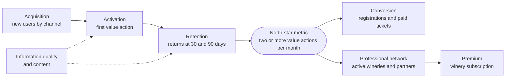

# Key metrics

How to tell whether the business model works. This page gathers the indicators of the
[Business Model Canvas](business-model-canvas.md) and the
[SWOT analysis](swot.md) on a single board, and separates what the platform already
records from what still needs instrumentation.

## North-star metric

**Monthly active users who perform at least two value actions related to wine**: for
example, viewing and saving, comparing and rating, or discovering a winery and
opening an event. It measures meaningful use, not just visits.

Value actions the product already supports:

| Action | Where it happens |
|---|---|
| View the detail of a wine, winery, route or event | [Wines](../modules/wines/README.md), [Wineries and regions](../modules/wineries/README.md), [Wine routes](../modules/wine-routes/README.md), [Events and tickets](../modules/events/README.md) |
| Save a wine to the cellar | [Cellar](../modules/cellar/README.md) |
| Rate or review a wine | [Reviews](../modules/reviews/README.md) |
| Compare two wines | [AI profiles and comparisons](../modules/ai/README.md) |
| Scan a label or propose a wine | [Wines](../modules/wines/README.md) |
| Register for an event | [Events and tickets](../modules/events/README.md) |

**Status:** pending instrumentation. The signals exist separately (see
[What the platform measures today](#what-the-platform-measures-today)), but no process
counts them per person and per month.

## Indicators by dimension

| Dimension | Indicator | What it shows | In the product today |
|---|---|---|---|
| Acquisition | New users by channel | Compares SEO, social media, partners, events and QR codes | Pending instrumentation: there is a user total, with no source channel |
| Activation | Share of users who perform a value action in their first session: save, compare, rate or follow a winery | Whether the first visit provides utility | Pending instrumentation: actions are recorded, but the first session is neither defined nor measured |
| Retention | Users who come back at 30 and 90 days; returning users | Whether Vinnot solves a recurring need | Partial: the app records opens per person for 180 days; the web sends no signals |
| Community | Valid reviews and saved wines per user | Whether there is value beyond the first visit | Data available in reviews and the cellar; no computed indicator |
| Content | Verified records, valid reviews per wine, current events | Trust and quality of the offer | Partial: totals of reviews and published events; record verification does not exist |
| Information quality | Share of verified records; corrections per 1,000 records | Trust in the catalog | Pending: there is no verification date or flag; reports and proposed wines serve as an indirect signal |
| Professional network | Active wineries and partners, active verified profiles, updated events | Whether the B2B proposal generates real participation | Partial: events per organizer; winery verification does not exist and is planned as a verified profile claim ([Monetization and plans](monetization.md#winery-account)) |
| Discovery | Comparisons started and records viewed per session | Usefulness of exploration | Partial: detail views per person and day in the app; comparisons are stored per wine pair, not per person |
| Conversion | Clicks or bookings from records and events toward events and wineries; ticket GMV, fee collected and repeat purchases | Connects usage with economic value and the digital with the territorial | Partial: registrations, payments and the fee of each ticket; clicks from records are not recorded |
| Premium | Conversion, churn and use of paid features | Only once a paid tier is validated | Not applicable yet; it starts with the winery subscription ([Monetization and plans](monetization.md)) |

Each row has an origin:

- **Canvas:** acquisition, activation, retention, content, professional network,
  conversion and Premium, plus the metrics of the Canvas block.
- **SWOT:** information quality, community, discovery and experiences. In this table,
  experiences were merged into conversion because they measure the same step.

### From usage to revenue

[View the full “From usage to revenue” diagram](https://images.vinnot.com/docs/diagrams/v1/en/business-key-metrics-545b51e9cecf.svg)

## What the platform measures today

Signals implemented as of October 2026, verified in the code:

| Signal | What it records | Limits | Source |
|---|---|---|---|
| Detail views | One row per person, content (wine, route, event or winery) and day, with the view count | App only and signed-in only; deleted after 180 days | [Activity](../modules/activity/README.md), [`useDetailViewTracking.ts`](../../../frontend-mobile/src/presentation/hooks/useDetailViewTracking.ts) |
| App opens and last activity | At most one open every 30 minutes, and the usual hour of use | App only; deleted after 180 days | [Activity](../modules/activity/README.md) |
| Opened push notifications | Each opened push, once per reference | Deleted after 180 days | [Activity](../modules/activity/README.md) |
| Admin dashboard totals | Users, enabled accounts, wines, wineries, events and published events, reviews, routes and published routes | A snapshot with no time series; "active users" counts enabled accounts, not activity | [`GetAdminStatsQueryHandler.java`](../../../backend/src/main/java/com/vinnot/admin/application/query/handler/GetAdminStatsQueryHandler.java), [`UC-ADM-01`](../modules/admin/use-cases/uc-adm-01-dashboard.md) |
| Reviews, likes and comments | Rating, title, comment and activity on each review | — | [Reviews](../modules/reviews/README.md) |
| Cellar | Wines saved per person, with a private rating and notes | — | [Cellar](../modules/cellar/README.md) |
| Registrations and payments | Status of each registration, each payment and the fee in basis points | — | [Events and tickets](../modules/events/README.md), [Payments](../modules/payments/README.md) |
| Points movements | Each rewarded action: reviews, likes received, comments, scans, cellar additions, registrations and approved wines | With daily caps and one award per action; an approximation, not an exact count | [Points and seals](../modules/gamification/README.md) |
| Reports and proposed wines | Reported content and wines people propose to the catalog | — | [Community](../modules/community/README.md), [Wines](../modules/wines/README.md) |

**Pending instrumentation:**

- usage analytics on the web;
- source channel of each sign-up (attribution);
- a session definition and the first-session funnel;
- clicks from records toward events and wineries;
- verification and update date of records;
- a process that aggregates the signals into the north-star metric and monthly
  series.

Vinnot uses no product analytics SDK: the signals above are stored in its own
database, are not shared with third parties and are not shown to other people
([Activity](../modules/activity/README.md)).
