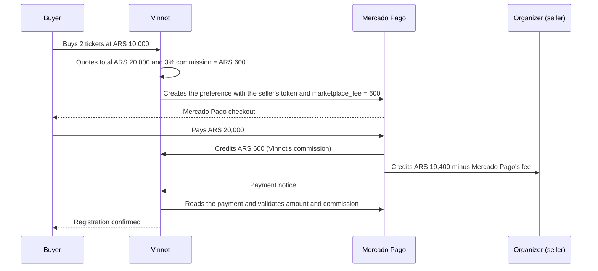
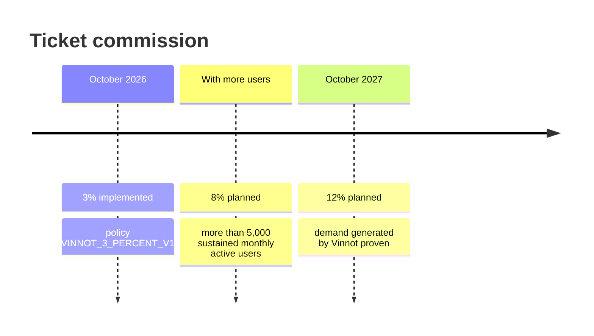
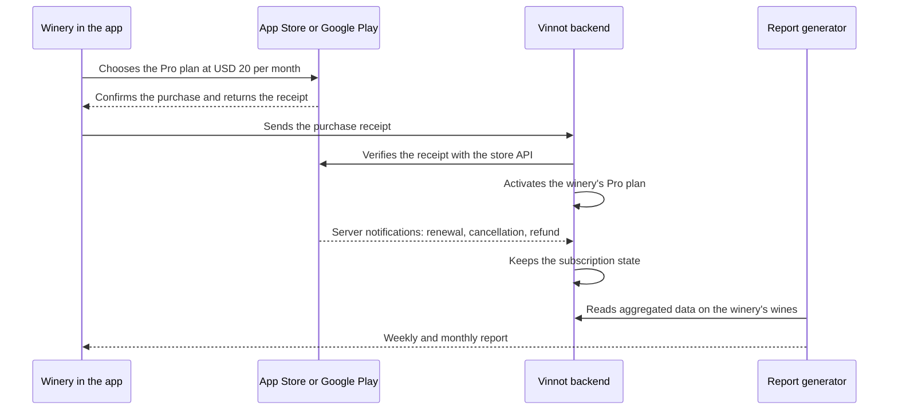

# Monetization and plans

This page explains how Vinnot makes money today and which revenue sources are planned.
It keeps three things apart: what the code already does (**implemented**), what the
business has decided but does not exist yet (**planned**), and figures calculated from
assumptions (**estimate**). The business's plans are quoted as decisions of the
business, not as facts of the code.

| Revenue source | Status | Summary |
|---|---|---|
| [Ticket commission](#ticket-commission) | Implemented | 3% of each purchase total, collected through the Mercado Pago split |
| [Commission increase](#commission-roadmap) | Planned | 8% once the user base grows and 12% around October 2027 |
| [Winery subscription](#winery-subscription) | Planned | Free plan with profile, own wines, events and basic metrics; Pro plan at USD 20 per month with reports, billed through the App Store and Google Play; target launch on 2027-03-01 |
| [Other Canvas sources](#other-revenue-sources) | Hypothesis | Labelled promotion, Premium for users, B2B services |

To try combinations of rate, volume and subscriptions, use the
[revenue simulator](revenue-simulator.mdx). The costs this revenue must cover are in
[Current costs](costs.md) and in
[Capacity and cost projections](capacity-and-cost-projections.md).

## Ticket commission

**Status: implemented.** When someone buys tickets for a paid event, Vinnot keeps 3% of
the total. The full technical detail is in the [Payments](../modules/payments/README.md)
module and its [architecture](../modules/payments/architecture.md#checkout); this
section summarizes what matters to the business.

### How it works with Mercado Pago

Vinnot uses the marketplace model of Mercado Pago Checkout Pro
([Mercado Pago documentation](https://www.mercadopago.com.ar/developers/es/docs/checkout-pro/how-tos/integrate-marketplace)):

1. **The organizer links their own account.** A partner authorizes Vinnot through OAuth
   with PKCE; Vinnot stores the seller's token encrypted with AES-GCM
   ([account linking](../modules/payments/architecture.md#account-linking),
   [partner manual](../manuals/partner.md#connect-your-mercado-pago-account)).
2. **The preference is created on the seller's behalf.** With the seller's token, the
   [`MercadoPagoCheckoutAdapter`](../../../backend/src/main/java/com/vinnot/payment/infrastructure/gateway/MercadoPagoCheckoutAdapter.java)
   creates the payment preference and includes the `marketplace_fee` field with
   Vinnot's commission.
3. **Mercado Pago splits the money.** The buyer pays the total. Mercado Pago credits the
   `marketplace_fee` to Vinnot's account and the rest to the seller's account.
4. **The seller pays Mercado Pago's fee.** Mercado Pago deducts its own processing fee
   from what the seller receives, not from Vinnot's commission.
5. **Vinnot reconciles before confirming.** A Mercado Pago notice credits nothing:
   `ReconcilePaymentsService` reads the payment and validates environment, seller,
   currency, exact amount and commission
   ([confirmation and reconciliation](../modules/payments/architecture.md#confirmation-and-reconciliation)).

### Money flow of a sale

[View the full “Money flow of a sale” diagram](https://images.vinnot.com/docs/diagrams/v1/en/business-monetization-9b9e4cda3a15.svg)

### Where the rate lives in the code

The rate is a **versioned, configurable policy** (status: implemented). The current
policy is read when the backend starts, and each payment attempt stores its own.

| Place | What it defines |
|---|---|
| [`CommissionPolicy.java`](../../../backend/src/main/java/com/vinnot/payment/domain/valueobject/CommissionPolicy.java) | Basis points (1 to 3000) and policy id, which must agree (300 ↔ `VINNOT_3_PERCENT_V1`, 800 ↔ `VINNOT_8_PERCENT_V1`) |
| [`application.yml`](../../../backend/src/main/resources/application.yml) | `app.payments.commission.basis-points` and `.policy`, via `EVENT_PAYMENTS_COMMISSION_BASIS_POINTS` and `EVENT_PAYMENTS_COMMISSION_POLICY`; defaults 300 and `VINNOT_3_PERCENT_V1`. If they disagree, the backend does not start |
| [`TicketPaymentQuote.java`](../../../backend/src/main/java/com/vinnot/payment/domain/valueobject/TicketPaymentQuote.java) | The commission is `total × basis points / 10000`, rounded once to cents |
| [`V74__configurable_commission_policy.sql`](../../../backend/src/main/resources/db/migration/V74__configurable_commission_policy.sql) | Replaces the V30 `CHECK`s that pinned 3% with general rules: basis points from 1 to 3000, an amount consistent with the stored policy |
| [`MercadoPagoCheckoutAdapter.java`](../../../backend/src/main/java/com/vinnot/payment/infrastructure/gateway/MercadoPagoCheckoutAdapter.java) | Sends `marketplace_fee` and the attempt's policy in the preference metadata |

Each payment attempt freezes its quote (`CheckoutSnapshot`) and is rebuilt with the
policy it stored, so a rate change does not alter purchases already started nor the
reconciliation of older payments.

### Worked example

Two tickets at ARS 10,000 (the same example as the
[Payments architecture](../modules/payments/architecture.md#checkout)). The Mercado
Pago fee is an **estimate**: it depends on the payout term the seller chooses. This
example uses the 10-day term, 4.39% plus 21% VAT = 5.3119%
([Mercado Pago fees](https://www.mercadopago.com.ar/herramientas-para-vender/check-out)).

| Item | 3% (today) | 8% (planned) | 12% (planned) |
|---|---:|---:|---:|
| Total the buyer pays | ARS 20,000 | ARS 20,000 | ARS 20,000 |
| Vinnot's commission | ARS 600 | ARS 1,600 | ARS 2,400 |
| Seller before Mercado Pago's fee | ARS 19,400 | ARS 18,400 | ARS 17,600 |
| Estimated Mercado Pago fee (5.3119% of the total) | ARS 1,062.38 | ARS 1,062.38 | ARS 1,062.38 |
| Seller's estimated net | ARS 18,337.62 | ARS 17,337.62 | ARS 16,537.62 |

## Commission roadmap

**Status: planned.** The business decision, in the owner's words: «ahora cobramos 3 %
pero eventualmente con más usuarios aumentarlo a 8 % y de acá a un año a 12 %» (we
charge 3% now, raise it to 8% once there are more users, and to 12% a year from now).
The table orders that decision into phases. The triggers are a proposal for deciding
when to move to the next phase; they use the metrics in [Key metrics](key-metrics.md).

| Phase | Rate | When | Proposed triggers |
|---|---:|---|---|
| 1. Launch | 3% | Today (implemented) | Attract organizers and prove that paid events work end to end |
| 2. Growth | 8% | "Once there are more users" | Monthly active users above 5,000 for three months in a row; organizers who repeat paid events; event registrations that come from Vinnot and not only from the organizer's own channels |
| 3. Maturity | 12% | "A year from now", around October 2027 | Vinnot shows it generates demand: a relevant share of tickets is sold to people who found the event on the platform |

[View the full “Commission roadmap” diagram](https://images.vinnot.com/docs/diagrams/v1/en/business-monetization-3e34e16f39d7.svg)

### What raising the rate takes

Each phase is a configuration change, not a code change:

1. **Notify partners.** The [terms of use](../modules/legal/README.md) say a rate change
   is announced in advance and applies only to new sales. Communicate the effective date
   and update the [partner manual](../manuals/partner.md).
2. **Change both variables together** in the backend environment, for example
   `EVENT_PAYMENTS_COMMISSION_BASIS_POINTS=800` and
   `EVENT_PAYMENTS_COMMISSION_POLICY=VINNOT_8_PERCENT_V1`, and restart the backend.
3. **Verify.** The web and the app show the rate reported by the API
   (`GET /payments/mercadopago/account`); older attempts keep their policy.

The technical steps are in the [payments architecture](../modules/payments/architecture.md).

## Winery subscription

**Status: planned.** The offer was agreed on 2026-11-06. It builds on the business's
original decision: «el plan free donde pueden subir y modificar sus vinos, y la
suscripción paga 20 usd mensuales via playstore o appstore» (a free plan to upload and
edit their wines, and a paid subscription of USD 20 per month through the Play Store or
the App Store), with «informes semanales/mensuales con respecto a sus vinos» (weekly and
monthly reports on their wines). The target launch of the Pro plan for founder wineries
is 2027-03-01; the schedule and its dependencies are in the
[timeline](../gantt/README.md).

Starting point in the code: there is no winery account linked to its wines today. The
catalog is edited by administrators ([Administration](../modules/admin/README.md)), and
users can propose wines that the team reviews
([proposed wines](../modules/wines/submissions.md)). The partner role only manages
events ([partner manual](../manuals/partner.md)). Both plans therefore need development.

How the price rises with the audience, and the offer for the first 50 wineries, are in the
[winery pricing roadmap](winery-pricing-roadmap.md).

### Winery account

| Element | Decision (planned) |
|---|---|
| Role | A `WINERY` role that includes the `PARTNER` role's permissions: create and manage events and sell tickets with Mercado Pago |
| Team | Several people can manage the same winery |
| Profile claim | The winery claims its existing profile; an administrator verifies ownership (an email on the winery's domain or documents) and only then grants the role |
| Wine ownership | The winery creates and edits only its own wines; the backend checks ownership on every change and changes are audited |

### Free plan and Pro plan

| | Free plan | Pro plan |
|---|---|---|
| Price | Free | USD 20 per month; USD 20 locked for 24 months for the 50 [founder wineries](winery-pricing-roadmap.md#the-founder-winery-offer) |
| Billing | — | App Store or Google Play in-app purchase only, with server-side receipt validation and store server notifications |
| Edit the winery profile | Yes | Yes |
| Create and edit its own wines | Yes | Yes |
| Create events and sell tickets | Yes | Yes |
| Verified winery badge | Yes | Yes |
| Official reply to reviews | Yes | Yes |
| Basic metrics | Yes | Yes |
| Weekly pulse | No | Yes |
| Monthly report with cuts by wine, region and taste, and comparison with peer wines | No | Yes |
| Status | Planned: needs the `WINERY` role, the verified claim and wine ownership | Planned: needs the Free plan, in-app purchase and report generation |

The detail of the basic metrics is defined together with the report catalogue after the
pilot interviews (status: **pending**). The content of each report, its sources and its
privacy rules are in [Winery reports](winery-reports.md).

### Why these decisions

Each decision serves a business goal. The reasons were gathered on 2026-11-06.

| Decision | Why | Evidence |
|---|---|---|
| The Free plan shows basic metrics | The winery sees part of what Vinnot knows about its wines and what it misses without the Pro plan, which gives it a concrete reason to upgrade (a freemium upsell). In the owner's words: «mostrar lo que se pierdan y empujar al pro» (show them what they are missing and push them to Pro) | Business decision; the Free-to-Pro conversion is measured with the Premium metric in [Key metrics](key-metrics.md) |
| The verified badge and the official reply are free | They are the reason for a winery to claim its profile. Each claimed profile adds a winery that maintains its data and its wines, which improves the catalogue for users and is the first step toward the Pro plan | WO strategy in the [SWOT](swot.md#strategic-crossover): wineries claim and maintain their profile with verification and change auditing |
| Events are in the Free plan | Every ticket sold leaves the [commission](#ticket-commission) even if the winery does not pay for Pro | Implemented 3% commission |
| The Pro plan is billed only through in-app purchase | A subscription that unlocks features inside the app must use each store's in-app purchase; a single billing path, with the receipt validated on the server and the store's renewal, cancellation and refund notifications, keeps the plan state without Vinnot handling cards | Apple guideline 3.1.1 and the Google Play payments policy ([Store economics](#store-economics)) |
| A weekly pulse and a monthly report | A figure is published only with 10 or more people, and a small winery rarely gathers 10 new ratings in a week. The weekly report is a short winery-level pulse; cuts by wine, region and taste need a month's volume | Vivino offered weekly statistics and Wine Australia combines a weekly bulletin with deeper reports ([Winery reports](winery-reports.md#weekly-pulse)) |
| Vinnot sells demand, not sales | Wineries already pay for sales indicators inside their DTC platforms, such as Commerce7 or WineDirect. Vinnot covers the pre-purchase signals that those platforms, INV and retail panels do not provide | [Winery reports](winery-reports.md#vinnot-sells-demand-not-sales) |
| USD 20 per month | It sits far below the paid alternatives surveyed and answers small wineries' main barrier: cost. At that price the report must be automatic and interpreted, not a dashboard to explore | Price comparison in the [pricing roadmap](winery-pricing-roadmap.md#how-the-price-compares) |

### Store economics

Each rule links to its source.

| Item | App Store | Google Play |
|---|---|---|
| Fee on subscriptions | 30% in the first year and 15% from the second ([Apple](https://developer.apple.com/app-store/subscriptions/)) | 15% ([Google](https://support.google.com/googleplay/android-developer/answer/112622)) |
| Small developer program | 15% from the first year with less than USD 1 million in proceeds ([Small Business Program](https://developer.apple.com/app-store/small-business-program/)) | Not needed: the subscription fee is already 15% |
| Net per Pro winery (USD 20) | USD 17 with the program; USD 14 in the first year without it | USD 17 |
| In-app purchase required | Yes: in Argentina, a subscription that unlocks features in the app must use in-app purchase (Guideline 3.1.1, [App Review Guidelines](https://developer.apple.com/app-store/review/guidelines/)) | Yes: subscriptions and app features use Google Play billing ([Payments policy](https://support.google.com/googleplay/android-developer/answer/9858738)) |
| Event tickets | Can be sold outside the store: they are services consumed outside the app (Guideline 3.1.3(e)) | Can be sold outside the store: event tickets are real-world services |

Prerequisites:

- Apple's **Paid Applications Agreement**: it is separate from the Apple Developer
  Program membership and required to sell subscriptions
  ([Current costs](costs.md#app-stores)).
- A **Google Play payments profile** with tax and bank details.
- **Enrollment in the Small Business Program**, to pay 15% from the first year.

### Subscription purchase flow

[View the full “Subscription purchase flow” diagram](https://images.vinnot.com/docs/diagrams/v1/en/business-monetization-c0abead357da.svg)

The whole flow is planned. There is no in-app purchase in the app today.

## Other revenue sources

The [Business Model Canvas](business-model-canvas.md#status-of-revenue-sources) lists
other sources that are **hypotheses** today: a Premium subscription for users, clearly
labelled featured promotion, and B2B presence and aggregated analytics services. The
last two overlap with the winery Pro plan. None is planned; the Canvas says what must be
validated first.

## Sources

Prices and rules checked on 2026-10-29.

- Mercado Pago, marketplace in Checkout Pro: https://www.mercadopago.com.ar/developers/es/docs/checkout-pro/how-tos/integrate-marketplace
- Mercado Pago, Checkout fees: https://www.mercadopago.com.ar/herramientas-para-vender/check-out
- Apple, subscriptions: https://developer.apple.com/app-store/subscriptions/
- Apple, Small Business Program: https://developer.apple.com/app-store/small-business-program/
- Apple, App Review Guidelines: https://developer.apple.com/app-store/review/guidelines/
- Google Play, service fees: https://support.google.com/googleplay/android-developer/answer/112622
- Google Play, Payments policy: https://support.google.com/googleplay/android-developer/answer/9858738
