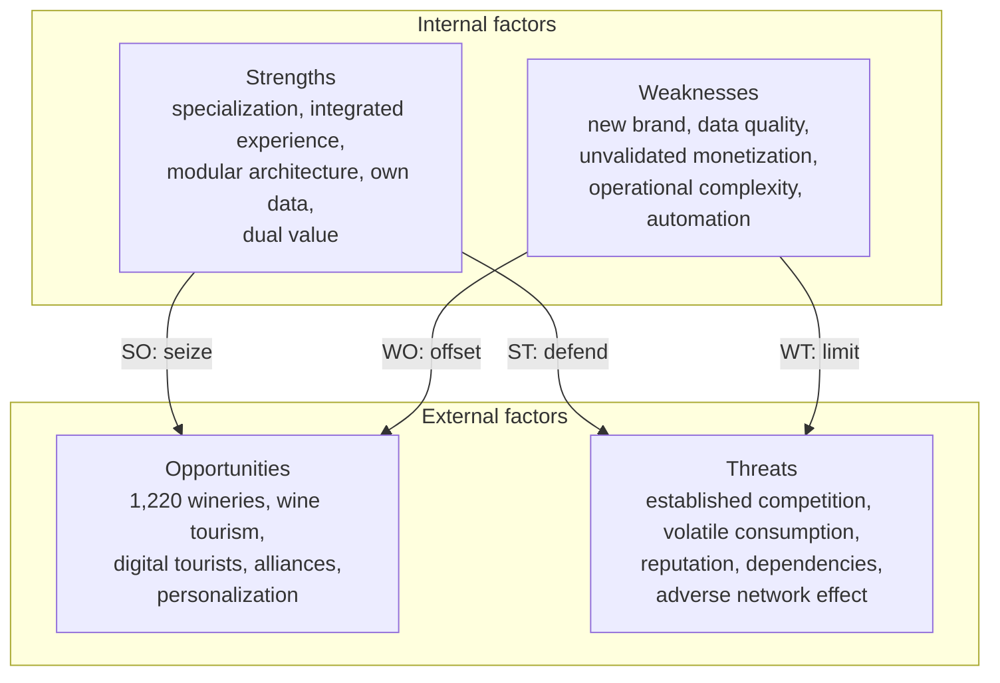

# SWOT analysis

Strengths, weaknesses, opportunities and threats of Vinnot as a digital platform
specialized in wine, which integrates a catalog, label comparison, reviews, wineries,
maps and experiences from the wine world. The goal is not to list isolated features,
but to separate the factors that depend on the project from those that come from the
environment, and turn the diagnosis into decisions.

**Criterion.** Strengths and weaknesses are internal factors: they are managed from
the product, the team or the business model. Opportunities and threats are external
factors: Vinnot does not control them, but it can prepare to seize them or reduce
their impact.

## Vinnot as the case analyzed

Vinnot brings into a single digital experience information that is usually scattered
across shops, social media, winery websites and general-purpose apps. For
professionals, it also opens a channel for presence and for reaching an audience
interested in the category.

| Dimension | What it includes |
|---|---|
| User | Catalog, comparison, reviews and cellar |
| Content | Wine records, grape varieties, wineries and events |
| Territory | Map and experiences linked to wine regions |
| Ecosystem | Users, wineries, partners, moderation and administration |

## Market context

Data from Argentina's National Institute of Viticulture (INV), sources [1] to [4], and
from the Tourism Secretariat, sources [5] to [7], consulted in October 2026.

| Indicator | Value | Body |
|---|---|---|
| Registered wineries (2025) | 1,220 | INV |
| Wineries that made wine (2025) | 895 | INV |
| Vineyards (2025) | 20,939 | INV |
| Domestic market volume (2025) | 7.46 million hectoliters | INV |
| Wine exports (2025) | About 1.93 million hectoliters | INV |
| Domestic market change (2025) | −2.7% cumulative | INV |
| Domestic market change (first half of 2026) | +0.8% year on year; June, +5.8% | INV |
| Wineries open to tourism (2026) | More than 375, in 16 provinces | Tourism Secretariat |

**Reading.**

- **Supply.** It is a large, diverse ecosystem, with enough depth of supply for a
  specialized platform.
- **Consumption.** The 2025 decline and the moderate 2026 recovery mean Vinnot cannot
  be just a catalog; it must add value through discovery, education, community and
  experiences.
- **Wine tourism.** Official guides point out that wine tourists use digital tools
  heavily before and after a visit [6], which connects with Vinnot's map, agenda and
  recommendations.

## SWOT matrix

Each item was chosen for its possible impact on adoption, growth, trust or
monetization.

| | Positive | Negative |
|---|---|---|
| **Internal** | **Strengths** • A vertical proposition specialized in wine, with a clear identity. • An integrated experience: catalog, comparison, reviews, map and events. • A modern, scalable architecture that evolves by modules. • Own data on preferences, reviews and interaction. • Dual value: users and professionals. | **Weaknesses** • A new brand: it needs reputation, community and a critical mass of reviews. • High demands on the quality and freshness of wines, wineries and events. • Monetization still to be validated without eroding trust. • Growing operational complexity from roles, moderation and partners. • Risk of relying too much on automation to enrich content. |
| **External** | **Opportunities** • A broad Argentine ecosystem: more than 1,200 registered wineries in 2025. • Growth and professionalization of wine tourism across several provinces. • Heavy use of digital tools by wine tourists. • Alliances with wineries, wine shops, sommeliers, events and wine routes. • Personalization, recommendations and educational content as a differentiator. | **Threats** • Competition from global platforms, e-commerce and wineries' own channels. • Volatile domestic consumption and discretionary spending. • Outdated or wrong data that quickly damages reputation. • Dependence on external services, app stores and regulatory changes. • Adverse network effect: without users there are no reviews; without content, users do not come. |

### Factor map

[View the full “Factor map” diagram](https://images.vinnot.com/docs/diagrams/v1/en/business-swot-fbcec0b47b4c.svg)

**Quick reading.** Vinnot's greatest asset is its ability to join content, community
and territory in a niche with a strong identity. The main internal risk is covering
too many features before consolidating data and users; the main external risk is
competing for attention with established platforms and with wineries' direct
channels.

## Strengths

**Specialization and positioning.** Vinnot does not start from a generic proposition.
Its focus on wine organizes the experience around what matters in the sector: grape
variety, region, winery, style, comparison, reviews and experiences. That vertical
focus makes a recognizable brand and deeper content easier than in a general
marketplace.

**Integrated experience.** Combining catalog, map, comparison and agenda reduces
fragmentation. A person can discover a label, learn about the winery, compare
alternatives and find a related experience without switching platforms. Integration
increases recurrence and allows discovery journeys, not just isolated searches.

**Technological capacity to iterate.** The platform is a modular monolith with a
hexagonal architecture ([System architecture](../architecture/README.md)), so each
feature evolves without rewriting the rest. That lowers the friction of testing new
hypotheses: recommendations, partner modules, geographic filters, events or mobile
features.

**Own data and learning.** Reviews, the cellar, comparisons and searches can become,
under clear privacy policies, signals about preferences. That knowledge improves
recommendations and content, and produces useful information for wineries or
partners without exposing personal data. Which signals are recorded today is in
[Key metrics](key-metrics.md#what-the-platform-measures-today).

**Two-sided ecosystem.** Vinnot creates value for consumers and for wineries and
other industry players. The better the user experience, the more attractive the
channel is for partners; and the more complete the professional participation, the
more value users get. That loop can become a competitive barrier if it is built on
trust.

**Implication.** The priority is not to add features, but to reinforce those that best
connect the strengths: a reliable catalog, community, territory and partners. That
combination is harder to copy than any single feature.

## Weaknesses

**Critical mass and trust.** A platform based on reviews, events and discovery needs
real activity. Early on there may be a broad catalog with little interaction, which
weakens the sense of community. The challenge is to focus the launch on segments or
regions where density can be built before expanding.

**Data quality and upkeep.** Wines change vintage, label, availability and price;
events expire and wineries change their hours or offers. The richer the database, the
more it costs to keep it reliable. A wrong record hurts a specialized platform more,
because people expect precision.

**Monetization not yet validated.** Advertising, memberships, partner promotions,
bookings or B2B services are possible, but each one changes incentives. If a
recommendation seems to answer to a brand's payment rather than to relevance, trust
erodes. The model must clearly separate editorial content, community opinion and
commercial promotion.

**Operational complexity.** Review moderation, onboarding wineries and events,
complaints, content and partner permissions add work that code alone does not solve.
Operations must grow with the product so the platform does not depend on permanent
manual fixes.

**Automation and generated content.** Automation speeds up records and
classification, but a wrong wine description or an invented recommendation damages
credibility. Technology helps structure and enrich; it does not replace verifying
sensitive or factual information. Vinnot's AI profiles can be edited and regenerated
by the team ([AI profiles and comparisons](../modules/ai/README.md)).

| Weakness | Early indicator | Response |
|---|---|---|
| Low activity | Reviews per record and returning users | Launch by specific communities and regions |
| Outdated data | Frequent reports or corrections | Traceability, verification date and a partner panel |
| Uncertain monetization | Low conversion or rejection of promotions | Test formats without mixing advertising into the organic ranking |

## Opportunities

**A wide universe of wineries and labels.** The 1,220 registered wineries and 895
wine-making wineries of 2025 are a potential supply large enough to justify search,
comparison, classification and discovery tools.

**Wine tourism and experiences.** Argentina is a regional reference in wine tourism,
with more than 375 wineries open to tourism in 16 provinces and significant growth
since 2018. Vinnot's map and agenda can bridge digital discovery and the physical
visit.

**Wine tourists' digital behavior.** The official wine tourism guide describes heavy
use of digital tools, from the initial search to the later recommendation. That
enables planning, saved routes, post-visit reviews and contextual recommendations.

**B2B alliances.** Wineries, wine shops, sommeliers, tasting organizers and tour
operators need visibility and tools to reach specific audiences. Vinnot can offer
verified profiles, event publishing and aggregated analytics without abandoning its
proposition for users.

**Education and personalization.** Wine has a knowledge barrier that is also an
opportunity: many people want to choose better without studying oenology.
Understandable comparisons, explanations of grape varieties, pairings and transparent
recommendations reduce friction and build trust.

**Market signal.** In the first half of 2026 the domestic market grew 0.8% year on
year and June rose 5.8%. It does not guarantee sustained growth, but it shows a
scenario that mixes challenges with signs of recovery and supports propositions that
add value around consumption, not only around the sale.

## Threats

**Competition for attention.** Vinnot competes indirectly with international wine
platforms, online shops, Google Maps, social media and each winery's own channels.
Although none replicates the proposition exactly, all of them solve part of the need
([Competitive analysis](competitive-analysis.md)).

**Consumption and discretionary spending.** The domestic market fell 2.7% in 2025. A
platform tied to leisure, gastronomy and tourism must assume that user spending
varies with the economic context and avoid depending only on high-value
transactions.

**Reputation and accuracy.** A fake review, a non-existent event or a wrong record
spreads quickly and damages trust. The threat grows with the community, because the
volume of content to moderate and verify grows too.

**Technological and regulatory dependencies.** Map services, infrastructure, mobile
stores and other providers can change prices or terms. At the same time, data
processing, commercial communications and third-party content require regulatory
adaptation. The product must not be tied to a single critical dependency. The current
providers are in the [technology catalog](../architecture/technologies/README.md).

**Network-effect problem.** Community platforms face a circular dynamic: people come
if there is useful information and opinions, but those opinions appear once users
already exist. If the start is too broad, activity spreads thin and feels empty.

**The most critical threat.** It is not a specific competitor, but the combination of
low critical mass with established alternatives. Vinnot needs to be clearly better at
one concrete journey (discovering, comparing and living wine experiences in
Argentina) before trying to cover every possible use.

## Strategic crossover

The value of a SWOT appears when internal and external factors are crossed. SO
strategies use strengths to seize opportunities; WO strategies use opportunities to
offset weaknesses; ST strategies use strengths to reduce threats; and WT strategies
limit a weakness and a threat at the same time.

| Type | Objective | Application to Vinnot |
|---|---|---|
| SO | Specialization + wine tourism | Connect catalog, map and agenda so that a wine record becomes a door to its winery, region and experiences. Build verified profiles for tourism and wine businesses |
| SO | Own data + personalization | Use the cellar, comparisons and reviews for explainable recommendations ("we suggest this wine because of its grape, region and your preferences"), avoiding black boxes that are hard to justify |
| WO | Low critical mass + alliances | Launch programs with wineries, sommeliers and local communities that contribute events and verified content, concentrating activity at first in priority regions or segments |
| WO | Hard data + professional participation | Let wineries claim and maintain their profile under verification and change auditing. Reduce manual work without handing over full control of public information |
| ST | Specialized identity + competition | Compete on depth and local experience, not catalog size. Prioritize Argentine information, routes, events and cultural context that general platforms cover in a fragmented way |
| ST | Modular architecture + dependencies | Design adapters for maps, authentication and external services; keep essential data in own models and define replacement options |
| WT | New brand + reputation | Build in moderation, traceability and reporting from the start. Label promoted content and verified profiles so opinion, advertising and fact are not mixed |
| WT | Uncertain monetization + volatile consumption | Diversify revenue: partner tools, experiences or Premium services, without depending only on commissions on wine sales |

Several of these strategies already have a basis in the product: the ports and
adapters of the hexagonal architecture (ST), reactive moderation with reports and
blocks ([Community](../modules/community/README.md), WT) and the ticket fee as revenue
that does not depend on selling wine ([Payments](../modules/payments/README.md), WT).

## Action plan

The priority combines strategic impact, urgency and capacity to execute.

| # | Priority | Impact | First action |
|---|---|---|---|
| 1 | Catalog reliability | High | Define source, update date, reports and a correction process for wines, wineries and events |
| 2 | Localized critical mass | High | Choose an initial region or community and concentrate partners, events and users to generate visible activity |
| 3 | Differential proposition | High | Refine the discover → compare → visit or take part journey before expanding secondary features |
| 4 | Partner program | Medium-high | Create verified profiles and a simple process for wineries to maintain their information and publish experiences |
| 5 | Transparent monetization | Medium | Test B2B or Premium services and clearly label any sponsored placement |
| 6 | Responsible personalization | Medium | Use interaction signals for explainable recommendations, measuring quality before the number of suggestions |

The indicators that track this plan are in [Key metrics](key-metrics.md).

## Conclusion

Vinnot starts from an attractive combination: a sector with a strong identity, plenty
of wineries and experiences, and a digital proposition able to integrate information
that is fragmented today. Its biggest risk is typical of community platforms: it
needs reliable content and critical mass before the experience reaches its full
value, and expanding catalog, events, partners and recommendations at once adds
complexity without solving that. The environment offers a concrete opportunity, which
is not simply to digitize wine, but to connect discovery, knowledge and experience.
The threats call for not competing on volume and for a specific position: being a
reliable reference to understand, compare and live Argentine wine.

**Synthesis.** Build trust before scale: a verifiable catalog, a concentrated
community, responsible partners and a differential proposition that connects the
bottle with the winery and the experience.

## Sources

1. National Institute of Viticulture (INV). Principales datos vitivinícolas, 2025.
   <https://www.argentina.gob.ar/inv/estadisticas-vitivinicolas/principales-datos-vitivinicolas>
2. INV. Annual domestic wine market reports.
   <https://www.argentina.gob.ar/inv/vinos/estadisticas/mercado-interno/anuarios>
3. INV. "El consumo interno de vinos creció más de 5% en junio", July 27, 2026.
   <https://www.argentina.gob.ar/node/508527>
4. INV. Informe Malbec 2026. <https://www.argentina.gob.ar/node/498136>
5. Secretariat of Tourism, Environment and Sports. "Argentina dijo presente en un foro
   en Brasil dedicado al enoturismo y la gastronomía", August 13, 2026.
   <https://www.argentina.gob.ar/noticias/argentina-dijo-presente-en-un-foro-en-brasil-dedicado-al-enoturismo-y-la-gastronomia>
6. Secretariat of Tourism, Environment and Sports. Guía para el desarrollo del turismo
   del vino: lineamientos para su implementación.
   <https://www.argentina.gob.ar/sites/default/files/guia_turismo_del_vino.pdf>
7. Secretariat of Tourism, Environment and Sports. Mapa de bodegas de Argentina.
   <https://www.argentina.gob.ar/jefatura/turismo/viaja-por-argentina/mapa-de-bodegas-de-argentina>

If the address of [3] or [4] stops responding, check the INV statistics page [1].
