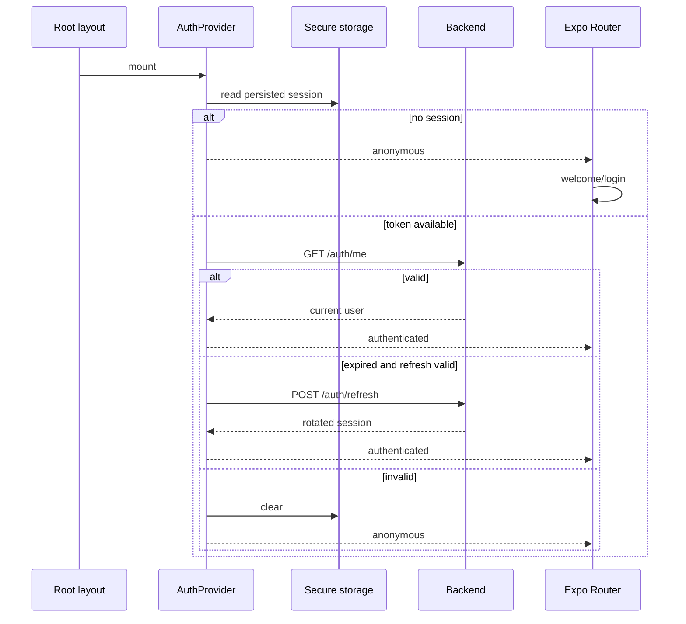

# Mobile navigation, session and state

## Route matrix

| Group | Main routes | Access |
|---|---|---|
| root | `/`, `/about`, `/help`, `/contact`, `/legal`, `/legal/[slug]`, `/terms`, `/privacy`, `/cookies`, `/content-policy` | public or initial decision |
| recovery | `/403`, `/500`, `/503`, `/429`, `/offline`, `/timeout`, `+not-found` | public |
| payment return | `/payments/return` | public; shows the checkout return and does not confirm payment |
| onboarding | `/welcome` | unauthenticated session |
| auth | login, registration, verification, recovery | anonymous |
| tabs | home, wine catalog/detail, event list/detail, route list/detail, profile | `(app)` shell AuthGuard |
| personal actions | cellar, community; scan, comparison, submissions and AI profile under wines | shell AuthGuard and per-screen checks |
| product | wineries, wine-routes | `(app)` shell AuthGuard |
| social | `/users/[id]`, `/users/[id]/followers`, `/users/[id]/following`, `/feed`, `/taste-quiz` | `(app)` shell AuthGuard |
| tickets | `/my-tickets`, `/my-tickets/[id]`; opened from Profile and not a tab (there are still five tabs) | `(app)` shell AuthGuard |
| account onboarding | complete-profile | authenticated user with incomplete profile |
| partner | dashboard and owned events | PARTNER or ADMIN per layout |
| admin | dashboard, wines, wineries, events, routes, reviews, submissions, publications, community | ADMIN or MODERATOR |
| admin/users, admin/notifications, admin/social-posts | users, roles and bans; push notifications; social posts approval queue | ADMIN only |

`app/+native-intent.tsx` resolves payment returns first through
`presentation/navigation/paymentReturn.ts`: `vinnot://payments/return` is
normalized to `/payments/return` (or `/my-tickets` when the link is invalid) and
`vinnot://payments/connected` returns to `/partner/events` or `/admin/events`,
depending on the screen that started account linking. Other intents go through
`safeNativeIntent`.

Route groups are not part of paths. Detail hooks use `skipToken` for missing
IDs; format validation is screen-specific, not a global router validator.

`TermsGate` checks current acceptance in the `(app)` shell, including before
profile completion. Root legal-information, help and contact routes remain
outside that gate and accessible. `AuthGuard` wraps `TermsGate` and the Stack,
preventing product screens from mounting while restoring or without a session.

## Main tabs, routes and cellar

The five tabs are Home, Wines, Events, Routes and Profile. Routes has its own
Stack in `app/(app)/(tabs)/routes`: list and detail keep that tab selected.
`WineRoutesScreen` and `WineRouteDetailScreen` are shared presentation; files
under `app/` only compose routes/layouts.

`/wine-routes` redirects to the Routes list. `/wine-routes/:id` preserves the
detail shell outside tabs for Home entry points and previous links. Detail back
uses history when available; without history it returns to Routes. The detail
query shares its cache by ID across both shells.

Cellar lives in `app/(app)/cellar.tsx`, outside tabs, preserving `/cellar`.
Home and the profile's “Wines in cellar” card open the same screen, including
when its count is zero. Back preserves the origin; without history it goes to
Home. Wine detail retains its cellar entry point. Navigation changes do not
alter cellar queries, filters or operations.

The same rule is shared through `goBackOr(router, fallback)` in
`presentation/navigation/discoveryNavigation.ts`: winery detail falls back to the
wineries list, the AI profile to its wine, admin screens to the admin panel (the
panel itself to Profile) and the organizer's events to Profile.

## Public profiles and follows

`/users/[id]` is anyone's public profile, one's own included
(`PublicProfileScreen`): avatar, name, current seal, @username, bio, counters
(followers, following, reviews, cellar wines), taste match with the viewer, the
taste profile card and the Reviews and Cellar sections. Other people's profiles show
Follow / Following and the report and block menu; one's own shows Edit profile
(the same sheet as the Profile tab, with the bio and the cellar visibility). The
Profile tab opens one's own from «My public profile». With no wheel yet (fewer than 5 rated wines) but with quiz traits, the taste card puts the locked wheel in the wheel's place, above the traits: the emblem in a dashed circle with a lock and the notice, as on the web.

The Profile tab (`ProfileScreen`) is ordered: header with points, «Stats», «Quick access» (My cellar, My tickets, My public profile, My submitted wines, Community and safety and, by role, the admin and partner panels), «Settings» (photo, password, account and security, notifications, language), «Support» and log out.

- Follow and unfollow change the button and the count at once
  (`useFollowToggle`); when the server fails they go back with a message. The
  mutation invalidates the `Social` tag shared by the profile, the lists, the feed
  and the suggestions; blocking, reviewing and editing one's own profile
  invalidate it too.
- The cellar is not requested when the profile says `cellarVisible: false`, and a
  403 `CELLAR_NOT_VISIBLE` also shows the locked state. Notes and purchase prices
  are never shown.
- The taste profile card (`TasteProfileCard`) follows the watercolor style of the
  AI profile. The taste wheel (`TasteWheel`, `expo-image`, `react-native-svg` and
  Reanimated) is a flower of watercolor petals on a cream stage with faint paper and
  the grape-cluster illustration at the centre; it turns and grows once, and under
  Reduce Motion it is drawn still. Without a wheel (fewer
  than 5 rated wines) the card explains why.
- The wheel shows one kind of entry at a time (S15). A selector built with the
  shared `Chip` offers «Grapes» (the default), «Styles» and «Regions»; a view
  without entries is hidden, without grapes the first view with entries opens, and
  with a single view there is no selector (`tasteWheelViews`, `tasteWheelSlicesOf`
  in `socialRules`).
- Each entry is one petal (`tasteWheelPetals` in `tasteWheelGeometry.ts`): equal
  angles of 360/n, the first at the top, going clockwise, with its tip towards the
  centre and 4 pt off the centre disc. The wheel is up to 290 pt across, or 88% of
  the card's content width when that is smaller (`tasteWheelSize`, measured with
  `onLayout`), and the stage grows with it (a 5% margin on each side). The centre
  disc never goes under a 48 pt radius, so the text keeps at least 67 pt of width.
  Its length grows with the score (`maxLength * (0.72 + 0.28 * score/5)`, clamped);
  its width reaches up to 1.15 times the art's aspect (213x280) and never exceeds
  the angular spacing at the petal's mid radius minus 3 pt, so up to 8 petals
  neighbours nearly touch and 2 to 4 do not turn into blobs. The three shapes `profile-art/taste/petal-wash-{1,2,3}.webp` (`TASTE_PETAL_WASHES`
  in `shared/profileArt.ts`, grayscale with alpha) cycle by index, with a fixed tilt
  of up to ±4°. Each petal is two `expo-image` `Image`s of the same wash: below,
  `tintColor` in the entry's colour at 0.88 opacity (the silhouette), and on top,
  inside a view with `mixBlendMode: "multiply"`, the texture that brings back the
  pigment and the darker edges. The legend swatches are tiny petals painted the
  same way.
- `useTasteWheel` keeps the view and the selection: tapping a petal's sector (an
  invisible SVG `Path` with `accessible`, its whole angle range out to the edge, over
  the art) or its legend row selects it with a light haptic tick; the petal grows 8%
  and moves 6 pt out at full opacity, the rest drop to 0.35 (Reanimated, a 220 ms
  `withTiming`) and the centre swaps the grape cluster for the name, the score with
  one decimal and "N wines" (older payloads without wines show only name and
  score). The centre text is limited to the disc's inscribed width: the name takes
  up to 2 lines, starts smaller when long (12, 11 or 10 pt from
  `centreLabelFontSize`) and shrinks down to 0.6 to fit, so it never touches the
  petals. Tapping it again or changing the view clears it; under Reduce Motion the
  selection changes without animation. Colours come from
  `tasteWheelPalette.ts` with the `tasteWheelPalette` values in
  `shared/theme/tokens.ts`, the same as on the web: grapes are grouped by `tone`
  (reds, rosés, whites, the rest) and alternate shades of their family so that two
  neighbours never look alike; styles use `wineTypeSwatches` and are named with
  `wines.types.*`; regions take 8 distinct hues. The mapper reads `tone` and
  `ratedWines` with `null` and `0` defaults, so an older payload still works.
- Under the wheel, the profile's `tasteTraits` add «Structure», one row per trait
  (Acidity, Body, Tannin, Sweetness) with its illustration, a level word and a scale
  marked at the 0-100 score, and the preferred aromas (Fruity, Floral, Herbal,
  Spicy, Oak, Mineral) as illustrated chips with their percent, highest first. A
  score under 34 reads low, under 67 medium and otherwise high (`tasteTraitLevel`);
  sweetness reads Dry, Off-dry or Sweet. An empty list hides its section, and with
  `tasteTraits: null` only the wheel or its locked state is shown. The mapper drops
  unknown traits and families. The illustrations come from
  `src/shared/profileArt.ts` (`TASTE_ART`, `tasteTraitArt`, `tasteFamilyArt`)
  and are decorative; the text carries the meaning.
- When any value comes from the taste quiz (`tasteTraits.fromQuiz`), the card says
  so under its title: «Based on your taste quiz» on one's own profile and «Based on
  the taste quiz» on someone else's. With a quiz and fewer than 5 rated wines there
  are traits but no wheel: the traits lead the card and a compact hint with the
  grape cluster explains that the wheel arrives after 5 rated wines. On one's own
  profile the card ends with «Take the taste quiz» or, once the quiz is completed,
  «Retake the quiz»; both open `/taste-quiz`.
- On one's own profile, «Structure» has «Adjust» in its header (even before there
  are any traits). The view model only creates the editor (`useTasteStructureEditor`)
  for the owner, so a visitor never sees the controls. Adjust turns the four scales
  into 0-100 sliders (`TasteTraitSlider`, Gesture Handler and Reanimated): drag the
  marker or tap the track, the level word updates live and releasing plays a light
  haptic. The pan only starts after a horizontal move (`activeOffsetX`) and gives way
  to a vertical one (`failOffsetY`), so the profile's `ScrollView` keeps scrolling.
  For screen readers each slider is `adjustable`, with the trait name as its label,
  the level word as its value and steps of 5 on increment and decrement. A missing
  trait starts at 50.
- «Save» sends `PUT /users/me/taste-traits` with only the touched traits that
  changed (`tasteStructureChanges`; a trait that was missing is saved once touched)
  and leaves edit mode when the server answers; with no changes it leaves without a
  request, and on failure it stays in edit mode with a message. «Cancel» restores
  the previous values. «Reset to calculated» (`DELETE /users/me/taste-traits`) only
  appears when some trait has `adjusted: true`, and those traits carry an
  «Adjusted» tag. The `social.tasteTraits.adjust` and `social.tasteTraits.reset`
  operations use the `Social` tag, which refreshes the profile.
- The followers and following counters open `/users/[id]/followers` and
  `/users/[id]/following`, each row with its Follow button (except one's own).
- Tapping a review author's avatar or name opens their profile.
- Review rows (wine reviews, the feed, profile reviews and the compact Home cards)
  and comments show the author's `@username` under the display name in smaller
  medium-gray text (`UserHandle`, `textTertiary` token); nothing is shown when the
  username is missing.

Home ends, only with a session and after all its other sections, with «From
people you follow» (the 3 latest reviews of followed people as compact cards: wine
thumbnail, author with their seal, glasses and two lines of text; «See all» opens
`/feed`) and «People to follow» (a horizontal row with avatar, seal, taste match
when there is one and a compact Follow button). Without a
session they are neither requested nor shown. Paged lists share
`usePagedSocialList`, which keeps the loaded pages and goes back to the first one
on refresh. Everything ships by OTA: no native module is added.

## Taste quiz

`/taste-quiz` (`app/(app)/taste-quiz.tsx`, a shell for `TasteQuizScreen` in
`presentation/features/tasteQuiz`) is five illustrated questions in a fixed order:
a rainy day, fruit, dessert, a special dinner and scent. It slides up as a full
screen without a dismiss gesture (a fade under Reduce Motion).

- Each question shows progress dots, the question in large type and cards with the
  watercolor on the cream stage and its label: two tall cards for the first one and
  a 2x2 grid for the rest. Only the options are shown; how they shape the profile
  stays on the server. Each option is a button with its selected state.
- Choosing highlights the card, plays a light haptic and moves to the next question
  after a short beat. Back keeps the chosen answer.
- «Skip», on every step, records `POST /users/me/taste-quiz/skip` and goes back (or
  to Home when there is no history). Retaking a completed quiz just leaves, records
  nothing and keeps the previous quiz.
- With the fifth answer, `PUT /users/me/taste-quiz` sends all five while «Defining
  your taste profile» stays on screen for at least 12.8 s, on the same engine as the
  AI profile and comparison animation (`WineProcessJourney`) but with four scenes of
  its own (`TasteProfileSceneArt`), one every 3.2 s, at a calm pace (each gesture eases in and out and rests on its final pose before the next): «Gathering your picks» (a fountain
  pen draws each chosen watercolor into a flat, open tasting journal, inked into
  the page with two handwritten note lines beside it), «Filling your glass» (an empty glass fills
  with red wine and its aromas rise in wisps; the picks no longer fly in as cut-outs), «Blending your flavors» (a brush dips into three
  wells of the palette and swirls the colours in the middle) and «Shaping your
  taste profile» (the brush paints the six petals of the wheel, one by one, around
  a glass of red wine seen from above, and repeats while saving). The choices arrive as `picks`
  (`tasteQuizPicks`, in question order), the way wine looks parameterize the wine
  scenes; under Reduce Motion each scene is drawn in its final pose. Then the quiz is
  replaced by one's own public profile `/users/{id}`. When it fails, it offers to
  retry with the same answers or to leave without recording anything.
- The `social.tasteQuiz`, `social.tasteQuiz.complete` and `social.tasteQuiz.skip`
  operations use the `Social` tag, so completing or skipping refreshes one's own
  profile and the quiz state. The watercolors come from `TASTE_QUIZ_ART` in
  `src/shared/profileArt.ts`.

The automatic offer lives in `TasteQuizPromptHost`, mounted in the `(app)` layout
inside `TermsGate`, next to `PointsHost`: it only runs with a session, the terms
accepted and a completed profile, so it never interrupts the legal acceptance, the
email verification (the `(auth)` group) or the required update (`AppUpdateGate`,
which wraps the whole app). When `GET /users/me/taste-quiz` answers
`shouldPrompt: true`, it opens `/taste-quiz` once, after a short pause so Home
settles. An in-memory record per member keeps it to once per app session; across
sessions the server decides, and it stops asking once the quiz is completed or
skipped.

## Bootstrap and restoration

[View the full “Bootstrap and restoration” diagram](https://images.vinnot.com/docs/diagrams/v1/en/frontend-mobile-architecture-navigation-and-state-0a74a15c0b07.svg)

`AppProviders` mounts on the first render: session restoration starts concurrently
with font loading. The native splash waits for fonts (or their failure, using
fallback fonts). Then `VinnotLaunchScreen` provides a neutral wait until
`initSession` finishes; `app/index.tsx` navigates immediately to the appropriate
destination once Expo Router confirms that the route is focused and navigation is ready, without an artificial pause. Guards and `TermsGate` still control
access. Session restoration never means blindly trusting storage: the backend
remains authoritative.

Home (cover and four wine types) and welcome illustrations use bundled WebP derivatives and `expo-image` with
downscaling enabled. Dimensions, transparency, and the original PNG design sources
are preserved. First launch does not require downloading these images from R2;
private-image cache policy is unchanged. To regenerate: `cwebp -q 90 -m 6 -metadata none <original.png> -o <derivative.webp>`.

The `startupRoutes.test.tsx` regression verifies provider startup before fonts
resolve, fallback after font failure, and immediate navigation only after session
restoration. It verifies startup ordering; it does not measure real-device timing
or demonstrate resolution of a native crash.

## Minimum supported version

`app/_layout.tsx` wraps `RootNavigator` in `AppUpdateGate`
(`presentation/features/appUpdate/`), inside `AppProviders` and after fonts
load, so the gate covers every route: public, authentication and the `(app)`
shell. `useAppUpdateRequirement` asks `appVersionService` for the public policy
`GET /app-versions/minimum` at launch and every time the app returns to the
foreground (`applicationLifecycleService`, AppState `active`). The service
compares the installed version (`Constants.expoConfig?.version`, read through
`appBuildGateway`) with the minimum for `Platform.OS`; the pure
`major.minor.patch` rules live in `domain/app/appVersion.ts` and compare each
part as a number, so `0.10.0` is newer than `0.9.9`.

When the installed version is lower, `UpdateRequiredScreen` replaces the whole
navigator. It has no dismiss and no navigation, the Android back button is
consumed, and its only action opens the platform's store listing through
`useExternalLink`. The gate fails open: while a check is pending, and after a
network error, timeout, unreadable response, missing app version or null
minimum, the app renders normally. Only the latest check counts, so a later
check with a lower or null minimum unblocks the app.

The gate is JavaScript only (`expo-constants`, `Platform`, `AppState`,
`Linking`) and adds no native module, so it ships by OTA update to builds already
in the stores. Because the runtime version policy is `appVersion`, an OTA update
never changes the version the gate compares.

## Agreement verification and profile refresh

While the server checks account acceptance, `TermsGate` shows a neutral wait.
It does not mount consent headings, text, or controls until acceptance is confirmed
as required. An already accepted account goes directly to the Stack. Failure keeps
content blocked, offers retry, and preserves legal/contact and sign-out access.
Storage is never used as proof of acceptance.

Pull-to-refresh on the profile calls `refreshUser` through `useAuth`, delegating to
`refreshAuthenticatedUser` and the authentication application service. It updates
the user and persistence without running `initSession`, changing the session
generation, setting `isInitializing`, or unmounting guards/the Stack, preserving
the profile tab and navigation. Responses arriving after logout/account changes
or a newer profile edit are discarded before persistence. Temporary errors keep
the profile visible and are reported; credential renewal retains the existing
interceptor and composition.

## Wines navigation

The wines stack combines browse, detail, AI profile, comparison, scan and
submissions. Two rules prevent historical loops:

- tapping Wines navigates/replaces to its index rather than reopening a child;
- opening scan records an `origin`; back uses that origin instead of an
  ambiguous `router.back()`.

Detail opened from a scan result may return to that result. Tapping Wines always
opens the catalog.

## State ownership

| Data | Owner | Persistence | Invalidates |
|---|---|---|---|
| user and tokens | Auth + Redux | SecureStore by sensitivity | all queries on identity change |
| language | language/UI slice | local preference | localized content |
| wine list | Query cache | memory/cache policy | wine keys |
| entered filters | ViewModel/local | optionally in route | derived query only |
| scan image | scan session/provider | temporary | when workflow closes |
| form | reducer/local | no unless explicitly designed | nothing until submit |
| unsent review/comment | `drafts` Redux slice | memory, app session only | cleared on publish, cancel or sign-out |

## Concurrent refresh

The interceptor marks retried requests. The first `401` creates the refresh
promise; later requests subscribe. On success each request is rebuilt with the
new token. On failure the queue is rejected, state is cleared and navigation to
auth happens once.

## Invalidation and identity change

Login/logout or account change clears query cache so cellar, profile or
submission data cannot leak into another session. Mutations invalidate family tags: cellar invalidates `Cellar` and `User`;
wines invalidate `Wines`. See [remote state](remote-state-and-transport.md).

## Deep links and parameters

A deep link may arrive without history. Screens reconstruct from parameters +
session + server and never depend on a previous screen passing a full object.
Invalid IDs produce controlled not-found state rather than a query with
`undefined`.

## Push notifications

`RootNavigator` mounts `PushNotificationsSync`
(`presentation/navigation/PushNotificationsSync.tsx`) next to the Stack. It
combines two presentation hooks that delegate to `pushNotificationsService`:

- `useLaunchPushPrompt` shows `PushPermissionSheet` on a cold start: on the first
  launch it explains notifications before the system prompt; afterwards, while
  they are off, it reminds a signed-in member once per launch (never on a return
  from the background). The allow action closes the sheet and opens the system
  prompt, or the notification settings once the system no longer asks.
- `usePushNotificationsSync` creates the Android channels at startup and keeps the
  device registered while signed in: on every cold start, after a login, on a
  language switch or token rotation, and on a return to the app while not yet
  registered. Signing out forgets the token.
- A tapped notification (also the one that launched the app) is reported as
  opened and opens its screen once navigation is ready. While signed out it does
  not navigate: the screen is kept as the destination after the login.

`domain/notification/pushRoute.ts` treats the push route as untrusted input: it
only accepts lists and details of `my-tickets`, `events`, `wines`, `routes`,
`wine-routes` and `wineries`, plus `/partner`, `/partner/events`, `/points` and
the profile `/users/<uuid>` (the NEW_FOLLOWER push opens the new follower's
profile); any other route, `/users` and a profile's lists included, is ignored.

## Failure cases

- camera permission: request CTA plus Back action;
- expired session: refresh, then login if it fails;
- forbidden access: `/403`, not a disguised 404;
- missing resource: module not-found state;
- offline: persistent feedback and explicit retry;
- navigation-cancelled request: no late error feedback.

## Testing rules

The verification matrix distinguishes valid/invalid restoration, refresh queue, concurrent logout, onboarding
redirect, roles, tab reset, contextual back, deep links, language change and
cache clearing between identities.

For automated scope and commands, see [testing](../testing/strategy.md).

## Protected-access intent

`AuthGuard` waits for the session before mounting the Stack and retains the
product pathname for return after login/registration and profile completion.
Pure `returnPath.ts` validation admits only product routes (`/wines`,
`/wineries`, `/events`, `/wine-routes`, `/routes`, `/cellar`, `/profile`,
`/community`, `/home`, `/partner`, `/admin` and `/my-tickets`, including the
`/my-tickets/<id>` ticket that "view ticket" opens after checkout) and rejects
external routes, encoded escapes and invalid segments. An auth, onboarding or
rejected pathname (for example `/login` seen by the still-mounted guard after
the redirect) never overwrites an already remembered product destination. Intent lives in auth memory, is consumed
on navigation and clears on logout; it is not persisted across restarts and
does not retain query/hash. Legal/contact routes stay outside the shell.

## Welcome history

`RootNavigator` uses `Stack.Protected` to remove `(onboarding)` from history once
a session exists and hide it during restoration. This prevents swipe/back from
revealing Welcome and appearing to log out. Login/registration retain their
authenticated redirects. Verification, recovery and public pages remain available;
`AuthGuard`, `TermsGate` and profile completion retain their responsibilities.
Token lifetimes and refresh rules do not change.

`RootNavigator.test.tsx` mounts Expo Router with actual groups: after Welcome →
Login → Home there is no previous entry; opening a detail and going back preserves
the session.
