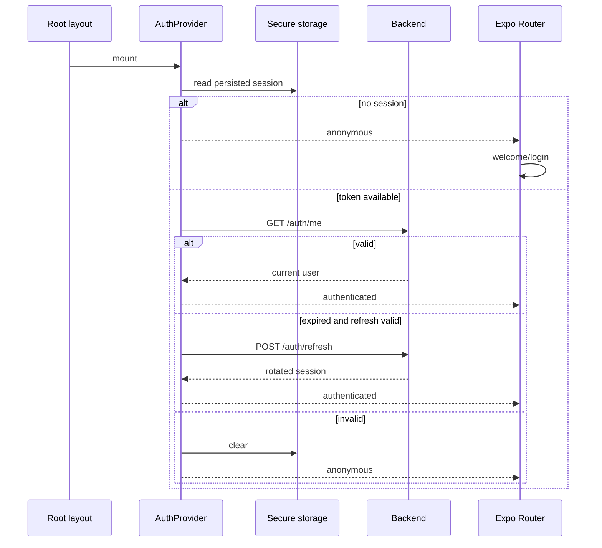

# Mobile navigation, session and state

## Route matrix

| Group | Main routes | Access |
|---|---|---|
| root | `/`, `/about`, `/help`, `/contact`, `/legal`, `/legal/[slug]`, `/terms`, `/privacy`, `/cookies`, `/content-policy` | public or initial decision |
| recovery | `/403`, `/500`, `/503`, `/429`, `/offline`, `/timeout`, `+not-found` | public |
| payment return | `/payments/return` | public; shows the checkout return and does not confirm payment |
| onboarding | `/welcome` | unauthenticated session |
| auth | login, registration, verification, recovery | anonymous |
| tabs | home, wine catalog/detail, event list/detail, route list/detail, profile | `(app)` shell AuthGuard |
| personal actions | cellar, community; scan, comparison, submissions and AI profile under wines | shell AuthGuard and per-screen checks |
| product | wineries, wine-routes | `(app)` shell AuthGuard |
| tickets | `/my-tickets`, `/my-tickets/[id]`; opened from Profile and not a tab (there are still five tabs) | `(app)` shell AuthGuard |
| account onboarding | complete-profile | authenticated user with incomplete profile |
| partner | dashboard and owned events | PARTNER or ADMIN per layout |
| admin | dashboard, wines, wineries, events, routes, reviews, submissions, publications, community | ADMIN or MODERATOR |
| admin/users, admin/notifications, admin/social-posts | users, roles and bans; push notifications; social posts approval queue | ADMIN only |

`app/+native-intent.tsx` resolves payment returns first through
`presentation/navigation/paymentReturn.ts`: `vinnot://payments/return` is
normalized to `/payments/return` (or `/my-tickets` when the link is invalid) and
`vinnot://payments/connected` returns to `/partner/events` or `/admin/events`,
depending on the screen that started account linking. Other intents go through
`safeNativeIntent`.

Route groups are not part of paths. Detail hooks use `skipToken` for missing
IDs; format validation is screen-specific, not a global router validator.

`TermsGate` checks current acceptance in the `(app)` shell, including before
profile completion. Root legal-information, help and contact routes remain
outside that gate and accessible. `AuthGuard` wraps `TermsGate` and the Stack,
preventing product screens from mounting while restoring or without a session.

## Main tabs, routes and cellar

The five tabs are Home, Wines, Events, Routes and Profile. Routes has its own
Stack in `app/(app)/(tabs)/routes`: list and detail keep that tab selected.
`WineRoutesScreen` and `WineRouteDetailScreen` are shared presentation; files
under `app/` only compose routes/layouts.

`/wine-routes` redirects to the Routes list. `/wine-routes/:id` preserves the
detail shell outside tabs for Home entry points and previous links. Detail back
uses history when available; without history it returns to Routes. The detail
query shares its cache by ID across both shells.

Cellar lives in `app/(app)/cellar.tsx`, outside tabs, preserving `/cellar`.
Home and the profile's “Wines in cellar” card open the same screen, including
when its count is zero. Back preserves the origin; without history it goes to
Home. Wine detail retains its cellar entry point. Navigation changes do not
alter cellar queries, filters or operations.

The same rule is shared through `goBackOr(router, fallback)` in
`presentation/navigation/discoveryNavigation.ts`: winery detail falls back to the
wineries list, the AI profile to its wine, admin screens to the admin panel (the
panel itself to Profile) and the organizer's events to Profile.

## Bootstrap and restoration

[View the full “Bootstrap and restoration” diagram](https://images.vinnot.com/docs/diagrams/v1/en/frontend-mobile-architecture-navigation-and-state-0a74a15c0b07.svg)

`AppProviders` mounts on the first render: session restoration starts concurrently
with font loading. The native splash waits for fonts (or their failure, using
fallback fonts). Then `VinnotLaunchScreen` provides a neutral wait until
`initSession` finishes; `app/index.tsx` navigates immediately to the appropriate
destination once Expo Router confirms that the route is focused and navigation is ready, without an artificial pause. Guards and `TermsGate` still control
access. Session restoration never means blindly trusting storage: the backend
remains authoritative.

Home (cover and four wine types) and welcome illustrations use bundled WebP derivatives and `expo-image` with
downscaling enabled. Dimensions, transparency, and the original PNG design sources
are preserved. First launch does not require downloading these images from R2;
private-image cache policy is unchanged. To regenerate: `cwebp -q 90 -m 6 -metadata none <original.png> -o <derivative.webp>`.

The `startupRoutes.test.tsx` regression verifies provider startup before fonts
resolve, fallback after font failure, and immediate navigation only after session
restoration. It verifies startup ordering; it does not measure real-device timing
or demonstrate resolution of a native crash.

## Minimum supported version

`app/_layout.tsx` wraps `RootNavigator` in `AppUpdateGate`
(`presentation/features/appUpdate/`), inside `AppProviders` and after fonts
load, so the gate covers every route: public, authentication and the `(app)`
shell. `useAppUpdateRequirement` asks `appVersionService` for the public policy
`GET /app-versions/minimum` at launch and every time the app returns to the
foreground (`applicationLifecycleService`, AppState `active`). The service
compares the installed version (`Constants.expoConfig?.version`, read through
`appBuildGateway`) with the minimum for `Platform.OS`; the pure
`major.minor.patch` rules live in `domain/app/appVersion.ts` and compare each
part as a number, so `0.10.0` is newer than `0.9.9`.

When the installed version is lower, `UpdateRequiredScreen` replaces the whole
navigator. It has no dismiss and no navigation, the Android back button is
consumed, and its only action opens the platform's store listing through
`useExternalLink`. The gate fails open: while a check is pending, and after a
network error, timeout, unreadable response, missing app version or null
minimum, the app renders normally. Only the latest check counts, so a later
check with a lower or null minimum unblocks the app.

The gate is JavaScript only (`expo-constants`, `Platform`, `AppState`,
`Linking`) and adds no native module, so it ships by OTA update to builds already
in the stores. Because the runtime version policy is `appVersion`, an OTA update
never changes the version the gate compares.

## Agreement verification and profile refresh

While the server checks account acceptance, `TermsGate` shows a neutral wait.
It does not mount consent headings, text, or controls until acceptance is confirmed
as required. An already accepted account goes directly to the Stack. Failure keeps
content blocked, offers retry, and preserves legal/contact and sign-out access.
Storage is never used as proof of acceptance.

Pull-to-refresh on the profile calls `refreshUser` through `useAuth`, delegating to
`refreshAuthenticatedUser` and the authentication application service. It updates
the user and persistence without running `initSession`, changing the session
generation, setting `isInitializing`, or unmounting guards/the Stack, preserving
the profile tab and navigation. Responses arriving after logout/account changes
or a newer profile edit are discarded before persistence. Temporary errors keep
the profile visible and are reported; credential renewal retains the existing
interceptor and composition.

## Wines navigation

The wines stack combines browse, detail, AI profile, comparison, scan and
submissions. Two rules prevent historical loops:

- tapping Wines navigates/replaces to its index rather than reopening a child;
- opening scan records an `origin`; back uses that origin instead of an
  ambiguous `router.back()`.

Detail opened from a scan result may return to that result. Tapping Wines always
opens the catalog.

## State ownership

| Data | Owner | Persistence | Invalidates |
|---|---|---|---|
| user and tokens | Auth + Redux | SecureStore by sensitivity | all queries on identity change |
| language | language/UI slice | local preference | localized content |
| wine list | Query cache | memory/cache policy | wine keys |
| entered filters | ViewModel/local | optionally in route | derived query only |
| scan image | scan session/provider | temporary | when workflow closes |
| form | reducer/local | no unless explicitly designed | nothing until submit |
| unsent review/comment | `drafts` Redux slice | memory, app session only | cleared on publish, cancel or sign-out |

## Concurrent refresh

The interceptor marks retried requests. The first `401` creates the refresh
promise; later requests subscribe. On success each request is rebuilt with the
new token. On failure the queue is rejected, state is cleared and navigation to
auth happens once.

## Invalidation and identity change

Login/logout or account change clears query cache so cellar, profile or
submission data cannot leak into another session. Mutations invalidate family tags: cellar invalidates `Cellar` and `User`;
wines invalidate `Wines`. See [remote state](remote-state-and-transport.md).

## Deep links and parameters

A deep link may arrive without history. Screens reconstruct from parameters +
session + server and never depend on a previous screen passing a full object.
Invalid IDs produce controlled not-found state rather than a query with
`undefined`.

## Push notifications

`RootNavigator` mounts `PushNotificationsSync`
(`presentation/navigation/PushNotificationsSync.tsx`) next to the Stack. It
combines two presentation hooks that delegate to `pushNotificationsService`:

- `useLaunchPushPrompt` shows `PushPermissionSheet` on a cold start: on the first
  launch it explains notifications before the system prompt; afterwards, while
  they are off, it reminds a signed-in member once per launch (never on a return
  from the background). The allow action closes the sheet and opens the system
  prompt, or the notification settings once the system no longer asks.
- `usePushNotificationsSync` creates the Android channels at startup and keeps the
  device registered while signed in: on every cold start, after a login, on a
  language switch or token rotation, and on a return to the app while not yet
  registered. Signing out forgets the token.
- A tapped notification (also the one that launched the app) is reported as
  opened and opens its screen once navigation is ready. While signed out it does
  not navigate: the screen is kept as the destination after the login.

`domain/notification/pushRoute.ts` treats the push route as untrusted input: it
only accepts lists and details of `my-tickets`, `events`, `wines`, `routes`,
`wine-routes` and `wineries`, plus `/partner` and `/partner/events`; any other
route is ignored.

## Failure cases

- camera permission: request CTA plus Back action;
- expired session: refresh, then login if it fails;
- forbidden access: `/403`, not a disguised 404;
- missing resource: module not-found state;
- offline: persistent feedback and explicit retry;
- navigation-cancelled request: no late error feedback.

## Testing rules

The verification matrix distinguishes valid/invalid restoration, refresh queue, concurrent logout, onboarding
redirect, roles, tab reset, contextual back, deep links, language change and
cache clearing between identities.

For automated scope and commands, see [testing](../testing/strategy.md).

## Protected-access intent

`AuthGuard` waits for the session before mounting the Stack and retains the
product pathname for return after login/registration and profile completion.
Pure `returnPath.ts` validation admits only product routes (`/wines`,
`/wineries`, `/events`, `/wine-routes`, `/routes`, `/cellar`, `/profile`,
`/community`, `/home`, `/partner`, `/admin` and `/my-tickets`, including the
`/my-tickets/<id>` ticket that "view ticket" opens after checkout) and rejects
external routes, encoded escapes and invalid segments. An auth, onboarding or
rejected pathname (for example `/login` seen by the still-mounted guard after
the redirect) never overwrites an already remembered product destination. Intent lives in auth memory, is consumed
on navigation and clears on logout; it is not persisted across restarts and
does not retain query/hash. Legal/contact routes stay outside the shell.

## Welcome history

`RootNavigator` uses `Stack.Protected` to remove `(onboarding)` from history once
a session exists and hide it during restoration. This prevents swipe/back from
revealing Welcome and appearing to log out. Login/registration retain their
authenticated redirects. Verification, recovery and public pages remain available;
`AuthGuard`, `TermsGate` and profile completion retain their responsibilities.
Token lifetimes and refresh rules do not change.

`RootNavigator.test.tsx` mounts Expo Router with actual groups: after Welcome →
Login → Home there is no previous entry; opening a detail and going back preserves
the session.
