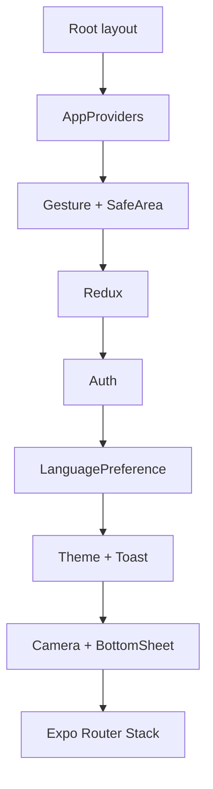

# Mobile frontend architecture

## Purpose and scope

The mobile application is an Expo/React Native client designed for touch,
camera use and interaction while moving. It does not duplicate backend business
rules: it presents use cases, retains session state and coordinates native
capabilities. The dependency rule is:

```text
app route -> screen/view model -> query hook -> application service
          -> infrastructure client -> HTTP/device adapter
```

`app/` is an Expo Router shell. Implementations live in `src/`; helpers, tests
and non-route components must not be placed where the router treats them as
routes.

The event detail (`app/(app)/(tabs)/events/[id].tsx`, including the payment
flow), profile and admin list routes only read route parameters and render one
screen from `src/presentation/features` (`event/EventDetailScreen` with
`useEventDetailViewModel`, `profile/ProfileScreen`, `admin/Admin*Screen`).
`features/admin/__tests__/routeShells.test.ts` keeps those files thin.

**Known debt:** some route files still contain screen logic, for example
`app/(app)/partner/index.tsx`. New routes must not repeat that pattern.

## Layers

| Layer | Responsibility | Must not |
|---|---|---|
| `app/` | declare layouts, groups and route parameters (with the debt noted above) | own business rules or HTTP clients |
| `src/presentation` | screens, components, hooks, ViewModels and feedback | manipulate raw DTOs or native APIs directly |
| `src/application` | use-case-oriented services and orchestration | import React, Expo Router or components |
| `src/domain` | pure types, mappers, validators and decisions | depend on Axios, Expo, storage or navigation |
| `src/infrastructure` | HTTP, DTOs, social identity, camera, storage and platform | decide product policies |
| `src/shared` | tokens, configuration and cross-cutting utilities | become a generic business module |

## Runtime composition

`app/_layout.tsx` loads fonts, controls the splash and mounts `AppProviders`.
Provider order is intentional: gesture/safe-area frame interaction; Redux hosts
session, preferences and RTK Query cache. Auth configures transport, followed by
LanguagePreference, Theme, Toast, Camera and BottomSheet. `AppProviders` defines
the concrete composition.



[View the full “Runtime composition” diagram](https://images.vinnot.com/docs/diagrams/v1/en/frontend-mobile-architecture-overview-0733f67a2a67.svg)

## State: one source per nature

- **RTK Query (`appApi`):** remote data, loading, errors, cache and invalidation.
- **Redux:** observable identity/session and global UI preferences.
- **SecureStore/persistence adapter:** refresh token and sensitive material; it
  is not a direct rendering source.
- **Local state/reducer:** forms, modals, animation and transient selection.
- **Route parameters:** navigable identity such as `wineId` or scan origin.

RTK Query cache is part of the Redux store, not a separate QueryClient.
`executeQuery` and `executeMutation` delegate to `application/operations`. Tags
combine operation families, lists and resource IDs; not every mutation
invalidates a whole family. See
[remote state and transport](remote-state-and-transport.md).

## Session and transport

The central Axios transport adds the access token. AI clients explicitly send
`language` in parameters or request bodies; there is no global locale header. When concurrent
requests receive `401`, one refresh runs and the rest wait in a queue.
`AuthProvider` injects callbacks into transport so infrastructure never imports
the store. A failed refresh clears the session and prevents authentication
endpoint loops.

Errors are normalized before UI. Presentation distinguishes validation,
authorization, expired session, offline, timeout, unavailable provider and
unexpected failures. Message and retry policy depend on the error class, not on
matching backend strings.

## Navigation and access

Groups `(auth)`, `(onboarding)`, `(app)` and `(tabs)` organize files without
changing URLs. The `(app)` layout wraps its whole Stack in `AuthGuard` and `TermsGate`,
so it is not public; it also redirects authenticated users with incomplete profiles
to `complete-profile`. Admin/partner layouts add role gates, while definitive authorization
remains in backend.

The Wines tab forces the browse root so a detail or scanner is not retained as
the tab destination. Scanner origin is explicit and contextual back navigation
does not rely on accidental history.

## Native capabilities

Camera, ML Kit, social identity, maps, location and secure storage are behind
adapters/providers. This supports implementation replacement, test fakes,
permission/unsupported states and isolation of modules that require a dev build
instead of Expo Go.

The scanner keeps its capture temporarily across scan, manual search and
submission. Reset removes the URI from presentation state; this does not mean deleting
the temporary device file. Images are not saved to the gallery by default.

## Internationalization

UI language resolves from explicit preference and then device locale. It is
sent to the backend to select persisted ES/EN content. UI does not translate AI
semantics; it applies a structured fallback when a version is unavailable. A
new language requires locale, content contracts and fallback—not scattered
conditionals.

## Performance and resilience

- virtualized lists and stable component identity;
- sized images and placeholders without layout blocking;
- 400 ms catalog debounce and serializable operation arguments;
- generation checks to discard late scan results;
- use-case-specific timeouts rather than one blind global value;
- late responses ignored after screen unmount;
- skeletons for initial load, semantic progress for long operations;
- explicit scan retry using the same image and OCR text.

## Testability

Pure logic is tested in `domain`; services use fake clients; hooks/ViewModels
verify state transitions; screens cover interaction and accessibility; native
capabilities are tested through ports. Scanning additionally has a reproducible
benchmark and a physical-device matrix separated from unit tests.

## Evolution rules

1. A new screen starts from a use case, not from Axios.
2. DTOs stay in infrastructure and are mapped before presentation.
3. Every mutation declares which query keys it invalidates.
4. New native APIs enter through an adapter and document permissions/fallback.
5. Protected routes declare access policy and fallback.
6. Every flow with return navigation defines an explicit origin.

## Related reading

- [Application map](../diagrams/application-map.md)
- [Navigation and state](navigation-and-state.md)
- [Product flows](../use-cases/product-flows.md)
- [Wine-label scanning](../../modules/wines/architecture.md)
- [Conventions](conventions.md)

## Code evidence

- `frontend-mobile/app/_layout.tsx`
- `frontend-mobile/app/(app)/_layout.tsx`
- `frontend-mobile/app/(app)/(tabs)/_layout.tsx`
- `frontend-mobile/src/presentation/providers/AppProviders.tsx`
- `frontend-mobile/src/infrastructure/api/http.ts`
- `frontend-mobile/src/presentation/providers/AuthProvider.tsx`
