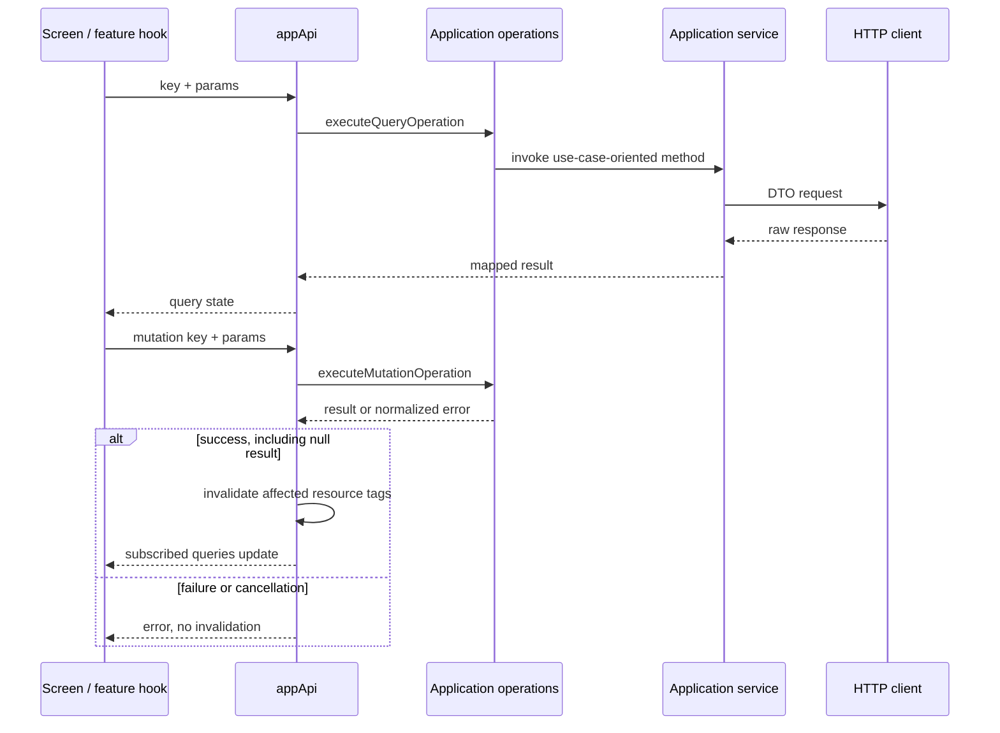

# Mobile remote state, operations and transport

## Composition and responsibility

`presentation/store/api.ts` declares `appApi` with `createApi` and
`fakeBaseQuery<ApiError>`. Its reducer and middleware are integrated into Redux.
This application has no TanStack QueryClient.

Feature hooks build a `QueryRequest` or `MutationRequest`. The key identifies
an application operation, not an HTTP endpoint.
`application/operations/queryHandlers.ts` and `mutationHandlers.ts` select
the service. Services transform input, invoke clients and return mapped models.
Only clients know methods, endpoint paths and DTOs.

## Query contract

| Field/state | Meaning |
|---|---|
| `key` | Name declared in `queryOperationKeys`, such as `wine.list` |
| `params` | Serializable arguments: filters, page, ID or language |
| `skipToken` | No query subscription, for example without a detail ID |
| `data` | Last available hook result |
| `currentData` | Result for the current argument |
| `isLoading` | Initial load without a result |
| `isFetching` | Request in flight, including refresh with previous data |
| `refetch` | Explicit repetition of the subscribed query |

`useTypedQuery` and `useTypedQueryList` adapt generic results to feature types.
`useTypedQuery` also accepts a `pollingInterval`; the admin announcement history
uses it only while a send is still being delivered.
Hook types do not validate payloads at runtime; normalization belongs to services
and mappers.

## Implemented invalidation

`queryTags` and `mutationTags` are pure application policies using operation keys
and parameters. The RTK adapter invalidates only after a mutation succeeds,
including `null`/204 results. Failure or cancellation does not imply changed data.

| Queried resource | Tag scope |
|---|---|
| Wine lists / winery wines | `Wines:LIST`; winery wines also provide `Wineries` |
| Wine detail | `Wines:<id>` |
| AI profile and availability | `WineProfiles:<id>`, shared across languages |
| Reviews and own review status | `WineReviews:<id>` |
| Comments | `WineComments:<wineId>` |
| Own submissions | `WineSubmissions` |
| Public, nearby and discovery events | `Events:LIST` |
| Event detail and registrations | `Events:<id>` |
| Administration | `Admin:<resource>`: wines, wineries, events, routes, users, reviews, submissions, stats, countries or regions |
| Admin notifications | `Admin:notifications.push`, `.metrics`, `.preview`, `.reach` and `.history`; a switch refreshes `notifications.push`, a test or send only `notifications.history` |
| Wineries, routes, cellar, user, partner and references | `Wineries`, `WineRoutes`, `Cellar`, `User`, `Partner`, `References` families |
| Community: receipts, blocks, overviews and queues | `Community` family |
| Social: public profile, followers, following, feed, suggestions, a profile's reviews and cellar | `Social` family; follow/unfollow, block, review, cellar and own-profile edits invalidate it |
| Comparison | No automatic invalidation tags |

Partner event creation/editing/deletion refreshes Partner, public events, the
affected detail when its ID is available, and administrative event management/statistics.
It does not invalidate users or wines. Reading a partner event invalidates nothing.
Admin operations retain public refreshes for their resource without invalidating
the entire panel. Reviews refresh ratings and cellar/user projections without
rereading AI profiles. Generating a profile refreshes that profile, availability
and catalog, without refreshing other wines' profiles. Operations without an ID
use the affected resource family, not an application-wide invalidation.

RTK Query refetches invalidated subscribed entries; unsubscribed entries are
discarded for a later read. This policy does not replace domain objects directly.
Scanning and comparing do not invalidate catalog data. Comparisons also opt out
of focus refetching: requests are driven by user selection/retry.

## Read and write sequence

[View the full “Read and write sequence” diagram](https://images.vinnot.com/docs/diagrams/v1/en/frontend-mobile-architecture-remote-state-and-transport-62231e761192.svg)

## Errors, retry and cancellation

`toApiError` retains available `message`, `status`, `code` and `details`.
Transport normalizes Axios failures; the scanner additionally classifies errors
to select messages. Recovery belongs to each workflow, not a uniform retry promise.

`useOperationMutation` exposes RTK-promise cancellation. The dispatcher passes
`AbortSignal` to handlers and scanning propagates it through service/client.
The scan ViewModel also discards capture/OCR/responses from abandoned attempts.
Aborting transport does not guarantee stopping work already started on the
server; see [scan lifecycle](../diagrams/scan-lifecycle.md).

## Identity and application lifecycle

Login and social-login thunks reset `appApi` when establishing a session.
`clearSession` clears persistence and resets cache; the reducer clears identity
when that operation starts. `AuthProvider` injects token and refresh callbacks
into Axios so infrastructure does not depend on the store.

`refetchOnFocus` is configured in `appApi`. Store listeners and native
lifecycle wiring determine delivery of focus events; this configuration is not
offline persistence or background synchronization.

`GET /app-versions/minimum` goes through the shared `http` instance without
requiring a session: an expired token on that public path reaches the backend as
an anonymous call, so it does not start a refresh loop. Its client uses a shorter
timeout, and `useAppUpdateRequirement` treats any failure as "no minimum" (see
[navigation and state](./navigation-and-state.md)).

## Evidence and related reading

- [Redux API](../../../../frontend-mobile/src/presentation/store/api.ts)
- [Keys and tags](../../../../frontend-mobile/src/application/operations/types.ts)
- [Handlers](../../../../frontend-mobile/src/application/operations/queryHandlers.ts)
- [Mutation adapter](../../../../frontend-mobile/src/presentation/store/mutationAdapter.ts)
- [Session and account](../../modules/users/architecture.md)
