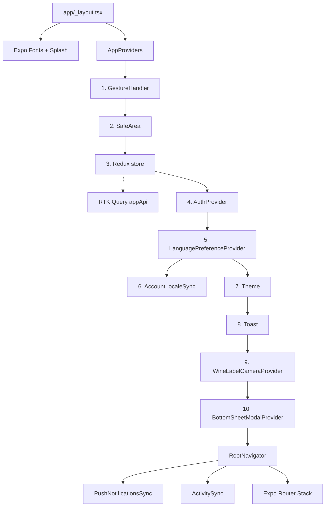
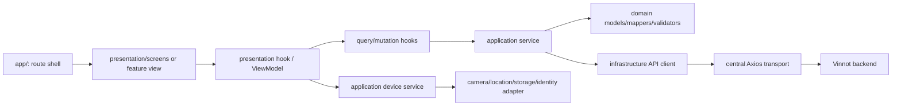
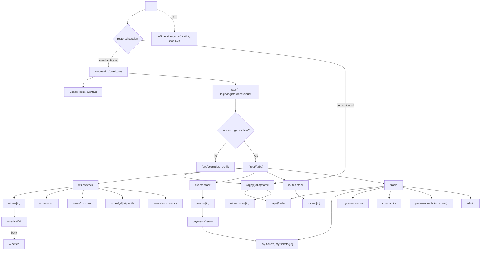
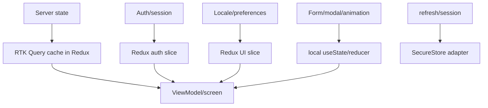
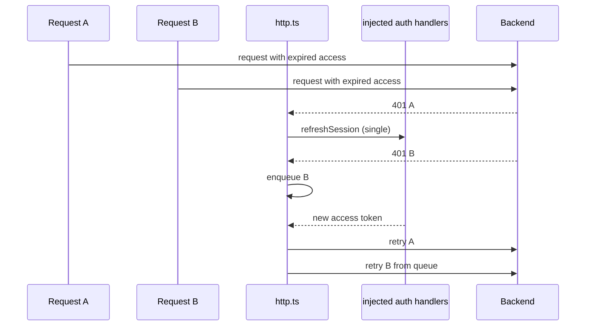
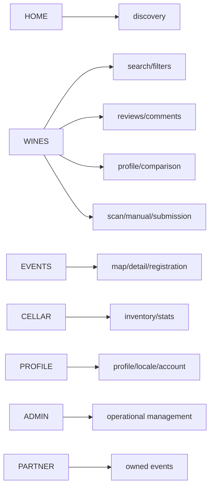

# Mobile application maps

## Runtime composition

[View the full “Runtime composition” diagram](https://images.vinnot.com/docs/diagrams/v1/en/frontend-mobile-diagrams-application-map-805e8a462fbb.svg)

Provider order is wiring, from outside in: `GestureHandler`, `SafeArea`, Redux,
`AuthProvider`, `LanguagePreferenceProvider` (with `AccountLocaleSync` inside),
`Theme`, `Toast`, `WineLabelCameraProvider` and `BottomSheetModalProvider`.
`AuthProvider` needs the store and configures transport; the language provider
sits under the session so it can sync the account preference. `RootNavigator`
mounts `PushNotificationsSync` and `ActivitySync` next to the Expo Router stack;
screens need safe area, query, locale, and session.

## Layers and dependency direction

[View the full “Layers and dependency direction” diagram](https://images.vinnot.com/docs/diagrams/v1/en/frontend-mobile-diagrams-application-map-ab22e3625624.svg)

`app/` only contains files Expo Router must interpret as routes or layouts.
Tests, styles, and helpers live under `src/`.

## Navigation tree

[View the full “Navigation tree” diagram](https://images.vinnot.com/docs/diagrams/v1/en/frontend-mobile-diagrams-application-map-20733fc81e92.svg)

All five tabs intercept `tabPress` in `(tabs)/_layout.tsx` and call
`openTabRoot`, which resets only the selected tab's nested stack and keeps its
root list and filters instead of a stale detail/scan. Scan back navigation
retains its originating route.

The winery page opens from the winery name on the wine page or from a shared
link; the `wineries` list has no entry in the interface and is only reached with
back from a winery opened by link. `partner` and `partner/events` show the same
screen. The service-state screens (offline, timeout, 403, 429, 500 and 503) are
root routes that render `ServiceStateScreen` when opened by URL; inside a screen,
load errors are shown inline with `QueryErrorState`.

## State and data

[View the full “State and data” diagram](https://images.vinnot.com/docs/diagrams/v1/en/frontend-mobile-diagrams-application-map-0918471dd1c5.svg)

RTK Query cache is part of Redux. Only successful mutations invalidate
resource/entity tags through `mutationTags`; comparisons are excluded from
automatic refresh. See [remote state](../architecture/remote-state-and-transport.md).

## Concurrent refresh

[View the full “Concurrent refresh” diagram](https://images.vinnot.com/docs/diagrams/v1/en/frontend-mobile-diagrams-application-map-8ebba53b04ed.svg)

`/auth/*` endpoints and retried requests do not enter refresh again, preventing
loops. Handlers are injected by `AuthProvider`, so infrastructure does not import
stores.

## Per-module flows

[View the full “Per-module flows” diagram](https://images.vinnot.com/docs/diagrams/v1/en/frontend-mobile-diagrams-application-map-2f1fdfe1581f.svg)

## More diagrams

- [Navigation, session, and access](navigation-and-session.md)
- [Visual scan pipeline](wine-label-scan.md)
- [Mobile architecture](../architecture/overview.md)
- [Wine-label scanning](../../modules/wines/architecture.md)
