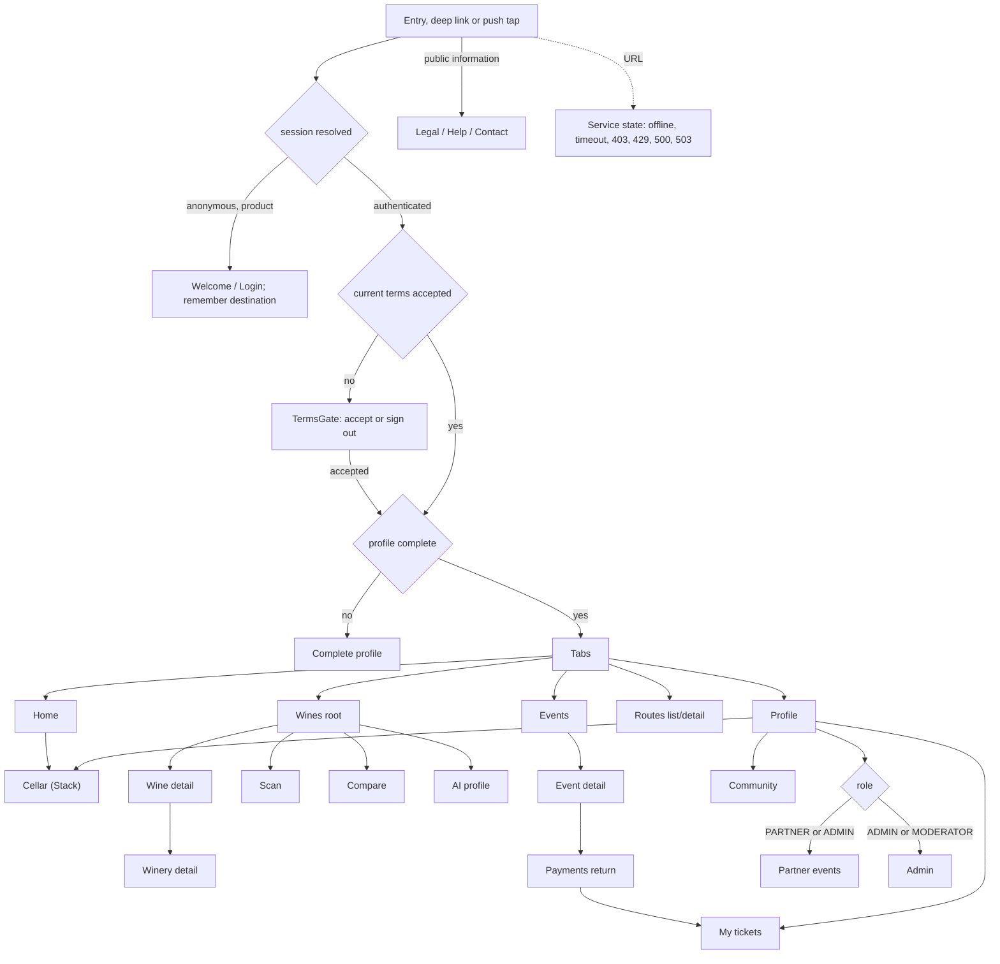
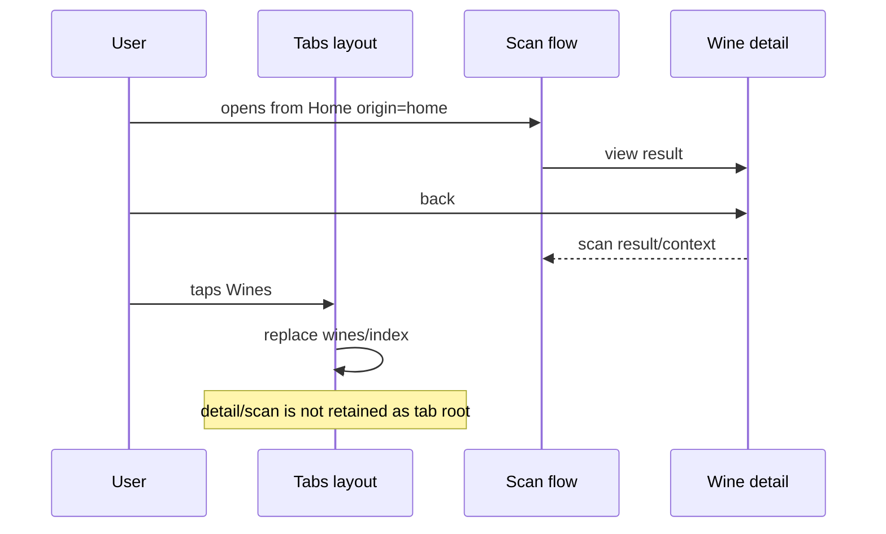
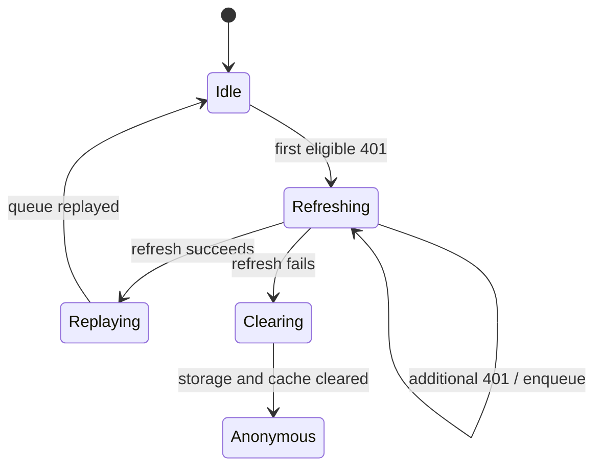

# Mobile navigation and session diagrams

## Access tree

[View the full “Access tree” diagram](https://images.vinnot.com/docs/diagrams/v1/en/frontend-mobile-diagrams-navigation-and-session-5e8adc7f5cca.svg)

A tap on a push notification is another entry: while signed out, the target
screen is kept and opens after the login.

## Tab reset versus contextual back

[View the full “Tab reset versus contextual back” diagram](https://images.vinnot.com/docs/diagrams/v1/en/frontend-mobile-diagrams-navigation-and-session-c969f9c76c04.svg)

## Refresh queue

[View the full “Refresh queue” diagram](https://images.vinnot.com/docs/diagrams/v1/en/frontend-mobile-diagrams-navigation-and-session-c9cf1430801e.svg)
