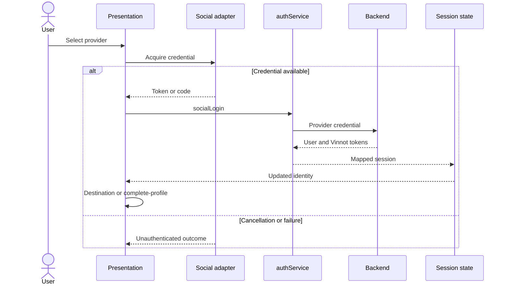
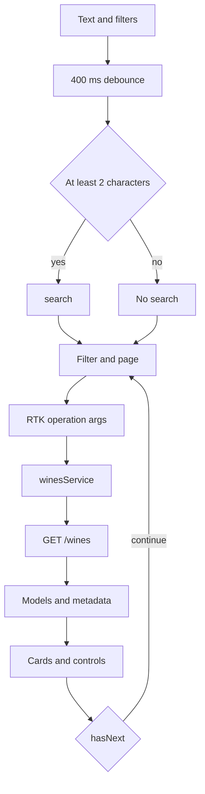
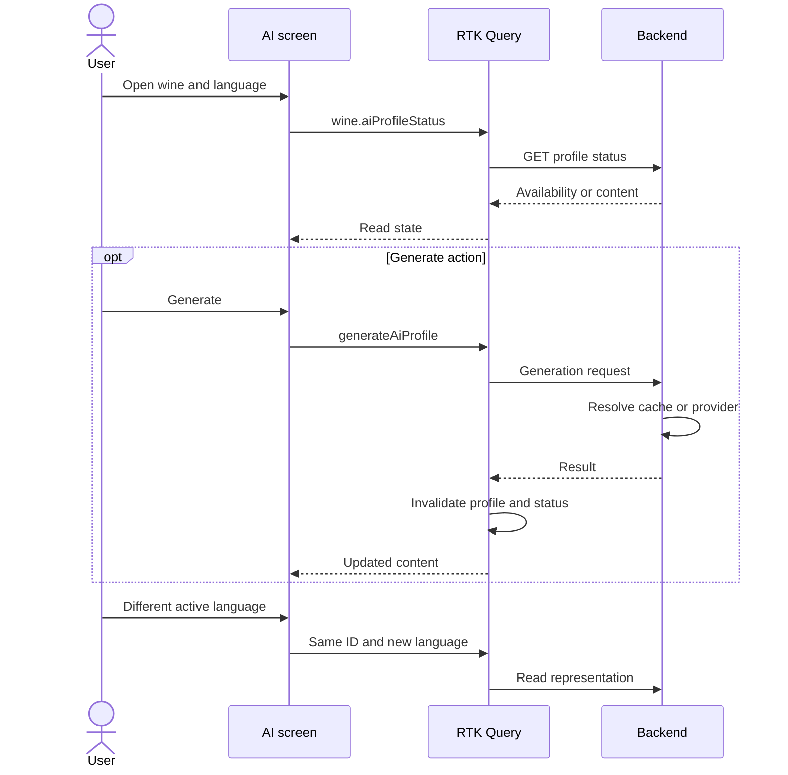
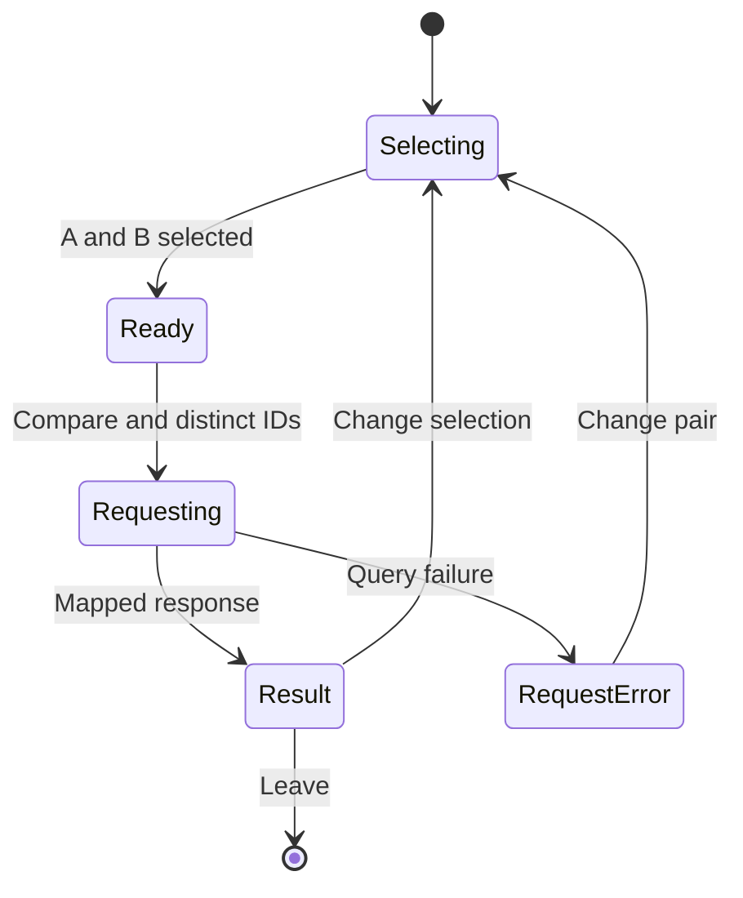
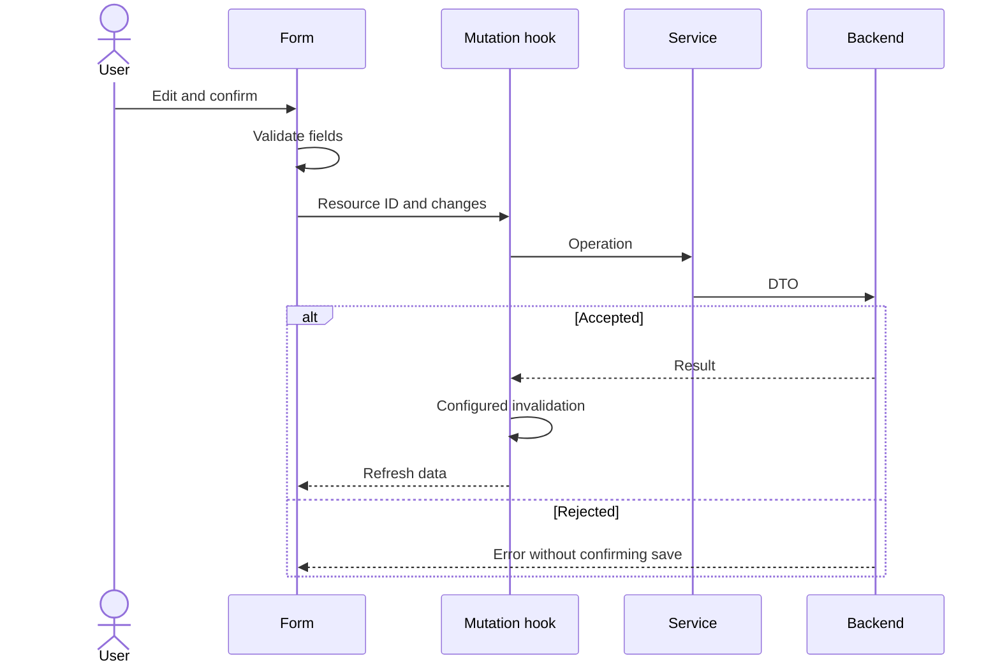
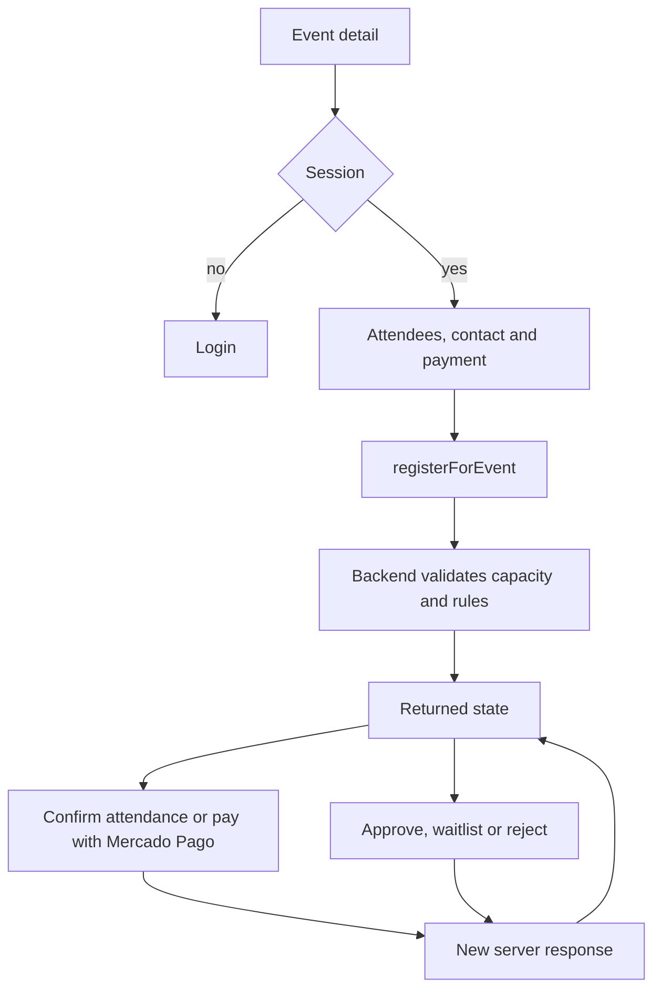
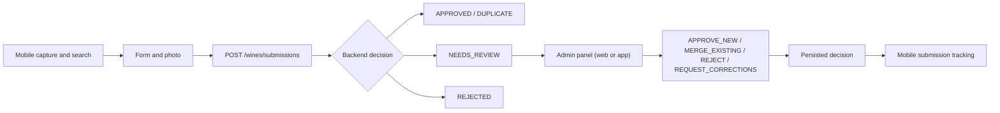

# Product sequences and states mobile

## Diagram scope

These views describe frontend responsibilities. Server validates permissions,
transitions and persistence; diagrams do not introduce new business rules.
Error responses produce operation error state, not implicit success.

## Social login

[View the full “Social login” diagram](https://images.vinnot.com/docs/diagrams/v1/en/frontend-mobile-diagrams-product-processes-afd3fde12061.svg)

Restoring a saved session is separate from this exchange.
See [authentication](../../modules/users/architecture.md).

## Search and pagination

[View the full “Search and pagination” diagram](https://images.vinnot.com/docs/diagrams/v1/en/frontend-mobile-diagrams-product-processes-6be19ed1f890.svg)

Pages start at zero. Mobile accumulation and web page navigation are different
presentations of the same paginated contract.

## AI profile and localized representation

[View the full “AI profile and localized representation” diagram](https://images.vinnot.com/docs/diagrams/v1/en/frontend-mobile-diagrams-product-processes-635a949f28f0.svg)

The diagram does not attribute every request to the provider. Exact sequence
and visual journey differ by platform; see [AI](../../modules/ai/architecture.md).

## Comparison

[View the full “Comparison” diagram](https://images.vinnot.com/docs/diagrams/v1/en/frontend-mobile-diagrams-product-processes-c7661a3b0ab6.svg)

States describe the operation; they do not assert identical error components
or retry buttons across screens.

## Cellar or review: write and cache

[View the full “Cellar or review: write and cache” diagram](https://images.vinnot.com/docs/diagrams/v1/en/frontend-mobile-diagrams-product-processes-0ce0c0b477d8.svg)

## Event registration

[View the full “Event registration” diagram](https://images.vinnot.com/docs/diagrams/v1/en/frontend-mobile-diagrams-product-processes-75095f02ade4.svg)

Registration and payment maintain separate states. Available actions derive
from current state, not a universal payment sequence.

## App submission and review

[View the full “App submission and review” diagram](https://images.vinnot.com/docs/diagrams/v1/en/frontend-mobile-diagrams-product-processes-22c6a59f720c.svg)

Web does not scan. Submissions are reviewed from the admin panel, on the
web or in the app. Decisions
and timestamps belong to backend.

## Functional references

- [Catalog](../../modules/wines/architecture.md)
- [Cellar](../../modules/cellar/architecture.md#app) and [reviews](../../modules/reviews/architecture.md#app)
- [Events](../../modules/events/architecture.md#app), [wineries](../../modules/wineries/architecture.md#app) and [routes](../../modules/wine-routes/architecture.md#app)
- [Administration](../../modules/admin/architecture.md)
