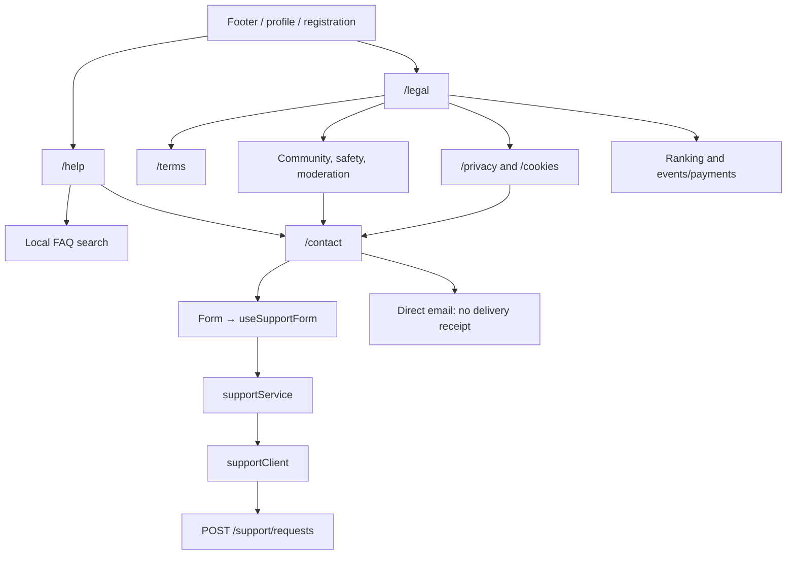
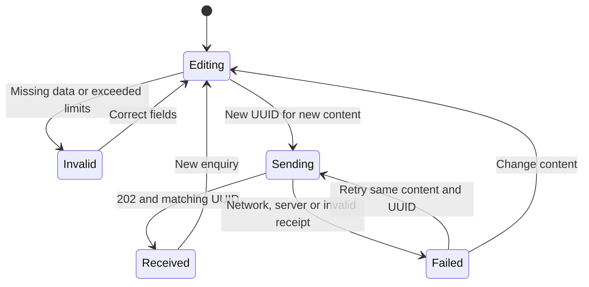
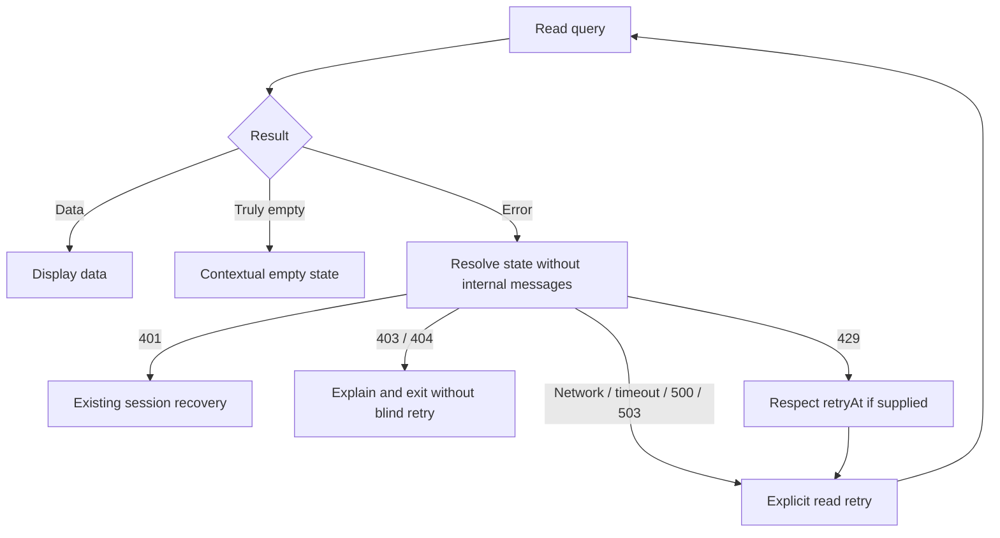
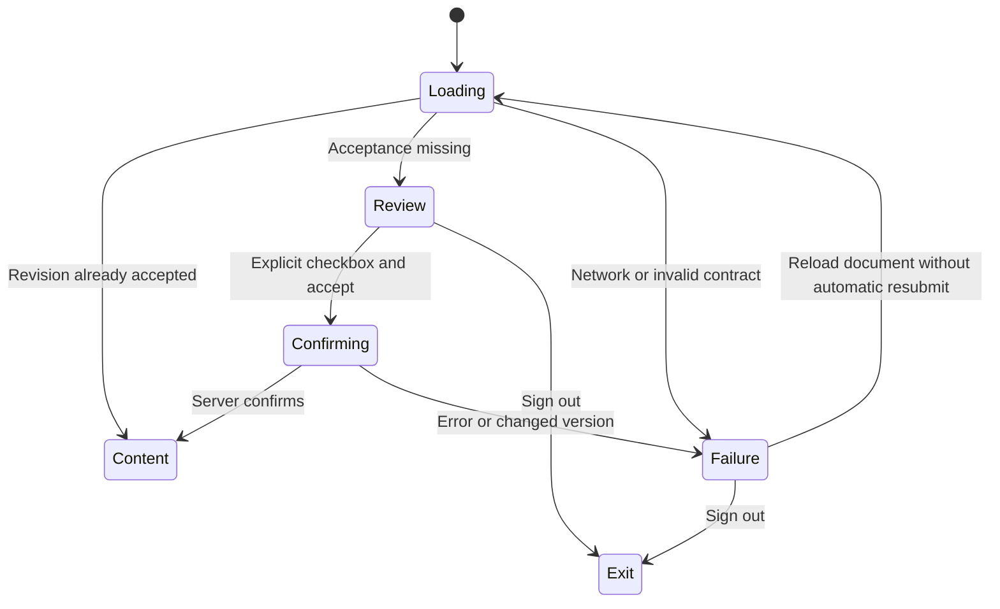

# Public navigation and recovery

## Routes and channels

[View the full “Routes and channels” diagram](https://images.vinnot.com/docs/diagrams/v1/en/frontend-mobile-diagrams-public-information-7af5c5e9939c.svg)

Documents are public. Current terms are retrieved from the backend;
other policies and FAQs ship with the frontend. There are no AI calls. This map does not change private catalogue or admin authorization.

## Contact state machine

[View the full “Contact state machine” diagram](https://images.vinnot.com/docs/diagrams/v1/en/frontend-mobile-diagrams-public-information-0ced47910786.svg)

Sending disallows another submit. Failed preserves the form. Received means
durable acceptance; external delivery happens afterwards.

## Read results and visual states

[View the full “Read results and visual states” diagram](https://images.vinnot.com/docs/diagrams/v1/en/frontend-mobile-diagrams-public-information-9a3bf4cd4ca7.svg)

Classification does not clear credentials or cached content. Registration,
payment and generation mutations retain their operation-specific recovery.

## Render boundaries

Render failures use a boundary independent of HTTP results. Retrying resets
that surface; the error component does not execute a business mutation. No
message exposes stack traces or credentials.

See the [functional contract](../../modules/support/architecture.md).

## Contract review

[View the full “Contract review” diagram](https://images.vinnot.com/docs/diagrams/v1/en/frontend-mobile-diagrams-public-information-2ff4262a6435.svg)

Legal, privacy, help and contact remain outside the acceptance gate.
Registration uses the same document and sends selection with account creation.
