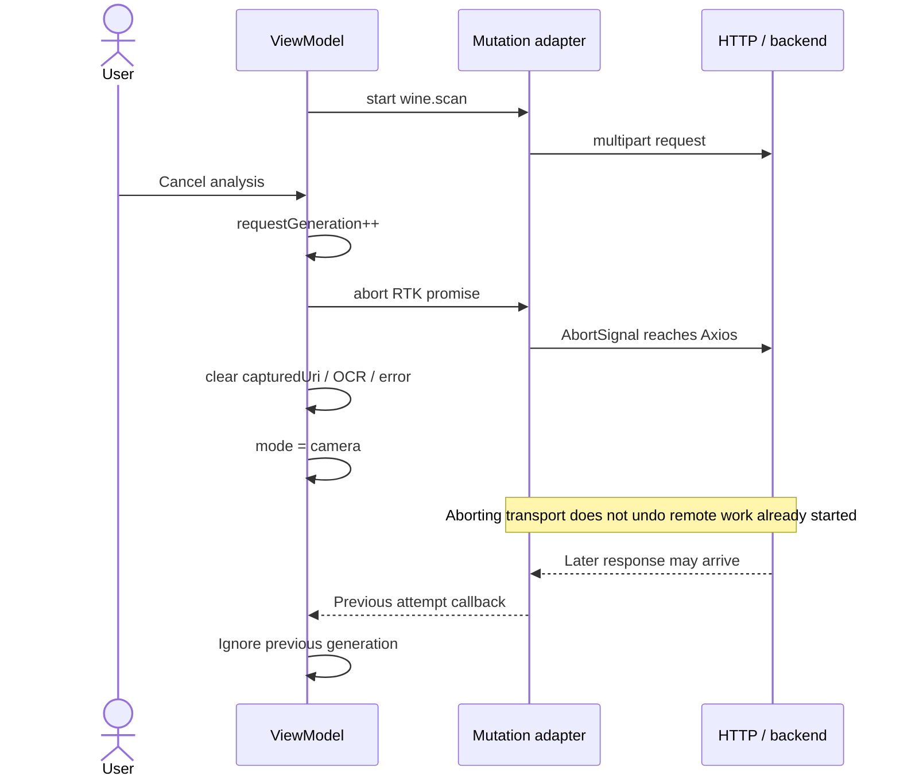
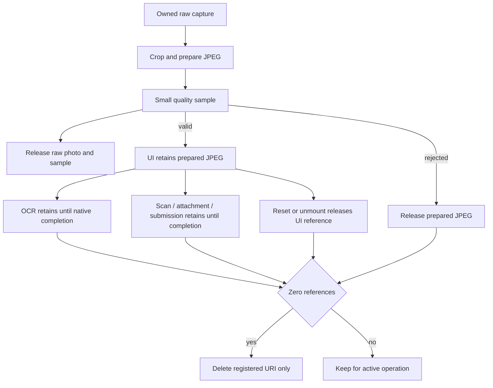

# Scanner capture, cancellation and recovery

## Resources and ownership

| Resource | Owner | Lifetime |
|---|---|---|
| Preview | Camera adapter | Mounted camera with permission |
| Raw photo and quality sample | Camera adapter | Until processing/validation completes |
| Prepared JPEG URI | Camera temporary-file registry | Until UI and all retained operations release it |
| capturedUri / observedText | Scan ViewModel | Until reset or unmount |
| requestGeneration | Scan ViewModel ref | Increments to invalidate attempts |
| RTK promise | Mutation adapter | Operation or abort |
| Published image | Backend storage | Submission/attachment contract |

## Cancellation sequence

[View the full “Cancellation sequence” diagram](https://images.vinnot.com/docs/diagrams/v1/en/frontend-mobile-diagrams-scan-lifecycle-b276bd5376ac.svg)

This sequence describes interaction cancellation and late-result protection.
It does not guarantee cancelling costs or work already started on the server.
Reset releases the interaction reference. The file is deleted only after OCR and
uploads also release their references; the adapter registers only its own URIs
inside cacheDirectory. OCR retains its reference until native work settles, even
when the UI's one-second wait has expired.

[View the full “Cancellation sequence” diagram](https://images.vinnot.com/docs/diagrams/v1/en/frontend-mobile-diagrams-scan-lifecycle-5f8f4ed86742.svg)

A capture arriving after cancellation is released before starting OCR. Generation
is also checked after OCR and HTTP. A guard prevents simultaneous captures/retries
while the previous attempt finishes.

## Retry and continuity

`retryAnalysis` reuses URI/OCR, clears the error and starts a new generation.
It does not require another photo. `reset` returns to camera. Manual search and
submission keep capture in the same workflow; attaching an image to an existing
wine is a separate mutation. Exit cancels the observed attempt and prevents
an older response from becoming a new capture's result.

## Evidence

- [ViewModel](../../../../frontend-mobile/src/presentation/features/wine/scan/useWineLabelScanViewModel.ts)
- [Mutation adapter](../../../../frontend-mobile/src/presentation/store/mutationAdapter.ts)
- [Camera adapter](../../../../frontend-mobile/src/infrastructure/device/camera/WineLabelCamera.tsx)
- [HTTP client](../../../../frontend-mobile/src/infrastructure/api/clients/wines.client.ts)
- [Use case](../../modules/wines/architecture.md)
