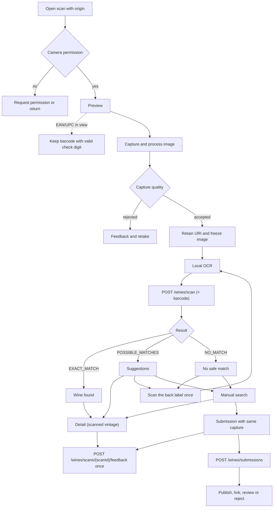
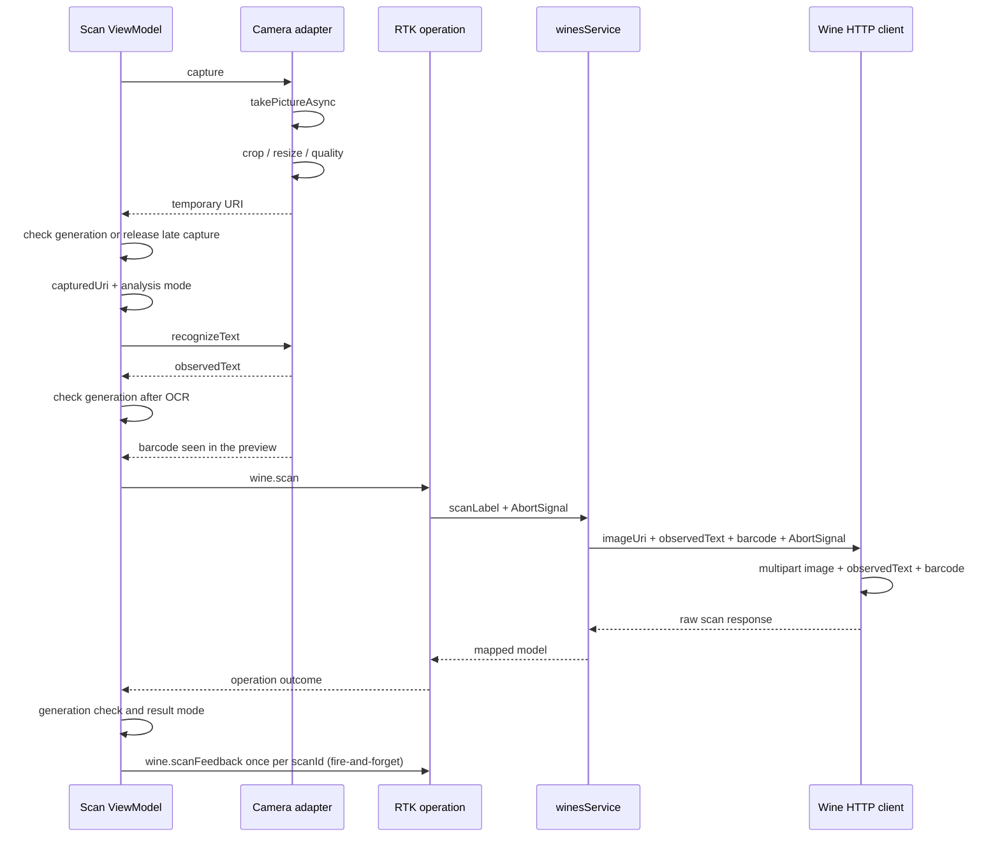
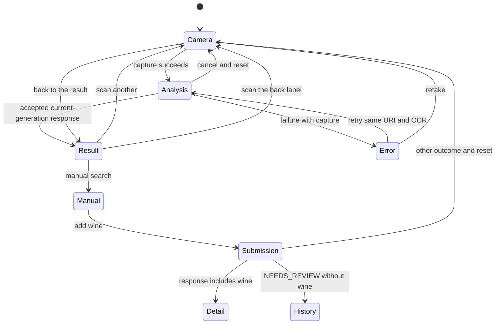

# Mobile-only scanning diagrams

## Product workflow

[View the full “Product workflow” diagram](https://images.vinnot.com/docs/diagrams/v1/en/frontend-mobile-diagrams-wine-label-scan-1f7ed32d1cfc.svg)

Exact results are presented before opening detail; automatic navigation is not
required. The web app-download invitation does not participate in this pipeline.

## Technical interaction

[View the full “Technical interaction” diagram](https://images.vinnot.com/docs/diagrams/v1/en/frontend-mobile-diagrams-wine-label-scan-a7abac95f1ad.svg)

Multipart contains no locale field. Scan requests transmit images; transmission
is not catalog-image persistence. A back-label capture is read and released: the
scan sends the front photo again with both readings merged. The verdict on the
result is sent at most once per `scanId` and its failure is never shown.

## Recovery states

[View the full “Recovery states” diagram](https://images.vinnot.com/docs/diagrams/v1/en/frontend-mobile-diagrams-wine-label-scan-55e2f66e34c2.svg)

Found/suggestions/no-match are result branches; ViewModel mode groups their
presentation. Capture survives for retry or submission. See [lifecycle](scan-lifecycle.md).
