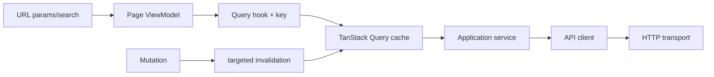

# Web routing, access and state

## Access matrix

| Level | Routes | Guard |
|---|---|---|
| public without shell | login, register, register/success, forgot-password, reset-password, verify-email, confirm-email-change | none |
| checkout return | payments/return | none; outside AppShell, status from an opaque receipt |
| onboarding | complete-profile | ProtectedRoute + TermsGate, outside AppShell |
| public | home, about, contact, help, legal and legal/:slug, legal/ranking, terms, privacy, cookies, content-policy | none; legal information bypasses incomplete-onboarding redirection |
| service states | 403, 404, 500, 503, 429, offline, timeout, wildcard | none; inside AppShell |
| catalog | wines, detail, events, wineries, routes | AppShell + ProtectedLayout |
| authenticated | compare, scan, AI profile, profile, cellar, community, my-tickets, my-tickets/:id, users/:id, users/:id/followers, users/:id/following, feed | ProtectedLayout |
| partner | partner/events | PartnerLayout (`PARTNER` or `ADMIN`) |
| payment account | partner/payments, partner/payments/callback | no route guard, outside AppShell; exist only with the payments flag |
| administrative | dashboard, wines, wines/:id/ai-profile, wineries, events, routes, reviews, wine-submissions, publications, community | AdminLayout (`ADMIN` or `MODERATOR`) |
| strict admin | users | AdminOnlyLayout (`ADMIN`) |

Heavy pages use lazy imports and `PageLoadingFallback`. Wildcards resolve to
NotFound inside the shell.

## Providers and restoration

Auth mounts after router/store/query so it can restore identity, configure
transport handlers, clear cache and navigate. While restoring, guards show a
neutral state rather than redirecting prematurely.

## Cache model

[View the full “Cache model” diagram](https://images.vinnot.com/docs/diagrams/v1/en/frontend-web-architecture-navigation-and-state-8e3ca861e35c.svg)

Keys include every parameter affecting results. `enabled` prevents invalid-ID
requests. `keepPreviousData` may retain a page during pagination without
presenting it as the response to new filters.

Follow and unfollow (`useFollowUser`) are optimistic: the button, the profile
follower count and every cached list under `social` change at once; a failed
request restores the previous copy and warns. When it settles, profiles, people
lists and the feed are invalidated, but not «People to follow», so a person just
followed keeps showing «Following» until the list loads again. Someone else's
cellar is only requested when the profile says `cellarVisible`; the service turns
a `403 CELLAR_NOT_VISIBLE` into a locked cellar state.

## Refresh and logout

The interceptor does not import Redux. Auth registers token-read, refresh and
failure callbacks. A shared promise prevents duplicate refresh. Logout attempts
backend invalidation and always clears local tokens/cache.

## Roles and ownership

Guards filter UX, but `403` remains expected. Partner may edit owned events only;
ownership cannot be inferred from the displayed object. Every administrative
route declares the authorities required by its backend endpoint.

## URL as contract

Catalog reads initial URL filters and writes `q`, `page`, `country` and `region`.
Type and grape also have local state; changing only the URL does not completely
restore every filter.
See [catalog](../../modules/wines/architecture.md). Modals and unsent drafts remain local.

## Required states

Every page handles loading, empty, recoverable error, forbidden, not-found and
success. Navigation-cancelled requests do not toast. Validation maps to fields;
conflicts request a decision; offline/timeouts offer safe retry.

## Test cases

Cover anonymous redirects, safe post-login return, roles, restored session,
concurrent refresh, logout clearing, back/forward filters, lazy fallback,
403/404 and no request for invalid parameters.

## Scroll and account-access return

`RouteScroll` owns the viewport at the router boundary. A PUSH to another page
starts at the top; a hash waits up to two seconds for its lazy section and uses
`scroll-margin-top` to clear the header. Query-only changes do not reset scroll.
POP restores in-memory positions keyed by history entry, observes height for
up to two seconds, and user interaction cancels late restoration. Unmount
releases observers/listeners/timers and restores browser scroll policy.

`ProtectedRoute` keeps pathname + query + hash in `returnUrl`, without mounting
protected content during initialization. `useAuthReturnPath` validates internal
returns and prevents returning into authentication routes. Login, registration,
registration confirmation and profile completion carry that intent in the URL;
a completed profile returns to the destination with current terms gates intact.

## Anonymous startup and terms verification

`AuthProvider` waits for `initSession`. Without an access token, the application
uses `authService.restoreSession`: 204 from the web adapter means no session,
not a validation error or expired session; `/auth/me` is not queried in that case.
Concurrent startup in the same generation shares restoration and profile loading.
Logout/login change generation and discard late responses. Renewal for a
protected operation stays strict: absence does not mean valid credentials.
HttpOnly cookie, Origin, CSRF header and rotation are preserved; no local hint
is treated as proof of a session or acceptance.

`TermsGate` blocks content with a neutral status while awaiting the server's
answer. Consent text/checkbox/buttons appear only after confirmation that they
are needed. An already accepted agreement proceeds directly to content; errors
retain blocking and recovery, while legal/contact routes remain exempt.
Registration retains its review and explicit consent.
