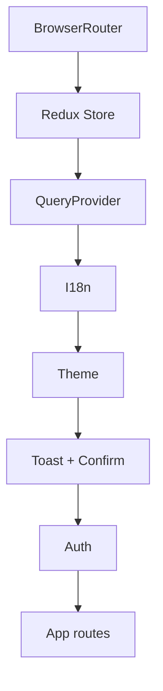

# Web frontend architecture

## Client role

The React web client presents use cases and manages interaction state; backend
owns rules, authorization and integrity. Allowed dependency direction is:

```text
Page -> ViewModel/presentation hook -> query hook -> application service
     -> infrastructure client -> central HTTP transport -> API
```

Pages do not import Axios or clients. Clients do not choose UI messages. DTOs
are mapped to stable models before presentation.

## Layers

| Area | Responsibility |
|---|---|
| `src/app` | composition, providers, router and layouts |
| `src/presentation/pages` | visual use-case entry points |
| `src/presentation/hooks` | server state, mutations and UI coordination |
| `src/application/services` | product operations and mapping |
| `src/domain` | pure module types, mappers and validators |
| `src/infrastructure/api` | DTOs, paths, params and HTTP contracts |
| `src/infrastructure/http` | Axios, base URL, token, refresh and errors |
| `src/shared` | i18n, configuration, utilities and shared components |

## Composition

`AppProviders` establishes BrowserRouter, Redux, TanStack Query, i18n, theme,
toast, confirmation and auth in stable order. QueryClient is a singleton: five
minute `staleTime`, thirty minute `gcTime`, one query retry, no window-focus
refetch and no global mutation retry.



[View the full “Composition” diagram](https://images.vinnot.com/docs/diagrams/v1/en/frontend-web-architecture-overview-e2df8e1474e1.svg)

## Routing and loading

Feature pages use `lazy` + `Suspense`; the public shell remains stable. Access
levels are public (auth, home, information/legal, service states and checkout return), authenticated (catalog, events, wineries, wine routes, compare, scan, AI profile, community, account, cellar and tickets), partner and admin/moderator. Users use the
admin-only gate; submissions allow moderators. Guards improve UX and navigation but never replace backend
security. Administrative routes mostly consume `/admin/**`, with exceptions: `GET /users`, `PATCH /wines/{id}/ai-profile` and `/regions/*`; catalog/moderation accept
`ROLE_ADMIN` or `ROLE_MODERATOR`; users and catalog deletion require `ROLE_ADMIN`.

## State

- TanStack Query owns remote data and loading/error state.
- Redux retains auth and global preferences, not catalog copies.
- ViewModels own filters, forms and page coordination.
- URL retains shareable/navigable resources and filters.
- storage persists only deliberately designed state.

Query keys are organized by resource and identity. Mutations invalidate the
smallest necessary set. Login/logout/identity changes clear private cache.

## HTTP and session

Transport adds the token and normalizes errors. AI clients explicitly send
`language`, without a global locale header. Transport performs
single-flight refresh. Concurrent requests await one promise; a retried `401`
does not loop. Refresh failure clears session and rejects the queue.

API asset paths use the URL resolver. No private secret belongs in the bundle;
all `VITE_*` values are public by definition.

## i18n and bilingual content

The web client provides `es-AR` and `en-US`. Locale selects UI and is sent to
API. AI profiles/comparisons arrive localized from backend; web never translates
semantic content. Fallback is visible and deterministic.

## Presentation security

- never render unsanitized remote HTML;
- never treat guards as sole authorization;
- avoid sensitive data in URLs/logs;
- validate uploads client-side but trust server validation;
- classify `403`, `404`, `409`, `422`, timeout and offline;
- confirm destructive actions.

## Performance

Lazy routes reduce initial bundle size. Search uses a 400 ms debounce and keys separating query arguments.
Cache isolation does not mean aborting an in-flight HTTP request. Lists retain server pagination; images have dimensions
and fallback. Private data is not prefetched without user intent.

## Testing

Domain/application use Vitest; services mock clients, not Axios internals.
Hooks/pages use Testing Library and MSW. Playwright covers the `tests/e2e` specs: `auth-errors`, `brand-animation`, `brand-parity`, `browser-session-startup`, `discovery-access`, `homepage`, `navigation`, `public-information`, `release-retention`, `session-security`, `smoke` and `wines`; none covers event registration, checkout, tickets or payments;
see [testing](../testing/strategy.md) for scope and environment.
CI validates test architecture and coverage with lint/build.

## Change rule

New endpoints add DTO/client, mapping/service, query hook, ViewModel and page
only where needed. A page needing direct HTTP indicates a missing abstraction,
not an acceptable shortcut.

## More information

- [Navigation and state](navigation-and-state.md)
- [Application maps](../diagrams/application-map.md)
- [Product flows](../use-cases/product-flows.md)
- [Wine catalog](../../modules/wines/architecture.md)
