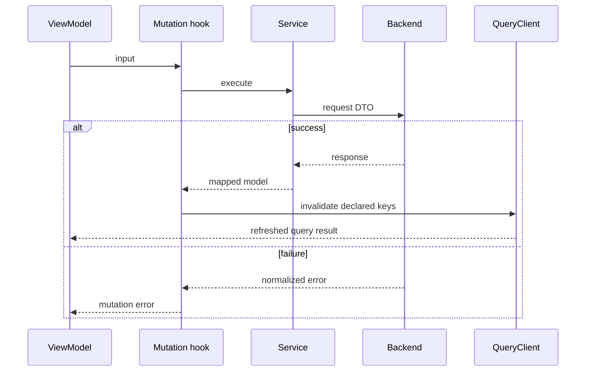

# Web remote state and transport

## Ownership and composition

TanStack Query owns remote responses and loading/error states. Redux owns
identity and preferences. Forms and modals are presentation state.
`QueryProvider` creates a QueryClient with five-minute staleTime, thirty-minute
gcTime, one query retry and no automatic focus refetch. Mutations have no global
retry policy.

The graph is page → ViewModel/hook → service → DTO client → Axios. A mapper
normalizes responses before rendering. Application services use concrete
infrastructure dependencies; this is not an unimplemented port-injection container.

## Cache identity

`queryKeys.ts` centralizes hierarchical keys:

| Family | Significant arguments |
|---|---|
| wines | filters/page; ID for detail |
| reviews | wine, page and filter; review ID for comments |
| AI profile/status | wine ID and language |
| compare | ID A, ID B and language; root independent from wines |
| events | filters or position/radius; event for own registration |
| wineries / wineRoutes | filters, ID, geographic hierarchy |
| cellar / users | cellar filters and own statistics |
| admin / partner | resource, filters/page and detail ID |

Exceptions with ad hoc keys outside `queryKeys.ts`: `useCommunity.ts` (`["community", userId, …]` for reports, blocks, moderation and publications), `useMyTickets.ts` (`myTickets` and `paymentReceipt`), `usePaymentAccountStatus.ts` (`paymentAccount`), `useOrganizerPayments.ts` (`["events", eventId, "organizerPayments", ids]`) and location (`device-location`, `location-country`).

Keys are built from hook arguments, not HTTP URLs. Different keys isolate
in-memory responses; they do not guarantee cancellation of previous requests
or preservation of every filter in the browser URL.

## Mutations and invalidation

Module hooks declare `onSuccess` and invalidate families or details. Reviews
relate to wine-detail keys; cellar update/delete uses its family; admin and
partner have separate namespaces. The exact scope is defined in mutation hooks,
not inferred from similar public and administrative endpoints.

Partner event creation/editing/deletion invalidates partner lists, public lists,
nearby, discovery, event administration and statistics. Editing/deletion also
invalidates that event's public detail, including registrations, without affecting
other event details or the wine catalog. This only runs on success, never on
`onError`. The mutation awaits refresh of invalidated active queries before
completing its success callback.

[View the full “Mutations and invalidation” diagram](https://images.vinnot.com/docs/diagrams/v1/en/frontend-web-architecture-remote-state-and-transport-af293e1bd60d.svg)

## Transport and session

`infrastructure/http/http.ts` configures base URL, timeout and Bearer.
Auth injects an access-token getter, refresh and expiration callback.
The first eligible 401 initiates refresh; concurrent requests wait and replay
with the new token. `/auth/*` and already-retried requests are excluded.

Session bootstrap is separate from the interceptor: the store requests
access using the `/auth/web/refresh` cookie, then `/auth/me`. See
[authentication](../../modules/users/architecture.md).
There is no global locale header; AI methods send `language`.

## Cache, network and recovery

`keepPreviousData` retains data across argument changes. `isLoading`,
`isFetching`, previous results and current results have distinct meanings.
Consumers select which state to render. `enabled` controls conditional queries,
such as detail without an ID.

Comparison is a cache query even though it uses POST transport. Its hook disables
automatic retry and focus, reconnect and remount refetching; its `compare` root
isolates it from `wines` catalog invalidations. A new selection/language without
a cached entry starts a request. On failure, the page keeps both selections and
offers explicit retry with a loading indicator. Screens present results; backend
decides AI reuse, permissions and persistent consistency.

AuthProvider clears QueryClient on identity change or session termination.
Cache and access are in memory; localStorage stores neither tokens nor queries.
Cookie mutations use Web Locks across tabs and a per-tab queue. If browser privacy
policy denies the Locks API with `SecurityError` before the operation starts,
only the per-tab queue remains available. An operation that already started is
never repeated through this fallback. Denied cookies prevent session restoration
after reload; tokens are not moved into another storage mechanism to bypass that choice.

## Evidence

- [Keys](../../../../frontend-react/src/presentation/hooks/queries/queryKeys.ts)
- [Transport](../../../../frontend-react/src/infrastructure/http/http.ts)
- [Session provider](../../../../frontend-react/src/app/providers/AuthProvider.tsx)
- [Comparison](../../../../frontend-react/src/presentation/hooks/queries/wine/useWineComparison.ts)
- [HTTP diagrams](../diagrams/server-state-and-http.md)
