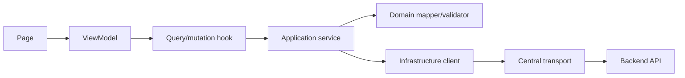
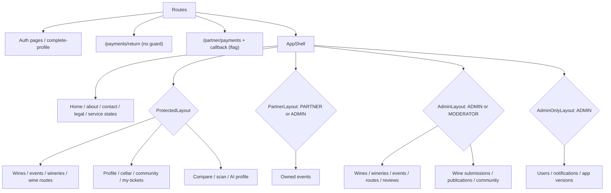
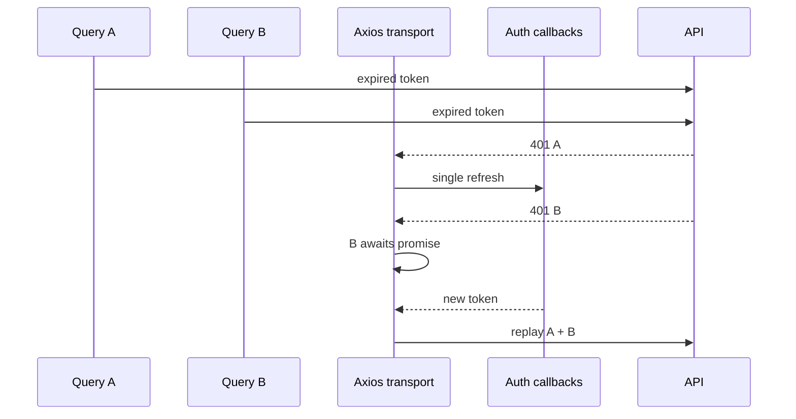
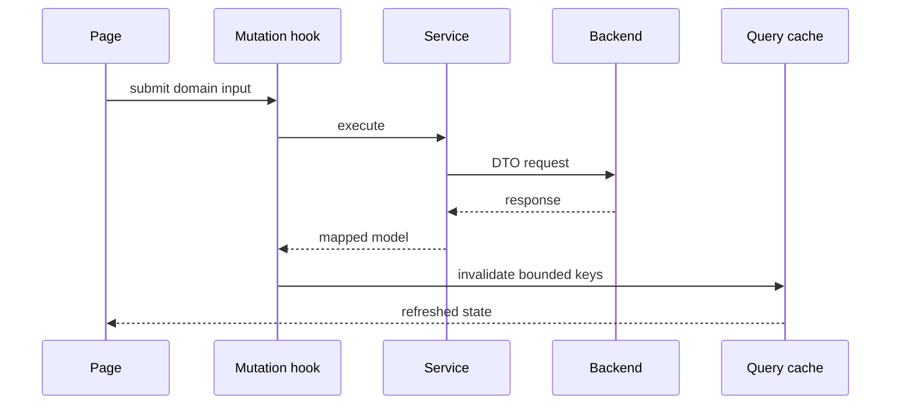

# Web application maps

## Layers and dependencies

[View the full “Layers and dependencies” diagram](https://images.vinnot.com/docs/diagrams/v1/en/frontend-web-diagrams-application-map-f802780c6735.svg)

## Route tree

[View the full “Route tree” diagram](https://images.vinnot.com/docs/diagrams/v1/en/frontend-web-diagrams-application-map-592dc41f587f.svg)

## Concurrent session

[View the full “Concurrent session” diagram](https://images.vinnot.com/docs/diagrams/v1/en/frontend-web-diagrams-application-map-0b8756a3ba3b.svg)

## Mutation and invalidation

[View the full “Mutation and invalidation” diagram](https://images.vinnot.com/docs/diagrams/v1/en/frontend-web-diagrams-application-map-841e265e2930.svg)

- [Routing and access](routing-and-access.md)
- [Server state and HTTP](server-state-and-http.md)
