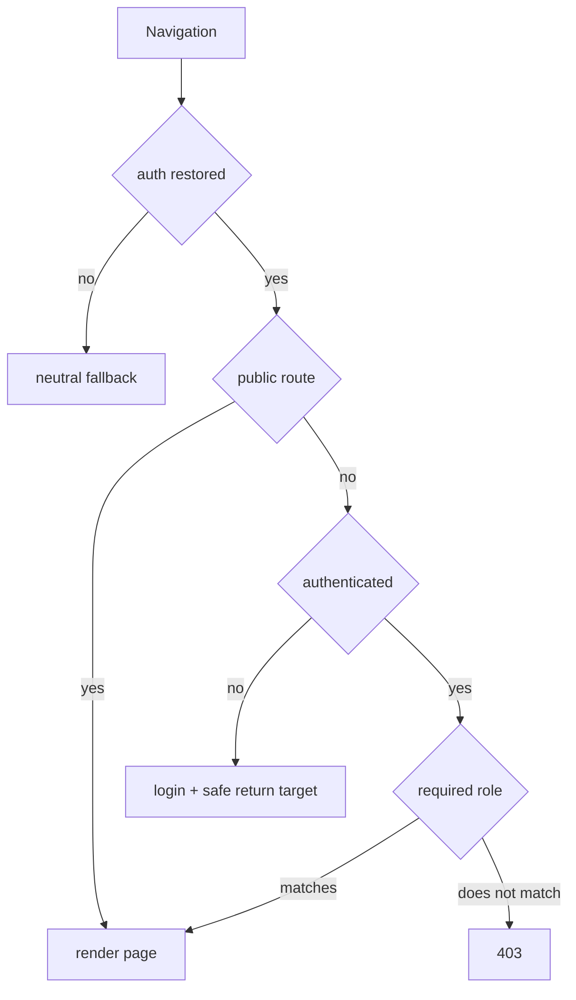
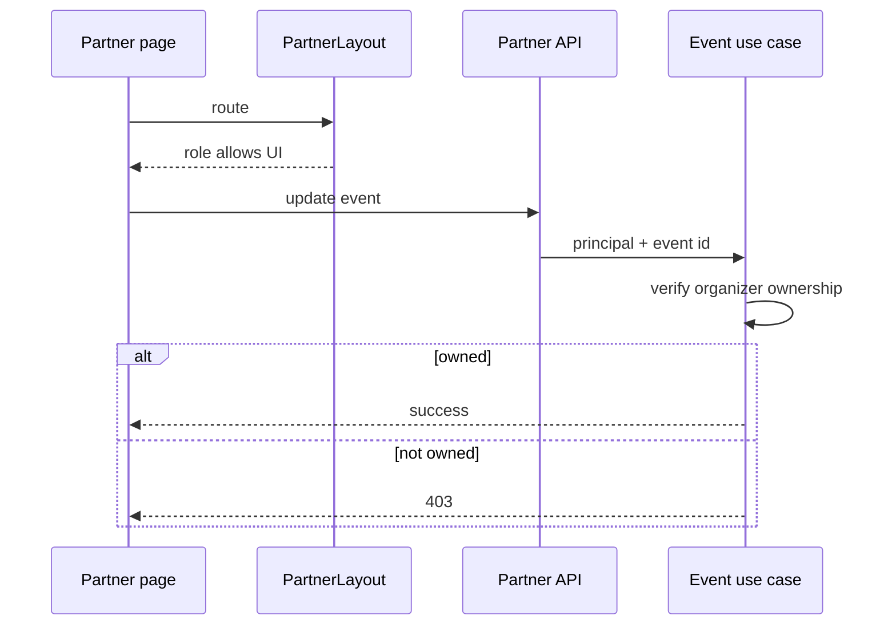

# Web routing and access diagrams

## Guard decision

[View the full “Guard decision” diagram](https://images.vinnot.com/docs/diagrams/v1/en/frontend-web-diagrams-routing-and-access-952ed0a623d3.svg)

## Partner ownership

[View the full “Partner ownership” diagram](https://images.vinnot.com/docs/diagrams/v1/en/frontend-web-diagrams-routing-and-access-aa928fe309b9.svg)

