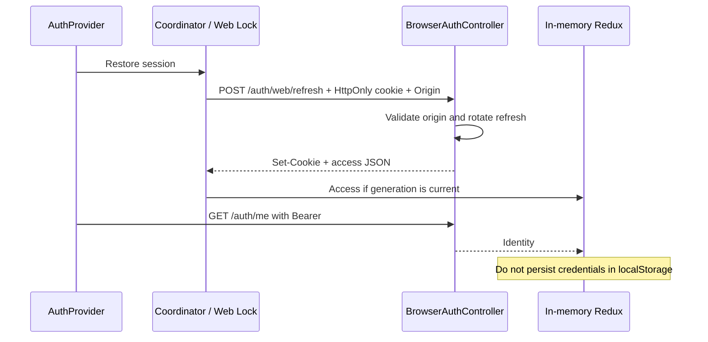
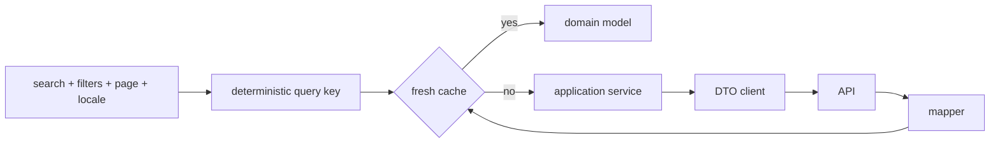
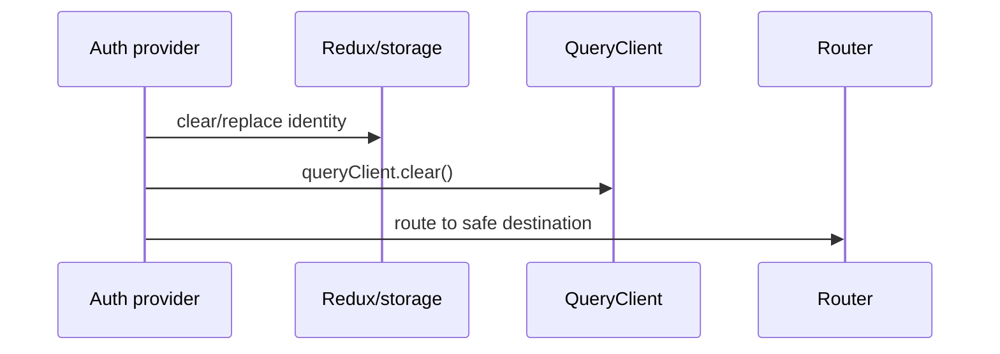
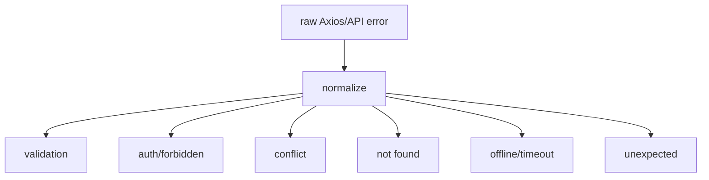

# Web server-state and HTTP diagrams

## Cookie restoration and tab isolation

[View the full “Cookie restoration and tab isolation” diagram](https://images.vinnot.com/docs/diagrams/v1/en/frontend-web-diagrams-server-state-and-http-c15635e94e10.svg)

The cookie uses credentials and X-Vinnot-Web-Session. Non-secret tab events
clear identity/cache on logout and restore new identity on login. Pending work
from older generations is discarded. Administrative reauthentication follows
the [backend sequence](../../backend/architecture/authentication-and-identity.md).

## Query identity

[View the full “Query identity” diagram](https://images.vinnot.com/docs/diagrams/v1/en/frontend-web-diagrams-server-state-and-http-49b0437be91d.svg)

## Identity change

[View the full “Identity change” diagram](https://images.vinnot.com/docs/diagrams/v1/en/frontend-web-diagrams-server-state-and-http-73622d631157.svg)

## Error taxonomy

[View the full “Error taxonomy” diagram](https://images.vinnot.com/docs/diagrams/v1/en/frontend-web-diagrams-server-state-and-http-34952bc170bc.svg)
