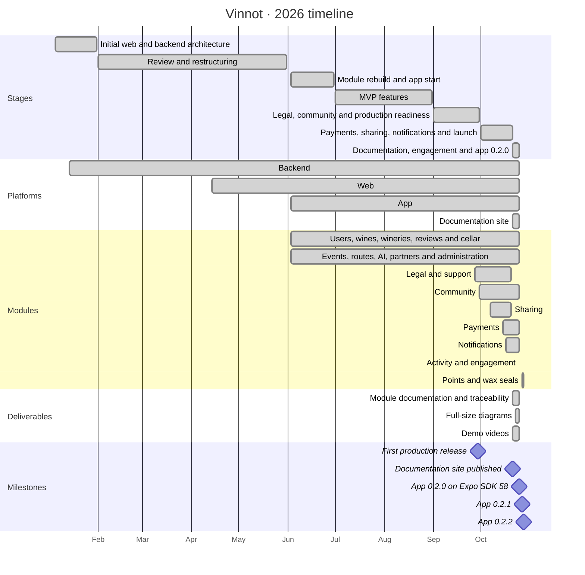
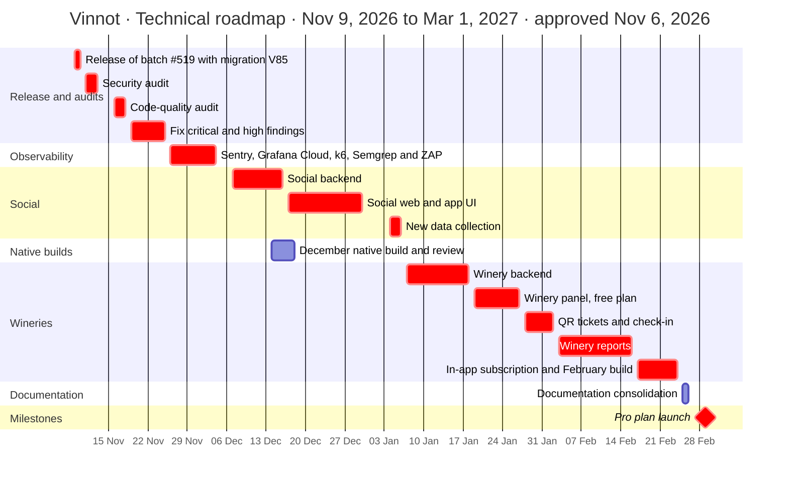
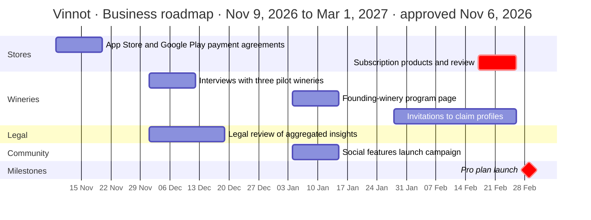

# Timeline

This chapter holds the completed timeline and the approved roadmap:

- the timeline from January to October 2026, rebuilt from the repository history: dates
  are those of the first and last change of each stage and each module;
- the [technical roadmap](#technical-roadmap) and the
  [business roadmap](#business-roadmap) from November 9, 2026 to March 1, 2027, approved
  on November 6, 2026;
- the [critical path](#critical-path) of that roadmap.

[View the full “Timeline” diagram](https://images.vinnot.com/docs/diagrams/v1/en/gantt-readme-88d3a99a62a1.svg)

## Stages

| Stage | Dates | What was done |
|---|---|---|
| Initial architecture | January 2026 | Web structure, role-based routes, session and API contracts; backend skeleton with style and coverage checks |
| Review and restructuring | February to May 2026 | Backend review and web alignment |
| Module rebuild | June 2026 | Backend organized by modules, app start, AWS integration and first CI workflows |
| MVP features | July and August 2026 | Sign-in, events, label scanning and test coverage |
| Legal, community and production | September 2026 | Terms and support, community, release scripts and CI |
| Payments, sharing and notifications | October 2026 | Public links, Mercado Pago payments, push and email notifications, and launch |
| Documentation, engagement and app 0.2.0 | October 2026 | One chapter per module with use cases, requirements, tests and traceability; full-size diagrams; demo videos; personalised pushes with the engagement module; app 0.2.0 on Expo SDK 58 |

## Milestones

| Milestone | Date |
|---|---|
| First production release | September 29, 2026 |
| Documentation site published | October 21, 2026 |
| App 0.2.0 on Expo SDK 58 submitted to the stores | October 25, 2026 |
| App 0.2.1: Expo SDK 58 native patches (`expo` 58.0.20 and its modules) and Skia pre-installed so the animated wax seals ship by OTA | October 27, 2026 |
| App 0.2.2: the next Expo SDK 58 native patches (`expo` 58.0.21 and 15 modules) | October 28, 2026 |

Each new native version has its own OTA runtime: binaries of an earlier version do not
receive the next version's bundles. The details are in
[App distribution](../frontend-mobile/guides/distribution.md). Between 0.2.1 and 0.2.2,
the web and the app's JavaScript gained the points system with animated wax seals, the
rating with a bottle that pours the glass, and a shortcut to write a review from the wine
detail.

The MVP user stories are grouped in three GitHub milestones: access base and initial
management; catalog, reviews and cellar; and experiences, partners and artificial
intelligence.

## Technical roadmap

Horizon: November 9, 2026 to March 1, 2027. Plan approved on November 6, 2026. Every task
is planned; tasks marked as critical path have zero slack. The calendar runs Monday to
Friday, without the holidays of December 24, 25 and 31, 2026 and January 1, 2027.

[View the full “Technical roadmap” diagram](https://images.vinnot.com/docs/diagrams/v1/en/gantt-readme-c961f75befb6.svg)

| Deliverable | Dates | Depends on | Status |
|---|---|---|---|
| Release of batch #519 to development and production, with migration V85 at low traffic | November 9 and 10 | — | Planned |
| Security audit: code scan, OWASP ASVS level 1 and OWASP ZAP against development | November 11 to 13 | Release of batch #519 | Planned |
| Code-quality audit by module: architecture, SOLID, patterns, tests and technical debt | November 16 to 18 | Security audit | Planned |
| Fix the critical and high findings of both audits | November 19 to 25 | Code-quality audit | Planned |
| Observability: Sentry on the backend and the web, Grafana Cloud with Alloy and dashboards, a k6 load baseline, Semgrep and OWASP ZAP in CI | November 26 to December 4 | Fix of findings | Planned |
| Social backend: follows, public profile, cellar visibility (public by default, followers only or private), follower points with anti-abuse controls, taste-affinity percentage, people to follow, new-follower notification and following feed | December 7 to 16 | Observability | Planned |
| December native build: Sentry in the app, React Native 0.88.1 (#484) and store review | December 14 to 18 | Observability | Planned |
| Social web and app UI: public profile, animated taste wheel, follower lists and feed | December 17 to 30 | Social backend | Planned |
| New data collection: optional age range, optional price paid and place when rating, aggregated internal search logging, privacy policy and store privacy labels | January 4 to 6 | Social UI | Planned |
| Winery backend: WINERY role (includes PARTNER), winery members, verified profile claim, ownership guard on own wines, audit, verified-winery badge and official reply to reviews | January 7 to 18 | New data collection | Planned |
| Winery panel on the web and the app, free plan: profile, own wines, events and basic metrics | January 19 to 27 | Winery backend | Planned |
| Event tickets with a QR code and organizer check-in from the app | January 28 to February 2 | Winery panel | Planned |
| Winery reports: weekly and monthly catalogue | February 3 to 16 | QR tickets; pilot winery interviews | Planned |
| In-app subscription (App Store and Google Play, server receipt validation and store server notifications) and February native build | February 17 to 24 | Reports; store payment agreements | Planned |
| Documentation consolidation (Mermaid and Excalidraw, in Spanish and English) | February 25 and 26 | In-app subscription | Planned |
| Milestone: Pro plan launch for founding wineries | March 1, 2027 | Subscription product review; legal review | Planned |

## Business roadmap

Horizon: November 9, 2026 to March 1, 2027. Plan approved on November 6, 2026. Every task
is planned.

[View the full “Business roadmap” diagram](https://images.vinnot.com/docs/diagrams/v1/en/gantt-readme-a8289463c156.svg)

| Deliverable | Dates | Depends on | Status |
|---|---|---|---|
| App Store Paid Applications Agreement with tax and banking details; Google Play payments profile | November 9 to 20 | — | Planned |
| Interviews with three pilot wineries to validate the report catalogue | December 1 to 12 | — | Planned |
| Legal review of selling aggregated insights (Apple guideline 5.1.2, Google Play User Data policy and Argentina's Law 25,326) and privacy policy update | December 1 to 19 | — | Planned |
| Founding-winery program page | January 4 to 15 | — | Planned |
| Social features launch campaign | January 4 to 15 | Social UI | Planned |
| Invitations to wineries to claim their profiles | January 28 to February 26 | Winery panel | Planned |
| Subscription products in both stores and their review | February 17 to 26 | In-app subscription; store payment agreements | Planned |
| Milestone: Pro plan launch | March 1, 2027 | Subscription product review; legal review | Planned |

## Critical path

A task's slack is the number of working days it can slip without moving the Pro plan
launch. One full-time developer does the development, so the development chain is serial:
each task starts the working day after the previous one ends. The tasks of that chain have
zero slack and carry the `crit` tag in the diagrams; a delay in any of them moves the
launch by the same number of working days.

| Order | Task | Dates | Working days | Depends on | Slack |
|---|---|---|---|---|---|
| 1 | Release of batch #519 | November 9 and 10 | 2 | — | 0 |
| 2 | Security audit | November 11 to 13 | 3 | 1 | 0 |
| 3 | Code-quality audit | November 16 to 18 | 3 | 2 | 0 |
| 4 | Fix critical and high findings | November 19 to 25 | 5 | 3 | 0 |
| 5 | Observability | November 26 to December 4 | 7 | 4 | 0 |
| 6 | Social backend | December 7 to 16 | 8 | 5 | 0 |
| 7 | Social web and app UI | December 17 to 30 | 8 | 6 | 0 |
| 8 | New data collection | January 4 to 6 | 3 | 7 | 0 |
| 9 | Winery backend | January 7 to 18 | 8 | 8 | 0 |
| 10 | Winery panel | January 19 to 27 | 7 | 9 | 0 |
| 11 | QR tickets and check-in | January 28 to February 2 | 4 | 10 | 0 |
| 12 | Winery reports | February 3 to 16 | 10 | 11 | 0 |
| 13 | In-app subscription and February native build | February 17 to 24 | 6 | 12 | 0 |
| 14 | Store review of the subscription products | February 25 and 26 | 2 | 13 | 0 |
| 15 | Pro plan launch | March 1, 2027 | — | 14 | 0 |

The subscription products are set up in the stores from February 17, alongside task 13;
their review stays on the critical path because it can only finish once the February
native build is approved.

### External constraints

These tasks depend on third parties and cannot be compressed, but they are not on the
critical path: their slack is the number of working days between their end and the last
day they can finish without delaying the task that needs them.

| Constraint | Dates | Must finish before | Slack |
|---|---|---|---|
| App Store and Google Play payment agreements | November 9 to 20 | In-app subscription (February 17) | 58 working days |
| Pilot winery interviews | December 1 to 12 | Winery reports (February 3) | 33 working days |
| Legal review of aggregated insights | December 1 to 19 | Pro plan launch (March 1) | 46 working days |
| December native build and store review | December 14 to 18 | February native build (February 17) | 38 working days |

The December native build runs alongside the social work: build and store review time
does not take the developer's time. The documentation consolidation is not a launch
prerequisite and also stays off the critical path.
