# Development process

Vinnot is built with a **DevOps** model and manages its workflow with **Kanban**. DevOps
brings the technical practices that sustain quality: automated testing, security,
deployment and monitoring. Kanban brings the flow management a small team needs with
shifting priorities and production emergencies. From the spiral model it takes risk
analysis, applied in [risk-based testing](../quality/risk-based-testing.md).

This page summarises the process and links the details; it does not repeat them.

## Why this model

| Alternative | Why it is not used alone |
|---|---|
| Waterfall | Requirements changed during development (payments, notifications, scanning) and the stores require incremental releases |
| Scrum | Its roles and events are designed for teams of 3 to 10 people, and an urgent payment fix cannot wait for the next sprint |
| Kanban alone | It defines no technical quality or deployment practices |
| DevOps alone | It automates, but does not manage priorities or work in progress |

## CALMS in practice

| Principle | In Vinnot |
|---|---|
| Culture | Whoever owns a change answers for it in production; building and operating are not split |
| Automation | Build, tests, coverage, security, deployment to development and production release in GitHub Actions workflows |
| Lean | Small changes, one branch per issue, and one issue finished before the next starts |
| Measurement | [Quality metrics](../quality/metrics.md), production alarms and AI cost |
| Sharing | Living documentation in Spanish and English, validated on every CI run |

## Stages and workflows

| Stage | How it applies | Where |
|---|---|---|
| Plan | Every piece of work starts with an issue (`feature`, `bugfix`, `hotfix` or `task`) with acceptance criteria and dates on the GitHub Projects roadmap | [`create-work-branch.yml`](../../../.github/workflows/create-work-branch.yml); [Issue, branch, and pull request workflow](github-work-items.md) |
| Code | A branch linked to the issue with a normalised name, conventional commits and hexagonal architecture | [Work types](github-work-items.md#work-types) |
| Build | Maven for the backend, Vite for the web, the app export; Docker images pinned by digest | [`ci.yml`](../../../.github/workflows/ci.yml) |
| Test | CI on every pull request: tests, coverage, static analysis, architecture, documentation and a quality gate that rejects failed or skipped checks | [CI/CD](../infra/guides/ci-cd.md) |
| Release | A pull request from `development` to `main`; production ships only from the exact, already validated `main` commit | [Step-by-step release](../infra/guides/release-step-by-step.md) |
| Deploy | Development deploys automatically after the quality gate; production through a manual prepare, publish and roll-back workflow; the app through a native build or an OTA update | [`deploy-backend-dev.yml`](../../../.github/workflows/deploy-backend-dev.yml), [`deploy-frontend-dev.yml`](../../../.github/workflows/deploy-frontend-dev.yml), [`production-release.yml`](../../../.github/workflows/production-release.yml) |
| Operate | Containers with health checks, daily backups and the development environment shut down out of hours | [AWS deployment](../infra/architecture/aws-deployment.md), [low-cost development](../infra/operations/low-cost-dev.md) |
| Monitor | Probe and collector every 5 minutes with health, resource, backup, AI and bounced-email alarms; incident response | [Observability and incidents](../infra/operations/observability-and-incidents.md) |

Dependency security checks run when dependency inputs change, on every pull request
into `main` and weekly with
[`security-checks.yml`](../../../.github/workflows/security-checks.yml).

## Flow of a change

```mermaid
flowchart LR
    I["Issue<br/>Create Work Branch"] --> B["Linked branch<br/>feature/bugfix/task"]
    B --> L["Local work<br/>+ preflight"]
    L --> P["Pull request<br/>to development"]
    P --> CI{"CI quality gate"}
    CI -- "fails" --> L
    CI -- "passes" --> M["Merge to development"]
    M --> DD["Automatic deploy<br/>to development"]
    DD --> R["Release pull request<br/>development → main"]
    R --> CI2{"Quality gate<br/>on the commit"}
    CI2 -- "passes" --> PR["Production release<br/>SHA approval"]
    PR --> MON["Monitoring"]
    MON -- "incident" --> H["Hotfix issue<br/>from main"]
    H --> P2["Pull request to main"]
    P2 --> CI2
```

[View the full “Flow of a change” diagram](https://images.vinnot.com/docs/diagrams/v1/en/governance-development-process-0766ecd4a9bc.svg)

A hotfix branches from `main` and returns to `development` through a later pull request,
as explained in [Returning a hotfix](github-work-items.md#returning-a-hotfix-to-development).

## Kanban

- **Visualise the flow:** each issue is a card on the GitHub Project and its branch is linked
  in the issue's **Development** section.
- **Limit work in progress:** one issue is finished before the next one starts.
- **Manage the flow:** planned start and end dates live on the Project and feed the roadmap.
- **Explicit policies:** issue templates in [`.github/ISSUE_TEMPLATE`](../../../.github/ISSUE_TEMPLATE),
  the pull request template in [`pull_request_template.md`](../../../.github/pull_request_template.md)
  and the [pre-merge checklist](github-work-items.md#pre-merge-checklist).
- **Improve through feedback:** every pipeline or production failure is analysed and can
  become a process rule.

## Continuous improvement

The analysis of the 72 failed GitHub Actions runs between 2026-06-20 and 2026-10-21 led to
the mandatory checklist before every push and every merge: run the same preflight as CI
locally, rerun tests prone to intermittent failures, review Actions pins and never merge red
pull requests. The repository has no branch protection, so that checklist is the control.
Open quality gaps are tracked in the [improvement backlog](../quality/improvement-backlog.md).

## Planning

The project's stages and milestones are in the [timeline](../gantt/README.md).
