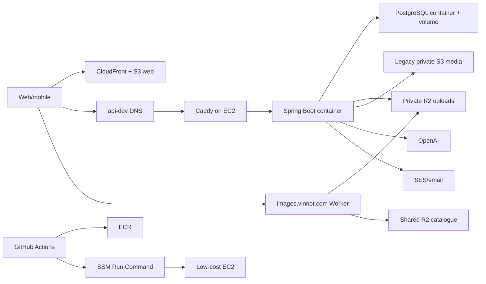
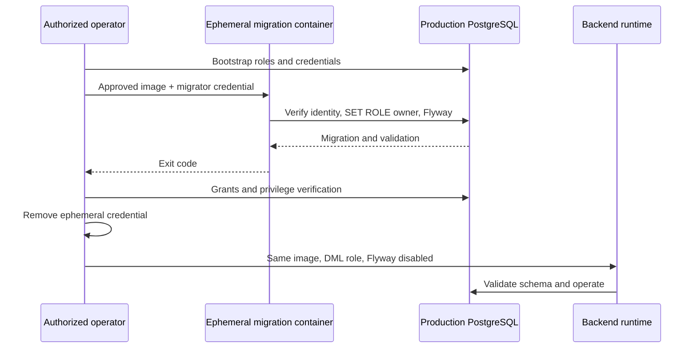

# AWS deployment architecture

## Development-environment goal

The current environment prioritizes low cost and reproducible recovery. It is
not highly available: one EC2 instance runs PostgreSQL, backend and Caddy via
Docker Compose. Web is decoupled on S3 + CloudFront; new user uploads use private R2 and WebP.
S3 retains web, backups and legacy-media reads/deletion. Public DNS/TLS
integrates Cloudflare/Caddy.



[View the full “Development-environment goal” diagram](https://images.vinnot.com/docs/diagrams/v1/en/infra-architecture-aws-deployment-00f221458187.svg)

## Components and ownership

| Component | Responsibility | Persistent state |
|---|---|---|
| CloudFront/S3 web | static bundle and edge cache | replaceable artifacts |
| EC2 | runtime host | configuration and local volumes |
| Caddy | TLS/reverse proxy | certificates/config |
| backend | API and Flyway | no local business state |
| PostgreSQL | catalog/transactions | critical EBS volume |
| ECR | versioned backend images | reproducible images |
| R2 uploads | private dev/prod buckets; covers/quarantine through API and public avatars/labels through Worker | user media |
| R2 catalogue + Worker | one shared copy, identical URLs across environments | catalogue images |
| S3 media | legacy-original reads/deletion | compatibility and rollback |
| SSM Run Command | remote administrative execution | operational records |
| Secrets Manager | environment-specific runtime secrets | sensitive configuration |
| EventBridge Scheduler | start/stop windows | operational rules |

## Network and public access

Only proxy/API is public. PostgreSQL listens inside Compose and is not exposed
to Internet. SSM replaces SSH for deployment. Security groups bound inbound
traffic. Backend serves `/api`; Caddy publishes health and API routes. Media
buckets remain private. The Worker serves only public avatars/labels; backend
checks ownership and visibility for covers and quarantine.
[WebP/R2 storage](../operations/user-images-r2.md).

**State in the account (verified in the AWS console on 2026-10-29):** the production
security group accepts 80 and 443 from anywhere and does not open port 22. A leftover 443
rule for an operator IP also remains.

`production-stack.json` describes the state with Cloudflare in front: it opens 80 (ACME and
redirect) and 443 only to the 15 IPv4 ranges Cloudflare publishes, one rule per range and
port. There are no IPv6 rules because the VPC has no IPv6. It has no operator parameter and
does not open 22 or 5432. Applying the stack removes the leftover rule and the opening to all
IPv4, so it is applied only after the proxy is on: see
[Put Cloudflare in front of the API](#put-cloudflare-in-front-of-the-api).

## Persistence and cost

Moving PostgreSQL to EC2 reduces RDS fixed cost but changes guarantees:

- stopping EC2 stops API and database;
- host failure affects both;
- backup/restore is no longer RDS-managed;
- there is a single host: no horizontal scaling or high availability.

Stopping does not delete the volume. Docker volume/EBS and backups are critical;
container images are not. Scheduler may stop outside hours, with understood
downtime.

## Backend deployment

GitHub builds linux/amd64, pushes `dev-<sha>` and `dev-latest`, starts the host,
synchronizes versioned scripts over SSM with base64 + SHA256 and runs
`/opt/vinnot/deploy.sh`. The host refreshes runtime env, uses temporary Docker
credentials, pulls, starts postgres/backend, waits for health through migrations
and only then starts proxy. Failure prints bounded diagnostics. Third-party
images (`postgres`, `caddy`) are pinned to an exact version and multi-arch index
digest, so that pull never rolls them; bump them deliberately.

The deployment uses no ECS or target groups, and the dev deployer boundary
grants only read access to ECS and RDS.

## Isolated production configuration

`compose.production.yml` is an explicit overlay of the shared Compose topology,
not a replacement for the dev deployment. Resolve both files in that order from
`/opt/vinnot-prod`. It uses the `vinnot-production` project, its own network and
volumes; it does not mount development data. PostgreSQL and backend still do
not publish ports. The proxy reuses the Caddyfile with
`VINNOT_API_HOST=api.vinnot.com`; without that variable it keeps the dev hostname.

Configuration requires explicit `PROD_BACKEND_IMAGE`, Google audiences,
Apple team/key and monthly AI allowance. Facebook credentials are deliberately
empty in the production overlay; development remains independent. The image must be the verified
digest of the approved artifact (`repository@sha256:...`), not a mutable tag.
The sum of dev/prod allowances must respect the shared budget; Compose does not
query spending in the other environment or replace that reconciliation.

Runtime receives only `runtime.env` from the production secret. PostgreSQL's
bootstrap password is mounted as a file under `/run/secrets`, not used as the
application's DML password. `migration.env` contains only
`VINNOT_MIGRATION_DB_PASSWORD` for the ephemeral `migrate` service; deliver it
with mode 0600 for the operation and remove it afterwards. None of these files
are versioned. Missing `migration.env` allows normal runtime operation, but the
migrator refuses to start without its password.

For database-only provisioning or recovery, use `compose.production-data.yml`.
It reuses the engine definition in `compose.postgres.yml` without requiring
application/OAuth credentials and uses the same production volume and network as
the full overlay. Never use a development Compose file to provision production.

SES bounce and complaint feedback lives in its own stack,
`email-feedback-stack.json`, deployed once per environment; it attaches its IAM
policy to the existing host role and leaves `production-stack.json` unchanged.
See [observability and incidents](../operations/observability-and-incidents.md#email-bounces-and-complaints).

### Migrations outside runtime

`ProductionMigrationRunner` belongs to the persistence adapter and uses Flyway
already included in the backend. `PropertiesLauncher` executes that class from
the same JAR without starting Spring, HTTP, consumers or scheduled jobs. The
normal `mainClass` remains `VinnotApplication`.

1. Prepare `vinnot_prod`, roles and passwords through a protected administrative
   channel; execute `production-roles.sql`.
2. Using an image of the validated revision, referenced by digest in
   `PROD_BACKEND_IMAGE`, execute the `migrate` service
   under the Compose `migration` profile with `run --rm`. Its fixed URL points
   to `postgres:5432/vinnot_prod` and the user is `vinnot_prod_migrator`.
3. Flyway verifies session identity, assumes `vinnot_prod_owner`, validates
   checksums and applies migrations. It disallows clean, automatic baseline,
   out-of-order execution and JDBC options supplied in the URL.
4. After success, apply `production-runtime-grants.sql` as administrator and
   verify permissions. If any step fails, do not start or promote the new backend.
5. Remove ephemeral credentials and leave the migrator as `NOLOGIN PASSWORD NULL`
   until the next authorized migration. Start backend with
   `SPRING_FLYWAY_ENABLED=false`, `vinnot_prod_runtime` and JPA schema validation.

`deploy-production.sh` does not migrate and refuses to publish when Flyway history
or the release journal do not match the candidate. The complete order (`prepare`
and its host preparation plan, a first `publish` that stages the image and stops
before the host, file installation, `migrate-production.sh` with backup,
migration, grants and journal update, and a second `publish` with
`host_prepared=true`) and the `release-state/` content are in
[Production release with migrations](../guides/deployment.md#production-release-with-migrations).



[View the full “Migrations outside runtime” diagram](https://images.vinnot.com/docs/diagrams/v1/en/infra-architecture-aws-deployment-5af8258cb835.svg)

These files define the deployment contract; their presence in the repository
does not demonstrate AWS provisioning. DNS/TLS, IAM, volume encryption, provider
configuration and restoration are verified at the destination before enabling
public access.

## Web deployment

CI validates, builds and inspects artifacts. Hashed `dist/assets` receive annual
immutable cache; images and fonts (`png`, `jpg`, `webp`, `svg`, `ico`, `woff2`)
get a day of caching (`public,max-age=86400,stale-while-revalidate=604800`) so
emails and shared links load them from CloudFront without reaching S3; other entry
files receive `no-cache,no-store`. CloudFront is then
invalidated and awaited. `VITE_*` values are bundled and cannot be private.

### Production DNS and edge

Cloudflare remains authoritative for `vinnot.com`. Production records are separate
from `dev.vinnot.com` and `api-dev.vinnot.com`; adding production must not replace
their targets or change the domain's nameservers. `api.vinnot.com` uses an A record
to the dedicated production elastic IP. Today it is DNS-only, with TLS terminated by Caddy;
the target is the Cloudflare proxy, which terminates the client's TLS and encrypts again
towards Caddy ([Put Cloudflare in front of the API](#put-cloudflare-in-front-of-the-api)).
The apex web record targets the dedicated CloudFront hostname using Cloudflare's
apex CNAME flattening. ACM validation CNAMEs remain DNS-only for renewal.

`production-web-stack.json` defines its own S3 Origin Access Control, distribution,
WAF and CloudFront Free flat-rate subscription. Its sole origin is the private
production web bucket; signed origin requests, HTTPS redirection, TLS 1.2 minimum
and managed security headers are enforced. Managed WAF groups cover IP reputation,
common attacks and known bad inputs; request sampling is disabled. The subscription
references only that distribution and WAF, never development resources. Verify that
the subscription is `ACTIVE` and `FREE`; provisioning resources alone does not
prove that flat-rate billing applies. See [AWS subscription documentation](https://docs.aws.amazon.com/AWSCloudFormation/latest/TemplateReference/aws-resource-pricingplanmanager-subscription.html).

A new stack creates the distribution **disabled** (`AcceptanceEnabled=false`).
Before enabling it, scope the bucket's read policy to its exact distribution ARN,
install and test the shared SPA/security function and upload a verified production
artifact. DNS setup enables nothing on its own.

The foundation stack is the single owner of the web bucket policy. After creating
the distribution, supply its verified ID as `WebDistributionId` in
`production-stack.json`. The empty default grants no CDN access. When configured,
only `cloudfront.amazonaws.com` receives `s3:GetObject` on web objects, conditioned
on that exact distribution ARN in the same account. It grants neither write access
nor access to media or backups; public access blocking and the insecure-transport
deny remain in place. Do not replace this policy from another stack or from the
frontend deployment script.

The distribution is enabled with `AcceptanceEnabled=true` and the published
function ARN in `SecurityFunctionArn`. The template rejects enabling the CDN
without that function and preserves its viewer-request and viewer-response
associations. Production is launched and its stack runs with
`AcceptanceEnabled=true`. On update, `aws cloudformation deploy` keeps the previous
value of any parameter you do not pass; never pass `AcceptanceEnabled=false`,
because it disables the site.

The site is public. The WAF allows by default and applies three AWS managed groups,
in this order: IP reputation (priority 10), common rules (20) and known bad inputs
(30). The template no longer has the pre-launch rule that only let the operator IP
through, nor its IP set.

## Apply the public launch alignment

No workflow deploys these stacks: the release role has no CloudFormation, security
group or WAF permissions. The owner applies them by hand, with an administrative
AWS session, from the repository root and at a commit that already contains the
aligned templates. Do not deploy these stacks from an earlier commit: it would close
production to the public again. Each step first creates a change set, to see the
diff, and only then executes it.

| What is applied | What changes in the account |
|---|---|
| Foundation (`production-stack.json`) | Revokes the leftover 443 rule for the operator IP and the opening to all IPv4; 80 and 443 stay open only to the Cloudflare IPv4 ranges (30 rules). The `OperatorCidr` parameter goes away. The security group is modified, not replaced: its description deliberately keeps the old text, because changing it forces CloudFormation to replace the group. |
| Web (`production-web-stack.json`) | Removes the pre-launch WAF rule if it is still live and deletes the operator IP set. The three managed groups remain. |
| Monitoring (`scripts/build-monitoring-stack.mjs`) | The probe moves to `AcceptanceMode=public`. |
| Development (`docker-compose.yml`) | CORS stops accepting the `vinnot-dev-web.pages.dev` origin. |

1. **Find the stacks.** Their names are not in the repository; they are resolved
   from resources with fixed names:

   ```bash
   export AWS_REGION=us-east-1
   FOUNDATION_STACK=$(aws cloudformation describe-stack-resources \
     --physical-resource-id vinnot-prod-low-cost-host-role \
     --query 'StackResources[0].StackName' --output text)
   WEB_DISTRIBUTION_ID=$(aws cloudformation describe-stacks --stack-name "$FOUNDATION_STACK" \
     --query "Stacks[0].Parameters[?ParameterKey=='WebDistributionId'].ParameterValue" --output text)
   WEB_STACK=$(aws cloudformation describe-stack-resources \
     --physical-resource-id "$WEB_DISTRIBUTION_ID" \
     --query 'StackResources[0].StackName' --output text)
   MONITORING_STACK=$(aws cloudformation describe-stack-resources \
     --physical-resource-id vinnot-prod-edge-probe \
     --query 'StackResources[0].StackName' --output text)
   echo "$FOUNDATION_STACK | $WEB_STACK | $MONITORING_STACK"
   ```

   If any of them is empty or `None`, stop and check that stack in the console.

2. **Foundation: see the current rules and prepare the change set.** This step leaves the
   origin open only to Cloudflare. Run it after steps 0 to 2 of
   [Put Cloudflare in front of the API](#put-cloudflare-in-front-of-the-api), with both
   records already Proxied; otherwise the API stops answering. Steps 3 to 5 do not depend
   on Cloudflare.

   ```bash
   SG_ID=$(aws cloudformation describe-stack-resource --stack-name "$FOUNDATION_STACK" \
     --logical-resource-id SecurityGroup \
     --query 'StackResourceDetail.PhysicalResourceId' --output text)
   aws ec2 describe-security-group-rules --filters Name=group-id,Values="$SG_ID" \
     --query 'SecurityGroupRules[?!IsEgress].[SecurityGroupRuleId,FromPort,CidrIpv4,Description]' \
     --output table
   aws cloudformation deploy --stack-name "$FOUNDATION_STACK" \
     --template-file infra/aws-low-cost/production-stack.json \
     --capabilities CAPABILITY_NAMED_IAM --no-execute-changeset
   ```

   `deploy` keeps the previous values of `ImageId` and `WebDistributionId` and prints a
   `describe-change-set` command with the change set ARN. Review the diff:

   ```bash
   aws cloudformation describe-change-set --change-set-name "<printed ARN>" \
     --query 'Changes[].ResourceChange.[Action,LogicalResourceId,Replacement]' --output table
   ```

   The expected result is a single row: `Modify`, `SecurityGroup`, `False`. If another
   resource or a replacement shows up, do not execute: delete the change set with
   `aws cloudformation delete-change-set --change-set-name "<printed ARN>"` and review the
   difference. If everything matches:

   ```bash
   aws cloudformation execute-change-set --change-set-name "<printed ARN>"
   aws cloudformation wait stack-update-complete --stack-name "$FOUNDATION_STACK"
   aws ec2 describe-security-group-rules --filters Name=group-id,Values="$SG_ID" \
     --query 'SecurityGroupRules[?!IsEgress].[SecurityGroupRuleId,FromPort,CidrIpv4,Description]' \
     --output table
   ```

   Expected: 30 rules, 80 and 443 from each Cloudflare range, none from `0.0.0.0/0` and
   no `/32`.

   The 443 rule open to all IPv4 was added by hand at launch. CloudFormation did not create
   it, so it may remain after the update. If it is still in the table, revoke it by its ID.
   Nothing breaks: traffic already arrives through Cloudflare.

   ```bash
   aws ec2 revoke-security-group-ingress --group-id "$SG_ID" \
     --security-group-rule-ids <id-of-the-open-443-rule>
   ```

3. **Web.** The CloudFront and WAF stack lives in us-east-1.

   ```bash
   aws cloudformation deploy --stack-name "$WEB_STACK" \
     --template-file infra/aws-low-cost/production-web-stack.json --no-execute-changeset
   aws cloudformation describe-change-set --change-set-name "<printed ARN>" \
     --query 'Changes[].ResourceChange.[Action,LogicalResourceId,Replacement]' --output table
   ```

   Expected: `Modify WebAcl False`, `Remove AcceptanceOperator` and
   `Modify Distribution False` (only the comment changes). `CertificateArn`,
   `AcceptanceEnabled` and `SecurityFunctionArn` keep their previous values; do not
   pass them. If it matches:

   ```bash
   aws cloudformation execute-change-set --change-set-name "<printed ARN>"
   aws cloudformation wait stack-update-complete --stack-name "$WEB_STACK"
   curl -sI https://vinnot.com/ | head -1
   ```

   Run the `curl` from a network other than the operator's: the expected result is `200`.

4. **Monitoring.**

   ```bash
   node scripts/build-monitoring-stack.mjs /tmp/vinnot-monitoring-stack.json
   aws cloudformation deploy --stack-name "$MONITORING_STACK" \
     --template-file /tmp/vinnot-monitoring-stack.json --capabilities CAPABILITY_IAM \
     --parameter-overrides AcceptanceMode=public --no-execute-changeset
   aws cloudformation describe-change-set --change-set-name "<printed ARN>" \
     --query 'Changes[].ResourceChange.[Action,LogicalResourceId,Replacement]' --output table
   ```

   Pass `AcceptanceMode=public` explicitly: on update, an omitted parameter keeps its
   previous value (`private`) even though the default changed. The expected result is
   `Modify Probe False`. If it matches:

   ```bash
   aws cloudformation execute-change-set --change-set-name "<printed ARN>"
   aws cloudformation wait stack-update-complete --stack-name "$MONITORING_STACK"
   aws lambda invoke --function-name vinnot-prod-edge-probe /tmp/vinnot-probe.json
   cat /tmp/vinnot-probe.json
   ```

   Expected: `"healthy": true` and `"scope": "public-web-and-api"`.

5. **Development CORS.** No manual step is needed. A change to
   `infra/aws-low-cost/docker-compose.yml` triggers the development backend deployment
   ([`ci-impact.mjs`](../../../../scripts/ci-impact.mjs)). Once it reaches
   `development`, the workflow copies the compose file to the server and `deploy.sh`
   recreates the backend with the new list. To check it while the development server
   is running:

   ```bash
   curl -s -o /dev/null -w '%{http_code}\n' -X OPTIONS \
     -H 'Origin: https://vinnot-dev-web.pages.dev' -H 'Access-Control-Request-Method: GET' \
     https://api-dev.vinnot.com/api/actuator/health
   ```

   The expected result is `403`: the backend rejects the origin.

When you finish, mark the alignment as applied in
[Hosting and runtime](hosting-and-runtime.md#alignment-with-the-public-launch).

## Put Cloudflare in front of the API

`api.vinnot.com` (production) and `api-dev.vinnot.com` (development) move behind the
Cloudflare proxy. Cloudflare terminates the client's TLS, applies its WAF and its request
limit, and encrypts again towards Caddy, which keeps its ACME certificate. The repository
already holds both origin pieces:

- [`Caddyfile`](../../../../infra/aws-low-cost/Caddyfile) trusts only the Cloudflare ranges
  (`trusted_proxies`) and takes the client IP from `CF-Connecting-IP`. It sends Spring an
  `X-Forwarded-For` with a single value, `{client_ip}`, which is what the backend's request
  limit reads. A direct connection that does not come from Cloudflare cannot spoof its IP:
  Caddy ignores `CF-Connecting-IP` from untrusted peers and uses the connection's IP. It also
  sets `X-Forwarded-Host` and `X-Forwarded-Proto` from the request itself, so Cloudflare does
  not pass on the values a client sends.
- [`production-stack.json`](../../../../infra/aws-low-cost/production-stack.json) opens 80 and
  443 only to the 15 Cloudflare IPv4 ranges: 30 rules, half of the quota of 60 inbound IPv4
  rules per security group. There are no IPv6 rules because the VPC has no IPv6; Cloudflare
  reaches the origin over IPv4 while the record is an A record.

[`proxy-trust-policy.test.mjs`](../../../../scripts/test/proxy-trust-policy.test.mjs) and
[`production-infrastructure.test.mjs`](../../../../scripts/test/production-infrastructure.test.mjs)
pin both pieces.

Order matters. If the security group is restricted before the proxy is on, the API stops
answering. If the proxy is turned on before the new Caddyfile, the backend sees the
Cloudflare node's IP instead of the client's, and the request limit groups every user that
comes through that node. The new Caddyfile works the same without the proxy: with no
Cloudflare in front, `{client_ip}` is the connection's IP. That is why it goes first.

The Free plan limits do not affect the API: it accepts bodies up to 100 MB (uploads reach
15 MB) and waits up to 100 s for the origin (AI calls take up to 60 s). The API uses no
websockets.

### 0. Deploy the Caddyfile

- **Development:** once on `development`, a Caddyfile change triggers
  [`deploy-backend-dev.yml`](../../../../.github/workflows/deploy-backend-dev.yml).
  [`deploy.sh`](../../../../infra/aws-low-cost/deploy.sh) validates the file with the pinned
  Caddy image before activating it and keeps the previous one if it fails.
- **Production:** the Caddyfile travels in the release manifest
  ([`prepare-production-manifest.mjs`](../../../../scripts/prepare-production-manifest.mjs)).
  Follow the [release guide](../guides/release-step-by-step.md).

Check that `curl -sI https://api.vinnot.com/api/actuator/health` (and its development
counterpart) still answers `200`.

### 1. Configure Cloudflare

In the `vinnot.com` zone dashboard. Try `api-dev` first and repeat with `api`; the
development server is off from 02:00 to 09:00.

1. **SSL/TLS on Full (strict).** If the zone mode is already Full (strict), change nothing.
   Otherwise, create a Configuration Rule (Rules › Configuration Rules) with `Hostname` equal
   to `api.vinnot.com` or `api-dev.vinnot.com` and the SSL setting on Full (strict). Never use
   Flexible: Cloudflare would speak HTTP to Caddy and the HTTPS redirect would loop. In the
   same rule, turn Browser Integrity Check off: it challenges clients with unusual headers,
   such as apps and webhooks.
2. **Always Use HTTPS off** (SSL/TLS › Edge Certificates). Caddy already redirects HTTP to
   HTTPS. In Full mode, Cloudflare connects to the origin with the same scheme as the client
   ([documentation](https://developers.cloudflare.com/ssl/origin-configuration/ssl-modes/full/)),
   so the ACME challenge `/.well-known/acme-challenge/*` reaches Caddy's port 80 over HTTP and
   HTTP-01 renewal keeps working. This option takes no per-path exceptions. If another
   hostname in the zone needs it, turn it off and create a Single Redirect to HTTPS that
   excludes `/.well-known/acme-challenge/`.
3. **Bot Fight Mode off** (Security › Bots). On the Free plan it cannot be skipped with rules
   and it may challenge API and mobile app traffic
   ([documentation](https://developers.cloudflare.com/bots/get-started/bot-fight-mode/)): it
   would block Mercado Pago webhooks and the app.
4. **Managed WAF on:** Cloudflare Free Managed Ruleset, in Security › WAF › Managed rules.
5. **One rate limiting rule** (Security › WAF › Rate limiting rules). The Free plan allows a
   single rule, counted per IP, with a 10 s period, a 10 s block and only the path field
   ([documentation](https://developers.cloudflare.com/waf/rate-limiting-rules/)):

   | Field | Value |
   |---|---|
   | If the request matches | `URI Path` starts with `/api/auth/` |
   | Characteristics | IP |
   | Requests | 20 |
   | Period | 10 seconds |
   | Action | Block |
   | Duration | 10 seconds |

   It stops bursts before they reach the server; the backend limit stays as it is
   (10 credential attempts per minute per client, `RATE_LIMIT_CREDENTIAL_*` in
   [`application.yml`](../../../../backend/src/main/resources/application.yml)). Since the
   Free plan cannot filter by hostname, the rule applies to the whole zone; only the API has
   `/api/auth/` paths.
6. **No cache for the API.** Create a Cache Rule with `Hostname` equal to `api.vinnot.com`
   or `api-dev.vinnot.com` and the Bypass cache action. Cloudflare caches by file
   extension, and no API response should stay at the edge.
7. **Turn the proxy on.** In DNS › Records, switch the record (`api-dev`, then `api`) from
   DNS only to Proxied.

### 2. Verify

With each record Proxied:

1. `curl -sI https://api.vinnot.com/api/actuator/health` answers `200` with
   `server: cloudflare` and a `cf-ray` header.
2. The app and the website work: sign-in, catalog and an image upload.
3. A Mercado Pago webhook arrives: send the test notification from the Mercado Pago
   dashboard (Your integrations › Webhooks) and check that it answers `200`.
4. Caddy's access log shows real IPs. Through SSM, on the server:

   ```bash
   docker logs --tail 20 vinnot-prod-proxy 2>&1 | grep -o '"remote_ip":"[^"]*","remote_port":"[^"]*","client_ip":"[^"]*"'
   ```

   `remote_ip` must be a Cloudflare address and `client_ip` the public IP of whoever ran the
   test. In development, the container is `vinnot-dev-proxy`.

If anything fails, switch the record back to DNS only (step 4) and review before going on.

### 3. Restrict the origin to Cloudflare

Only with both records Proxied and verified:

- **Production:** apply step 2 of
  [Apply the public launch alignment](#apply-the-public-launch-alignment). The change set
  must show only `Modify SecurityGroup False`.
- **Development:** its security group is in no template in the repository; it is created and
  changed by hand. With an administrative AWS session, from the repository root:

  ```bash
  export AWS_REGION=us-east-1
  DEV_SG_ID=$(aws ec2 describe-instances \
    --filters Name=tag:Name,Values=vinnot-dev-low-cost-host \
    --query 'Reservations[0].Instances[0].SecurityGroups[0].GroupId' --output text)
  aws ec2 describe-security-group-rules --filters Name=group-id,Values="$DEV_SG_ID" \
    --query 'SecurityGroupRules[?!IsEgress].[SecurityGroupRuleId,FromPort,CidrIpv4,CidrIpv6]' \
    --output table
  for cidr in $(jq -r '[.Resources.SecurityGroup.Properties.SecurityGroupIngress[].CidrIp] | unique[]' \
      infra/aws-low-cost/production-stack.json); do
    for port in 80 443; do
      aws ec2 authorize-security-group-ingress --group-id "$DEV_SG_ID" --ip-permissions \
        "IpProtocol=tcp,FromPort=$port,ToPort=$port,IpRanges=[{CidrIp=$cidr,Description=Cloudflare edge}]"
    done
  done
  ```

  Then revoke, by their IDs, the 80 and 443 rules from `0.0.0.0/0` (and `::/0`, if any):

  ```bash
  aws ec2 revoke-security-group-ingress --group-id "$DEV_SG_ID" \
    --security-group-rule-ids <open-80-id> <open-443-id>
  ```

In both cases, check that the origin no longer answers directly. From any network, this
request must time out, while `curl -sI https://api.vinnot.com/...` still answers `200`:

```bash
curl -sk --connect-timeout 5 --resolve api.vinnot.com:443:<elastic IP> \
  https://api.vinnot.com/api/actuator/health
```

### 4. Roll back

1. **Reopen the origin first.** With the record DNS only and the security group restricted,
   the API does not answer.
   - Production: deploy, with a change set, the previous template from the commit before
     this change (`git show <commit>:infra/aws-low-cost/production-stack.json`). Meanwhile,
     traffic keeps arriving through Cloudflare.
   - Development: authorize 80 and 443 from `0.0.0.0/0` again.
2. **Record to DNS only.** In DNS › Records, switch `api` or `api-dev` to DNS only. Clients
   may keep using the Cloudflare IPs for the record's TTL.
3. **The Caddyfile stays.** With no Cloudflare in front, `{client_ip}` is the connection's IP
   again and nobody outside can use `CF-Connecting-IP`.

### Keep the ranges current

The Cloudflare ranges live in four places that change together: `trusted_proxies` in the
[`Caddyfile`](../../../../infra/aws-low-cost/Caddyfile), the security group in
[`production-stack.json`](../../../../infra/aws-low-cost/production-stack.json), the lists in
[`proxy-trust-policy.test.mjs`](../../../../scripts/test/proxy-trust-policy.test.mjs) and
[`production-infrastructure.test.mjs`](../../../../scripts/test/production-infrastructure.test.mjs),
and the development security group, by hand. If Cloudflare adds a range and the security
group lacks it, requests that come through those nodes fail. Check every quarter and before
each infrastructure release. From the repository root, both `diff` commands must print
nothing:

```bash
diff <({ curl -s https://www.cloudflare.com/ips-v4; echo; curl -s https://www.cloudflare.com/ips-v6; echo; } | grep . | sort) \
  <(grep -o 'trusted_proxies static .*' infra/aws-low-cost/Caddyfile | cut -d' ' -f3- | tr ' ' '\n' | sort)
diff <({ curl -s https://www.cloudflare.com/ips-v4; echo; } | grep . | sort) \
  <(jq -r '.Resources.SecurityGroup.Properties.SecurityGroupIngress[].CidrIp' infra/aws-low-cost/production-stack.json | sort -u)
```

If they differ, update the four places and the date in the Caddyfile comment, and apply the
Caddyfile before the security groups.

## Availability and scaling

The topology has single points of failure. Required availability, RTO/RPO and
budget determine whether managed databases, replicas, multiple instances or a
load balancer are needed; calling an environment “production” does not make them
automatic requirements. Separate dev/prod hosts isolate restarts and resource
pressure between environments but do not make each host highly available. The
current architecture must not be described as HA.

## Security

- least-privilege IAM for workflow, host and scheduler;
- runtime secrets in Secrets Manager and workflow credentials in GitHub secrets, never versioned Compose;
- temporary ECR login with cleanup;
- encrypted bounded S3 policies;
- external TLS and closed DB ports;
- encrypted backups with tested restore and retention;
- logs without tokens, passwords or image payloads.

## Evidence

- `infra/aws-low-cost/docker-compose.yml`
- `infra/aws-low-cost/Caddyfile`
- `infra/aws-low-cost/deploy.sh`
- `infra/aws-low-cost/provision-host.sh`
- `.github/workflows/deploy-backend-dev.yml`
- `.github/workflows/deploy-frontend-dev.yml`
- `infra/aws-low-cost/deploy-production.sh`
- `infra/aws-low-cost/compose.production.yml`
- `infra/aws-low-cost/compose.production-data.yml`
- `infra/aws-low-cost/production-stack.json`
- `infra/aws-low-cost/production-web-stack.json`
- `infra/aws-low-cost/iam/production-release-stack.json`
- `.github/workflows/production-release.yml`
- `scripts/prepare-production-manifest.mjs`
