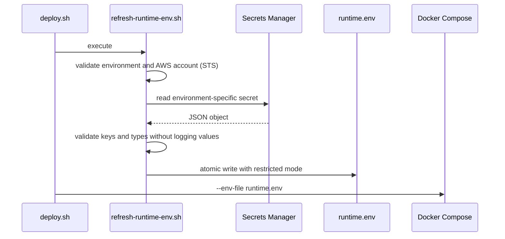
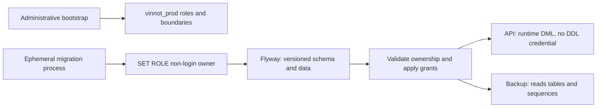

# Environments, configuration and secrets

## Configuration separation

The repository stores examples and variable names, never real values. Four
moments differ:

1. **backend build:** code/image without runtime secrets;
2. **web/mobile build:** public values embedded into artifacts;
3. **backend runtime:** host obtains secrets through `refresh-runtime-env.sh`;
4. **operations:** non-secret resource IDs and IAM policies.

## Classification

| Class | Examples | Location |
|---|---|---|
| public client | API URL, OAuth client ID, feature flag | GitHub vars/EAS env |
| backend secret | DB password, JWT, OpenAI, mail credentials | Secrets Manager; GitHub secrets for workflow credentials |
| infrastructure identifier | region, bucket, distribution, instance ID | workflow/config |
| local data | `.env.local`, generated runtime env | Git-ignored |

OAuth client IDs identify applications and may be public; client secrets, tokens
and private keys may not. `VITE_` and `EXPO_PUBLIC_` variables are public.

## Runtime flow

This automatic flow belongs to development `deploy.sh`. Production
`deploy-production.sh` does not refresh secrets: the operator materializes
`runtime.env` with `refresh-runtime-env.sh prod`, reconciles its hash/journal and
publishes a compatible candidate through the [deployment procedure](../guides/deployment.md).
Rotating a secret in AWS alone does not update the active production container.

[View the full “Runtime flow” diagram](https://images.vinnot.com/docs/diagrams/v1/en/infra-architecture-environments-and-secrets-9a759d30561a.svg)

The file is rewritten before pull/up to support rotation without image rebuild.
`refresh-runtime-env.sh` accepts `dev` or `prod`; no argument retains `dev` for
compatibility. Unknown selectors and AWS accounts other than the configured
account are rejected before credentials are retrieved.

| Selector | Secret | Destination |
|---|---|---|
| `dev` | `vinnot/dev/backend` | `/opt/vinnot/runtime.env` |
| `prod` | `vinnot/prod/backend` | `/opt/vinnot-prod/runtime.env` |

The directory must already be provisioned. The selector does not create AWS
resources or provision an environment. Credentials required by the environment's
validator must be non-empty, with examples in `runtime.env.example`; Facebook is
not required in production. Additional entries require valid variable names and scalar
values. Serialization preserves dollar signs, quotes and multiline keys for
Compose. This is a Compose dotenv file, not a script to execute with `source`.

Writing uses a mode-0600 temporary file in the same directory and an atomic
rename. Retrieval/validation failure preserves the previous configuration and
removes the temporary file; values never appear in diagnostics. The development
workflow synchronizes the script with a checksum before deployment, alongside
Compose and the deployment executor.

## Production database roles

The administrative scripts in `infra/postgres/` target only `vinnot_prod`;
they reject another database before changing roles or permissions. They are not
Flyway migrations and are not automatically executed by the development deploy.

| Role | Responsibility | Boundaries |
|---|---|---|
| `vinnot_prod_owner` | owns schema/objects | no login |
| `vinnot_prod_migrator` | runs Flyway with `SET ROLE vinnot_prod_owner` | no superuser, database creation or role administration |
| `vinnot_prod_runtime` | application DML, sequences and functions | no DDL, TRUNCATE or Flyway history access; legal documents read-only |
| `vinnot_prod_backup` | reads tables/sequences for dumps | no writes or escalation to owner |

`production-roles.sql` prepares roles and restricts public privileges; it does not
install passwords or take ownership of existing tables. Assign credentials over
a protected administrative channel, not in Git or command-line arguments. Flyway
runs the versioned migrations as owner. Then run `production-runtime-grants.sql`
with administrative privileges: it validates ownership, reconciles grants and
enables new tables. Repeat this step after each migration before enabling runtime.
The application process uses only its runtime credential with
`SPRING_FLYWAY_ENABLED=false`; it must not receive migrator or bootstrap credentials.
Do not apply this configuration to an existing development database without an
explicit transition.

[View the full “Production database roles” diagram](https://images.vinnot.com/docs/diagrams/v1/en/infra-architecture-environments-and-secrets-12d3ed3c1cac.svg)

Effective privileges are additive, including memberships and PUBLIC privileges.
The bootstrap therefore rejects elevated roles or unexpected memberships.
Reference: [PostgreSQL privileges and memberships](https://www.postgresql.org/docs/18/sql-grant.html).

## Visual PostgreSQL access (TablePlus)

Remote databases run inside Docker without publishing `5432` on EC2. TablePlus
connects to `127.0.0.1` through an AWS Session Manager tunnel to the selected
environment's container, rather than the API domain or a historical RDS instance.
This requires AWS CLI, Session Manager Plugin and a principal authorized for
`ssm:StartSession` on that instance and the remote port-forwarding document.
The release OIDC role and host role are not personal TablePlus credentials.

| Field | Development | Production |
|---|---|---|
| Local host | `127.0.0.1` | `127.0.0.1` |
| Suggested local port | `15432` | `25432` |
| Database | `vinnot` | `vinnot_prod` |
| Remote container | `vinnot-dev-postgres-local` | `vinnot-prod-postgres-local` |
| Existing runtime user | `vinnot_admin` | `vinnot_prod_runtime` |

Obtain the container's current internal IP through an authorized operator session
(`docker inspect`); it may change when recreated. Start a tunnel using
`AWS-StartPortForwardingSessionToRemoteHost`, `host=<internal IP>`, `portNumber=5432`
and `localPortNumber=<selected port>`, keeping the session open while using TablePlus.
Select PostgreSQL, the local fields and the environment password obtained through
the authorized private channel. The tunnel protects transport without changing SQL
privileges. Never store real passwords in documentation, Git or commands.

The production runtime role can write; it is not a read-only audit account.
These scripts do not provision a desktop password for the backup role; do not
invent or reuse bootstrap/migrator credentials. For inspection, use `BEGIN READ ONLY`
transactions and check `current_database()` and `current_user` before querying.
A permanent read-only account requires explicit provisioning and permissions;
this guide does not claim that it exists. Close the tunnel when done. Development's
daily pause interrupts its connection.

Reference: [Session Manager remote port forwarding](https://docs.aws.amazon.com/systems-manager/latest/userguide/session-manager-working-with-sessions-start.html#sessions-remote-port-forwarding).

## Local

Development uses `.env.local`/shell variables and docs enumerate names. Copying
production secrets to laptops is not preferred; use bounded development
credentials. Examples contain placeholders and safe defaults.

## Facebook availability by environment

Facebook is disabled in production: the production overlay sets `FACEBOOK_APP_ID`
and `FACEBOOK_APP_SECRET` to empty values, even when the runtime file contains
inherited credentials. The identity verifier rejects that provider without
credentials. `refresh-runtime-env.sh prod` does not require the Facebook secret;
all other mandatory credentials remain required. Development keeps its independent
configuration and validation.

Web uses `VITE_APP_ENV=production`; mobile uses `EXPO_ENV=production`. Both hide
Facebook and reject gateway calls before initializing its SDK. Production native
builds also omit the Facebook plugin. `VITE_FEATURE_FACEBOOK_LOGIN=false` and
`EXPO_PUBLIC_FACEBOOK_LOGIN_ENABLED=false` additionally disable it in non-production
environments. Enabling a flag does not enable production Facebook: adding it
requires a reviewed policy change and approved provider configuration.

## Google Maps: credentials and usage

Sharing a Google Cloud project does not require sharing a key between clients
and server. `GOOGLE_MAPS_API_KEY` is the backend credential, restricted to
Directions API and the environment's fixed public IP. It is not included in
web or mobile builds. The web receives a different key through
`VITE_GOOGLE_MAPS_API_KEY`, limited to the application's HTTPS domain and Maps
JavaScript, Geocoding and Embed. The operational `GOOGLE_MAPS_WEB_API_KEY` field
stores that value separately; it does not make it secret once the web is built.

Application restrictions must match the consumer: domain for web, IP for server,
and application/signature for native SDKs. Before connecting a native key to a
REST service, verify both permitted access and rejection of an incorrect app
identity. A server-IP-restricted key must not be used from a phone.

Quotas are shared per project and billing aggregates usage per billing account.
Free allowances depend on the SKU; an alert budget does not stop requests.
Daily limits must account for both environments, days in the month and other
projects on the account. Exhausting a quota can temporarily interrupt the
corresponding maps feature; do not resolve this by removing restrictions or
switching to another environment's key.

References: [Google Maps security](https://developers.google.com/maps/api-security-best-practices)
and [pricing and free allowances by SKU](https://developers.google.com/maps/billing-and-pricing/pricing).

## Apple private email relay

Sign in with Apple and delivery to hidden-email addresses are separate
configurations. Register the backend's exact `EMAIL_FROM` address in Apple
Developer's email sources when only that sender is needed; do not enable every
address in the domain unnecessarily. The relay requires SPF and/or DKIM
authentication, as well as a registered source. With SES's default envelope
sender, use the verified domain's DKIM signature aligned with the visible From
address. An SPF warning in the registration interface does not by itself test
that DKIM path. Verify delivery to an authorized real relay address separately
from ordinary mailbox delivery; keep relay failure notifications enabled.

Reference: [Apple private email relay configuration and authentication](https://developer.apple.com/help/account/capabilities/configure-private-email-relay-service/).

## OpenAI: service identity and permissions

Each environment uses its own project and backend service account. The current
adapters need Request permission for `/v1/chat/completions` (text and label vision)
and `/v1/moderations` only, plus `/v1/images/edits` in the environment that enables
`AI_IMAGES_ENABLED` (social illustrations). They do not require file management,
fine-tuning, project administration or API-key administration. A custom
project role should replace a broader member role, not supplement it: inherited
roles can otherwise retain the broader access. Keep the account's key in the
environment's backend secret, never in a frontend bundle.

Permissions and spending controls are independent. Restricting endpoints does
not impose a per-user request count or reduce the quality of generated content.
`AI_MONTHLY_LIMIT_USD` governs Vinnot's configured application budget; calls made
outside its spending ledger still consume provider credit. Acceptance probes
must therefore have a separately authorized call count and record usage without
persisting their synthetic output in the catalogue.

After changing a role, verify one permitted request and one unrelated denied
operation without logging the key or private response data. A new provider
capability requires reviewing its adapter and adding only its necessary scope.
See [OpenAI service accounts and least-privilege roles](https://developers.openai.com/api/docs/guides/terraform/service-accounts).

## Social media agent

Social publishing (#510) is configured with backend variables only. Secrets go in the
`vinnot/<environment>/backend` Secrets Manager secret and reach the container through
`runtime.env`; never Git, `VITE_*` or `EXPO_PUBLIC_*`. Every variable has a default, so an
environment without them starts with everything off and the panel shows every network as not
configured. Step by step per network: [Social networks setup](../guides/social-networks-setup.md).

| Variable | Default | Secret | Purpose |
|---|---|---|---|
| `MARKETING_ACCOUNTS_ENCRYPTION_KEY` | empty | Yes | AES-256-GCM key of the Threads and TikTok tokens: base64 of 32 random bytes; one per environment, never shared |
| `MARKETING_META_ACCESS_TOKEN` | empty | Yes | Meta system-user token (Instagram and Facebook Page), non-expiring |
| `MARKETING_META_PAGE_ACCESS_TOKEN` | empty | Yes | Optional: the Page token; empty reads it from the Graph API with the token above |
| `MARKETING_META_INSTAGRAM_USER_ID` | empty | No | Id of the Instagram professional account |
| `MARKETING_META_PAGE_ID` | empty | No | Id of the Facebook Page |
| `MARKETING_THREADS_CLIENT_ID` | empty | No | Threads app id |
| `MARKETING_THREADS_CLIENT_SECRET` | empty | Yes | Threads app secret |
| `MARKETING_THREADS_REDIRECT_URI` | empty | No | `https://<API host>/api/public/social-accounts/threads/callback` |
| `MARKETING_TIKTOK_CLIENT_KEY` | empty | No | TikTok app client key |
| `MARKETING_TIKTOK_CLIENT_SECRET` | empty | Yes | TikTok app secret |
| `MARKETING_TIKTOK_REDIRECT_URI` | empty | No | `https://<API host>/api/public/social-accounts/tiktok/callback` |
| `MARKETING_THREADS_AUTHORIZE_URL`, `MARKETING_THREADS_API_BASE_URL` | `https://threads.com/oauth/authorize`, `https://graph.threads.com` | No | Threads OAuth |
| `MARKETING_TIKTOK_AUTHORIZE_URL`, `MARKETING_TIKTOK_API_BASE_URL` | `https://www.tiktok.com/v2/auth/authorize/`, `https://open.tiktokapis.com` | No | TikTok OAuth |
| `MARKETING_ACCOUNTS_CONNECT_TIMEOUT`, `MARKETING_ACCOUNTS_READ_TIMEOUT` | `5s`, `15s` | No | OAuth and Page token timeouts |
| `MARKETING_ACCOUNTS_REFRESH_INITIAL_DELAY_MS`, `MARKETING_ACCOUNTS_REFRESH_DELAY_MS` | `120000`, `3600000` | No | Token refresh cadence |
| `MARKETING_PUBLISHING_ENABLED` | `false` | No | Turns publishing on |
| `MARKETING_PUBLISHING_INSTAGRAM_ENABLED`, `MARKETING_PUBLISHING_FACEBOOK_ENABLED`, `MARKETING_PUBLISHING_THREADS_ENABLED`, `MARKETING_PUBLISHING_TIKTOK_ENABLED` | `false` | No | Turns each network on |
| `MARKETING_PUBLISHING_TIKTOK_MODE` | `MEDIA_UPLOAD` | No | `MEDIA_UPLOAD` (draft) or `DIRECT_POST` (after TikTok's audit) |
| `MARKETING_PUBLISHING_INITIAL_DELAY_MS`, `MARKETING_PUBLISHING_DELAY_MS` | `60000`, `300000` | No | Sweep cadence |
| `MARKETING_PUBLISHING_DRAFT_SYNC_INITIAL_DELAY_MS`, `MARKETING_PUBLISHING_DRAFT_SYNC_DELAY_MS` | `120000`, `900000` | No | Cadence of the sweep that marks TikTok drafts the creator posted as `PUBLISHED` (#516) |
| `MARKETING_PUBLISHING_DRAFT_SYNC_WINDOW_DAYS`, `MARKETING_PUBLISHING_DRAFT_SYNC_MAX_PER_SWEEP` | `14`, `20` | No | Days a draft is still checked, and drafts checked per run (TikTok allows 30 status checks per minute) |
| `MARKETING_PUBLISHING_MEDIA_GRACE` | `PT6H` | No | Wait for the slides; the publishing window is twice that |
| `MARKETING_METRICS_ENABLED` | `false` | No | Turns the daily metrics reading on |
| `MARKETING_METRICS_CRON`, `MARKETING_METRICS_WINDOW_DAYS` | `0 0 6 * * *`, `30` | No | Time (planner zone) and days measured |
| `MARKETING_WEIGHTING_WINDOW_DAYS` | `90` | No | Days of metrics the planner weighs |
| `MARKETING_AUTO_APPROVE_ENABLED` | `false` | No | Turns auto-approval on |
| `MARKETING_AUTO_APPROVE_LEAD`, `MARKETING_AUTO_APPROVE_DELAY_MS` | `24h`, `900000` | No | Lead and cadence |
| `MARKETING_NETWORKS_CONNECT_TIMEOUT`, `MARKETING_NETWORKS_REQUEST_TIMEOUT` | `10s`, `30s` | No | Adapter timeouts |
| `MARKETING_NETWORKS_POLL_INTERVAL`, `MARKETING_NETWORKS_POLL_TIMEOUT` | `15s`, `5m` | No | Wait for image processing |
| `MARKETING_META_BASE_URL`, `MARKETING_META_GRAPH_VERSION` | `https://graph.facebook.com`, `v27.0` | No | Meta Graph API |
| `MARKETING_THREADS_BASE_URL`, `MARKETING_THREADS_VERSION` | `https://graph.threads.com`, `v1.0` | No | Threads API |
| `MARKETING_TIKTOK_BASE_URL` | `https://open.tiktokapis.com` | No | TikTok API |
| `MARKETING_INSTAGRAM_METRICS` | `views,reach,likes,comments,saved,shares` | No | Metrics asked from Instagram |
| `MARKETING_INSTAGRAM_ALT_TEXT` | `true` | No | Sends the alt text on every Instagram image |

Rotating `MARKETING_ACCOUNTS_ENCRYPTION_KEY` makes the stored tokens unreadable: the refresh marks
Threads and TikTok `REFRESH_FAILED` with `TOKEN_UNREADABLE`, notifies the administrators and they
must be connected again. A malformed key stops startup. Threads and TikTok tokens are not copied
between environments. The OAuth `state` lives in the backend's memory: it works with a single
instance.

## Rotation

Rotation updates the source, redeploys/restarts consumers, verifies health and
revokes the old value. JWT/refresh may require compatibility windows; DB changes
coordinate server and client password. Track owner/date outside the secret.

## Controls

- secret scanning and diff review;
- IAM by path/resource rather than global wildcard;
- no secrets in visible arguments or URLs;
- no env files, dumps or runtime files in images/artifacts;
- invalidate exposed credentials rather than only deleting from Git;
- isolate development and production.

## R2 image credentials

`APP_STORAGE_R2_ACCESS_KEY_ID` and `APP_STORAGE_R2_SECRET_ACCESS_KEY` reach only
the backend through the environment runtime secret. Each credential limits object
access to its dev/prod bucket; catalogue migrations use separate access. Account
ID, bucket and public domain identify resources. Never include private keys in
`VITE_*`, `EXPO_PUBLIC_*`, Wrangler, scripts or execution manifests. The Worker
reads through R2 bindings without embedding these backend keys.
[Variables, rotation and limits](../operations/user-images-r2.md).

## Event payment and webhook preparation

The `vinnot/dev/backend` and `vinnot/prod/backend` secrets hold their respective backend configuration. The webhook signing secret is shared only because both destinations belong to the same Mercado Pago application. Credential encryption keys and organizer tokens are not copied between environments.

| Destination | Development | Production |
|---|---|---|
| General webhook | `https://api-dev.vinnot.com/api/payments/mercadopago/webhooks` | `https://api.vinnot.com/api/payments/mercadopago/webhooks` |
| Public payment return | `https://dev.vinnot.com/payments/return` | `https://vinnot.com/payments/return` |
| Organizer OAuth callback | `https://dev.vinnot.com/partner/payments/callback` | `https://vinnot.com/partner/payments/callback` |

The `compose.production.yml` overlay pins all three production URLs so a development value in the runtime file cannot misroute users or notifications. Current state: production runs payments with `EVENT_PAYMENTS_ENVIRONMENT=LIVE`, set in its private configuration rather than in `compose.production.yml`; development keeps its own configuration.

Mercado Pago supports one general URL per application mode. When production is released, the live-mode general destination switches to the production API; each development checkout retains its higher-priority per-attempt `notification_url`. Do not use test mode to route a real-money pilot. Select only the `payment` event supported by the verification adapter; do not activate topics without a corresponding receiver.

Joint release sequence:

1. Integrate and validate the batch; publish versioned, scanned images through the existing release workflow. Apply migrations through the production process without bypassing revision checks.
2. Complete the environment OAuth credentials and independent encryption key through the authorized workflow. Register the exact production callback in Mercado Pago, preserving PKCE and the development callback. Storing a URL in AWS does not register it with the provider.
3. Materialize production `runtime.env` and reconcile its journal/fingerprint before deployment. Publish the frontend with `/payments/return` and `/my-tickets` as well.
4. Enable only the approved execution policy and operational components, check health and receiver signatures; then switch the general URL in Mercado Pago and simulate a notification. Verify valid/tampered signatures, durable reconciliation and absence of private data in the public return.
5. Record public and email acceptance evidence before considering the flow accepted. Keep reconciliation and retries for delayed notifications. Preparing secrets or deploying code does not enable sales.

The code supports `SANDBOX`, `LIVE_PILOT` and `LIVE`. `LIVE_PILOT` restricts the seller to one permitted account and the total to ARS 50. `LIVE` admits verified real organizers, distinct from the platform account, with positive ARS amounts. The policy is selected with `EVENT_PAYMENTS_ENVIRONMENT`; a code deployment does not change it. See [Event discovery and registration](../../modules/payments/architecture.md#backend).

### History: joint release preparation and pilot (2026-10-15)

Historical record, superseded by the current `LIVE` policy. Production
configuration was first prepared with all three flags `EVENT_PAYMENTS_ENABLED`,
`EVENT_PAYMENTS_CHECKOUT_ENABLED` and `EVENT_PAYMENTS_SETTLEMENT_ENABLED` set to `false`.
After publication authorization, both secrets contain platform OAuth, independent
encryption keys and all three payment flags enabled under `LIVE_PILOT`: only the
authorized seller and up to ARS 50. Materialization and public acceptance remain
part of deployment; saving a secret does not change the running container. Seller
tokens are not copied between environments. The production callback must also be
saved in Mercado Pago.

Web builds declare `VITE_EVENT_PAYMENTS_ENABLED=true`; this enables only the UI.
Authorization, recipient and amounts are always checked by the backend. The
legacy sandbox flag alone never enables the production UI.
