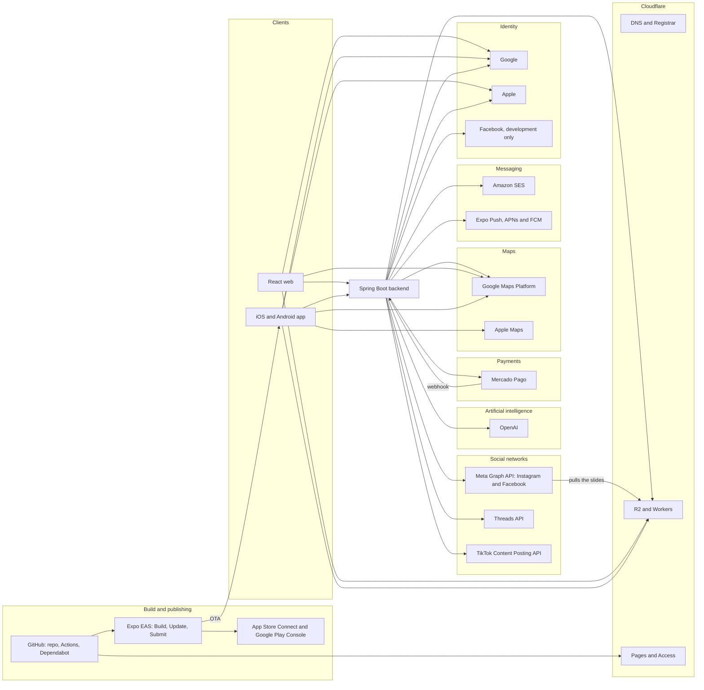

# External services

Every third-party service Vinnot depends on: what it is for, how it is integrated, which
configuration keys turn it on, what happens when it fails and which plan it is on. Only the
**key names** appear here; the values live in Secrets Manager, GitHub secrets or EAS, never
in the repository ([Environments and secrets](environments-and-secrets.md)). The amounts of
each plan are in [Costs](../../business/costs.md).

## Dependency map

[View the full “Dependency map” diagram](https://images.vinnot.com/docs/diagrams/v1/en/infra-architecture-external-services-de9a0863cbe9.svg)

## Summary

| Service | What for | Integration | Plan | When it fails |
|---|---|---|---|---|
| OpenAI | Wine profiles and comparisons, label reading, moderation | own HTTP calls, no SDK | paid API with a monthly project limit | 503 without budget headroom; the feature becomes unavailable |
| Mercado Pago | Ticket payments, organizer account, refunds | own HTTP calls, no SDK | no fixed cost; fee per sale | a missing notice is recovered by scheduled reconciliation |
| Google Maps Platform | Route distances and maps | HTTP on the backend; JavaScript API on the web; native SDK on Android | Google Cloud billing account | without a key, the route has no distance |
| Apple Maps | Maps on iOS | native SDK through `react-native-maps` | included in iOS | — |
| Amazon SES | Transactional and newsletter email | AWS SDK v2 | pay per use | sending goes through the outbox and is retried |
| Expo Push | Push notifications | HTTP to the Expo Push API | free | retries and outbox |
| Expo EAS | Builds, OTA and store submission | CLI and `expo-updates` | Free | — |
| App Store Connect | iOS distribution | console and EAS Submit | Apple Developer Program, individual | — |
| Google Play Console | Android distribution | console | one-time registration | — |
| Cloudflare | DNS, domain, API proxy and WAF, images, documentation | console, Wrangler and the R2 S3 API | Free; R2 pay as you go | — |
| GitHub | Repository, CI/CD and updates | Actions and Dependabot | Free, private repository | — |
| Meta Graph API | Publish and measure on Instagram and the Facebook Page | Own HTTP, no SDK | free | publishing is retried up to 5 attempts and then fails |
| Threads API | Publish and measure on Threads; account OAuth | Own HTTP, no SDK | free | same as Meta; the account is reconnected when the refresh fails |
| TikTok Content Posting API | Send the carousel as a draft or publish it; account OAuth | Own HTTP, no SDK | free; direct posting after TikTok's audit | same as Meta |
| Google, Apple and Facebook | Sign-in with external accounts | SDKs on web and app; token verification on the backend | free | sign-in with that account is unavailable; email and password remain |

## OpenAI

- **What for:** wine profiles and comparisons, label reading from an image and image
  moderation ([AI](../../modules/ai/README.md)); copy and illustrations of social posts
  ([Social media marketing](../../modules/marketing/README.md)).
- **Integration:** own HTTP calls to `/v1/chat/completions` and `/v1/moderations`, with no
  SDK ([`OpenAiClient.java`](../../../../backend/src/main/java/com/vinnot/shared/infrastructure/ai/OpenAiClient.java)).
- **Models:** `gpt-6-luna` for text, `gpt-4o-mini` for vision and `omni-moderation-latest`
  for moderation, on the `priority` service tier ([`application.yml`](../../../../backend/src/main/resources/application.yml)).
- **Keys:** `OPENAI_API_KEY`, `OPENAI_MODEL`, `OPENAI_VISION_MODEL`, `OPENAI_VISION_REASONING_EFFORT`, `OPENAI_MODERATION_MODEL`,
  `OPENAI_SERVICE_TIER`, `OPENAI_INPUT_PER_MILLION_USD`, `OPENAI_OUTPUT_PER_MILLION_USD`,
  `AI_PROVIDER`, `AI_ENABLED`, `AI_MONTHLY_LIMIT_USD`, `AI_DAILY_LIMIT_USD`,
  `AI_MAXIMUM_CONCURRENT_REQUESTS`, `AI_INTERACTIVE_WAIT`, `AI_PROFILE_REFRESH_ENABLED`, `AI_PROFILE_REFRESH_INTERVAL`,
  `AI_PROFILE_REFRESH_PROFILES_PER_RUN`, `AI_PROFILE_REFRESH_BUDGET_SHARE`.
- **Illustrations:** `/v1/images/edits` with `gpt-image-1`, off by default
  ([`OpenAiImageClient.java`](../../../../backend/src/main/java/com/vinnot/shared/infrastructure/ai/OpenAiImageClient.java)); keys `AI_IMAGES_ENABLED`, `AI_IMAGES_MODEL`,
  `AI_IMAGES_QUALITY`, `AI_IMAGES_SIZE`, `AI_IMAGES_MAX_COST_USD`, `AI_IMAGES_TIMEOUT`,
  `AI_IMAGES_MAX_ATTEMPTS`, `AI_IMAGES_INITIAL_BACKOFF_MS` and `OPENAI_IMAGES_URL`. Every image
  reserves a flat cost against the same monthly cap; without AI the pillar vignette is used.
- **Limits:** 3 concurrent calls (the last one kept for label scans, which wait up to 4 s for a
  slot) and a monthly USD cap reserved before each call; each person
  can generate 20 per hour.
- **When it fails:** 10 s connect timeout, 30 s read timeout and up to 2 attempts. Without
  capacity or budget headroom, the API answers 503. With another provider configured, label
  reading and moderation use "unavailable" adapters
  ([`UnavailableWineLabelRecognitionAdapter.java`](../../../../backend/src/main/java/com/vinnot/wine/infrastructure/ai/UnavailableWineLabelRecognitionAdapter.java)).
  The app reads the label text on the device with ML Kit, without calling OpenAI
  ([`wineLabelTextRecognizer.ts`](../../../../frontend-mobile/src/infrastructure/device/camera/wineLabelTextRecognizer.ts)).
- **More:** service identity and permissions in
  [Environments and secrets](environments-and-secrets.md#openai-service-identity-and-permissions).

## Mercado Pago

- **What for:** charging event tickets, linking the organizer's account and refunding
  payments ([Payments](../../modules/payments/README.md)).
- **Integration:** own HTTP calls to `api.mercadopago.com`, with no SDK: checkout, payment
  lookup and search, and refunds
  ([`MercadoPagoPaymentAdapter.java`](../../../../backend/src/main/java/com/vinnot/payment/infrastructure/gateway/MercadoPagoPaymentAdapter.java)).
- **Keys:** `EVENT_PAYMENTS_ENABLED`, `EVENT_PAYMENTS_CHECKOUT_ENABLED`,
  `EVENT_PAYMENTS_ENVIRONMENT`, `EVENT_PAYMENTS_CLIENT_ID`, `EVENT_PAYMENTS_CLIENT_SECRET`,
  `EVENT_PAYMENTS_WEBHOOK_SECRET`, `EVENT_PAYMENTS_ENCRYPTION_KEY`,
  `EVENT_PAYMENTS_NOTIFICATION_URI`, `EVENT_PAYMENTS_REDIRECT_URI`, and their
  `EVENT_PAYMENTS_SANDBOX_*` pairs. In the app, `EXPO_PUBLIC_EVENT_PAYMENTS_ENABLED`.
- **Webhook:** the backend checks the HMAC-SHA256 signature and answers 401 on a mismatch. It
  does not trust the notice body: it looks the payment up by the checkout reference
  ([`PaymentWebhookController.java`](../../../../backend/src/main/java/com/vinnot/payment/infrastructure/web/PaymentWebhookController.java)).
- **When it fails:** if a notice never arrives, scheduled reconciliation recovers the payment.
- **Plan:** no fixed cost. Mercado Pago deducts its fee from the seller and Vinnot keeps the current policy's commission, 3% today,
  per sale ([`TicketPaymentQuote.java`](../../../../backend/src/main/java/com/vinnot/payment/domain/valueobject/TicketPaymentQuote.java)).
- **More:** [Event payment and webhook preparation](environments-and-secrets.md#event-payment-and-webhook-preparation).

## Maps: Google Maps and Apple Maps

- **Backend:** the Directions API over HTTP for the total distance of a wine route. Key
  `GOOGLE_MAPS_API_KEY`, 3 s connect and 5 s read timeouts. Without a key, it logs a warning
  and the route has no distance
  ([`GoogleMapsDistanceService.java`](../../../../backend/src/main/java/com/vinnot/shared/infrastructure/maps/GoogleMapsDistanceService.java)).
- **Web:** the Maps JavaScript API with `VITE_GOOGLE_MAPS_API_KEY`
  ([`MapView.tsx`](../../../../frontend-react/src/presentation/components/ui/MapView.tsx)).
- **App:** `react-native-maps` with no fixed provider, so it uses Apple Maps on iOS and Google
  Maps on Android ([`RouteMap.tsx`](../../../../frontend-mobile/src/presentation/features/wineRoute/RouteMap.tsx)).
  Keys `EXPO_PUBLIC_GOOGLE_MAPS_API_KEY`, `EXPO_PUBLIC_GOOGLE_MAPS_ANDROID_API_KEY` and
  `EXPO_PUBLIC_GOOGLE_MAPS_IOS_API_KEY`; in production the iOS key is empty
  ([`app.config.ts`](../../../../frontend-mobile/app.config.ts)).
- **More:** [Google Maps: credentials and usage](environments-and-secrets.md#google-maps-credentials-and-usage).

## Google Gemini

- **What for:** image embeddings for visual label search: the backend compares a scanned photo
  with the catalog label images Vinnot hosts ([Wines](../../modules/wines/architecture.md#label-scan-accuracy)).
- **Integration:** own HTTP calls to the Gemini API (`generativelanguage.googleapis.com/v1beta`),
  with no SDK and the `x-goog-api-key` header
  ([`GeminiImageEmbeddingAdapter.java`](../../../../backend/src/main/java/com/vinnot/wine/infrastructure/visual/GeminiImageEmbeddingAdapter.java)).
- **Model:** `gemini-embedding-2` at 768 dimensions; vectors are stored as int8 in
  `wine_image_embeddings` and kept in memory.
- **Keys:** `GEMINI_API_KEY` (optional), `GEMINI_BASE_URL`, `GEMINI_EMBEDDING_MODEL`,
  `GEMINI_EMBEDDING_DIMENSIONS`, `GEMINI_CONNECT_TIMEOUT`, `GEMINI_TIMEOUT`, and the
  `WINE_LABEL_VISUAL_INDEX_*` settings.
- **When it fails:** 3 s connect and 8 s request timeouts. Without a key, or when a call fails,
  scans use text retrieval only and never report an error for it.

## Amazon SES

- **What for:** email verification, password recovery, account notices, events, payments and
  newsletters.
- **Integration:** AWS SDK v2 (SES v2), through the host role; no access keys
  ([`SesNotificationDeliveryAdapter.java`](../../../../backend/src/main/java/com/vinnot/notification/infrastructure/delivery/SesNotificationDeliveryAdapter.java)).
- **Keys:** `EMAIL_PROVIDER` (`ses` on the hosts; the `log` default only logs), `EMAIL_FROM`,
  `EMAIL_SES_REGION`, `EMAIL_SES_CONFIGURATION_SET`, `EMAIL_FEEDBACK_QUEUE_URL`.
- **When it fails:** sending goes through the outbox and is retried. Bounces and complaints
  arrive through SNS and SQS ([Email bounces and complaints](../operations/observability-and-incidents.md#email-bounces-and-complaints)).

## Expo

- **Push:** HTTP to the Expo Push API, which relays to APNs and FCM
  ([`ExpoPushSenderAdapter.java`](../../../../backend/src/main/java/com/vinnot/notification/infrastructure/push/ExpoPushSenderAdapter.java)).
  Keys `PUSH_PROVIDER` (`expo` on the hosts; `log` by default), `EXPO_ACCESS_TOKEN`,
  `PUSH_DAILY_CAP` and `PUSH_RATE_PER_SECOND`. It sends at most 500 messages per second and 3
  non-transactional notifications per person per day. On a 429 or 5xx it retries 3 times,
  honouring `Retry-After`; after that, the outbox retries the job.
- **EAS Build:** profiles `development`, `preview` and `production`; the build number lives in
  EAS and increments automatically in production ([`eas.json`](../../../../frontend-mobile/eas.json)).
  Free plan; Android builds run locally.
- **EAS Update:** OTA updates per channel, with the runtime version equal to the app version
  ([`app.config.ts`](../../../../frontend-mobile/app.config.ts)). A native change needs a new
  build.
- **EAS Submit:** sends the binaries to the stores
  ([Distribution](../../frontend-mobile/guides/distribution.md)).

## Stores: App Store Connect and Google Play Console

- **App Store Connect:** iOS distribution and TestFlight, with an individual Apple Developer
  Program account. In-app subscriptions also require the Paid Applications Agreement
  (verified in the Apple console on 2026-10-29).
- **Google Play Console:** Android distribution, with closed testing.
- **More:** [Distribution](../../frontend-mobile/guides/distribution.md).

## Cloudflare

| Product | What for | Plan | Source |
|---|---|---|---|
| DNS | Zone `vinnot.com`; the apex points to CloudFront | Free | [AWS deployment architecture](aws-deployment.md#production-dns-and-edge) |
| Proxy and WAF | `api.vinnot.com` and `api-dev.vinnot.com` go through the proxy: Free managed WAF and one rate limiting rule on `/api/auth/`; the origin accepts only Cloudflare ranges. Until it is applied, the records stay DNS only | Free | [Put Cloudflare in front of the API](aws-deployment.md#put-cloudflare-in-front-of-the-api) |
| Registrar | Registration and renewal of `vinnot.com` | automatic yearly renewal | verified in the Cloudflare console on 2026-10-29 |
| R2 | Private catalogue images and user uploads | pay as you go, currently within the free tier | [Catalogue images in R2](../operations/catalog-images-r2.md) |
| Workers | `vinnot-catalog-images` at `images.vinnot.com` | Free | [`worker.mjs`](../../../../infra/cloudflare/catalog-images/worker.mjs) |
| Pages | The `vinnot-docs` documentation site | Free | [Documentation site](../../governance/documentation-site.md) |
| Access | Private access to the documentation | Zero Trust Free | [Documentation site](../../governance/documentation-site.md) |

The backend writes to R2 through the S3-compatible API of the AWS SDK. Keys
`APP_STORAGE_PROVIDER` (`r2`, `s3` or `local`) and `APP_STORAGE_R2_*`, with monthly caps on
storage, writes and reads per environment ([`docker-compose.yml`](../../../../infra/aws-low-cost/docker-compose.yml)).

## GitHub

- **Repository:** private, Free plan.
- **Actions:** CI, development deploys, the production release and security scans, on
  `ubuntu-24.04` and `macos-26` runners. Every action is pinned by SHA
  ([`actions-policy.json`](../../../../infra/security/actions-policy.json), [CI/CD](../guides/ci-cd.md)).
- **Dependabot:** actions weekly; npm, Maven and Docker monthly, grouped by patch and minor
  ([`dependabot.yml`](../../../../.github/dependabot.yml),
  [Dependency updates](../guides/dependency-updates.md)).
- **When it fails:** without GitHub there is no CI or deploy; production keeps serving the
  last published version.

## Social networks: Meta, Threads and TikTok

- **What for:** the social media agent publishes approved posts and reads their metrics
  ([Social media marketing](../../modules/marketing/README.md)). Everything is off by default.
- **Integration:** own HTTP without SDK ([`infrastructure/social`](../../../../backend/src/main/java/com/vinnot/marketing/infrastructure/social/)
  and [`infrastructure/accounts`](../../../../backend/src/main/java/com/vinnot/marketing/infrastructure/accounts/)).
  The networks pull the slides from their public https R2 URLs (`images.vinnot.com`).
  - **Meta Graph API** (`graph.facebook.com`, `v27.0`): Instagram containers and `media_publish`,
    Facebook Page photos and post, `content_publishing_limit` and insights. Business portfolio
    system-user token, non-expiring.
  - **Threads API** (`graph.threads.com`, `v1.0`): containers, `threads_publish` and insights; OAuth at
    `threads.com/oauth/authorize` with `threads_basic`, `threads_content_publish` and
    `threads_manage_insights`; 60-day token refreshed automatically.
  - **TikTok Content Posting API** (`open.tiktokapis.com`): `creator_info`, `content/init` and
    `status/fetch` for photo posts; OAuth (Login Kit) at `www.tiktok.com/v2/auth/authorize/` with
    `user.info.basic`, `video.upload`, `video.publish` and `video.list`. Without TikTok's audit only
    inbox drafts are sent (`MEDIA_UPLOAD`); `status/fetch` is polled every 15 minutes, at most 20
    drafts per run (limit: 30 per minute), to mark the drafts the creator posted as published.
- **Keys:** `MARKETING_PUBLISHING_*`, `MARKETING_METRICS_*`, `MARKETING_AUTO_APPROVE_*`,
  `MARKETING_NETWORKS_*`, `MARKETING_META_*`, `MARKETING_THREADS_*`, `MARKETING_TIKTOK_*`,
  `MARKETING_INSTAGRAM_*` and `MARKETING_ACCOUNTS_*`
  ([Environments and secrets](environments-and-secrets.md#social-media-agent)).
- **Limits:** Instagram's daily publishing quota (checked before publishing); carousels of 2 to 20
  images on Instagram and Threads, up to 50 photos on Facebook and up to 35 on TikTok.
- **When it fails:** 10 s connect and 30 s request; the processing wait stops after 5 minutes.
  Limits, outages and delays are retried up to 5 attempts by the outbox; refusals and an invalid
  token leave the network failed, notify the administrators and are retried by hand from the panel.
- **More:** [Social networks setup](../guides/social-networks-setup.md).

## Identity: Google, Apple and Facebook

| Provider | Web | App | Backend | Production |
|---|---|---|---|---|
| Google | `@react-oauth/google`, `VITE_GOOGLE_OAUTH_CLIENT_ID` | Google Sign-In, `EXPO_PUBLIC_GOOGLE_*_CLIENT_ID` | checks the token against `GOOGLE_OAUTH_AUDIENCES` | on |
| Apple | `VITE_APPLE_CLIENT_ID`, `VITE_APPLE_REDIRECT_URI` | `expo-apple-authentication` | checks the token with `APPLE_OAUTH_AUDIENCES`, `APPLE_TEAM_ID`, `APPLE_KEY_ID`, `APPLE_PRIVATE_KEY` | on |
| Facebook | `VITE_FACEBOOK_APP_ID` | Facebook SDK, `EXPO_PUBLIC_FACEBOOK_LOGIN_ENABLED` | Graph API `v23.0` with `FACEBOOK_APP_ID` and `FACEBOOK_APP_SECRET` | off: empty credentials in the production overlay |

The backend checks the tokens in
[`SocialIdentityVerifierAdapter.java`](../../../../backend/src/main/java/com/vinnot/user/infrastructure/identity/SocialIdentityVerifierAdapter.java),
with 3 s connect and 5 s read timeouts. It then issues its own JWT with JJWT
([`JwtTokenService.java`](../../../../backend/src/main/java/com/vinnot/shared/infrastructure/security/JwtTokenService.java)).
More detail in [Users](../../modules/users/README.md) and
[Facebook availability by environment](environments-and-secrets.md#facebook-availability-by-environment).

## No external service

There is no error monitoring, APM, product analytics or external search service: metrics go
to CloudWatch, search uses PostgreSQL and the documentation uses local search
([Hosting and runtime](hosting-and-runtime.md#backups-monitoring-and-logs)).
