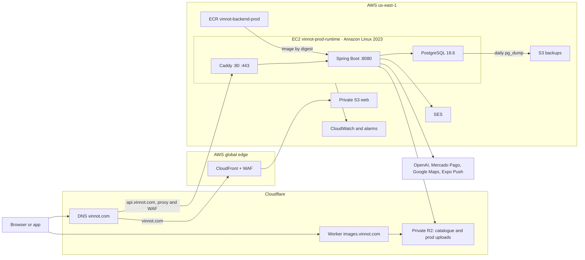
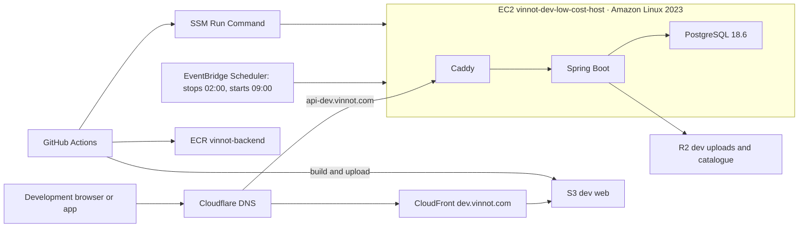

# Hosting and runtime

This page gathers the platform core: where each part runs, on which machines and operating
system, with which versions and limits, and which AWS, Cloudflare and Expo services take
part. Every row cites its source in the repository. Facts that exist only in a console are
marked **verified in the AWS console on 2026-10-29**; they are a snapshot of that day, not a
guarantee made by the code.

The operational detail of each topic stays on its own page: [AWS deployment architecture](aws-deployment.md),
[Environments and secrets](environments-and-secrets.md), [Low-cost operation](../operations/low-cost-dev.md)
and [Observability and incidents](../operations/observability-and-incidents.md). External
providers are in [External services](external-services.md), and the animated path of a
request is in [Request journey](../diagrams/request-journey.mdx).

## In short

- **API:** one EC2 `t3a.small` host per environment, running Amazon Linux 2023, with Caddy,
  Spring Boot and PostgreSQL in Docker Compose. There is no load balancer, NAT, RDS or Kubernetes.
  The Cloudflare proxy, with its WAF, sits in front of the API
  ([pending apply](aws-deployment.md#put-cloudflare-in-front-of-the-api)).
- **Web:** static files in a private S3 bucket, served by CloudFront; production adds AWS WAF.
- **Images:** a Cloudflare Worker serves them from private R2 buckets at `images.vinnot.com`.
- **Mobile app:** binaries in the App Store and Google Play; JavaScript changes ship through EAS Update.
- **Documentation:** Cloudflare Pages, private behind Cloudflare Access.
- **Region:** everything on AWS is in `us-east-1`.

## Hosting map

| Component | Where it runs | Provider and service | Region | Domain | Environment | Source |
|---|---|---|---|---|---|---|
| API | EC2 `vinnot-prod-runtime`: Caddy, Spring Boot and PostgreSQL in Docker Compose, behind the Cloudflare proxy | AWS EC2; Cloudflare proxy and WAF | us-east-1 | `api.vinnot.com` | production | [`production-stack.json`](../../../../infra/aws-low-cost/production-stack.json), [`compose.production.yml`](../../../../infra/aws-low-cost/compose.production.yml) |
| API | EC2 `vinnot-dev-low-cost-host`, with the same Compose, behind the Cloudflare proxy | AWS EC2; Cloudflare proxy and WAF | us-east-1 | `api-dev.vinnot.com` | development | [`docker-compose.yml`](../../../../infra/aws-low-cost/docker-compose.yml), [`Caddyfile`](../../../../infra/aws-low-cost/Caddyfile) |
| Web | Private S3 bucket behind CloudFront and AWS WAF | AWS S3, CloudFront, WAF | us-east-1 and global edge | `vinnot.com` | production | [`production-web-stack.json`](../../../../infra/aws-low-cost/production-web-stack.json) |
| Web | S3 bucket behind CloudFront | AWS S3, CloudFront | us-east-1 and global edge | `dev.vinnot.com` | development | [`deploy-frontend-dev.yml`](../../../../.github/workflows/deploy-frontend-dev.yml) |
| Documentation | `vinnot-docs` project, built by Cloudflare from Git, with Cloudflare Access | Cloudflare Pages, Zero Trust Free | global | `vinnot-docs.pages.dev` | shared | [Documentation site](../../governance/documentation-site.md) |
| Catalogue images | Worker `vinnot-catalog-images` and R2 bucket `vinnot-catalog-images` | Cloudflare Workers, R2 | global | `images.vinnot.com` | shared | [`wrangler.uploads.jsonc`](../../../../infra/cloudflare/catalog-images/wrangler.uploads.jsonc) |
| User uploads | R2 buckets `vinnot-user-uploads-dev` and `vinnot-user-uploads-prod`, served by the same Worker | Cloudflare R2 | global | `images.vinnot.com` | one per environment | [User images](../operations/user-images-r2.md) |
| Legacy media | Private S3 buckets, read and delete only | AWS S3 | us-east-1 | — | one per environment | [`production-stack.json`](../../../../infra/aws-low-cost/production-stack.json) |
| Database | PostgreSQL 18.6 container on its environment's EC2, with an EBS volume | AWS EC2 and EBS | us-east-1 | not publicly exposed | one per environment | [`compose.postgres.yml`](../../../../infra/aws-low-cost/compose.postgres.yml) |
| Database backups | S3 backup bucket | AWS S3 | us-east-1 | — | one per environment | [Backup and recovery](../operations/backup-and-disaster-recovery.md) |
| Container images | ECR `vinnot-backend-prod` and `vinnot-backend` | AWS ECR | us-east-1 | — | one per environment | [`production-stack.json`](../../../../infra/aws-low-cost/production-stack.json) |
| Mobile app | Binaries published in the stores, plus TestFlight and closed testing | App Store Connect, Google Play Console | global | — | production | [Distribution](../../frontend-mobile/guides/distribution.md) |
| OTA updates | Channels `development`, `preview` and `production` | Expo EAS Update | global | `u.expo.dev` | one per channel | [`eas.json`](../../../../frontend-mobile/eas.json), [`app.config.ts`](../../../../frontend-mobile/app.config.ts) |
| DNS | Zone `vinnot.com`, Free plan | Cloudflare DNS | global | `vinnot.com` | shared | [AWS deployment architecture](aws-deployment.md#production-dns-and-edge) |
| Domain registration | `vinnot.com`, auto-renews on 2027-04-23 | Cloudflare Registrar | — | `vinnot.com` | shared | verified in the Cloudflare console on 2026-10-29 |
| Email | Transactional and newsletter email | Amazon SES v2 | us-east-1 | the domain's `no-reply` sender | shared | [`application.yml`](../../../../backend/src/main/resources/application.yml) |
| Push notifications | Expo Push API, which relays to APNs and FCM | Expo | global | — | shared | [`PushConfiguration.java`](../../../../backend/src/main/java/com/vinnot/notification/infrastructure/push/PushConfiguration.java) |
| CI/CD | Workflows on GitHub-hosted runners | GitHub Actions | — | — | shared | [CI/CD](../guides/ci-cd.md) |

### Production end to end

[View the full “Production end to end” diagram](https://images.vinnot.com/docs/diagrams/v1/en/infra-architecture-hosting-and-runtime-1256f73c8bea.svg)

### Development end to end

[View the full “Development end to end” diagram](https://images.vinnot.com/docs/diagrams/v1/en/infra-architecture-hosting-and-runtime-981aa91b2951.svg)

## Host inventory

Both hosts share the instance type and operating system. The code sets the type and requires
an Amazon Linux 2023 x86_64 AMI; the exact AMI, kernel and launch date come from the console.

| Fact | Production `vinnot-prod-runtime` | Development `vinnot-dev-low-cost-host` | Source |
|---|---|---|---|
| Instance type | `t3a.small`: 2 vCPU AMD EPYC, 2 GiB RAM, burstable | same | [`production-stack.json`](../../../../infra/aws-low-cost/production-stack.json), [Low-cost operation](../operations/low-cost-dev.md) |
| CPU credits | `standard`: when credits run out it drops to baseline, with no extra charge | not set in the repository | [`production-stack.json`](../../../../infra/aws-low-cost/production-stack.json) |
| Operating system | Amazon Linux 2023 | Amazon Linux 2023 (`dnf`, user `ec2-user`) | [`provision-host.sh`](../../../../infra/aws-low-cost/provision-host.sh) |
| AMI | `al2023-ami-2023.12.20260928.0-kernel-6.18-x86_64` | — | verified in the AWS console on 2026-10-29 |
| Kernel | Linux 6.18 | — | verified in the AWS console on 2026-10-29 |
| Architecture | x86_64 (`linux/amd64`) | x86_64 | [`provision-host.sh`](../../../../infra/aws-low-cost/provision-host.sh), [`deploy-backend-dev.yml`](../../../../.github/workflows/deploy-backend-dev.yml) |
| Launched | 2026-09-29 | — | verified in the AWS console on 2026-10-29 |
| Disk | 32 GiB encrypted EBS gp3, kept when the instance terminates | 16 GiB EBS gp3 | [`production-stack.json`](../../../../infra/aws-low-cost/production-stack.json), [Low-cost operation](../operations/low-cost-dev.md) |
| Swap | 2 GiB swap file | 2 GiB swap file | [`provision-host.sh`](../../../../infra/aws-low-cost/provision-host.sh) |
| Metadata | IMDSv2 required, hop limit 2 | — | [`production-stack.json`](../../../../infra/aws-low-cost/production-stack.json) |
| Protection | termination protection on; the instance and IP are retained if the stack is deleted | — | [`production-stack.json`](../../../../infra/aws-low-cost/production-stack.json) |
| Public IP | Elastic IP | Elastic IP | [`production-stack.json`](../../../../infra/aws-low-cost/production-stack.json), [Low-cost operation](../operations/low-cost-dev.md) |
| Schedule | 24 × 7 | on from 09:00 to 02:00, Argentina time | [`ec2-start-schedule-target.json`](../../../../infra/aws-low-cost/ec2-start-schedule-target.json), [`ec2-stop-schedule-target.json`](../../../../infra/aws-low-cost/ec2-stop-schedule-target.json) |
| Working directory | `/opt/vinnot-prod`, owned by `root` | `/opt/vinnot`, owned by `ec2-user` | [`provision-host.sh`](../../../../infra/aws-low-cost/provision-host.sh) |
| Administration | SSM, no SSH | SSM, no SSH | [`production-stack.json`](../../../../infra/aws-low-cost/production-stack.json) |

### Production host IAM role

`vinnot-prod-low-cost-host-role` grants only what the runtime uses
([`production-stack.json`](../../../../infra/aws-low-cost/production-stack.json)):

- `AmazonSSMManagedInstanceCore`, to administer through SSM without SSH;
- image pulls from the production ECR repository only;
- read access to the `vinnot/prod/backend-*` secret only;
- read, write and delete in the production media bucket;
- write and read on `database-backups/` in the backup bucket, with no delete permission;
- `ses:SendEmail` for the `vinnot.com` identity only, and only from the `no-reply` address.

The email stack adds its own policy to read the bounce queue
([`email-feedback-stack.json`](../../../../infra/aws-low-cost/email-feedback-stack.json)).

## Containers

Production resolves `docker-compose.yml` plus `compose.production.yml`
([`deploy-production.sh`](../../../../infra/aws-low-cost/deploy-production.sh)), so it inherits
the limits, JVM options and connection pool of the base Compose file.

| Container | Image | Pinning | Memory | CPU | Ports | User | Source |
|---|---|---|---|---|---|---|---|
| `caddy` | `caddy:2.11.6-alpine` | exact version and digest | 96 MiB | 0.20 | 80 and 443 published | the image default | [`docker-compose.yml`](../../../../infra/aws-low-cost/docker-compose.yml) |
| `backend` | `eclipse-temurin:25-jre` (Ubuntu) with the Spring Boot JAR | ECR digest; the base image by digest | 768 MiB | 1.05 | 8080 on the Compose network only | `vinnot`, unprivileged | [`Dockerfile`](../../../../backend/Dockerfile), [`docker-compose.yml`](../../../../infra/aws-low-cost/docker-compose.yml) |
| `postgres` | `postgres:18.6-alpine` | exact version and digest | 384 MiB | 0.65 | not published | the image default | [`compose.postgres.yml`](../../../../infra/aws-low-cost/compose.postgres.yml) |
| `migrate` (ephemeral) | the same backend image | approved digest | 384 MiB | 0.65 | none | `vinnot` | [`compose.production.yml`](../../../../infra/aws-low-cost/compose.production.yml) |

The build image is `maven:3.9-eclipse-temurin-25`, also pinned by digest. Each container's
logs use the `local` driver with 3 files of 10 MB.

### JVM, Tomcat and connection pool

| Setting | Value | Why | Source |
|---|---|---|---|
| Heap | `-Xms128m -Xmx512m` | leaves headroom inside the 768 MiB container | [`docker-compose.yml`](../../../../infra/aws-low-cost/docker-compose.yml) |
| Collector | `-XX:+UseSerialGC` | the lightest collector for about one vCPU | [`docker-compose.yml`](../../../../infra/aws-low-cost/docker-compose.yml) |
| Metaspace | `-XX:MaxMetaspaceSize=192m` | bounds off-heap memory | [`docker-compose.yml`](../../../../infra/aws-low-cost/docker-compose.yml) |
| Out of memory | `-XX:+ExitOnOutOfMemoryError` | the container exits and Docker restarts it instead of running degraded | [`docker-compose.yml`](../../../../infra/aws-low-cost/docker-compose.yml) |
| Container | `-XX:+UseContainerSupport` | the JVM reads the container limits | [`docker-compose.yml`](../../../../infra/aws-low-cost/docker-compose.yml) |
| Migrator | `-Xmx256m` | Flyway runs separately with less memory | [`compose.production.yml`](../../../../infra/aws-low-cost/compose.production.yml) |
| Hikari | minimum 1, maximum 6 connections (the application default is 5 and 20) | stays under PostgreSQL's 20 connections | [`docker-compose.yml`](../../../../infra/aws-low-cost/docker-compose.yml), [`application.yml`](../../../../backend/src/main/resources/application.yml) |
| Tomcat | 2 spare threads, 30 at most | bounds HTTP concurrency to the available memory | [`docker-compose.yml`](../../../../infra/aws-low-cost/docker-compose.yml) |

### PostgreSQL

| Setting | Value | Source |
|---|---|---|
| Version | 18.6 (Alpine) | [`compose.postgres.yml`](../../../../infra/aws-low-cost/compose.postgres.yml) |
| `shared_buffers` | 96MB | [`compose.postgres.yml`](../../../../infra/aws-low-cost/compose.postgres.yml) |
| `effective_cache_size` | 768MB | [`compose.postgres.yml`](../../../../infra/aws-low-cost/compose.postgres.yml) |
| `maintenance_work_mem` | 64MB | [`compose.postgres.yml`](../../../../infra/aws-low-cost/compose.postgres.yml) |
| `work_mem` | 2MB | [`compose.postgres.yml`](../../../../infra/aws-low-cost/compose.postgres.yml) |
| `max_connections` | 20 | [`compose.postgres.yml`](../../../../infra/aws-low-cost/compose.postgres.yml) |
| Extensions | `unaccent` and `pg_trgm` for search; no PostGIS | [`db/migration`](../../../../backend/src/main/resources/db/migration/) |

The separate owner, migrator and runtime roles are in
[Environments and secrets](environments-and-secrets.md#production-database-roles).

### Caddy

Caddy terminates TLS with automatic ACME certificates, redirects HTTP to HTTPS, compresses
with zstd and gzip, adds one-year HSTS with subdomains, `nosniff` and `Referrer-Policy`,
removes the `Server` header, drops the client's `Forwarded` header, checks
`/api/actuator/health` every 30 seconds and writes the access log as JSON
([`Caddyfile`](../../../../infra/aws-low-cost/Caddyfile)). Caddy's admin API is off.

Caddy trusts only the published Cloudflare ranges (`trusted_proxies`) and takes the client IP
from `CF-Connecting-IP`; from any other peer it uses the connection's IP. It sends the backend
an `X-Forwarded-For` with that single IP and sets `X-Forwarded-Host` and `X-Forwarded-Proto`
from the request itself. This way the backend's request limit counts per real client and
nobody can spoof their IP by connecting directly.

## Network and public access

- **VPC:** a dedicated production VPC with a single public subnet and a route to the
  Internet. There is no NAT Gateway or load balancer
  ([`production-stack.json`](../../../../infra/aws-low-cost/production-stack.json)).
- **Ports:** only Caddy publishes 80 and 443. PostgreSQL and the backend listen inside the
  Compose network. The template opens 80 and 443 only to the 15 Cloudflare IPv4 ranges
  (30 rules out of the 60 a security group allows).
- **Administration:** SSM Run Command. The security group does not open port 22.
- **Live security group:** verified in the AWS console on 2026-10-29, production accepts
  80/tcp and 443/tcp from anywhere. A leftover 443 rule for an operator IP also remains.
  Both go away when the stack is applied, after the Cloudflare proxy is on. The development
  security group is in no template and is changed by hand
  ([steps](aws-deployment.md#3-restrict-the-origin-to-cloudflare)).

### Alignment with the public launch

The code already describes the launched state:

- [`production-stack.json`](../../../../infra/aws-low-cost/production-stack.json) opens 80 and
  443 only to the Cloudflare IPv4 ranges, with no operator parameter and no port 22 or 5432.
  There are no IPv6 rules because the VPC has no IPv6. It is applied after the proxy is on
  ([Put Cloudflare in front of the API](aws-deployment.md#put-cloudflare-in-front-of-the-api)).
- [`production-web-stack.json`](../../../../infra/aws-low-cost/production-web-stack.json) keeps
  only the three managed WAF groups, without the pre-launch rule or its IP set.
- The external probe defaults to `AcceptanceMode=public`
  ([`build-monitoring-stack.mjs`](../../../../scripts/build-monitoring-stack.mjs)).
- Development CORS no longer accepts `vinnot-dev-web.pages.dev`
  ([`docker-compose.yml`](../../../../infra/aws-low-cost/docker-compose.yml)).

The tests
[`production-infrastructure.test.mjs`](../../../../scripts/test/production-infrastructure.test.mjs),
[`production-web-infrastructure.test.mjs`](../../../../scripts/test/production-web-infrastructure.test.mjs),
[`production-monitoring.test.mjs`](../../../../scripts/test/production-monitoring.test.mjs) and
[`production-compose.test.mjs`](../../../../scripts/test/production-compose.test.mjs) pin that
state.

- **Status:** pending the owner's manual apply of the stacks.
- **Action:** follow
  [Apply the public launch alignment](aws-deployment.md#apply-the-public-launch-alignment).

## AWS services in use

The cost of each one is in [Costs](../../business/costs.md); this table only says what
makes it grow.

| Service | What for | Environment | Cost driver | Source |
|---|---|---|---|---|
| EC2 | The two `t3a.small` hosts | prod and dev | hours running; dev stops 7 hours a night | [`production-stack.json`](../../../../infra/aws-low-cost/production-stack.json) |
| EBS | 32 and 16 GiB gp3 disks | prod and dev | GiB per month | [`production-stack.json`](../../../../infra/aws-low-cost/production-stack.json) |
| VPC (public IPv4) | The Elastic IPs | prod and dev | hours per address, also while the instance is stopped | [`production-stack.json`](../../../../infra/aws-low-cost/production-stack.json) |
| ECR | Backend images, immutable and scanned on push | prod and dev | GiB stored | [`production-stack.json`](../../../../infra/aws-low-cost/production-stack.json) |
| S3 | Web, legacy media and backups, encrypted and versioned | prod and dev | GiB and requests | [`production-stack.json`](../../../../infra/aws-low-cost/production-stack.json) |
| CloudFront | Web distribution | prod and dev | Free flat-rate plan: no traffic charge within the plan | [`production-web-stack.json`](../../../../infra/aws-low-cost/production-web-stack.json) |
| WAF | Managed rule groups for the web | prod | included in the Free flat-rate plan | [`production-web-stack.json`](../../../../infra/aws-low-cost/production-web-stack.json) |
| ACM | `vinnot.com` certificate in us-east-1 | prod | no charge | [`production-web-stack.json`](../../../../infra/aws-low-cost/production-web-stack.json) |
| SES | Outgoing email | shared | per email sent | [`application.yml`](../../../../backend/src/main/resources/application.yml) |
| SNS and SQS | Email bounces and complaints, with a dead-letter queue, and alarm notices | prod and dev | per message; currently within the free tier | [`email-feedback-stack.json`](../../../../infra/aws-low-cost/email-feedback-stack.json) |
| CloudWatch | `Vinnot/Production` metrics and alarms | prod | alarms and custom metrics | [`collector.py`](../../../../infra/aws-low-cost/monitoring/collector.py) |
| Lambda and EventBridge | External probe `vinnot-prod-edge-probe` (python3.13) every 5 minutes | prod | invocations; currently within the free tier | [`build-monitoring-stack.mjs`](../../../../scripts/build-monitoring-stack.mjs) |
| EventBridge Scheduler | Stop and start the development host | dev | no charge at this volume | [`ec2-start-schedule-target.json`](../../../../infra/aws-low-cost/ec2-start-schedule-target.json) |
| Systems Manager | Deploys and releases through SSM, document `Vinnot-ProductionRelease` | prod and dev | no charge | [`production-release-stack.json`](../../../../infra/aws-low-cost/iam/production-release-stack.json) |
| Secrets Manager | One runtime secret per environment | prod and dev | per secret per month | [`refresh-runtime-env.sh`](../../../../infra/aws-low-cost/refresh-runtime-env.sh) |
| IAM and STS | Host role, OIDC role `vinnot-production-release` and the development deployer boundary | prod and dev | no charge | [`production-release-stack.json`](../../../../infra/aws-low-cost/iam/production-release-stack.json) |
| CloudFormation | Production, web, email, release and monitoring stacks | prod | no charge | [`production-stack.json`](../../../../infra/aws-low-cost/production-stack.json) |
| RDS | **Unused.** The stopped instance `vinnot-dev-postgres` (db.t4g.micro) remains from an earlier topology | dev | storage and backups, even while stopped | verified in the AWS console on 2026-10-29 |

### Finding: leftover RDS

The code does not use RDS: each environment's database is the container in
[`compose.postgres.yml`](../../../../infra/aws-low-cost/compose.postgres.yml). The stopped
instance `vinnot-dev-postgres` still bills storage and backups.

- **Status:** scheduled for deletion; the owner deletes it by hand.
- **Action:** confirm it holds no data you need, take a final snapshot if required, and
  delete the instance and its automated backups. Keep in mind that AWS starts a stopped RDS
  instance again after 7 days.

## Platform decisions

These are deliberate decisions, not pending debt.

- **Per-instance rate-limit counters.**
  [`RateLimitingFilter`](../../../../backend/src/main/java/com/vinnot/shared/infrastructure/security/RateLimitingFilter.java)
  keeps its counters in each backend's memory. With a single backend per environment, the
  instance counter is the global counter. Restarting the backend resets them, and that is
  accepted. **When to revisit:** when a second backend runs in the same environment
  (horizontal scaling, a load balancer or a deployment that runs two versions at once). At
  that point the counters move to a shared store or the limit is enforced at the edge. Details
  in [Resource protection](../../backend/architecture/resource-protection.md).
- **AWS IDs in the repository.**
  [`monitoring/config.example.json`](../../../../infra/aws-low-cost/monitoring/config.example.json)
  and other infra files contain the production account and instance IDs. They stay: an AWS
  account ID is not a secret and grants no access on its own, and the repository is private.
  The collector also validates them at startup to make sure it runs on the right host
  ([`collector.py`](../../../../infra/aws-low-cost/monitoring/collector.py)). Credentials never
  go into the repository.
- **Leftover RDS.** The stopped instance `vinnot-dev-postgres` is scheduled for deletion by
  the owner; see [Finding: leftover RDS](#finding-leftover-rds).

## Edge and TLS

| Traffic | Who terminates TLS | Edge protection | Source |
|---|---|---|---|
| Web `vinnot.com` | CloudFront, ACM certificate, `TLSv1.2_2021` minimum, HTTP/2 and HTTP/3, IPv6 | AWS WAF with the managed IP reputation, common rule and known bad input groups; CloudFront Function with security headers and SPA routing; Origin Access Control to S3 | [`production-web-stack.json`](../../../../infra/aws-low-cost/production-web-stack.json), [`configure-web-security-function.mjs`](../../../../scripts/configure-web-security-function.mjs) |
| API `api.vinnot.com` and `api-dev.vinnot.com` | Cloudflare towards the client; Caddy on the EC2, with ACME, towards Cloudflare (Full strict). Until the change is applied, the record stays DNS-only and Caddy terminates everything | Cloudflare Free managed WAF, one rate limiting rule on `/api/auth/`, origin open only to Cloudflare, backend rate limits and Caddy headers | [`Caddyfile`](../../../../infra/aws-low-cost/Caddyfile), [Put Cloudflare in front of the API](aws-deployment.md#put-cloudflare-in-front-of-the-api), [Resource protection](../../backend/architecture/resource-protection.md) |
| Images `images.vinnot.com` | Cloudflare | The Worker accepts only GET, HEAD and OPTIONS and keys in an exact format; edge cache; R2 with no public access | [`worker.mjs`](../../../../infra/cloudflare/catalog-images/worker.mjs) |
| Documentation | Cloudflare | Cloudflare Access with a list of authorized people | [Documentation site](../../governance/documentation-site.md) |

The production web uses the **CloudFront Free** flat-rate plan through an
`AWS::PricingPlanManager::Subscription` bound to that distribution and its WAF. Development
also uses the Free plan (verified in the AWS console on 2026-10-29).

## Backups, monitoring and logs

- **Backups:** a systemd timer runs `pg_dump -Fc` every day at 04:00 UTC, checks the dump
  with `pg_restore --list` and uploads it to S3. It keeps 2 days on the host and 30 days in
  S3 in production (8 in development). RPO 24 hours, RTO 4 hours. There are no EBS snapshots
  and no AWS Backup. Detail in [Backup and recovery](../operations/backup-and-disaster-recovery.md).
- **Monitoring:** in production, a collector publishes metrics every 5 minutes and an
  external Lambda probe checks the edge. Alarms notify by email through SNS: memory, disk,
  container memory, connections, backup age, 5xx errors, slowness, AI budget, EC2 status,
  CPU credits and email bounces. Development has no alarms. Detail in
  [Observability and incidents](../operations/observability-and-incidents.md).
- **Logs:** each container keeps up to 3 files of 10 MB with the `local` driver; Caddy writes
  access logs as JSON. There is no central log store and no APM or error service such as Sentry.

## Capacity per host

Each host has 2 GiB of RAM plus 2 GiB of swap. The container limits add up to about 1.25 GiB
(768 + 384 + 96 MiB); the rest is left for the system, Docker, the SSM agent and the disk
cache PostgreSQL relies on.

- **What saturates first:** backend memory and CPU credits. A sustained peak drains the
  `t3a.small` credits and the CPU drops to baseline; that is why the alarm on credits below
  12 exists.
- **Concurrency:** 30 Tomcat threads share 6 database connections. Requests that wait more
  than 3 seconds for a connection fail instead of piling up
  ([`application.yml`](../../../../backend/src/main/resources/application.yml)).
- **Protection:** per-client rate limits are in
  [Resource protection](../../backend/architecture/resource-protection.md); they live in
  memory and hold for a single instance.
- **High availability:** there is none. A host failure stops the API and the database together.

The number of users each stage supports, and which plan to upgrade, are in
[Capacity and cost projections](../../business/capacity-and-cost-projections.md).

## Versions of everything

A runtime summary. The full list, with every dependency, is in the
[technology catalogue](../../architecture/technologies/README.md).

| Layer | Version | Source |
|---|---|---|
| Operating system | Amazon Linux 2023, kernel 6.18, x86_64 | verified in the AWS console on 2026-10-29 |
| Docker Engine | Amazon Linux 2023 `docker` package, version not pinned | [`provision-host.sh`](../../../../infra/aws-low-cost/provision-host.sh) |
| Docker Compose | v2.39.1, checksum-verified on install | [`provision-host.sh`](../../../../infra/aws-low-cost/provision-host.sh) |
| Caddy | 2.11.6 | [`docker-compose.yml`](../../../../infra/aws-low-cost/docker-compose.yml) |
| PostgreSQL | 18.6 | [`compose.postgres.yml`](../../../../infra/aws-low-cost/compose.postgres.yml) |
| Java | 25 (Eclipse Temurin JRE) | [`pom.xml`](../../../../backend/pom.xml), [`Dockerfile`](../../../../backend/Dockerfile) |
| Spring Boot | 4.1.2, with Tomcat 11.0.27 | [`pom.xml`](../../../../backend/pom.xml) |
| External probe | Lambda python3.13 | [`build-monitoring-stack.mjs`](../../../../scripts/build-monitoring-stack.mjs) |
| Web | React 19.3.1 and Vite 8.3.5 | [`package.json`](../../../../frontend-react/package.json) |
| App | Expo SDK 58, React Native 0.88.0, version 0.2.2, iOS 16.4 or later | [`package.json`](../../../../frontend-mobile/package.json), [`app.config.ts`](../../../../frontend-mobile/app.config.ts) |
