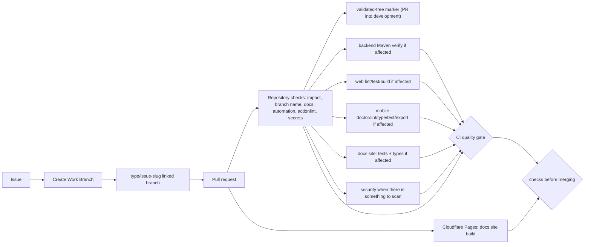
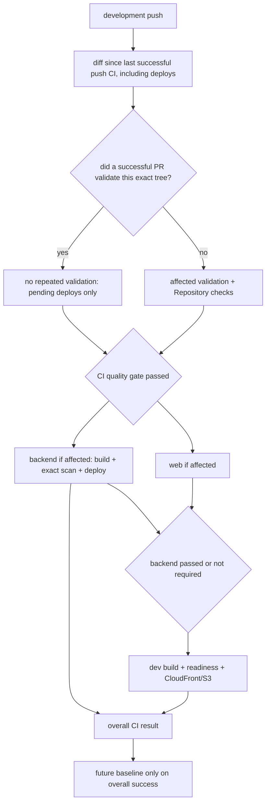
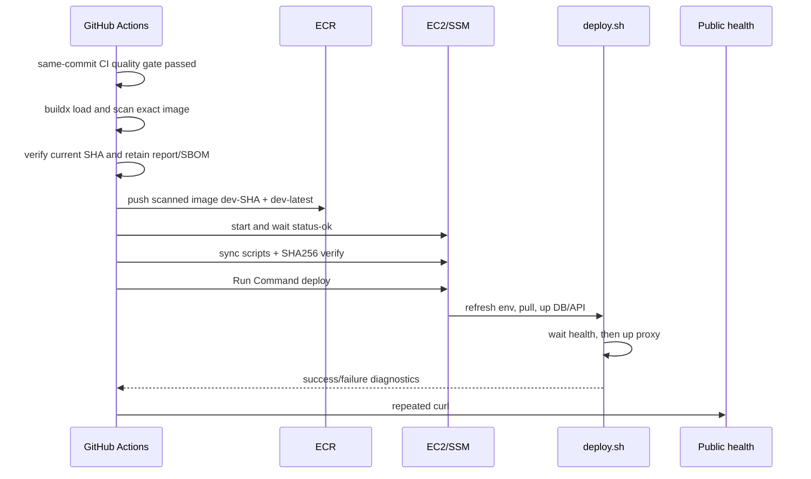
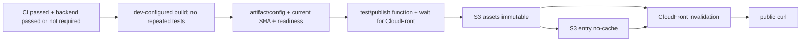
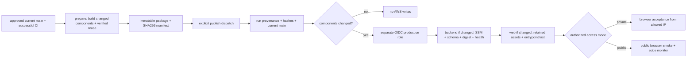

# CI/CD diagrams

## Pull request

[View the full “Pull request” diagram](https://images.vinnot.com/docs/diagrams/v1/en/infra-diagrams-ci-cd-pipeline-8b865ad52c82.svg)

## Post-merge coordination

[View the full “Post-merge coordination” diagram](https://images.vinnot.com/docs/diagrams/v1/en/infra-diagrams-ci-cd-pipeline-1ba63fde6cba.svg)

Adapters verify the remote development tip before using credentials. A superseded run
skips its remaining steps and ends green; per-resource queues do not interrupt an
active deployment.

## Backend development deploy

[View the full “Backend development deploy” diagram](https://images.vinnot.com/docs/diagrams/v1/en/infra-diagrams-ci-cd-pipeline-41af0c88b539.svg)

## Web development deploy

[View the full “Web development deploy” diagram](https://images.vinnot.com/docs/diagrams/v1/en/infra-diagrams-ci-cd-pipeline-ce730c934d5e.svg)

## Production release

[View the full “Production release” diagram](https://images.vinnot.com/docs/diagrams/v1/en/infra-diagrams-ci-cd-pipeline-eb4cef1ebc58.svg)
